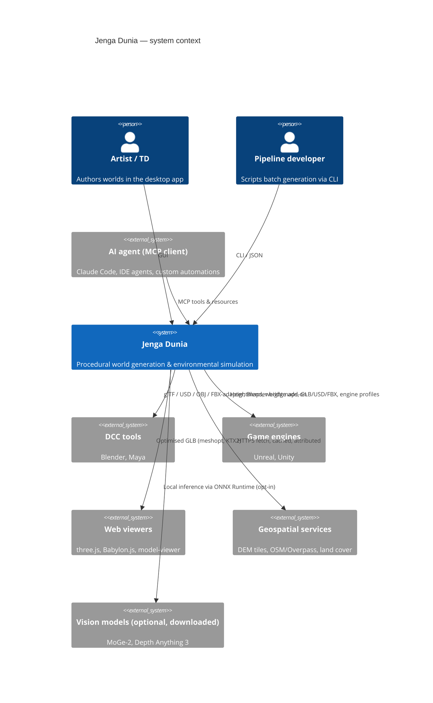
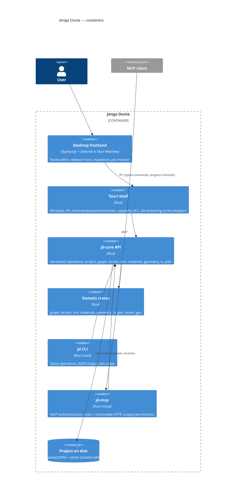

# 00 — Architecture Overview

Status: **Design (Round 1, 2026-10-19)**. Nothing described here is implemented yet; see `docs/roadmap.md` for phases and `memory/todo.md` for the backlog. Diagrams are Mermaid and are the single source of truth for structure — update them with the code.

## Context (C4 level 1)

## Containers (C4 level 2)

## Key architectural rules

| Rule | Consequence |
|---|---|
| **One core, three adapters.** GUI, CLI and MCP call `jd-core` operations with identical JSON schemas. | No business logic in the frontend, Tauri command handlers, CLI subcommands or MCP tool bodies — they marshal only. |
| **Rust owns computation.** | The WebView never computes terrain; it receives previews (textures/meshes) through channels. |
| **Graph engine is UI-independent.** | Graph evaluation is a library with no Tauri/WebView dependency; CLI and MCP evaluate graphs headless. |
| **Tiles are the unit of work.** | Heightfields and masks are f32 tiles (default 512², configurable) with halos; jobs stream tiles; memory is bounded. |
| **Determinism by construction.** | Seeds are explicit, PRNG is PCG/xoshiro, parallel reductions are ordered; CPU/GPU paths have documented tolerances. |
| **Interop is data, not shader code.** | Internal WGSL never leaves the app; exports carry glTF PBR / UsdPreviewSurface / MaterialX + baked textures with a loss report. |
| **Untrusted input everywhere.** | Imported files, plugins, downloaded assets and agent inputs go through hardened parsers and scoped capabilities. |
| **Measured performance.** | Every kernel has a bench; CI tracks peak RSS; the 4 GB ceiling is a test, not a hope. |

## Document map

| Doc | Content |
|---|---|
| `01-system-architecture.md` | Crate workspace, layering, dependency rules |
| `02-subsystems.md` | The 15 subsystems and their interactions |
| `03-data-flow.md` | Core data model (tiles, scene), end-to-end flows |
| `04-graph-engine.md` | Node graph model, evaluation, caching, dirty propagation |
| `05-rendering-compute.md` | Viewport hosting, render pipeline, compute dispatch, CPU/GPU parity |
| `06-jobs.md` | Scheduler, job state machine, cancellation, resource budgets |
| `07-agent-interfaces.md` | CLI, MCP, JSON envelope, permissions, audit |
| `08-io-formats.md` | Canonical scene representation, import/export adapters, conversion correctness |
| `09-plugins.md` | Extension architecture and isolation of licence-incompatible adapters |
| `10-security.md` | Threat model, Tauri capabilities, supply chain |
| `11-diagnostics.md` | Logging, error codes, telemetry, diagnostic bundles |
| `12-ui-workspace.md` | Workspace layout, design language, interaction principles |
| `13-geo-vision.md` | Location-to-terrain and image/video-to-terrain pipelines |
