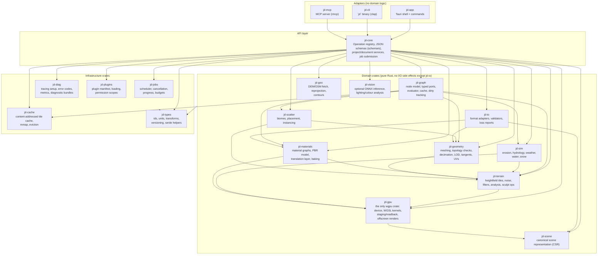
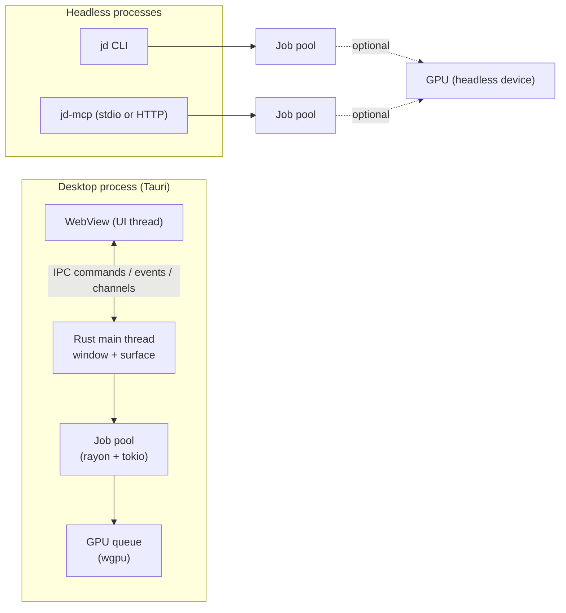

# 01 — System Architecture: Crate Workspace and Layering

Status: Design. Crate names are the decided naming convention (`jd-*`); versions of third-party crates are recorded in `docs/research/stack.md` and the licensing register, not here.

## Layering



### Dependency rules (enforced by `cargo deny` bans + review)

1. Adapters depend only on `jd-core` and `jd-types`. They may not import domain crates directly.
2. Domain crates never depend on Tauri, WebView, HTTP clients or the filesystem, except `jd-io` (files), `jd-geo` (HTTP via injected client), `jd-vision` (model files), `jd-cache` (disk).
3. `jd-gpu` is the only crate that touches `wgpu`/`naga` (wgpu ships a breaking major roughly quarterly — `docs/research/stack.md` §2); it is behind the `gpu` feature so CLI/MCP can build CPU-only. The interactive viewport lives in the WebView (three.js, ADR-0003); `jd-gpu` renders offscreen stills.
4. `jd-types` has no internal dependencies; it holds ids, units, transforms, `SchemaVersion`, error-code enum.
5. No crate may depend on an adapter.
6. Unsafe code and FFI are confined to `jd-io` adapters (optional features), `jd-cache` (mmap) and `jd-gpu`; each `unsafe` block carries a `// SAFETY:` comment and is listed in `docs/architecture/10-security.md`.

## Workspace layout

```
jenga-dunia/
├─ Cargo.toml                 # workspace
├─ crates/
│  ├─ jd-types/
│  ├─ jd-diag/
│  ├─ jd-cache/
│  ├─ jd-jobs/
│  ├─ jd-plugins/
│  ├─ jd-terrain/
│  ├─ jd-sim/
│  ├─ jd-geometry/
│  ├─ jd-materials/
│  ├─ jd-scatter/
│  ├─ jd-scene/
│  ├─ jd-io/                 # features: gltf, usd, obj, stl, ply, exr, tiff, raw, geotiff, vdb, fbx-ufbx (read), fbx-sdk (optional, user-installed)
│  ├─ jd-geo/
│  ├─ jd-vision/             # feature: onnx
│  ├─ jd-gpu/                # feature: gpu
│  ├─ jd-graph/
│  └─ jd-core/
├─ apps/
│  ├─ desktop/               # Tauri app (src-tauri = jd-app) + frontend (TypeScript)
│  ├─ cli/                   # jd-cli
│  └─ mcp/                   # jd-mcp
├─ shaders/                  # WGSL sources (include_str! by jd-gpu; dev hot-reload)
├─ schemas/                  # generated JSON schemas (versioned), committed
├─ fixtures/                 # test terrains, meshes, malformed files
├─ benches/                  # criterion/divan harnesses + benchmark scenes
├─ bridges/
│  └─ blender/               # Blender add-on (separate licence: GPL-compatible), not linked into core
├─ docs/
├─ memory/
└─ .github/workflows/
```

## Build profiles and features

| Feature | Default | Notes |
|---|---|---|
| `gpu` | on (desktop), off (CI tests without GPU) | wgpu compute kernels; CPU fallbacks always compiled |
| `onnx` | off | `jd-vision` inference via ONNX Runtime; weights downloaded on demand with licence prompt |
| `geotiff`, `vdb` | off | heavier deps; `vdb` deferred until justified |
| `fbx-ufbx` | on | FBX **import** via ufbx (MIT) |
| `fbx-sdk` | off | FBX **export** through the Autodesk FBX SDK found on the user's machine; never bundled |

## Process model



The CLI and MCP server are separate binaries that link `jd-core`; they do not talk to the desktop app (no daemon in Phase 1 — `ponytail:` single-process simplicity; a shared daemon is a Phase 5 option if agents need to drive a running GUI session).
