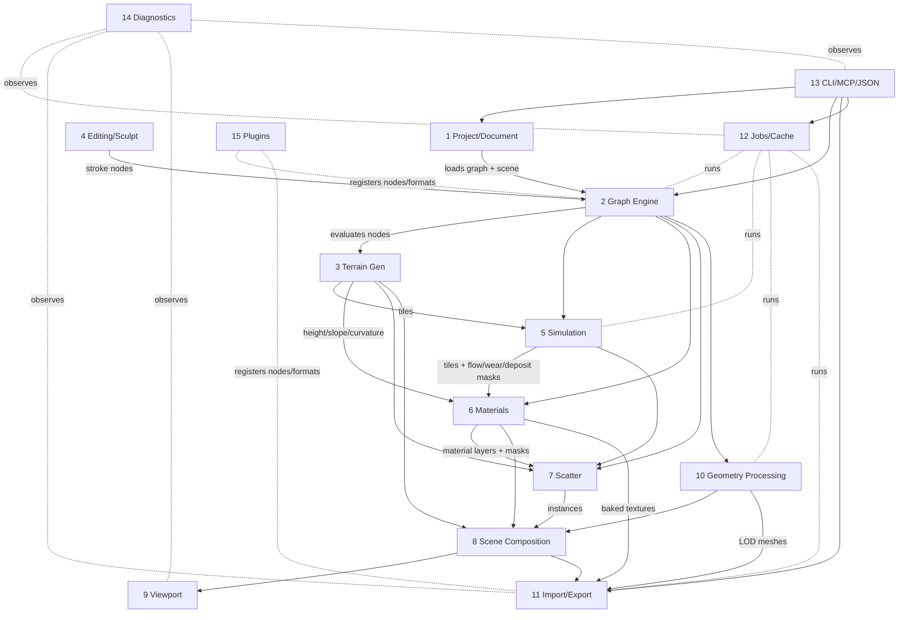

# 02 — Subsystems and Interactions

The brief (§3.1) names 15 subsystems. This maps each to crates and shows the interactions.

| # | Subsystem | Crate(s) | Phase |
|---|---|---|---|
| 1 | Project & document management | `jd-core` (project service), `jd-types` (versioning) | 1 |
| 2 | Procedural graph evaluation | `jd-graph` | 2 |
| 3 | Terrain & geometry generation | `jd-terrain`, `jd-geometry` | 2 |
| 4 | Terrain editing & sculpting | `jd-terrain` (brush ops as graph nodes with stroke data) | 2 |
| 5 | Physics & environmental simulation | `jd-sim` | 3 |
| 6 | Procedural materials & shaders | `jd-materials` | 2–3 |
| 7 | Asset scattering & ecosystems | `jd-scatter` | 3 |
| 8 | Scene & world composition | `jd-scene` | 2 |
| 9 | Real-time visualisation | frontend viewport (three.js) + `jd-gpu` offscreen | 2 |
| 10 | Geometry processing & optimisation | `jd-geometry` | 4 |
| 11 | Import/export/conversion | `jd-io` | 2–4 |
| 12 | Scheduling & background jobs | `jd-jobs`, `jd-cache` | 1 |
| 13 | Agent & automation interfaces | `jd-cli`, `jd-mcp`, `jd-core` schemas | 1 |
| 14 | Diagnostics, telemetry, profiling | `jd-diag` | 1 |
| 15 | Plugin & extension management | `jd-plugins` | 4–5 |

## Interaction diagram

## Per-subsystem responsibilities and boundaries

### 1 Project & document
- Owns the `.jdproj` document (versioned JSON, `schema_version`), migrations, autosave (interval + on job completion), crash recovery journal, undo/redo (command pattern over graph/scene mutations).
- Boundary: it never evaluates anything; it stores graph + scene + settings + references to cache.

### 2 Graph engine
- Typed DAG; validation (types, cycles, missing inputs); incremental evaluation with content-hash cache; dirty propagation; region-aware recomputation (tile dirty sets); async with cancellation and progress; custom node registration (plugins). Detail: `04-graph-engine.md`.

### 3 Terrain & geometry generation
- Heightfield tile type (`f32`, row-major, halo), noise nodes, shape/stamp nodes, filters, masks, analysis (slope, aspect, curvature, AO, flow), mesh extraction (grid, RTIN, TIN; dual contouring for the volumetric module).

### 4 Editing & sculpting
- Brushes are recorded as stroke nodes (position, radius, falloff, pressure samples) so edits are non-destructive and replayable. Real-time preview applies the stroke to the dirty tiles only.

### 5 Simulation
- Hydraulic (particle, virtual-pipes grid, stream-power), thermal, wind/aeolian, coastal, snow/glacial; hydrology (priority-flood fill, flow accumulation, rivers/lakes); weather state (rain, wind field, temperature, humidity, time of day, season) as parameters that drive masks; water/ocean (FFT for viewport, shallow-water for terrain interaction). Every node documents fidelity level: *physical*, *physically-inspired*, *visual approximation*.

### 6 Materials
- Material graph (layers blended by masks from height/slope/curvature/aspect/moisture/temperature/erosion/paint/noise/biome) → internal PBR model → translation layer → {glTF metallic-roughness, UsdPreviewSurface, MaterialX/OpenPBR, baked textures}. Loss report per translation.
- **Material-science reference layer** (`docs/research/materials-geomorphology.md` §(c)): a swappable `ReferenceProvider` (offline coarse rasters: Köppen, GLiM, GSDS30; online: SoilGrids, Macrostrat, cached) yields a `SiteContext` (climate, biome, USDA soil texture, lithology, snow months) per coarse sample; `MaterialPreset` records (dry/wet linear albedo derived from USGS Spectral Library v7 CC0 spectra, roughness, grain size, angle of repose, wet-darkening, CC0 texture ids from ambientCG/Poly Haven/TextureCan) feed layer weights and thermal-erosion defaults; attribution travels with the data. User-side libraries (Fab/Megascans, Substance) are imports only, never bundled.

### 7 Scatter
- Biome classification (temperature × moisture × altitude × slope), Poisson-disk/blue-noise placement with density masks, instance streams, LOD/impostor hints; outputs instance tables (position, rotation, scale, asset id).

### 8 Scene composition
- Canonical Scene Representation (CSR): nodes with transforms, mesh refs, material refs, instancers, lights, environment, metadata, units/up-axis declared. Detail: `08-io-formats.md`.

### 9 Viewport
- Interactive viewport in the WebView (three.js WebGPU with WebGL 2 fallback, ADR-0003): PBR, shadows, IBL, atmosphere, fog, water, CDLOD terrain, debug views, quality presets, graceful degradation. Rust `jd-gpu` renders offscreen stills/thumbnails at arbitrary size. Detail: `05-rendering-compute.md`.

### 10 Geometry processing
- Topology validation, QEM decimation (attribute-aware), LOD chains, MikkTSpace tangents, UV generation, tile stitching, statistics.

### 11 Import/export
- Adapter per format with explicit capability declaration; conversion correctness (axes, units, winding, colour spaces); validators; round-trip tests. Detail: `08-io-formats.md`.

### 12 Jobs & cache
- Scheduler with priorities, cancellation tokens, progress, timeouts, memory/CPU budgets; content-addressed tile cache (blake3), mmap, LRU eviction with configurable limits. Detail: `06-jobs.md`.

### 13 Agent interfaces
- Operation registry in `jd-core` with JSON schemas; CLI and MCP are thin. Detail: `07-agent-interfaces.md`.

### 14 Diagnostics
- `tracing` structured logs, stable error codes, metrics (RSS, GPU memory, cache hit rate, frame times), diagnostic bundles. Detail: `11-diagnostics.md`.

### 15 Plugins
- Manifest-declared extensions: nodes, format adapters, material translators, bridges. Permission scopes. Licence-incompatible adapters (FBX SDK, GPL Blender add-on) are plugins/bridges, never core. Detail: `09-plugins.md`.
