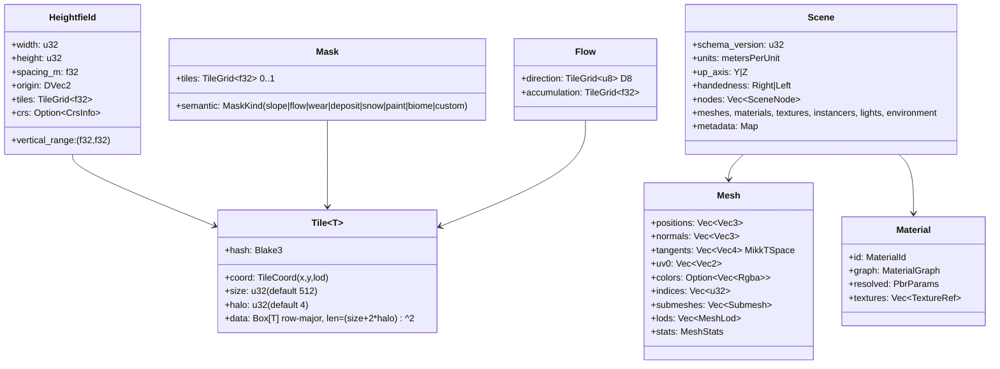
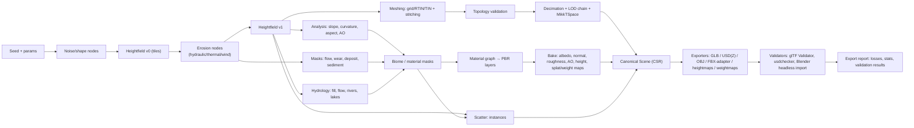
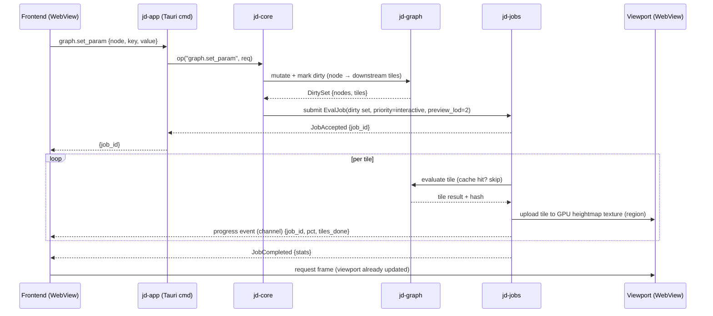
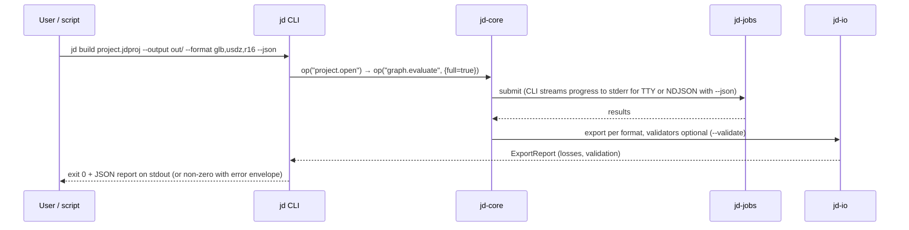

# 03 — Data Model and Data Flow

## Core data types (in `jd-types` / `jd-terrain` / `jd-scene`)

Decisions:
- **f32 heightfields** (not u16, not f64). u16 is an export quantisation; f64 is only used for world-space origins (`DVec2`) to support large worlds with origin rebasing.
- **Tiles with halos** so filters (blur, erosion stencils, slope) run per tile without global synchronisation; halo width is the max stencil radius of the node (default 4, nodes declare their radius).
- **Content hash per tile** enables region-based recomputation and cache reuse across sessions.
- **Row-major, +X east, +Y north in heightfield space**; conversion to engine axes happens only in `jd-io` (see `08-io-formats.md`).

## End-to-end flow: generate → simulate → texture → mesh → export

## Sequence: interactive parameter change in the GUI

Preview evaluation runs at a reduced LOD (e.g. 1/4 resolution) for interactivity; full-resolution evaluation is a separate job triggered on idle or on explicit "build", as in the reference tools' preview/build split.

## Sequence: headless CLI build

## Memory budget model (design target, to be measured)

| Item | Size at 4096² | Notes |
|---|---|---|
| One f32 heightfield | 64 MiB | 4096² × 4 B |
| One f32 mask | 64 MiB | per mask; typical pipeline keeps 4–8 live → 256–512 MiB |
| Erosion working set (virtual pipes: height, water, sediment, 4 flux, velocity ×2) | ~9 × 64 MiB ≈ 576 MiB | tiled execution bounds live set to tiles-in-flight × 9 × tile size |
| Mesh (full-res grid, 16.7 M verts) | ~0.6–1 GiB | never materialised whole: meshed per tile; LODs reduce |
| Baked textures (4k, 5 maps, RGBA8) | 320 MiB | written streaming to disk |
| GPU heightmap/LOD textures | 64–200 MiB | R32F + mips |

Conclusion: at 4k a naive "everything resident" pipeline already reaches ~2 GB; at 8k it would be ~8 GB. Hence tiling + cache + streaming are mandatory from Phase 2, and CI must assert peak RSS on the benchmark scenes (`docs/spec/performance-targets.md`).
