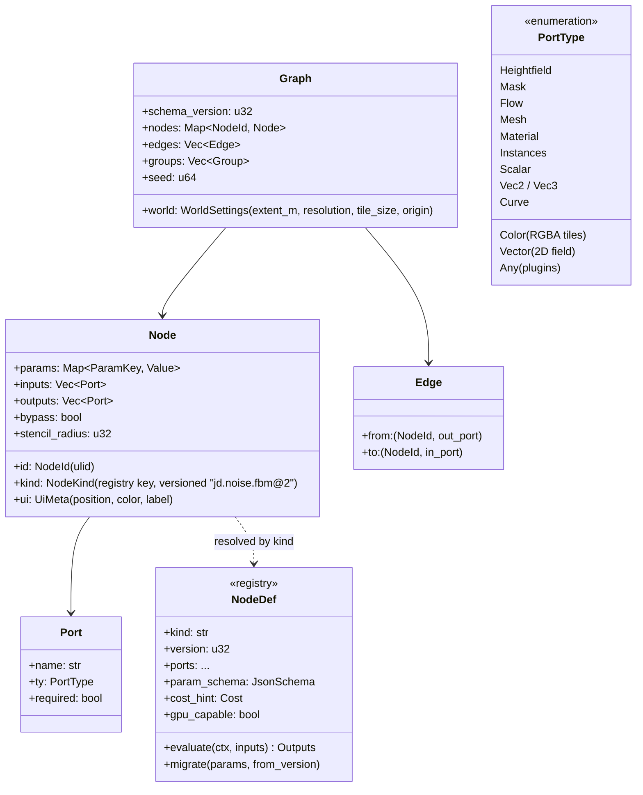
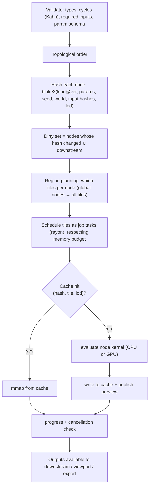

# 04 — Procedural Graph Engine (`jd-graph`)

The graph engine is the central non-destructive model. It is a pure library: no UI, no Tauri, no filesystem (cache access through a trait). The CLI and MCP evaluate the same graphs headless.

## Node model

- **Typed ports** with implicit conversions limited to a documented set (Mask ↔ Heightfield normalised; Scalar → constant Mask). Anything else is a validation error with a stable code.
- **Versioned node kinds** (`kind@version`) with per-node `migrate` so old projects open after node changes (brief §3.3: resilient to updates).
- **Stencil radius** is declared per node so the tile halo for an evaluation is computed as the max radius along the dependency chain (clamped; nodes with global dependence, e.g. full-domain erosion or priority-flood, declare `Global` and force whole-field evaluation for that node).

## Evaluation

Properties required by the brief §6 and how they are met:

| Requirement | Mechanism |
|---|---|
| Typed inputs/outputs, validation, cycle detection | `PortType` + Kahn's algorithm on validate; errors carry `E_GRAPH_CYCLE`, `E_GRAPH_TYPE_MISMATCH` |
| Dependency tracking, dirty propagation | hash chain; mutation marks node + descendants dirty; tile-level dirty sets when a node is local (stencil) |
| Incremental evaluation, intelligent caching | content-addressed cache keyed by node hash + tile coord + lod; survives restarts (`jd-cache`) |
| Asynchronous computation, cancellation, progress | jobs with `CancellationToken`; kernels poll between tiles and inside long loops (erosion iterations) |
| Serialised graph definitions | JSON (`schema_version`, node `kind@version`), human-readable, diff-friendly, stable key ordering |
| Determinism | explicit seeds; per-tile PRNG derived as `seed ⊕ hash(node_id, tile)`; ordered parallel reductions; GPU kernels avoid atomics for float accumulation or use fixed-order reduction; documented tolerance tests CPU vs GPU |
| Custom node registration | `NodeDef` registry; plugins register at startup with manifest permission (`09-plugins.md`) |
| Visual previews | every output tile publishes a down-sampled preview (R8/RGBA8) to the frontend through a channel |
| Region-based recomputation | stencil radius → halo; local nodes recompute only dirty tiles + halo ring |

## Preview vs build

Two evaluation modes, as in the reference tools:

| Mode | Resolution | Trigger | Purpose |
|---|---|---|---|
| `Preview` | world resolution / 2^k (k from a quality slider, default 2) | any parameter change, debounced ~50 ms | interactive feedback |
| `Build` | full | explicit, idle, export, CLI `jd build` | final data for baking/export |

Previews reuse the same kernels with a `lod` parameter in the hash, so a preview and a build never collide in cache.

## Mutations and undo

All graph mutations are commands (`AddNode`, `RemoveNode`, `Connect`, `Disconnect`, `SetParam`, `MoveNode`, `Group`) with inverse commands; `jd-core` keeps the undo stack per document. Stroke-based sculpting appends samples to a `Stroke` node's param (coalesced per stroke) so undo removes the whole stroke.

## Node catalogue (Phase 2–3 initial set)

| Category | Nodes |
|---|---|
| Generators | Constant, Perlin, Simplex/OpenSimplex2, fBm, Ridged, Hybrid multifractal, Voronoi/Worley, Spectral (1/f^β), Gabor (later), Shape/Stamp (image/SDF primitives: mountain, crater, dune, plateau), Spline terrain, Import heightmap, Geo DEM |
| Math/Compose | Add, Mul, Lerp/Blend (with mask), Clamp, Remap, Curve, Min/Max, Abs, Pow, Normalize, Invert, Terrace, Warp (domain warp by vector field), Transform (offset/scale/rotate), Combine tiles |
| Filters | Blur (box/gaussian), Median, Sharpen, Slope limit, Smooth by mask, Erode/Dilate (morphology), Height fill |
| Analysis | Slope, Aspect, Curvature (profile/plan), Height select, Cavity/Peaks, Flow (D8/D∞), AO/Horizon, Distance field |
| Simulation | Hydraulic (particle), Hydraulic (grid/virtual pipes), Stream power (large-scale), Thermal, Wind/aeolian, Coastal, Snow, Glacier (later), Sediment layer |
| Hydrology | Fill depressions (priority-flood), Rivers (carve), Lakes, Sea level, Wetness (TWI) |
| Materials | Material layer, Mask→layer, Blend layers, Triplanar settings, Stochastic tiling, Color ramp, Bake targets |
| Biomes/Scatter | Biome classify, Scatter (Poisson), Density, Instance filter |
| Mesh | Heightfield→Mesh (grid/RTIN/TIN), Decimate, LOD chain, Tangents, UV, Validate |
| Output | Export heightmap, Export mesh, Export scene, Export masks, Bake textures |
