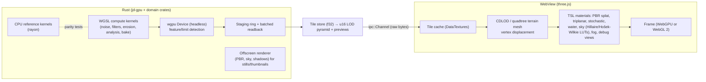

# 05 — Rendering and Compute Pipeline

Status: Design, gated by the ADR-0003 prototype. Evidence: `docs/research/stack.md` §1–2, §(b).

## Decision summary (ADR-0003)

| Concern | Choice |
|---|---|
| Terrain compute | Rust, `jd-gpu` (the only crate depending on `wgpu`/`naga`), headless device, WGSL kernels, CPU reference kernels always present |
| Interactive viewport | **three.js `WebGPURenderer` in the WebView with automatic WebGL 2 fallback** (TSL, not raw GLSL) — portable across WKWebView (WebGPU on macOS 26+), WebView2, WebKitGTK (WebGL 2 only) |
| Data to viewport | u16 heightfield tiles + normal/splat/preview textures at LOD, streamed over `tauri::ipc::Channel` raw bytes; never full-res f32 unless requested |
| Off-screen renders / screenshots / thumbnails | `jd-gpu` offscreen PBR render at arbitrary size (not limited by window size — a documented World Creator limitation) |
| Native wgpu surface in the Tauri window | macOS-only "pro viewport" experiment in Phase 2 behind a setting; Linux flickers (Tauri #9220 won't-fix), Windows unproven |

Why not a native wgpu surface as baseline: cross-platform evidence says it does not work on Linux and is risky on Windows; two compositors complicate node-editor overlays and gizmos. Why not WebGPU-only: not available in WebKitGTK and only default-on in WKWebView from macOS 26. The three.js renderer with fallback gives one viewport codebase. Trade-off accepted: Rust-side compute cannot share GPU buffers with the WebView, so previews cross IPC — hence LOD streaming and the throughput measurement in the prototype.

## Pipeline

## Compute dispatch rules

1. Every node declares `gpu_capable`; the executor picks GPU when the device exists, the kernel passed parity tests on this backend, and the estimated VRAM fits the budget; otherwise CPU.
2. Kernels are tile-sized dispatches (default 512², workgroup 16×16); halos read via buffer offsets.
3. Readbacks are batched per job through a staging ring (`MAP_READ`), never per tile.
4. Reductions: workgroup partials → CPU ordered sum (determinism, ADR-0007).
5. Shader modules are `include_str!`-embedded; dev builds hot-reload via `notify`.
6. Feature detection at startup → `jd diag env` reports adapter, backend, limits; failures surface as `E_GPU_DEVICE` / `E_SHADER_COMPILE` with next steps.
7. Apple Silicon: unified memory makes staging cheap but mapping still costs; prefer persistent mapped staging buffers. Discrete GPUs: explicit staging; avoid readback-per-frame paths.

## Viewport rendering capabilities (Phase 2→4)

| Capability | Plan |
|---|---|
| PBR shading, directional sun + ambient; point/spot lights for props | three.js standard/physical materials via TSL |
| Shadows | cascaded shadow maps (three.js) |
| IBL | HDR environment from procedural sky LUT or user HDRI |
| Atmosphere / sky | Hillaire 2020 LUTs computed in Rust (`jd-gpu`) and uploaded; Hošek–Wilkie CPU fallback |
| Height fog, volumetrics | height fog first; volumetric clouds later (Nubis-style) |
| Water | Gerstner waves + flow maps + depth-based colour/foam (Phase 3); FFT ocean optional later |
| Terrain LOD | CDLOD (Strugar 2009) — no tessellation dependency, no stitching |
| AO | baked heightfield AO from Rust (Timonen sweep) as a texture |
| Tonemapping / AA | AgX or ACES; TAA/FXAA per preset |
| Debug views | wireframe, normals, UVs, mask heat maps, LOD colouring, topology errors |
| Quality presets | Low/Medium/High/Ultra; auto-detect by `navigator.gpu` presence and adapter limits; graceful degradation |

## Shader portability (brief §8.3)

| Layer | Form | Leaves the app? |
|---|---|---|
| Editable material graphs | document data | yes (project) |
| Internal runtime shaders | WGSL (compute) + TSL (viewport) | **no** |
| Portable PBR representation | glTF metallic-roughness, UsdPreviewSurface, MaterialX/OpenPBR | yes |
| Baked textures | PNG/EXR/KTX2 | yes |
| Engine-specific shaders | none shipped; bridge scripts assemble engine materials from baked maps | per engine |

## Prototype gate (must pass before Phase 2 viewport work)

As specified in `docs/research/stack.md` §(b): 4096² FBM in WGSL → 1024² tiles → u16 over Channel → three.js `WebGPURenderer` scene. Measure latency (LOD 2 and 0), IPC MB/s on macOS **and** Windows, peak RSS (< 1.5 GB), `navigator.gpu` presence per platform/build mode. Record results in ADR-0003.
