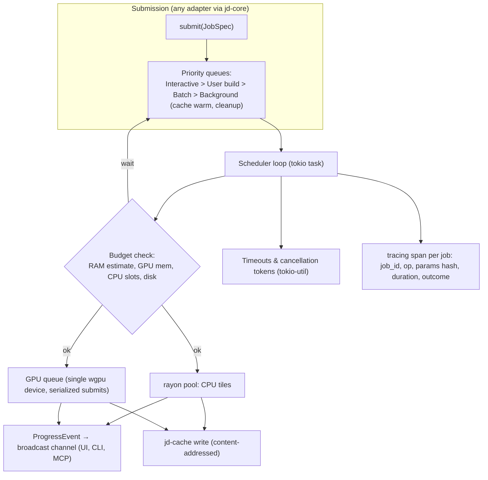

# 06 — Job Scheduling, Cancellation and Resource Budgets (`jd-jobs`, `jd-cache`)

Every long-running operation (graph evaluation, erosion, meshing, baking, export, import, geo fetch, inference) is a **job**. Jobs never run on the UI thread or the IPC thread.

## Job state machine

```mermaid
stateDiagram-v2
  [*] --> Queued: submit(op, params, priority)
  Queued --> Running: scheduler picks (priority, deps satisfied, budget available)
  Queued --> Cancelled: cancel()
  Running --> Progress: tile/iteration done (emits ProgressEvent)
  Progress --> Running
  Running --> Completed: result stored (and cached)
  Running --> Failed: error (stable code) — partial outputs discarded or kept per op policy
  Running --> Cancelled: token observed
  Running --> TimedOut: deadline exceeded
  Failed --> Queued: retry (if policy allows; idempotent ops only)
  Completed --> [*]
  Failed --> [*]
  Cancelled --> [*]
  TimedOut --> [*]
```

**Shipped (slice 1, 2026-10-20):** a process-wide job table in `jd-core::jobs` — `graph.evaluate` registers a job, reports per-node progress (`done/total`, current kind) and polls a cancel flag before every node and inside every thermal/hydraulic iteration; `jobs.list` and `jobs.cancel {id}` are ordinary operations, so the GUI header (progress + **Cancel**), the CLI and MCP agents share them. Cancellation returns `E_CANCELLED` with `job_id` and publishes nothing. **Slice 2 — detached execution:** `graph.evaluate_async` runs the same evaluation on a worker thread (owned job guard) and answers at once with `status: accepted` + `job_id`; `jobs.list` shows its progress, `jobs.cancel` stops it, and `jobs.result {id}` hands over the finished op's envelope (`status`/`result`/`error`/`warnings`) exactly once — the table keeps the last 64 finished envelopes. **Slice 3 — queue + timeout:** detached jobs take a worker slot before running (default half the cores, `Jobs::set_max_detached`); while waiting they show `state: queued` in `jobs.list` and a cancel ends them without running (`E_CANCELLED`, "cancelled while queued"); `graph.evaluate_async {timeout_s}` arms a watchdog that raises the cancel flag at the deadline and the collected envelope reports `E_TIMEOUT`. **Slice 4 — memory budget:** `NodeDef::with_memory(bytes_per_cell)` declares each kernel's scratch; `Evaluator::estimate_bytes` sums every node's outputs (4 B/cell each) plus the largest scratch at the evaluation's LOD; `graph.evaluate` refuses with `E_RESOURCE_MEMORY` (estimate, budget, advice) when that exceeds `settings.memory_budget_bytes` (default 4 GiB, ≥ 256 MiB). Priorities come next.

## Scheduler architecture

Design points:
- **One job system for all adapters.** The GUI's "Task monitor", the CLI's progress bar and MCP's progress notifications are three views of the same broadcast channel.
- **Priorities** ensure interactive previews preempt batch builds (cooperative: batch jobs yield between tiles).
- **Budgets.** Each `JobSpec` carries a memory estimate (computed from tile count × bytes per tile × working-set factor declared by the kernel). The scheduler admits jobs only while `estimated_live + current_rss < limit` (default limit 3.5 GB, configurable; GPU memory tracked separately via wgpu allocation accounting). Over-budget requests are split into more tiles or rejected with `E_RESOURCE_MEMORY`.
- **Cancellation** is cooperative: kernels check the token per tile and every N inner iterations (erosion: every 64 iterations). GPU jobs check between dispatches.
- **Timeouts** default per operation class; agents may set shorter ones.
- **Retry** only for idempotent, externally-failing ops (geo fetch, model download).
- **Reproducibility.** A job's spec (op + params + seed + schema versions + software version) is recorded with the result so any run can be replayed by the CLI.

## Cache (`jd-cache`)

**Shipped (Phase 2, slice 1):** whole-layer blobs `<project>/cache/layers/<blake3>.jdl` (magic `JDL1`, width/height/tile/halo header, f32 LE rows) with a JSON index name → hash, written temp-file + rename; `Context::set_layer` writes through and `with_layer` falls back to it, so CLI invocations, MCP sessions and the desktop app share one persisted layer set per project. **Slice 2:** LRU eviction — the core applies `settings.cache_limit_bytes` (default 2 GB) on every write; `LayerCache::gc` drops blobs oldest-first by modification time (unreferenced blobs before indexed ones, the newest blob never) and prunes the index; a read touches the blob so recently used layers survive; `project.cache_gc` runs it on demand and reports blobs/bytes kept and evicted. Target design below (tile-level, SQLite index) replaces it when layers stop fitting in RAM.

- Content-addressed by blake3 of (node hash, tile coord, lod). Stored under `<project>/cache/` as raw tile blobs (f32 LE) optionally zstd-compressed; index in SQLite (`rusqlite`, bundled) for atomic metadata and LRU accounting.
- Memory-mapped reads; writes go to a temp file then atomic rename (interrupted-write safety).
- Limits: per-project size cap (default 2 GB) and global cap; LRU eviction; `jd cache gc` and automatic cleanup on exit.
- Cache is disposable: deleting it never breaks a project.

## Resource monitoring

`jd-diag` samples process RSS, GPU allocations (wgpu accounting), CPU utilisation (`sysinfo`), disk free space, cache size, hit rate; exposed through the diagnostics panel, `jd diag`, and MCP resource `jd://diagnostics/resources`.
