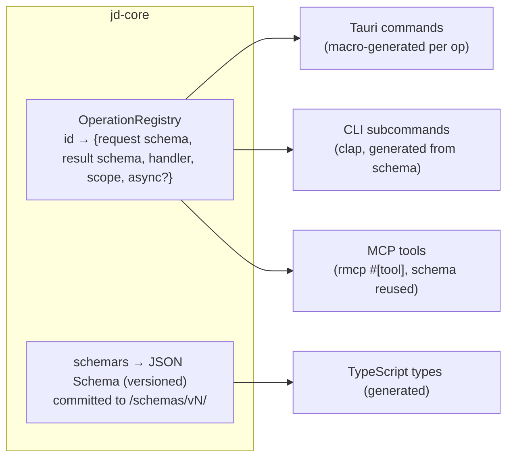
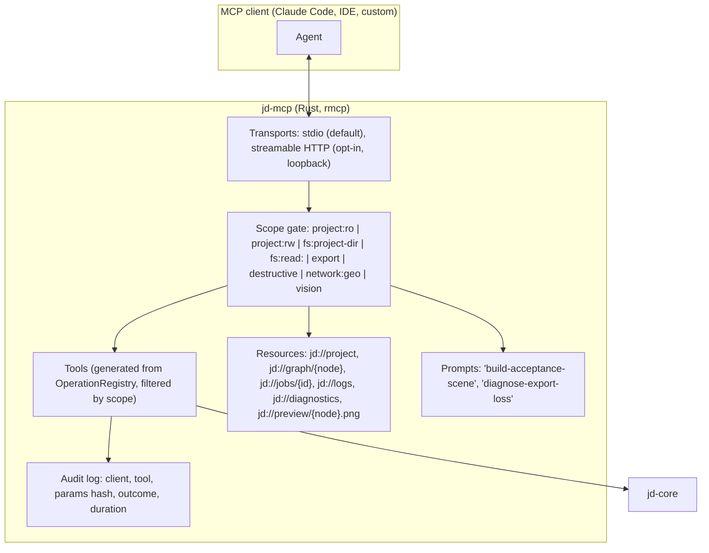

# 07 — Agent-First Interfaces: Operations, JSON, CLI, MCP

Automation ships with the feature. `jd-core` exposes a **registry of operations**; the GUI, CLI and MCP server are generated or thin adapters over it.

## Operation registry



Operation naming: `<subsystem>.<verb>` e.g. `project.create`, `project.open`, `graph.list_nodes`, `graph.add_node`, `graph.set_param`, `graph.evaluate`, `terrain.generate`, `sim.erode`, `materials.bake`, `geometry.decimate`, `geometry.lod_chain`, `io.export`, `io.import`, `io.validate`, `jobs.status`, `jobs.cancel`, `diag.logs`, `diag.resources`, `geo.fetch_dem`, `vision.estimate_depth`.

## JSON envelope (brief §13.3)

```json
// request
{ "op": "sim.erode", "schema_version": 1, "request_id": "01J...", "params": { "node": "...", "iterations": 200000, "seed": 42 }, "client": { "kind": "mcp", "name": "claude-code", "scopes": ["project:rw"] } }

// synchronous result
{ "op": "sim.erode", "schema_version": 1, "request_id": "01J...", "status": "ok", "result": { ... }, "warnings": [] }

// accepted async job
{ "op": "sim.erode", "schema_version": 1, "request_id": "01J...", "status": "accepted", "job_id": "01J...", "estimated_ms": 12000 }

// progress event (stream)
{ "event": "progress", "job_id": "01J...", "pct": 42.5, "stage": "erosion", "detail": { "tiles_done": 34, "tiles_total": 80 } }

// error
{ "op": "sim.erode", "schema_version": 1, "request_id": "01J...", "status": "error", "error": { "code": "E_INPUT_INVALID", "message": "iterations must be > 0", "why": "The erosion kernel cannot run zero passes.", "next": "Set params.iterations to a positive integer.", "details": { "path": "params.iterations" } } }
```

Rules: every op has id, params, schema version, validation, result shape, status, error, job id and progress where applicable (brief §13.3). Unknown fields are rejected on requests (`deny_unknown_fields`) and preserved on documents (forward compatibility).

## CLI (`jd`)

| Command | Purpose |
|---|---|
| `jd new <path> [--template]` | project creation |
| `jd graph eval <proj> [--node] [--lod]` | procedural graph execution |
| `jd terrain gen <proj> --preset ...` | terrain generation |
| `jd sim erode <proj> --node ...` | erosion |
| `jd materials bake <proj> --out ...` | material baking |
| `jd geometry optimize/lod <proj>` | mesh optimisation, LODs |
| `jd io convert <in> <out> [--profile unreal|unity|web]` | file conversion |
| `jd io validate <file>` | asset validation (glTF Validator / usdchecker when present) |
| `jd export <proj> --format glb,usdz,r16,... --out ...` | export |
| `jd batch <jobs.json>` | batch processing |
| `jd bench <scene>` | performance benchmarking (prints peak RSS, durations) |
| `jd diag [env|logs|resources]` | environment diagnostics |
| `jd cache gc` | cache maintenance |
| `jd schema <op>` | prints JSON schema for an op |

Conventions: `--json` for machine-readable NDJSON (progress events + final envelope on stdout; logs to stderr); exit codes: 0 ok, 1 generic error, 2 invalid input, 3 unsupported format, 4 resource (memory/disk), 5 cancelled/timeout, 6 validation failed, 7 permission denied.

## MCP server (`jd-mcp`)



- **Protocol note:** `rmcp` 3.5 implements MCP 2026-07-28, which made the protocol stateless and deprecated Roots/Sampling/Logging (`docs/research/stack.md` §5). Tools are therefore designed stateless with explicit handles (`job_id`, project path) and a `--workspace` allow-list instead of Roots.
- **Scopes** are granted at server launch (`jd-mcp --scope project:rw --project ./world.jdproj`) or interactively in the GUI's agent panel. Destructive ops (`project.delete`, overwriting exports outside the project dir, cache purge) require `destructive` scope **and** per-call confirmation unless `--yes`.
- **File access** is confined to the project directory (plus explicitly granted read paths). No arbitrary path access.
- **Progress** uses MCP progress notifications; long jobs return `job_id` and the client polls `jobs.status` or subscribes to the `jd://jobs/{id}` resource.
- **Previews** are returned as PNG image content so a vision-capable agent can "see" the terrain.
- **Vision tools** (`vision.*`) are only listed when the `onnx` feature is enabled and a model has been downloaded with its licence accepted.

## Tauri adapter

Commands are generated per operation; the frontend calls `invoke("op", envelope)`. Progress and previews stream over Tauri channels (binary payloads) to avoid JSON-encoding large buffers. Tauri capability files restrict `fs`, `shell`, `http` plugins to the project directory and allowlisted hosts (`10-security.md`).
