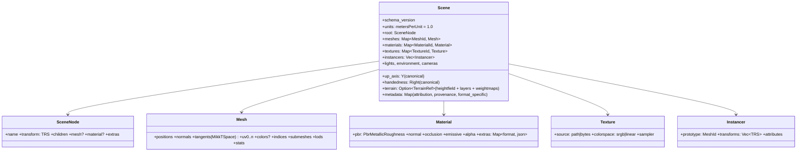
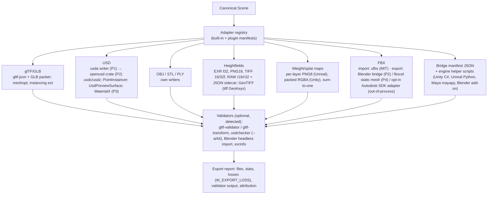

# 08 — Import/Export Architecture and Canonical Scene Representation (`jd-scene`, `jd-io`)

Evidence: `docs/research/formats-sdks.md` (crate versions, engine specs, coordinate conventions), ADR-0012.

## Canonical Scene Representation (CSR)



- Canonical frame = **glTF**: Y-up, right-handed, metres, −Z forward. All other targets are explicit transforms from this frame (table below).
- `extras` on materials/nodes hold **format-specific metadata** so nothing is silently discarded (e.g. USD variant sets, FBX properties).
- Representational limits (documented, not hidden): no animation in Phase 1–4 (terrain focus); one material per submesh; textures referenced by path or bytes, no procedural textures beyond baked output; terrain layers exist only in `TerrainRef`, not in any mesh format.

## Adapter architecture



Each adapter declares a **capability record** (import/export/round-trip, geometry, materials, textures, hierarchy, instancing, animation, known losses, dependencies, licence, validator). The interoperability matrix (`docs/spec/interoperability-matrix.md`) is the human-maintained view of these records until code generates it.

## Conversion correctness (brief §9.4)

| Target | Up | Hand | Unit | Transform from canonical | Winding |
|---|---|---|---|---|---|
| glTF | +Y | RH | m | identity | CCW |
| USD | `upAxis` Y (set), `metersPerUnit` 1 (set) | RH | m | identity; Z-up consumers: `upAxis="Z"` + rotate +90° X | CCW |
| FBX | +Y (axis system stored) | RH | cm | scale ×100 (or write `UnitScaleFactor`) | CCW |
| OBJ | none (de facto Y) | RH | none | identity; document "metres, Y-up" | CCW |
| Blender | +Z | RH | m | rotate +90° X: (x,y,z)→(x,−z,y) — importers do this | CCW |
| Unreal | +Z | **LH** | cm | rotate +90° X, mirror Y, ×100 — importers handle for glTF/USD/FBX; raw meshes verified by round-trip test | reverse after mirror |
| Unity | +Y | **LH** | m | mirror X (glTFast convention, REPORTED) | reverse after mirror |
| Maya | +Y | RH | cm | ×100 | CCW |
| Heightmaps | n/a | n/a | m | row 0 = north (images); Unity RAW row 0 = south → **flip toggle on every heightfield export** | — |

Also: matrix decomposition to TRS with validation (no shear); MikkTSpace tangents for normal-map parity; texture orientation (glTF UV origin top-left vs OpenGL bottom-left) handled per format; colour spaces: base colour/emissive sRGB, data maps linear; names sanitised per format; instancing via `EXT_mesh_gpu_instancing` / `UsdGeomPointInstancer` or expanded when unsupported (reported as loss); float precision: f32 positions with origin rebasing for large worlds, metadata records the world offset.

## Engine profiles (`--profile`)

| Profile | Heightmap | Size rule | Vertical | Layers | Extra |
|---|---|---|---|---|---|
| `unreal` | PNG16 / RAW r16 | 2ⁿ+1 recommended (1009, 2017, 4033, 8129) | Z-scale = max_m × 100 / 512 (documented formula) | per-layer 8-bit grayscale weightmaps at exact resolution | World Partition tiling, PCG instance CSV/JSON |
| `unity` | RAW r16 | 2ⁿ+1 (33–4097) | terrain size in metres | alphamaps (RGBA packs), TerrainLayers via helper script | byte order + flip toggles; glTFast for meshes |
| `blender` | EXR f32 + GLB/USD | any | m | materials via node groups from baked maps | Geometry Nodes instancing; add-on reads bridge manifest |
| `web` | GLB with meshopt (+KTX2 P3) | LOD chain, bounded draw calls | m | baked textures only | three.js tested |
| `usdz` | USDZ | ARKit limits | m | UsdPreviewSurface | `usdchecker --arkit` |

## Bridge manifest (versioned JSON, replaces the incumbents' XML+RAW convention)

```json
{ "schema_version": 1, "world": { "extent_m": [4096, 4096], "resolution_px": [4097, 4097], "height_range_m": [0, 1240], "origin": [0,0], "up_axis": "Y", "units": "m" },
  "tiles": [{ "x": 0, "y": 0, "heightmap": "tiles/h_0_0.r16", "heightmap_f32": "tiles/h_0_0.exr", "weightmaps": ["tiles/w_rock_0_0.png", "tiles/w_grass_0_0.png"], "colormap": "tiles/c_0_0.png", "normal": "tiles/n_0_0.png" }],
  "layers": [{ "name": "rock", "material": "materials/rock.json" }, { "name": "grass", "material": "materials/grass.json" }],
  "instances": [{ "asset": "assets/pine.glb", "table": "instances/pine.csv" }],
  "attribution": [ "..." ], "generator": "jenga-dunia 0.1.0" }
```

## Validation and round-trip tests (Phase 2→4)

- Fixture set: small/medium/large terrains, tiled world, textured scene, boundary cases (NaN heights, empty scene, 1×1, 16k).
- CI: export each fixture → run validators present on the runner → import back into Jenga Dunia → compare geometry (vertex/tri counts, bounds, hash of quantised positions), materials, metadata → record losses. Blender headless round-trip on runners with Blender installed; engines documented as manual procedures with checklists and marked `UNVERIFIED` until automated.
- Never report success when validator output contains errors; warnings are surfaced in the export report.
