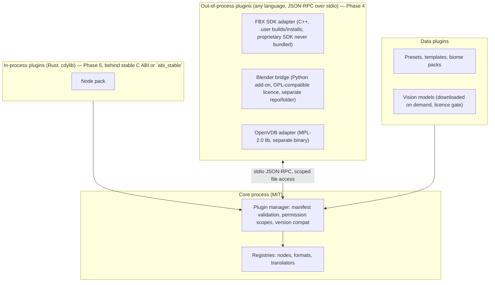

# 09 — Plugin and Extension Architecture (`jd-plugins`)

Goals: let third parties add nodes, format adapters, material translators and bridges **without** touching the core; isolate licence-incompatible components; keep agents and plugins inside explicit permission scopes.

## Extension points

| Point | Interface | Example |
|---|---|---|
| Node kinds | `NodeDef` registration | custom erosion variant, studio-specific stamp library |
| Format adapters | `Importer` / `Exporter` traits with capability declaration | FBX export via Autodesk SDK (user-installed), OpenVDB |
| Material translators | `MaterialTranslator` trait | engine-specific material presets |
| Bridges | external process protocol (JSON over stdio) | Blender add-on, Unreal/Unity editor scripts |
| Vision models | model manifest (name, licence, hash, input/output spec) | MoGe-2, Depth Anything 3 |
| Presets/templates | data files | biome packs, graph templates |

## Plugin kinds and isolation



Decision: **out-of-process first** (Phase 4). It solves licensing isolation (proprietary/GPL/MPL components never link into the MIT binary), crash isolation, and language freedom, at the cost of serialisation. In-process `cdylib` plugins come later only if a measured need appears (`ponytail:` defer ABI stability work).

## Manifest

```json
{
  "schema_version": 1,
  "id": "com.example.fbx-sdk-adapter",
  "name": "FBX SDK Exporter",
  "version": "0.1.0",
  "license": "Proprietary (uses Autodesk FBX SDK; user-installed)",
  "kind": "format-adapter",
  "entry": { "type": "process", "command": "./bin/jd-fbx-adapter" },
  "capabilities": { "formats": [{ "ext": "fbx", "import": false, "export": true, "geometry": ["mesh"], "materials": ["pbr-basic"], "textures": ["png"], "hierarchy": true, "instancing": false, "animation": false }] },
  "permissions": ["fs:project-dir", "fs:write:export-dir"],
  "min_jd_version": "0.1.0"
}
```

Capability declarations feed the interoperability matrix automatically (`docs/spec/interoperability-matrix.md` is partly generated from registered adapters once code exists).

## Permissions

Plugins receive the same scope model as MCP clients (`07-agent-interfaces.md`): project directory access, explicit extra paths, no network unless declared (`network:<host>`), no shell. The plugin manager refuses to load a plugin whose manifest requests undeclared or unapproved scopes; approvals are stored per user and shown in the GUI.
