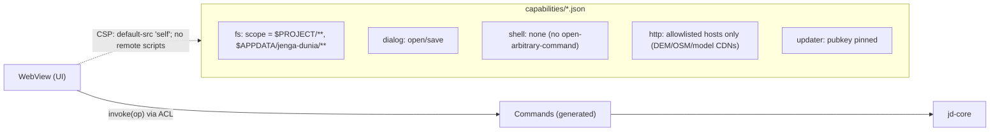

# 10 — Security Model

Scope: desktop app, CLI, MCP server, plugins, imported assets, downloaded data and models, supply chain.

## Threat model

| Asset | Threat | Control |
|---|---|---|
| User filesystem | agent/plugin reads or writes outside the project | Tauri capability scopes; `jd-core` path canonicalisation + allowlist; MCP scopes; path-traversal tests |
| Memory/CPU | malicious 3D/image file causes OOM, infinite loop, panic | hardened parsers (size limits, bounded allocations, `catch_unwind` at adapter boundary), fuzzing, job budgets/timeouts |
| Project integrity | corrupted or crafted `.jdproj` | schema validation, `deny_unknown_fields` on ops, migrations tested, recovery journal |
| Credentials/privacy | logs/telemetry leak paths, locations, API keys | redaction in `jd-diag` bundles; no telemetry by default; geo API keys stored via OS keychain (Tauri stronghold/keyring) |
| Supply chain | compromised dependency | `cargo deny` (licence + advisories), `cargo audit`, lockfiles committed, Dependabot, pinned GitHub Actions by SHA |
| Updates | tampered binaries | signed releases (Tauri updater signatures; macOS notarisation; Windows code signing when certificates exist) |
| Agents | over-privileged automation | scope gate, destructive-op confirmation, audit trail, no shell exposure through MCP |
| Plugins | arbitrary code | out-of-process, declared permissions, user approval, hash-pinned binaries |
| Network | fetching DEM/OSM/models from untrusted hosts | HTTPS only, host allowlist, content hash verification for models, size caps, cache in project dir |

## Tauri configuration (design)

- CSP forbids remote script loading; all frontend assets are bundled.
- `shell` plugin is not enabled; external tools (Blender, validators) are launched by Rust in `jd-io` with fixed argument vectors and sanitised paths, never via a shell string.
- Multi-window is allowed for detached panels only; no `window.open` of arbitrary URLs.

## Untrusted file parsing

- Every importer runs with: max file size, max element counts (vertices, nodes, textures), max image dimensions, decompression bomb limits, timeouts, and `std::panic::catch_unwind` converting panics to `E_FORMAT_CORRUPT`.
- Fuzz targets (`cargo-fuzz`) for every parser we write; crate-provided parsers are fuzzed through our wrapper.
- Fixtures: `fixtures/malformed/` with truncated, oversized, cyclic-hierarchy, NaN-laden files; CI runs them.

## Unsafe and FFI inventory

Maintained list of every `unsafe` block and FFI boundary (file:line, reason, invariant). Initially expected: wgpu device/offscreen surface handling (`jd-gpu`), optional `ufbx` C bindings (`jd-io`), mmap (`jd-cache` via `memmap2` — unsafe by API contract), ONNX Runtime (`jd-vision`). Reviewed on every change.

## Reporting

`SECURITY.md` at repo root: private disclosure channel, response targets, supported versions.
