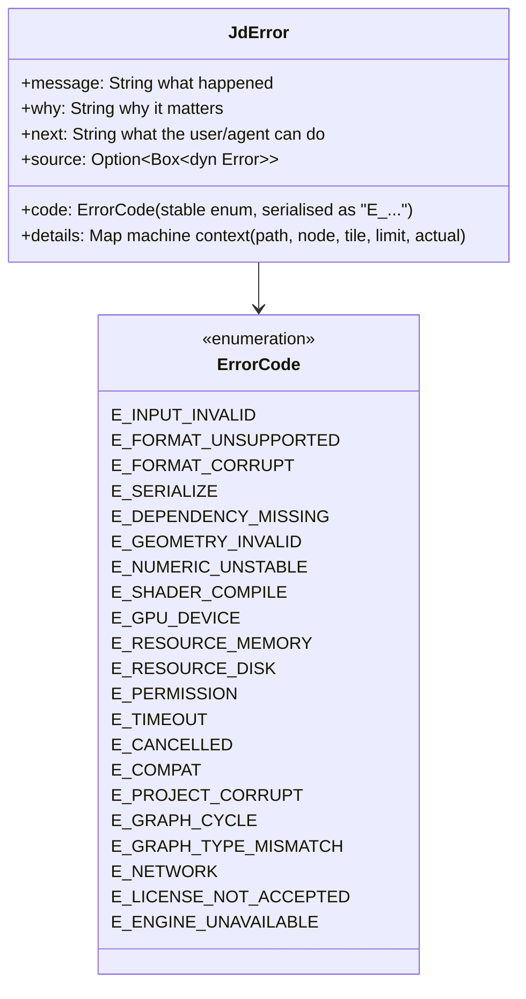

# 11 — Diagnostics, Logging, Error Handling (`jd-diag`)

## Structured logging

Backend: `tracing` with two subscribers: human-readable (stderr/console panel) and JSON lines (`<appdata>/logs/jd-YYYY-MM-DD.jsonl`, rotated). Every span/event carries the fields required by the brief §15.1:

| Field | Source |
|---|---|
| `ts` | subscriber |
| `level` | event |
| `subsystem` | crate target (`jd_sim::hydraulic`) |
| `op` | operation id |
| `job_id` / `request_id` | job span |
| `params_hash` | blake3 of request params (never raw params at INFO; raw at DEBUG with redaction) |
| `duration_ms` | span close |
| `outcome` | `ok` / `error` / `cancelled` / `timeout` |
| `error_code` | stable code |
| `ctx` | diagnostic context (tile coord, node id, format) |

Logs are viewable in the GUI diagnostics console, by `jd diag logs --since 10m --json`, and through MCP resource `jd://logs`.

## Error model

Implementation: `thiserror` enums per crate converting into `JdError` at the `jd-core` boundary; `miette`-style rich rendering in the CLI. The full catalogue with meanings and remediation lives in `docs/spec/error-codes.md` and is the single source for the GUI, CLI and MCP.

## Observability surface

| View | Shows |
|---|---|
| GUI Task monitor | active/queued jobs, progress, ETA, cancel buttons |
| GUI Performance profiler | per-node evaluation time (last build), tile throughput, GPU vs CPU share, frame time graph |
| GUI Diagnostics console | logs with filters, warnings, failed ops, cache status, export validation results, versions |
| `jd diag env` | OS, CPU, GPU adapter + backend + limits, RAM, disk, Blender/validator detection, feature flags |
| `jd diag resources` | RSS, GPU memory, cache size/hit rate |
| MCP `jd://diagnostics/*` | same as above, JSON |

## Profiling methodology

- Micro: `criterion`/`divan` benches per kernel, committed baselines, CI compares against the previous run with a tolerance band.
- Macro: `jd bench <scene>` on the benchmark scenes (`docs/spec/performance-targets.md`) records wall time, peak RSS (`/usr/bin/time -l` on macOS, `/proc` on Linux, Job Objects on Windows, via `jd-diag`), GPU memory, cache hit rate; results stored as JSON in `benches/results/` with machine fingerprint.
- Traces: `tracing` spans can be exported to Chrome trace format or Tracy (`tracing-tracy`, dev feature) for flame graphs.
- Rule: no "faster" claim without a bench diff attached to the PR.

## Diagnostic bundle

`jd diag bundle` / GUI button produces a zip: environment, last N log files, project graph (params only, no cache), job history, benchmark summary. Paths are relativised, usernames and API keys redacted, geo coordinates rounded to 0.1° unless the user opts in.
