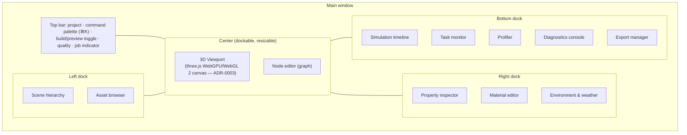
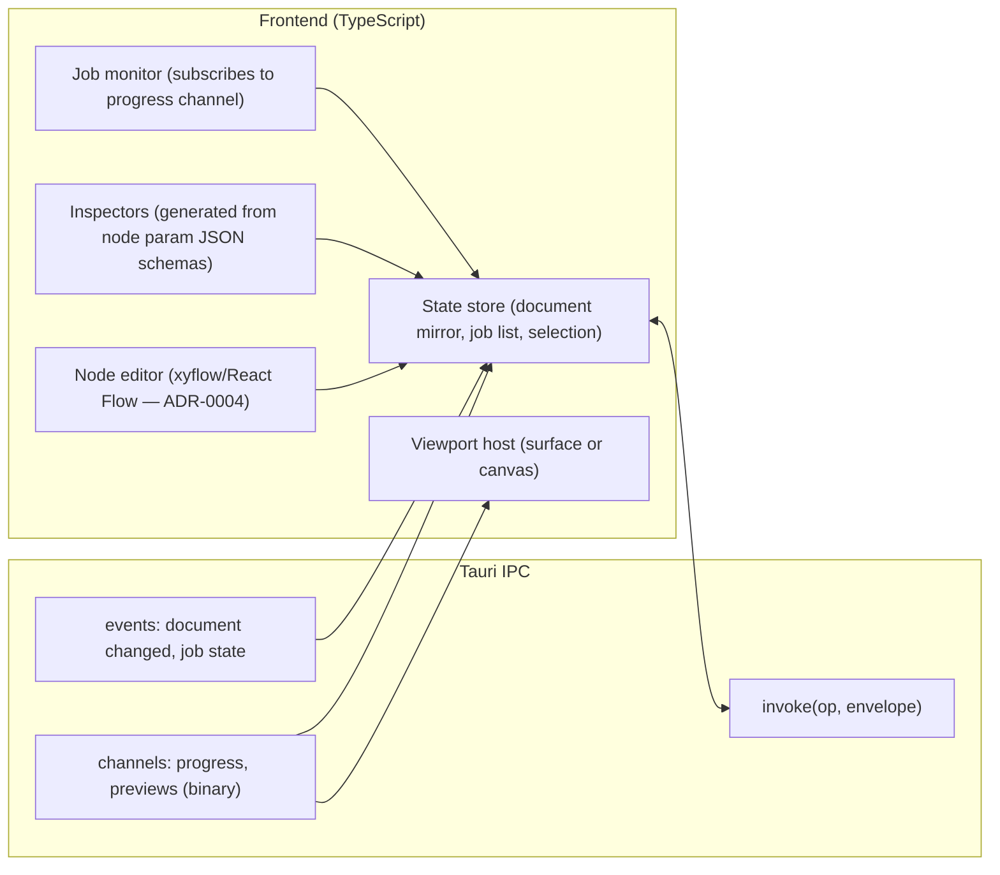

# 12 — UI Workspace and Design Language

## Design language

- Dark-first. Palette: black `#0A0A0A`, charcoal `#141414`, graphite `#1F1F1F`/`#2A2A2A`, greys `#3A3A3A` → `#9A9A9A`, white `#F2F2F2`; one accent for selection/progress (muted, high-contrast; exact value chosen with contrast tests ≥ 4.5:1 for text).
- Typography: Host Grotesk (verify licence/availability in `docs/research/stack.md`); monospace fallback for values/logs.
- Icons: Lucide. Spacing on a 4 px grid. Tailwind utility classes with a small token layer (`--jd-bg-0..3`, `--jd-fg-0..2`, `--jd-accent`).
- Minimal chrome, progressive disclosure (advanced node params behind "More"), clear technical language, tooltips with units.

## Workspace layout

Panels map to the brief §12 workspace list; sculpt/brush/mask controls appear as a toolbar overlay on the viewport when a stroke node is active.

## Frontend architecture

- The frontend holds a **mirror** of the document, never the source of truth; every mutation is an op round-trip (fast, local) and the store updates from the result/event, which keeps GUI, CLI and MCP consistent.
- Inspector forms are generated from the node parameter JSON schemas (`schemas/`), so adding a node in Rust adds its UI without frontend code.
- Non-blocking: every op that can exceed ~50 ms is a job; the UI shows progress and a cancel control.
- Keyboard shortcuts and a searchable command palette are backed by the operation registry.
- Accessibility: focus order, ARIA roles on custom widgets, contrast ≥ 4.5:1, reduced-motion respect.

## Interaction principles (brief §12)

Clear navigation, progressive disclosure, contextual guidance, shortcuts, searchable commands, undo/redo, presets, tooltips, consistent feedback, non-blocking ops, accessible errors (`message / why / next` from `JdError`), progress and cancellation.
