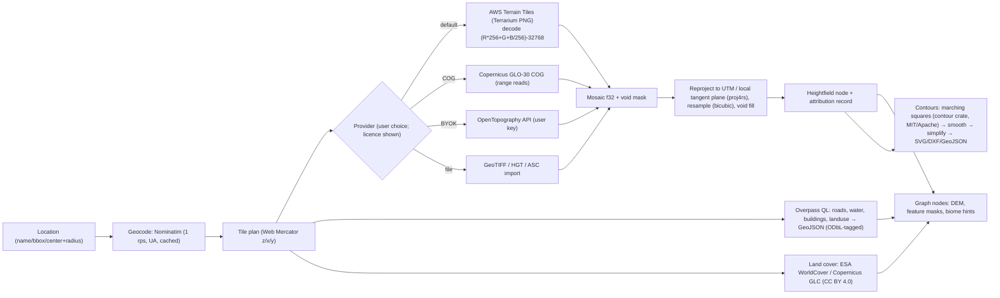
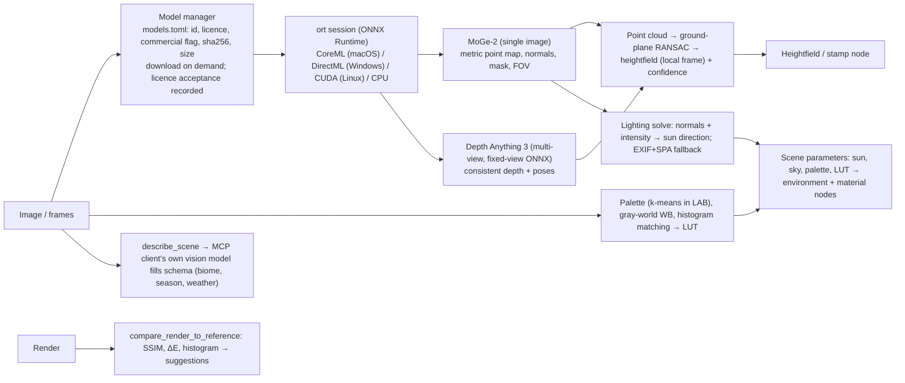

# 13 — Geospatial Input and Vision Modules (`jd-geo`, `jd-vision`)

Evidence: `docs/research/geo-vision.md` (licences, APIs, models), `docs/research/stack.md` §8.

## Geo: location → terrain

Rules from the research (binding):
- **Allowed by default:** AWS Terrain Tiles (Terrarium), Copernicus DEM (with its mandatory notice), SRTM/NASADEM/3DEP (public), GEBCO (bathymetry), ESA WorldCover / Copernicus GLC (CC BY 4.0), OSM via Overpass (ODbL).
- **BYOK only:** OpenTopography (commercial product integration needs an Enterprise key; never embed a key).
- **Excluded:** Google Elevation API (no caching/storing; use restricted), Google Earth Engine (commercial licence required), Cesium World Terrain (streaming-only), MapTiler Terrain-RGB (no commercial derivative works), Mapbox Terrain-DEM (SDK-only).
- **OSM/ODbL:** terrain exports are produced works (attribution); the intermediate feature dataset is a derivative database → keep it in separately labelled files that can be shared under ODbL.
- **Attribution** accumulates in `project.json → attribution[]` and is written to every export (`ATTRIBUTION.txt` + metadata). `geo.attributions` returns the consolidated list.
- **How the product talks to them** — client, hosts, adaptive connections, retries, cache, offline, keys: ADR-0014 (`docs/adr/0014-geo-fetch-policy.md`), implemented in `crates/jd-geo/src/fetch.rs` and the `geo.*` ops (2026-10-23).
- **Vertical datum:** record EGM96/EGM2008 vs ellipsoid per source; convert when mixing.
- `contour-isobands` crate is **AGPL — never linked**; use `contour`.

## Vision: image/video → depth, structure, lighting, colour

Model policy (binding until licences are re-verified before GA):

| Tier | Models |
|---|---|
| Default, commercial-safe | MoGe-2 ViT-S/B/L (MIT per HF card; **verify LICENSE file in weight repo**), DA3-SMALL / DA3-BASE / DA3METRIC-LARGE / DA3MONO-LARGE (Apache-2.0), Depth-Anything-V2-Small (Apache-2.0) |
| Optional, licence-gated | Marigold (RAIL++-M), VGGT-1B-Commercial (gated) |
| Non-commercial only (off by default; outputs tagged) | DA-V2 Base/Large/Giant, DA3-LARGE/GIANT/NESTED (CC BY-NC) |
| Excluded | UniDepth v2, DUSt3R, MASt3R (non-commercial code and weights) |

Constraints: weights are never bundled; one model resident at a time (ViT-L fp16 ≈ 0.66 GB) to respect the 4 GB budget; `ort` is release-candidate (API churn) → isolated in `jd-vision` behind the `onnx` feature; MoGe-2 post-processing (focal/shift recovery) must be reimplemented in Rust; no Apple Silicon benchmarks exist — measure before choosing the default size.

## MCP surface

`geo.geocode`, `geo.fetch_terrain`, `geo.fetch_features`, `geo.fetch_landcover`, `geo.contours`, `geo.attributions`; `vision.list_models`, `vision.install_model`, `vision.estimate_depth`, `vision.photo_to_terrain`, `vision.analyze_lighting`, `vision.extract_palette`, `vision.match_colors`, `vision.compare_render_to_reference`, `vision.describe_scene`. Every result carries `provenance[]` (source, licence, attribution). Scopes: `network:geo`, `vision`.
