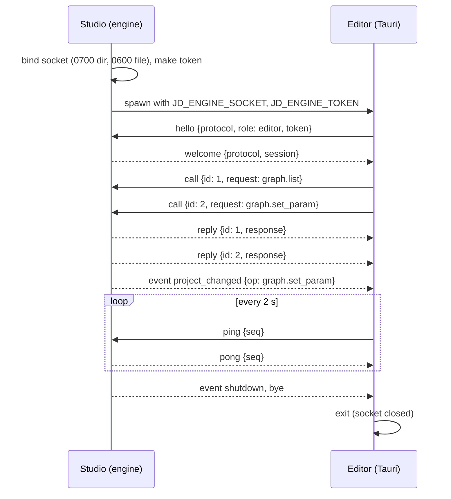

# 14 — Studio ↔ Editor protocol (`jd-ipc`)

Decision: [ADR-0017](../adr/0017-studio-and-editor-two-processes.md). Studio (egui, owns the engine) serves; the Editor (Tauri, node graph) and test clients connect.

## Transport

- A **local socket**: a Unix domain socket file on macOS / Linux, a named pipe on Windows (`interprocess` 2.4).
- Unix: the socket lives in a per-user directory created with mode `0700` (`$XDG_RUNTIME_DIR/jenga-dunia/` when set, else `<temp>/jenga-dunia-<uid>/`), the socket file is `0600`, and its name carries the Studio session id. Windows: `\\.\pipe\jenga-dunia-<session>`; named pipes are readable by any local user by default, so the token below is what admits a client.
- **Framing:** one JSON object per line (UTF-8, `\n`-terminated, no embedded newlines — `serde_json` never writes one). A line longer than **64 MiB** is refused (`E_SERIALIZE`) and the connection closed. The viewport lives in Studio, so no bulk pixel data crosses the boundary.

## Frames

Every frame is an object with a `t` (type) field.

| `t` | Direction | Fields | Meaning |
|---|---|---|---|
| `hello` | client → server | `protocol`, `role`, `pid`, `token`, `app_version` | first frame on a connection |
| `welcome` | server → client | `protocol`, `engine_version`, `session` | handshake accepted |
| `call` | client → server | `id` (u64, per connection), `request` (a `jd_core::Request`) | run one operation |
| `reply` | server → client | `id`, `response` (a `jd_core::Response`) | the operation's envelope, ok or error |
| `list_ops` | client → server | `id` | the registry's operation list (schemas, scopes) |
| `ops` | server → client | `id`, `ops` | its answer |
| `event` | server → clients | `topic`, `data` | pushed, unsolicited (below) |
| `ping` / `pong` | either way | `seq` | liveness |
| `bye` | either way | `reason` | orderly close |
| `error` | server → client | `error` (a `JdError`: `code`, `message`, `why`, `next`, `details`) | a protocol-level refusal, then close |

Calls are independent: the server runs each on its own worker, so a long evaluation never blocks a ping or a second call, and replies may arrive out of order — the client matches them by `id`.

**Events** (server → every client): `project_changed` `{ op, request_id, scope, client }` after any successful `ProjectWrite` / `FsWrite` / `Destructive` operation, and after `project.open` / `project.close` (the Editor reloads its graph; Studio refreshes its viewport — Studio's own operations announce themselves the same way, with `client` `gui-studio`, and Studio skips those: its own replies refresh it, and a refresh in the middle of a chain would read a half-done edit); `selection` `{ nodes: [id…], source }` (node ↔ viewport highlighting); `job` `{ id, done, total, state }` (progress); `shutdown` `{ reason }` before Studio exits.

## Handshake and versioning

- `protocol` is an integer, bumped on any incompatible frame change. A mismatch is refused with `error {code: E_COMPAT}` naming both versions, then the connection is closed; the Editor shows the message and quits.
- `token` must equal Studio's one-time launch token (`E_PERMISSION` otherwise; constant-time comparison). Test clients started by the test harness get the token the same way.
- No frame other than `hello` is accepted before `welcome`.

## Errors

Every failure a caller can see is a `JdError` with a catalogue code and a `next` step:

| Situation | Code | Seen by |
|---|---|---|
| Studio not running / socket missing / connection refused / connection lost mid-call | `E_ENGINE_UNAVAILABLE` (new) | every pending and later call |
| No reply within the call's timeout (default 10 min; `ping` 6 s) | `E_TIMEOUT` | that call |
| Protocol version mismatch | `E_COMPAT` | the handshake |
| Wrong token | `E_PERMISSION` | the handshake |
| Malformed or oversized frame | `E_SERIALIZE` | the peer that sent it (connection closed) |
| A reply that would exceed the frame cap (e.g. a full-resolution preview) | `E_SERIALIZE` inside `reply.response.error` | that call (the connection is fine); a request over the cap fails the same way on the client before it is sent |
| The operation itself failed | its own code, inside `reply.response.error` | that call (the connection is fine) |

Operation errors are data, not transport failures: a `reply` with `status: error` keeps the connection open.

## Liveness

The client pings every 2 s; any frame from the server counts as alive; 6 s of silence marks the engine lost: pending calls fail with `E_ENGINE_UNAVAILABLE`, the client's `on_lost` hook runs. A process that dies closes its socket, so a crashed Studio is noticed at once (end of stream), not after 6 s. A `bye` from the server ends the session the same way, with `details.orderly: true` (logged at `info`, not as a failure).

The server answers pings from the connection's reader thread (never queued behind an operation) and relies on end of stream to notice a client that went away: named pipes have no read timeouts, and a client's in-flight operations finish regardless (their results land in the project as usual). On Unix the handshake must arrive within 10 s.

## Processes (Phase 1)

- `jd-studio --headless` binds a fresh endpoint, prints one ready line on stdout — `{"socket", "token", "session"}` — and serves until its stdin closes, then sends `shutdown` and `bye` to every client and removes the socket directory. The Studio window (`jd-studio [project.jdproj]`, Phase 2) runs the same server in-process: its own operations go through `Server::invoke` as client `gui-studio` and announce `project_changed` exactly like the Editor's, and it hears every event through `Server::on_event`. It launches the Editor (`--editor <path>`, else `JD_EDITOR`, else `jd-app` next to `jd-studio`; `--no-editor` skips it) and supervises it: a clean exit means the user closed it (the Editor panel offers to reopen it); a crash is restarted, at most 3 times within 60 s. Closing Studio shuts the server down (the Editor exits on `shutdown`) and kills an Editor that has not exited within 3 s.
- The Editor (`jd-app`) connects when `JD_ENGINE_SOCKET` is set (token from `JD_ENGINE_TOKEN`); otherwise it runs today's in-process engine. Connected, its `op`, `ops_list` and `layer_preview` commands forward (`layer_preview` through `terrain.preview`), server events reach the frontend as `engine-event` `{topic, data}`, a `project_changed` from `project.open` / `project.create` / `project.close` triggers the frontend's existing `project-opened` re-read, a `shutdown` event closes the window quietly, and any other loss shows a native "engine lost" dialog with the error's next step and exits with status 1. If it cannot connect at launch it logs the error envelope and exits with status 1.

## Logging

Both sides log through `tracing`. Each call runs in a span carrying `request_id`, `op`, `role` and the connection's `session`, so the Studio log, the Editor log and the project's `logs/ops.log` (which records the client kind, e.g. `gui-editor`) line up on the request id. Frame-level detail is at `debug` (`JD_LOG=jd_ipc=debug`); payloads are never logged above `trace`.

## Tests

`crates/jd-ipc` (`cargo test -p jd-ipc`, real local sockets): framing round trip, a line over the cap and an unknown frame refused; a call round trip, operation errors, an unknown op and an oversized reply all keep the connection; wrong token → `E_PERMISSION`, protocol mismatch → `E_COMPAT`, nothing listening → `E_ENGINE_UNAVAILABLE`; 100 concurrent calls answered out of order and matched by id; a call past its timeout → `E_TIMEOUT` and the next call still works; `project_changed` (only after a write) and emitted events reach every client; shutdown → `shutdown` event, orderly loss, later calls `E_ENGINE_UNAVAILABLE`; an engine that dies mid-call fails the pending call at once; an engine that hangs is declared lost within the heartbeat window. `apps/studio` (`cargo test -p jd-studio`): the headless binary runs `project.create`, `terrain.generate`, `terrain.preview` and `list_ops` for a client, announces both writes, logs every op as `gui-test` in `logs/ops.log`; killing it fails the next call with `E_ENGINE_UNAVAILABLE`; closing its stdin shuts it down cleanly and removes the socket.
