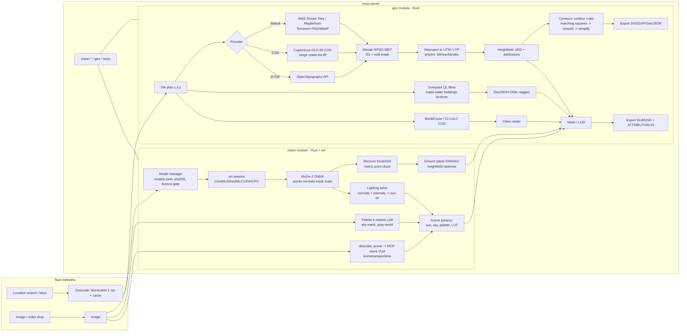

# Jenga Dunia — Geospatial data sources & vision-AI research report

Prepared for: Jenga Dunia (MIT-licensed, commercially usable Rust/Tauri terrain tool)
Accessed date for all sources: 2026-10-19
Scope: (A) real-world location → elevation / contours / land cover / OSM features → terrain; (B) MCP "vision" capability: image → depth/terrain structure, lighting/colour analysis.

## Evidence labels used throughout

- **VERIFIED** — I fetched the primary page/licence/file and the statement is on it.
- **REPORTED** — stated by a secondary source (search snippet, community catalogue, forum post quoting the primary, third-party mirror) or a primary page that I could only partly read.
- **UNVERIFIED** — could not reach a primary or reliable secondary source; stated from general knowledge or inferred; treat as a gap.
- **DERIVED** — arithmetic from verified numbers (e.g. weight-file sizes).

Nothing below is legal advice. Licence quotations are verbatim where marked.

---

# Part A — Geospatial

## A1. Elevation (DEM) sources

### A1.1 Copernicus DEM GLO-30 / GLO-90 (ESA / Airbus / DLR)

- Coverage: GLO-90 worldwide; GLO-30 "Public" worldwide except a small set of country tiles not released. Ocean has no tiles (treat as 0 m). **VERIFIED** — https://registry.opendata.aws/copernicus-dem/ and https://copernicus-dem-30m.s3.amazonaws.com/readme.html
- Type: Digital *Surface* Model (includes buildings/vegetation), TanDEM-X derived. **VERIFIED** — Planetary Computer STAC collection https://planetarycomputer.microsoft.com/api/stac/v1/collections/cop-dem-glo-30
- Resolution: 1 arc-sec (~30 m) / 3 arc-sec (~90 m). **VERIFIED**
- Vertical accuracy: absolute < 4 m LE90; relative < 2 m (slope ≤ 20 %), < 4 m (> 20 %); horizontal < 6 m CE90. **REPORTED** (dataspace collection page, EEA catalogue, product handbook ToC) — https://dataspace.copernicus.eu/explore-data/data-collections/copernicus-contributing-missions/collections-description/COP-DEM ; handbook https://dataspace.copernicus.eu/sites/default/files/media/files/2024-06/geo1988-copernicusdem-spe-002_producthandbook_i5.0.pdf
- Vertical datum: EGM2008 geoid. **UNVERIFIED** (not on the pages I could read; widely documented in the handbook).
- Format / access: COG GeoTIFF on AWS Open Data, `s3://copernicus-dem-30m/` and `s3://copernicus-dem-90m/` (eu-central-1, `--no-sign-request`, no key). Tile naming `Copernicus_DSM_COG_10_N50_00_W125_00_DEM/` (10 = GLO-30, 30 = GLO-90). **VERIFIED** — readme above. Also via OpenTopography API (`COP30`, `COP90`) and Planetary Computer STAC.
- **Licence (VERIFIED, full text extracted from the PDF)** — https://documentation.dataspace.copernicus.eu/APIs/SentinelHub/Data/DEM/resources/license/License-COPDEM-30.pdf ("Licence for Copernicus DEM instance COP-DEM-GLO-30-F Global 30m Full, Free & Open"):
  - Art. 4 Right of Use: "(a) reproduction; (b) distribution; (c) communication to the General Public; (d) adaptation, modification and combination with other data and information." Art. 3: rights are "worldwide and without limitation in time". Art. 5: "free of charge". No commercial restriction appears anywhere in the text → commercial use OK.
  - Art. 6(a) notice when distributing/communicating unmodified data: "© DLR e.V. 2010-2014 and © Airbus Defence and Space GmbH 2014-2018 provided under COPERNICUS by the European Union and ESA; all rights reserved."
  - Art. 6(b) notice when data have been adapted/modified: "produced using Copernicus WorldDEM-30 © DLR e.V. 2010-2014 and © Airbus Defence and Space GmbH 2014-2018 provided under COPERNICUS by the European Union and ESA; all rights reserved."
  - Art. 6(c) anyone redistributing (modified or not) must add to their licence/legal notice: "The organisations in charge of the Copernicus programme by law or by delegation do not incur any liability for any use of the Copernicus WorldDEM-30".
  - Art. 6(d) no implied endorsement; 6(e) must bind downstream users to the same obligations.
  - Note: the higher-resolution WorldDEM-10 is "expressly excluded" from this licence.
- Implication for Jenga Dunia: best default global DEM. Derived heightfields that are exported must carry the 6(b) notice and the 6(c) liability sentence in the export's metadata/credits.

### A1.2 SRTM 1 arc-second Global (NASA/USGS, SRTMGL1 v003)

- Coverage: mission data 60°N–56°S; USGS "void filled" product; tiles above 50°N/below 50°S are 2×1 arc-sec. **VERIFIED** — https://www.usgs.gov/centers/eros/science/usgs-eros-archive-digital-elevation-shuttle-radar-topography-mission-srtm-1
- Resolution: 1 arc-sec (~30 m); 1°×1° tiles. **VERIFIED**
- Datums: horizontal WGS84; vertical EGM96 geoid, metres. **VERIFIED** (same page)
- Vertical accuracy: official mission spec ≤ 16 m absolute LE90 — **UNVERIFIED** from primary; independent studies report RMSE ≈ 3–6 m in flat/moderate terrain. **REPORTED** — https://link.springer.com/chapter/10.1007/978-981-10-8016-6_70
- Licence: US-government/NASA data; NASA ESDS states EOSDIS data are "fully available to any user for any purpose" under the free and open data policy in effect since 1990. **REPORTED** — https://www.earthdata.nasa.gov/esds/open-science (page returned 403 to my fetcher; quoted via search snippet). USGS page gives DOI 10.5066/F7PR7TFT for citation but no explicit licence text. **VERIFIED**. Earthdata/LP DAAC product pages (https://www.earthdata.nasa.gov/data/catalog/lpcloud-srtmgl1-003) returned HTTP 403 to automated fetch.
- Access: EarthExplorer / LP DAAC (Earthdata login required for direct download — **UNVERIFIED** here but standard); AWS Terrain Tiles and OpenTopography (`SRTMGL1`) mirror it without login. Formats: HGT (DAAC), DTED/BIL/GeoTIFF (USGS).

### A1.3 NASADEM (NASA, NASADEM_HGT v001)

- Reprocessed SRTM with ICESat control, voids filled from ASTER GDEM, ALOS PRISM, USGS NED, Canada/Alaska DEMs. 1 arc-sec. Vertical datum "WGS84 Ellipsoid/EGM1996 Geoid (EPSG:5773)". **VERIFIED** — https://portal.opentopography.org/raster?opentopoID=OTSDEM.032021.4326.2
- Licence: OpenTopography lists "Use License: Not Provided"; "freely available through LP DAAC". Same NASA open policy as SRTM applies (**REPORTED**). Earthdata page 403.
- Access: LP DAAC (login), OpenTopography API (`NASADEM`), Planetary Computer (`nasadem` collection — **UNVERIFIED**, the collection listing was truncated at 100k chars).

### A1.4 ASTER GDEM v3 (METI / NASA)

- Coverage 83°N–83°S (99 % of land); 30 m postings; 1°×1° GeoTIFF tiles. **VERIFIED** — https://asterweb.jpl.nasa.gov/gdem.asp
- Terms: "available at no charge for any user pursuant to an agreement between METI and NASA"; provided "as is"; contains anomalies/artefacts. **VERIFIED** (same page). The customary credit "ASTER GDEM is a product of METI and NASA" is **UNVERIFIED** (not on the page I could read).
- Vertical accuracy: not stated on page; independent studies rank it least accurate of the 30 m globals (RMSE ≈ 5–8 m). **REPORTED**
- Use in Jenga Dunia: fallback only (noisier than Copernicus/NASADEM). Vertical datum EGM96 **UNVERIFIED**.

### A1.5 ALOS World 3D-30m (AW3D30, JAXA) v4.1

- Coverage: global except Japan and Antarctica in v4.1 (earlier versions cover those). 1 arc-sec DSM. GeoTIFF + MSK/STK/QAI masks. Registration required; download as 1°×1° or 5°×5° zips. **VERIFIED** — https://www.eorc.jaxa.jp/ALOS/en/dataset/aw3d30/aw3d30_e.htm
- Terms: "Any of the commercial and non-commercial purposes can be used free of charge" under JAXA "Terms for Use" (earth.jaxa.jp). **VERIFIED** (that sentence is on the page). Exact attribution wording and redistribution conditions are on the linked JAXA terms page — **UNVERIFIED** (not fetched).
- Vertical accuracy: not given numerically on page (points to validation papers). Vertical datum: "height above sea level" (EGM96 — **UNVERIFIED**).
- Also available via OpenTopography (`AW3D30`, plus ellipsoidal variant) and Planetary Computer (`alos-dem`, licence field "proprietary" in STAC — **VERIFIED** from the collections listing).

### A1.6 USGS 3DEP (United States)

- Products: 1 m (project-based, lidar), seamless 1/3 arc-sec (~10 m), 1 arc-sec (~30 m, CONUS+Alaska+most of Canada/Mexico), 2 arc-sec and 5 m IfSAR (Alaska). New 1 m seamless (S1M) COG since mid-2025. **VERIFIED** — https://www.usgs.gov/3d-elevation-program/about-3dep-products-services
- Licence: "available, free of charge and without use restrictions" (US public domain). **VERIFIED** (same page). Planetary Computer tags `3dep-seamless` as PDDL-1.0. **VERIFIED**
- Accuracy: QL2 lidar spec 10 cm RMSEz (nonvegetated), 1 m DEM cell. **REPORTED** — https://www.usgs.gov/3d-elevation-program/topographic-data-quality-levels-qls. 1 m DEMs are UTM/NAD83, NAVD88 vertical. **REPORTED**
- Access: The National Map downloader, WMS/WCS dynamic service, `prd-tnm` S3 bucket under `StagedProducts/Elevation/1m/Projects/` (**REPORTED**, forum post), OpenTopography API (3DEP rasters added 2023), Planetary Computer. Lidar point clouds: `s3://usgs-lidar/` requester-pays (**REPORTED**).

### A1.7 EU-DEM v1.1 (25 m, Copernicus Land)

- Status: obsolete/superseded; "not maintained anymore and no longer available on our website"; users are directed to Copernicus DEM 30 m/90 m on CDSE. **REPORTED** — https://land.copernicus.eu/pan-european/GHSL/european-settlement-map ; EEA catalogue https://sdi.eea.europa.eu/catalogue/srv/api/records/d08852bc-7b5f-4835-a776-08362e2fbf4b
- Recommendation: do not integrate; use Copernicus DEM. (OpenTopography does list a "Continental Europe Digital Terrain Model 30m" — EU_DTM — as a separate dataset. **VERIFIED** listing.)

### A1.8 OpenTopography Global DEM API

- Endpoint documented via Swagger at https://portal.opentopography.org/apidocs/ (page is JS-rendered; body not readable by my fetcher). Datasets (**VERIFIED** — https://opentopography.org/node/3158): SRTM GL3, SRTM GL1, SRTM GL1 Ellipsoidal, AW3D30 (+ ellipsoidal), SRTM15+ v2.1, NASADEM, COP30, COP90, EU_DTM 30 m, GEDI L3, GEBCOIceTopo, GEBCOSubIceTopo, CDEM Canada, Global Ensemble DTM, ANADEM.
- Area caps per request: 450,000 km² for all 30 m sets; 4,050,000 km² for 90 m. **VERIFIED**
- Quotas: free key — 200 calls/24 h academic, **50 calls/24 h non-academic**; OpenTopography Plus raises non-academic limits; "Extremely intensive use and commercial software integration require an Enterprise API key". **VERIFIED** (node/3158)
- Key rules (**VERIFIED** — https://opentopography.org/node/14 Terms of Use): one user, one key; keys must not be shared, made public, or "embedded in an application or service that lets third-party users bypass the one user, one key requirement"; "Commercial, for-profit integration of API keys into a product or service is not allowed" without an Enterprise key. Data itself may be used commercially ("free of all copyright restrictions" or CC BY 4.0 per dataset). Acknowledgement requested: "This work is based on API services provided by the OpenTopography Facility" + NSF award numbers.
- Implication: Jenga Dunia **must not ship a built-in OpenTopography key**. Pattern: user pastes their own key (BYOK) in settings; 50 calls/day is small, so prefer AWS Terrain Tiles / Copernicus COGs as the default path and OT as an optional provider.

### A1.9 Mapbox Terrain-RGB v1 / Terrain-DEM v1

- Decoding: `height = -10000 + ((R*256*256 + G*256 + B) * 0.1)` metres, 0.1 m steps. **VERIFIED** — https://docs.mapbox.com/data/tilesets/reference/mapbox-terrain-rgb-v1/
- Terrain-RGB: data to z15@256px / z14@512px; **no updates since 2021-12-01**; mixed vertical datums (NAVD88, EGM96, ODN) — "normalizing … may reduce accuracy". **VERIFIED**. Raw pixels via `https://api.mapbox.com/v4/mapbox.terrain-rgb/{z}/{x}/{y}.pngraw?access_token=…`. **VERIFIED**
- Terrain-DEM v1 (successor): same encoding, z ≤ 14, 1-px buffer, "Only for use in Mapbox SDKs" (GL JS, iOS, Android, Flutter), "not available via the Raster Tiles API". **VERIFIED** — https://docs.mapbox.com/data/tilesets/reference/mapbox-terrain-dem-v1/
- Terms: ToS defers to Product Terms (PDF) which I could not read. SDK docs state Mapbox ToS bar redistributing offline maps and bundling/preloading tiles. **REPORTED** — https://docs.mapbox.com/ios/legacy/maps/guides/offline/ . Attribution required ("public use requires proper attribution"). **VERIFIED**
- Implication: fetching Terrain-RGB tiles into a Rust app, caching them to disk, and exporting derived meshes is at best grey (SDK-only clause for Terrain-DEM; Terrain-RGB frozen). Not recommended as a default; if offered, BYOK and no persistent cache. **Caching allowed: UNVERIFIED/likely no.**

### A1.10 MapTiler Terrain-RGB v2

- Dataset `terrain-rgb-v2`: z0–14, WebP, 30 m global / 5 m in places, vertical resolution 6 m. **VERIFIED** — https://docs.maptiler.com/schema-raster/terrain-rgb/ . Same decode formula as Mapbox. **REPORTED** — https://www.maptiler.com/news/2019/03/rgb-encoded-elevation-data-in-maptiler-cloud/ ; https://docs.maptiler.com/guides/map-tilling-hosting/data-hosting/global-rgb-bathymetry-tileset
- Terms (**VERIFIED** — https://www.maptiler.com/terms/): §4.3 "you may not produce commercial derivative works from MapTiler Services" (only non-commercial or OSM-contributing derivative vector datasets permitted); §2.1 no working around technical limitations; §12.5 destroy map content on termination; §6.1 "© MapTiler" attribution (+ logo on free accounts), §6.2 "© OpenStreetMap" where applicable.
- Implication: **exclude** as a source for user-sold terrain (derivative-works clause). Fine only for on-screen preview.

### A1.11 AWS Terrain Tiles "Terrarium" (Mapzen/Tilezen, AWS Open Data)

- Buckets: `s3://elevation-tiles-prod/` (us-east-1) and `elevation-tiles-prod-eu` (eu-central-1); public, `--no-sign-request`; HTTP `https://elevation-tiles-prod.s3.amazonaws.com/terrarium/{z}/{x}/{y}.png` (path pattern **REPORTED**; bucket **VERIFIED** — https://registry.opendata.aws/terrain-tiles/).
- Formats (**VERIFIED** — https://github.com/tilezen/joerd/blob/master/docs/formats.md):
  - Terrarium PNG, EPSG:3857: `elevation = (R*256 + G + B/256) - 32768`; blue = fractional part in 1/256 m.
  - Normal PNG (RGB = normal, A = quantised height table).
  - GeoTIFF 512×512 tiles with 256 overview, raw elevation for analysis.
  - Skadi 1°×1° HGT (WGS84), voids = -32768, "referenced to the WGS84/EGM96 geoid".
- Zoom range: not stated on the formats page; commonly z0–15 (**UNVERIFIED**).
- Sources: SRTM, 3DEP/NED, GMTED2010, ETOPO1, EU-DEM, ArcticDEM, national LiDAR (Austria, Australia, Canada, Mexico, NZ, Norway, UK). Vertical datum mixed (mostly EGM96). **VERIFIED** list — https://github.com/tilezen/joerd/blob/master/docs/attribution.md
- Licence/attribution (**VERIFIED**, attribution.md): no single licence; each source's licence applies. Required credits include "Mapzen" (when using hosted service) plus per-source lines, e.g. "SRTM data courtesy of the U.S. Geological Survey", "3DEP data courtesy of the U.S. Geological Survey", "© Commonwealth of Australia (Geoscience Australia) 2017" (CC BY 4.0), "Produced using Copernicus data and information funded by the European Union - EU-DEM layers", "© Kartverket" (CC BY 4.0), UK Environment Agency (OGL v3), LINZ (CC BY 3.0 NZ), Austria (CC BY 3.0 AT), Canada (OGL-Canada), INEGI terms, ArcticDEM (NSF credit line). All of these are commercial-friendly attribution licences or public domain.
- Registry citation: "Terrain Tiles was accessed on DATE from https://registry.opendata.aws/terrain-tiles." **VERIFIED**
- Implication: **best zero-friction default** (no key, no quota, Web-Mercator tiles, 1/256 m precision). Caveats: frozen/old sources in places; mixed datums; last-updated unknown ("New data is added based on community feedback").

### A1.12 Mapterhorn (Protomaps-adjacent, Terrarium in PMTiles)

- Terrarium-encoded 512 px WebP tiles built from Copernicus DEM plus national high-res (e.g. swissALTI3D 0.5–2 m). Endpoint `https://tiles.mapterhorn.com/{z}/{x}/{y}.webp`, TileJSON `https://tiles.mapterhorn.com/tilejson.json`, full-planet PMTiles download. **VERIFIED** endpoint — https://mapterhorn.com/data-access/ ; sources **REPORTED** — https://protomaps.com/blog/mapterhorn-terrain/
- Attribution list in JSON: https://download.mapterhorn.com/attribution.json (**REPORTED**, not fetched). Code BSD-3 (**REPORTED**).
- Implication: modern alternative to AWS Terrain Tiles with Copernicus licence obligations (A1.1). No stated rate limits; copy PMTiles extract locally for heavy use.

### A1.13 Google Maps Elevation API

- Pricing (**VERIFIED** — https://developers.google.com/maps/billing-and-pricing/pricing, SKU "Elevation", Pro category, B43B-2A59-C153): first 5,000 events/month free; $5.00/1,000 (5,001–100k); $4.00 (100k–500k); $3.00 (500k–1M); $1.50 (1M–5M); $0.38 (5M+).
- Policies (**VERIFIED** — https://developers.google.com/maps/documentation/elevation/policies): "Content from the Elevation API should not be pre-fetched, cached, or stored, except for place IDs"; results displayed on a map "must be shown on a Google Map"; without a map "a Google logo and attribution must be included".
- ToS §3.2.3(a) "No Scraping": "Customer will not export, extract, or otherwise scrape Google Maps Content for use outside the Services. For example, Customer will not: (i) pre-fetch, index, store, reshare, or rehost Google Maps Content outside the services; (ii) bulk download Google Maps tiles, Street View images, geocodes, directions, distance matrix results, roads information, places information, elevation values, and time zone details; …". **REPORTED** — quoted by Cesium staff at https://community.cesium.com/t/saving-google-map-data/31228 ; the official page https://cloud.google.com/maps-platform/terms returned only 93 characters to my fetcher (JS-rendered). Service-Specific Terms (archived 2023-08-28 copy, **VERIFIED**) contain per-API "No use with a non-Google map" clauses and 30-day lat/lng caching allowances for Directions/Geocoding/Places/etc.; the archived page has **no Elevation section**.
- Implication: **exclude**. Building a stored heightfield from Elevation API responses is "store … elevation values" and use outside Google Maps. Cannot be used by a tool whose purpose is exporting terrain.

### A1.14 Google Earth Engine

- Terms (**VERIFIED** — https://earthengine.google.com/terms/): §2.1(c) services "can be used only for Non-Commercial Activities or Government Research Activities" unless on commercial (paid, GCP) terms; §2.1(a) non-commercial excludes "charging or receiving a fee for Applications or data created by use of the Services"; §4.4 third-party dataset licences govern exported data.
- Implication: not suitable as a backend for an open-source commercial tool; users with a commercial GEE licence could export GeoTIFFs themselves, but the tool should not depend on it.

### A1.15 Microsoft Planetary Computer

- Public STAC API `https://planetarycomputer.microsoft.com/api/stac/v1`; collection `cop-dem-glo-30` (licence field "proprietary" pointing to the ESA licence; providers ESA/Sinergise/OpenTopography/Microsoft; COG assets). **VERIFIED**. `3dep-seamless` PDDL-1.0; `alos-dem` "proprietary". **VERIFIED** (collections listing, partial).
- Docs say most datasets are open STAC; "we do require tokens to access some data sets" (SAS signing via `/api/sas/v1/token`). **REPORTED** — https://planetarycomputer.microsoft.com/docs/concepts/data-catalog (JS page). "Planetary Computer Pro" is a separate paid Azure product with Entra ID. **REPORTED**. No 2025–26 retirement notice for the public catalogue found (gap).
- Implication: useful STAC discovery front-end; licences are per dataset.

### A1.16 Land cover

| Product | Res. | Years | Licence | Attribution | Source |
|---|---|---|---|---|---|
| ESA WorldCover | 10 m, 11 classes | 2020 (v100), 2021 (v200) | CC BY 4.0 **VERIFIED** | "© ESA WorldCover project [year] / Contains modified Copernicus Sentinel data ([year]) processed by ESA WorldCover consortium" **VERIFIED** | https://esa-worldcover.org/en/data-access ; AWS `s3://esa-worldcover/` (no-sign-request), Zenodo 10.5281/zenodo.5571936 / 7254221; 3°×3° COGs EPSG:4326 |
| Copernicus Global Land Cover (CGLS-LC100 C3) | 100 m | 2015–2019 | CC BY 4.0 **VERIFIED** (Zenodo record field) | Buchhorn et al. (2020), doi:10.5281/zenodo.3939050 | https://zenodo.org/records/3939050 ; https://land.copernicus.eu/en/products/global-dynamic-land-cover |
| Esri / Impact Observatory Sentinel-2 10 m LULC | 10 m, 9 classes | 2017–2025 annual | CC BY 4.0 **REPORTED** | "This dataset was produced by Impact Observatory for Esri. © 2021 Esri" (exact required string not confirmed) **REPORTED** | https://gee-community-catalog.org/projects/S2TSLULC/ ; STAC `api.impactobservatory.com` collection `io-10m-annual-lulc`; Living Atlas explorer GeoTIFF download |

Sentinel-2 imagery itself (for textures): Copernicus Sentinel data are free/full/open under the Copernicus Sentinel Data Licence with "Contains modified Copernicus Sentinel data [year]" credit — **UNVERIFIED** here (not fetched), but WorldCover's attribution line above is consistent with it.

### A1.17 Cesium World Terrain / quantized-mesh

- Usage guide (**VERIFIED** — https://cesium.com/learn/ion/content-usage-and-attribution-guide/): assets may be used "by streaming the data from ion to your project"; "Do not cache Cesium or third-party assets" beyond the asset-specified period; must display Cesium ion logo + data attribution; renderings may be published. Pricing page (**VERIFIED** — https://cesium.com/platform/cesium-ion/pricing/): free Community plan is "Personal and non-commercial use"; paid plans cover commercial use "within your organization"; "Contact us if you plan to integrate Cesium ion into solutions used outside your organization". Staff posts: offline saving of CWT violates ToS; offline licences sold separately. **REPORTED** — https://community.cesium.com/t/does-cesium-for-unreal-work-offline/17271
- quantized-mesh format itself is an open spec (Apache-2.0 spec repo — **UNVERIFIED**).
- Implication: **exclude** as a data source (streaming-only, commercial plan, no export). The quantized-mesh *format* could be an export target.

### A1.18 Bathymetry

- **GEBCO** (2024/2025/2026 grids, 15 arc-sec global land+ocean; netCDF/GeoTIFF/Esri ASCII; 8×90° tiles or custom-area app): "placed in the public domain and may be used free of charge"; users may "Copy, publish, distribute and transmit", "Adapt", "Commercially exploit" the grid; must acknowledge source and not imply endorsement; not for navigation. **VERIFIED** (grid page) + **REPORTED** (terms page text via search) — https://www.gebco.net/data-products/gridded-bathymetry-data ; https://www.gebco.net/data-products/gridded-bathymetry/terms-of-use . Citation form: "GEBCO Bathymetric Compilation Group 2026 (2026). The GEBCO_2026 Grid … doi:10.5285/4f68d5c7-45eb-f999-e063-7086abc036fa". Vertical reference: assumed MSL.
- **EMODnet Bathymetry DTM 2024**: 1/16 arc-min (~115 m), European seas (36W–43E, 15N–90N) + Caribbean subset; GeoTIFF/NetCDF/XYZ/ASCII; WMS/WFS/WCS/WMTS; tiles at LAT or MSL. **VERIFIED** — https://emodnet.ec.europa.eu/en/bathymetry . Licence CC BY 4.0 per catalogue records, "DO NOT USE FOR NAVIGATION". **REPORTED** — https://emodnet.ec.europa.eu/geonetwork/srv/api/records/4a12d84b-b3fe-4b85-8d7f-96a9e7d659a8 (terms page returned 403). Citation: "EMODnet Digital Bathymetry (DTM 2024). EMODnet Bathymetry Consortium. https://doi.org/10.12770/cf51df64-56f9-4a99-b1aa-36b8d7b743a1".

---

## A2. OpenStreetMap

### A2.1 ODbL, produced works, share-alike

- Licence: ODbL 1.0; "If you alter or build upon our data, you may distribute the result only under the same license"; attribution must credit OpenStreetMap and make clear data is under ODbL. **VERIFIED** — https://www.openstreetmap.org/copyright
- Produced Work guideline (**VERIFIED** — https://osmfoundation.org/wiki/Licence/Community_Guidelines/Produced_Work_-_Guideline): test is whether the result is "intended for the extraction of the original data" → Derivative Database (must be ODbL) vs otherwise → Produced Work. Images (PNG/JPG/PDF/SVG), printed maps are "usually Produced Works"; database dumps are not. ODbL §4.6: if you publicly use a Produced Work from a Derivative Database, you must offer the Derivative Database (or the diff/algorithm) under ODbL. The guideline does **not** mention 3D models/game assets explicitly.
- Attribution guidelines (**VERIFIED** — https://osmfoundation.org/wiki/Licence/Attribution_Guidelines): "© OpenStreetMap contributors" / "© OpenStreetMap" acceptable; link to openstreetmap.org/copyright; interactive maps: corner credit, may collapse after interaction/5 s but licence info must remain reachable; apps: splash screen OK; games: splash, in-game, credits page or menu; data products: readme/metadata with ODbL link; 3D not explicitly addressed; ML models trained on substantial OSM data must be attributed in docs.
- Practical reading for Jenga Dunia (not legal advice):
  - A rendered terrain mesh/texture/scene (GLB, USD, PNG heightmap with OSM-derived roads burned in) is most naturally a **Produced Work**: the user's output must carry OSM attribution, but the output itself is not forced to be ODbL.
  - The intermediate dataset the tool builds (filtered OSM geometry for the bbox, possibly merged with DEM) is a **Derivative Database**. If the user *publicly* uses a Produced Work made from it, ODbL §4.6 requires offering that derivative database under ODbL on request. The tool can satisfy this by making the intermediate GeoJSON/PMTiles exportable and labelling it ODbL. Keep "ODbL data" separate from "MIT code" in the repo and in exports.
  - The tool's own code stays MIT; ODbL does not touch software. Export a `ATTRIBUTION.txt` / scene metadata with "© OpenStreetMap contributors, ODbL — https://www.openstreetmap.org/copyright".

### A2.2 Overpass API

- Public instance `https://overpass-api.de/api/interpreter` (behind it: gall/lambert.openstreetmap.de). Policy (**VERIFIED** — https://dev.overpass-api.de/overpass-doc/en/preface/commons.html): ~10,000 requests/day and ~1 GB/day per user guideline; slot-based rate limiting per IP (HTTP 429 when exceeded; 504 if not admitted within 15 s); default `[timeout:180]`, `[maxsize:536870912]`; discouraged: "building a general-purpose app on the public instances", stitching bboxes to scrape the world. Other public instances exist (e.g. Kumi Systems `overpass.kumi.systems`) — **UNVERIFIED** here.
- Overpass QL examples for a bbox (`south,west,north,east`) — syntax from the Overpass QL language reference (https://wiki.openstreetmap.org/wiki/Overpass_API/Overpass_QL, **UNVERIFIED** page not fetched; syntax standard):

```ql
[out:json][timeout:60][bbox:-1.30,36.80,-1.25,36.86];
(
  way["highway"];                       // roads & paths
  way["waterway"~"^(river|stream|canal)$"];
  way["natural"="water"]; relation["natural"="water"];
  way["building"]; relation["building"];
  way["landuse"]; relation["landuse"];
  way["natural"~"^(wood|scrub|grassland|sand|beach|bare_rock)$"];
);
out body; >; out skel qt;
```

  Use `out geom;` instead of `out body; >; out skel qt;` to get inline coordinates per way (simpler client). Prefer one combined query per bbox; cache by (bbox, timestamp).

### A2.3 Nominatim geocoding (public instance)

- Policy (**VERIFIED** — https://operations.osmfoundation.org/policies/nominatim/): max **1 request/second** per app; must send a valid identifying `User-Agent` or `Referer` ("stock User-Agents as set by http libraries will not do"); cache results on your side; bulk geocoding discouraged (single thread, one machine, ≤ 4 req/min for long jobs); **auto-complete is forbidden**; attribution required.
- Implication: use for "search a place" after Enter, not keystroke suggestions. Set `User-Agent: JengaDunia/<ver> (contact@…)`.

### A2.4 OSM tile usage policy (for basemap preview)

- `https://tile.openstreetmap.org/{z}/{x}/{y}.png` only; distinct identifying `User-Agent`; honour `Cache-Control`/`Expires`/`ETag` (≥ 7 days if you cannot); no bulk download, no pre-seeding, no "download for offline", no tile archives; attribution visible; "access may be withdrawn at any time" for commercial services. **VERIFIED** — https://operations.osmfoundation.org/policies/tiles/
- Implication: basemap preview OK; never fetch tiles outside the viewport. Consider Protomaps PMTiles for a self-hosted basemap.

### A2.5 Rust crates and offline data

| Crate / dataset | Version (2026-10-19) | Licence | Notes | Source |
|---|---|---|---|---|
| `osmpbf` | 0.3.8 | MIT OR Apache-2.0 | `.osm.pbf` reader, parallel blobs | https://crates.io/crates/osmpbf **VERIFIED** |
| `osm-io` | 0.3.0 | MIT OR Apache-2.0 | read/write OSM (pbf, xml) | https://crates.io/crates/osm-io **VERIFIED** |
| Geofabrik extracts | daily | ODbL | continent/country `.osm.pbf`; public extracts strip user metadata | https://download.geofabrik.de/ **VERIFIED** |
| Protomaps basemap | daily v4 builds | ODbL Produced Work; code BSD | planet PMTiles ≈120 GB z0–15; `pmtiles extract` for cutouts; verify BLAKE3; don't hotlink | https://docs.protomaps.com/basemaps/downloads **VERIFIED** |
| Overture Maps | monthly-ish releases | **Base, Buildings, Divisions, Transportation = ODbL**; Places = CDLA-Permissive 2.0 (Meta, Microsoft, …) / Apache-2.0 (Foursquare) / CC0 (AllThePlaces); Addresses = per-source open licences | GeoParquet on `s3://overturemaps-us-west-2/release/…` and Azure; STAC at stac.overturemaps.org | https://docs.overturemaps.org/attribution/ **VERIFIED**; https://github.com/OvertureMaps/data **VERIFIED** |

**Correction to the brief:** Overture is *not* a blanket CDLA-Permissive-2.0 alternative to OSM. The themes a terrain tool needs (roads, water, land, buildings) are OSM-derived and ODbL. Only Places (POIs) are CDLA/Apache/CC0. Overture's value is schema normalisation and GeoParquet bulk access, not a licence escape.

---

## A3. Contour tools and implementing contours

### A3.1 contourmap.app

- Inputs: rectangle / free-draw / imported KML, KMZ, GeoJSON, CSV polygon; units m/ft; detail "Standard" or "High (LiDAR)"; optional roads & structures, 3D buildings. Intervals 0.5–1000 m; smoothing 0–10; labels; palettes. **VERIFIED** — https://contourmap.app/
- Outputs: high-res image, KMZ, shareable online map, DXF, DWG, SVG, Shapefile, GeoJSON. No STL. **VERIFIED**
- Data sources (**VERIFIED** — https://contourmap.app/terms §14): terrain/contours from the **Mapzen Terrain Tiles** dataset; LiDAR from **USGS 3DEP**; roads/buildings from **OpenStreetMap (ODbL)**; background imagery Google Maps and Maxar open data. Terms push licence compliance to the user and "do not guarantee your rights to use the data for commercial or professional purposes".
- Pricing: $19 / 24 h, $95 / year; voucher-code access; "preliminary design only". **VERIFIED**
- Takeaway: it is exactly the pipeline proposed here (Terrarium tiles → marching squares → vector export), commercialised.

### A3.2 contourmapcreator.urgr8.ch (Christoph Hofstetter)

- The site refused connections (ECONNREFUSED ×3) on 2026-10-19. From the author's older page and tutorials: two-pin rectangle, contour interval, "Get Data", download **SVG** and **KML**; the SVG is lines only, drawn square (needs stretching). Elevation from the **Google Elevation API**; contouring with the **CONREC** algorithm (Paul Bourke / Jason Davies). **REPORTED** — https://ch.urgr8.ch/wp-content/uploads/2013/08/ContourMapCreator_V021.html (fetch failed, cited via search), https://permacultureapprentice.com/topographic-map-permaculture-design/ , https://community.projectkamp.com/research/can-we-make-an-elevation-height-map-of-the-land . No DXF/STL found. Terms/licence: **UNVERIFIED**.
- Note: a hobby tool built on the Google Elevation API; its outputs would be subject to Google's no-storage terms (A1.13) — not a model to copy.

### A3.3 Implementing contours in Rust

Pipeline: DEM heightfield (f32 grid, metres, local metric CRS) → optional Gaussian/bilateral pre-smooth → marching squares at thresholds `z0 + k·interval` → polylines/rings → join segments → smoothing (Chaikin or Catmull-Rom; `contour` crate has a built-in `smooth` flag that interpolates crossing positions) → simplification (Douglas-Peucker from `geo`) → label placement → export (SVG/DXF/GeoJSON) and/or 3D ribbons.

| Crate | Version | Licence | Role | Source |
|---|---|---|---|---|
| `contour` (mthh/contour-rs) | 0.13.1 | **MIT OR Apache-2.0** | `ContourBuilder::new(w,h,smooth)` → `.lines()` (MultiLineString), `.contours()` (MultiPolygon), `.isobands()`; optional `geojson` feature; `f32` feature | https://crates.io/crates/contour **VERIFIED**; https://github.com/mthh/contour-rs **VERIFIED** |
| `contour-isobands` | 0.4.3 | **AGPL-3.0-or-later** — **do not link** into an MIT app | isobands only | https://crates.io/crates/contour-isobands **VERIFIED** |
| `geo` | 0.33.1 | MIT OR Apache-2.0 | simplify, area, boolean ops, geodesic | https://crates.io/crates/geo **VERIFIED** |
| `geojson` | 1.0.0 | MIT/Apache-2.0 | GeoJSON I/O | https://crates.io/crates/geojson **VERIFIED** |
| `d3-contour` (JS, for the Tauri webview) | — | **ISC** | marching squares + `smooth(true)` linear interpolation | https://github.com/d3/d3-contour **VERIFIED** (licence) |

The `contour` crate's isoband feature is dual-licensed; the separate `contour-isobands` crate is AGPL — if band fills are needed, use `contour`'s own `.isobands()` (MIT/Apache) and avoid `contour-isobands`.

---

## A4. Pipeline design facts

### A4.1 Web Mercator / slippy tile math (**VERIFIED** — https://wiki.openstreetmap.org/wiki/Slippy_map_tilenames)

```
n = 2^z
x_tile = n * (lon_deg + 180) / 360
y_tile = n * (1 - ln(tan(lat) + sec(lat)) / π) / 2          (lat in radians)
lon_deg(x) = x / n * 360 - 180
lat_deg(y) = atan(sinh(π * (1 - 2*y / n))) * 180/π          (NW corner; +1 → SE corner)
ground resolution ≈ 156543.03 m/px * cos(lat) / 2^z          (256-px tiles; halve for 512-px)
```

Tile bbox = corners at (x,y) and (x+1,y+1). Valid for |lat| ≤ 85.0511°. EPSG:3857 metres per pixel vary with latitude, which is why a local metric reprojection is needed before meshing.

### A4.2 Tiles → heightfield → local metric grid

1. Choose z so that ground resolution ≈ source native resolution (z12–13 ≈ 30 m at mid-latitudes; z14–15 for 3DEP/LiDAR). Fetch the tile set covering the bbox (+1 tile ring for edge filtering), decode (Terrarium/Terrain-RGB formulas above), mosaic into one f32 array in EPSG:3857 pixel space.
2. Define the output CRS: **UTM zone of the bbox centre** (EPSG:326xx/327xx) for areas < ~500 km across, or a **local tangent plane / azimuthal equidistant centred on the bbox** for arbitrary placement. Both give metres on both axes. Choose output cell size (e.g. 10/30 m).
3. For each output cell, inverse-project to lon/lat → Mercator pixel coords → sample the mosaic with **bilinear** (default), **bicubic** (smoother, slight overshoot), or **Lanczos-3** (sharpest, ringing on cliffs). For downsampling use area-average first. Stage this as a pure function `sample(mosaic, x, y, Interp)`.
4. Voids: Terrarium has none (pre-filled), Skadi/SRTM use −32768. Fill by iterative inverse-distance or Laplacian inpainting; mark filled cells in a mask layer that is exported with the terrain.
5. Vertical datum: SRTM/NASADEM/AW3D30/Terrarium are **EGM96 geoid** heights (**VERIFIED** for SRTM/NASADEM/Terrarium Skadi), Copernicus is **EGM2008** (UNVERIFIED), 3DEP 1 m is NAVD88 (REPORTED), Mapbox mixes NAVD88/EGM96/ODN (VERIFIED). For a game/visualisation terrain this ≤ ~1 m geoid-model difference is irrelevant; do **not** convert to WGS84 ellipsoid heights (−100…+80 m offsets) unless aligning with GPS/ellipsoidal data. If needed, `proj4rs` cannot apply geoid grids; `proj` (libproj) can with `+geoidgrids=egm96_15.gtx`.
6. Units: keep metres throughout; expose `vertical_exaggeration` as a render/export multiplier (default 1.0), never bake it into the stored heightfield.
7. Mesh: regular grid → indexed triangles (two per cell, alternate diagonal by curvature), or RTIN/quadtree LOD for large areas; normals from central differences on the un-exaggerated field then scaled.

### A4.3 Rust crates for the geo module

| Need | Crate | Version | Licence | Trade-off | Source |
|---|---|---|---|---|---|
| Projections (pure Rust) | `proj4rs` | 0.2.1 | MIT OR Apache-2.0 | no libproj; UTM/Mercator/LTP fine; no geoid grids | https://crates.io/crates/proj4rs **VERIFIED** |
| Projections (full) | `proj` | 0.31.0 | MIT OR Apache-2.0 | binds libproj ("latest stable"); `bundled_proj` feature builds it (needs cmake/sqlite); grids via PROJ CDN | https://crates.io/crates/proj **VERIFIED** |
| Geometry | `geo` | 0.33.1 | MIT OR Apache-2.0 | simplify, clip, booleans | **VERIFIED** |
| Raster I/O heavy | `gdal` | 0.19.0 | MIT | needs system GDAL; optional feature only | https://crates.io/crates/gdal **VERIFIED** |
| TIFF | `tiff` (image-rs) | 0.11.3 | MIT | pure Rust decode/encode, incl. f32 tiles; COG range reads need your own HTTP range logic | https://crates.io/crates/tiff **VERIFIED** |
| GeoTIFF tags | `geotiff` (georust) | 0.1.0 | MIT | young (2025-06); reads geo-keys | https://crates.io/crates/geotiff **VERIFIED** |
| HTTP + cache | `reqwest` + `http-cache-reqwest` | 0.16.0 stable / 1.0.0-alpha.9 | MIT OR Apache-2.0 | RFC-compliant on-disk cache honouring `Cache-Control`/`ETag` (required by OSM tile policy) | https://crates.io/crates/http-cache-reqwest **VERIFIED** |
| MCP server | `rmcp` | 3.5.1 | Apache-2.0 | official Rust SDK | https://crates.io/crates/rmcp **VERIFIED** |

Recommendation: `proj4rs` by default (no native deps, Tauri-friendly), `proj`/`gdal` behind a cargo feature for power users.

### A4.4 Fetch etiquette and attribution rendering

- Send a stable identifying `User-Agent` on every request (OSM tile + Nominatim + Overpass policies; good practice for AWS/Mapterhorn). Respect `Retry-After` on 429; exponential backoff; max 2–4 concurrent connections per host; honour cache headers; cache DEM tiles on disk keyed by (provider, z, x, y, ETag) — permitted for AWS Terrain Tiles / Copernicus / Mapterhorn / OSM data (not OSM *raster tiles* beyond cache headers, not Google, not Cesium, not MapTiler/Mapbox for export).
- Attribution: maintain a per-project `attributions: Vec<Attribution { source, text, url, licence }>` populated by every provider used; render it (a) in the viewport corner, (b) in an "About / Data licences" panel, (c) into every export as sidecar `ATTRIBUTION.txt` and, where the format allows, as metadata (glTF `asset.extras`, USD custom layer data, SVG `<metadata>`, DXF `$COMMENTS`/XDATA).

## A5. Legal summary table (Part A)

| Source | Licence | Commercial OK | Attribution text | Cache/store allowed | Redistribute derived DEM | Label |
|---|---|---|---|---|---|---|
| Copernicus DEM GLO-30/90 | Copernicus "Full, Free & Open" licence (COP-DEM-GLO-30-F) | Yes (reproduce, distribute, adapt; no commercial limit) | Modified: "produced using Copernicus WorldDEM-30 © DLR e.V. 2010-2014 and © Airbus Defence and Space GmbH 2014-2018 provided under COPERNICUS by the European Union and ESA; all rights reserved." + liability sentence | Yes | Yes, with notices + downstream obligations | VERIFIED |
| SRTM GL1 v3 (NASA/USGS) | NASA/US public data, free & open | Yes | "SRTM data courtesy of the U.S. Geological Survey" (requested) / NASA LP DAAC citation | Yes | Yes | REPORTED (policy page 403) |
| NASADEM | NASA free & open | Yes | NASA JPL / LP DAAC citation | Yes | Yes | REPORTED |
| ASTER GDEM v3 | METI/NASA "no charge for any user" | Yes | "ASTER GDEM is a product of METI and NASA" (customary) | Yes | Yes (assumed) | VERIFIED (no-charge) / UNVERIFIED (credit text) |
| ALOS AW3D30 v4.1 | JAXA Terms for Use | Yes ("commercial and non-commercial … free of charge") | per JAXA terms (© JAXA) | Yes (registration to download) | Likely yes, per JAXA terms | VERIFIED (commercial) / UNVERIFIED (attribution, redistribution) |
| USGS 3DEP | US public domain (PDDL per MPC) | Yes | "3DEP data courtesy of the U.S. Geological Survey" (requested) | Yes | Yes | VERIFIED |
| EU-DEM | obsolete | — | — | — | — | REPORTED |
| OpenTopography API | data per dataset; API terms | Data yes; **API key integration in a commercial product needs Enterprise key** | "This work is based on API services provided by the OpenTopography Facility …" + dataset citation | Yes (data) | Yes (data) | VERIFIED |
| AWS Terrain Tiles (Terrarium) | per-source (public domain, CC BY 3.0/4.0, OGL) | Yes | "Mapzen" + per-source lines (see A1.11) | Yes | Yes with per-source credits | VERIFIED |
| Mapterhorn | per-source (Copernicus + national open data) | Yes | per attribution.json (Copernicus notices) | Yes | Yes with notices | REPORTED |
| Mapbox Terrain-RGB/DEM | Mapbox ToS + Product Terms | Paid account; Terrain-DEM SDK-only | "© Mapbox" + sources | Offline redistribution prohibited (SDK docs); duration limits unknown | **No** (treat as prohibited) | VERIFIED (SDK-only) / UNVERIFIED (cache terms) |
| MapTiler Terrain-RGB v2 | MapTiler Terms | Display yes; **§4.3 no commercial derivative works** | "© MapTiler" (+logo on free) | Destroy on termination; no extraction | **No** | VERIFIED |
| Google Elevation API | Google Maps Platform ToS | Paid; **no storing, caching, pre-fetching, bulk download; use outside Google Maps restricted** | Google logo | **No** | **No** | VERIFIED (policies) / REPORTED (ToS 3.2.3 quote) |
| Google Earth Engine | EE Terms | Only with paid commercial licence | per dataset | n/a | per dataset | VERIFIED |
| Microsoft Planetary Computer | per dataset (STAC `license`) | per dataset | per dataset | per dataset | per dataset | VERIFIED |
| ESA WorldCover | CC BY 4.0 | Yes | "© ESA WorldCover project 2021 / Contains modified Copernicus Sentinel data (2021) processed by ESA WorldCover consortium" | Yes | Yes | VERIFIED |
| Copernicus GLC 100 m | CC BY 4.0 | Yes | Buchhorn et al. 2020, Zenodo DOI | Yes | Yes | VERIFIED |
| Esri/IO 10 m LULC | CC BY 4.0 | Yes | "Impact Observatory for Esri. © 2021 Esri" (confirm exact) | Yes | Yes | REPORTED |
| Cesium World Terrain | Cesium ion ToS | Paid plan; streaming only | Cesium ion logo + data credits | **No** (beyond asset cache period) | **No** | VERIFIED |
| GEBCO grid | Public domain (GEBCO terms) | Yes ("Commercially exploit") | "GEBCO Compilation Group (2026) GEBCO 2026 Grid (doi:…)" | Yes | Yes (not for navigation) | VERIFIED/REPORTED |
| EMODnet Bathymetry DTM 2024 | CC BY 4.0 | Yes | "EMODnet Digital Bathymetry (DTM 2024). EMODnet Bathymetry Consortium. doi:10.12770/cf51df64-…" | Yes | Yes (not for navigation) | REPORTED |
| OpenStreetMap data | ODbL 1.0 | Yes | "© OpenStreetMap contributors" + ODbL link | Yes (Overpass: cache; Nominatim: must cache) | Derivative DB → ODbL; Produced Work → attribution only | VERIFIED |
| OSM raster tiles | Tile Usage Policy | Tolerated; may be withdrawn | "© OpenStreetMap contributors" | Only per cache headers; no offline/bulk | n/a | VERIFIED |
| Overture (Base/Buildings/Transportation/Divisions) | ODbL | Yes | "© OpenStreetMap contributors, Overture Maps Foundation" | Yes | as OSM | VERIFIED |
| Overture Places | CDLA-Permissive 2.0 / Apache-2.0 / CC0 (per provider) | Yes | per provider ("Data from Meta", Foursquare copyright line) | Yes | Yes | VERIFIED |

---

# Part B — Depth / vision AI

## B1. MoGe-2 (Microsoft Research)

- Paper: "MoGe-2: Accurate Monocular Geometry with Metric Scale and Sharp Details", Ruicheng Wang, Sicheng Xu, Yue Dong, Yu Deng, Jianfeng Xiang, Zelong Lv, Guangzhong Sun, Xin Tong, Jiaolong Yang; arXiv:2507.02546 (submitted 2025-07-03). MoGe-1: arXiv:2410.19115 (CVPR 2025 oral). The repo now also lists **MoGe-3** (arXiv:2607.17967, ViT-L 370M and ViT-g 1.25B). **VERIFIED** — https://arxiv.org/abs/2507.02546 ; https://github.com/microsoft/MoGe
- Outputs (`infer()`): metric-scale **point map** (H×W×3, camera frame), **depth map**, **normalised intrinsics** (3×3; FOV estimated or user-supplied), binary **validity mask** (sky/invalid), optional **normal map** (`-normal` checkpoints). **VERIFIED**
- Checkpoints (**VERIFIED**, README table): moge-2-vitl (326M), moge-2-vitl-normal (331M), moge-2-vitb-normal (104M), moge-2-vits-normal (35M); MoGe-3 vitl (370M), vitg (1.25B).
- Licence: code "released under the MIT license" except `moge/model/modules/dinov2` (Apache-2.0, Meta). **VERIFIED**. Weights: the README makes no statement; the Hugging Face model cards `Ruicheng/moge-2-vitl-normal` and `Ruicheng/moge-2-vitl-normal-onnx` carry `license: mit` in their metadata. **VERIFIED** (card metadata) — https://huggingface.co/Ruicheng/moge-2-vitl-normal ; https://huggingface.co/Ruicheng/moge-2-vitl-normal-onnx . Residual caveat: the DINOv2 backbone weights are Apache-2.0 (fine). Treat MoGe-2 weights as **MIT (REPORTED-strong)** — the only evidence is the HF card tag, not a LICENSE file in the weight repo.
- Runtime: PyTorch ≥ Python 3.10; README states **macOS is not supported** for the current repo because MoGe-3 depends on FlexGEMM/Triton; 60 ms/image on A100/RTX 3090 FP16 ViT-L. **VERIFIED**. Input: any aspect 2:1…1:2; `--resolution_level 0–9` / `--num_tokens 1200–2500`; output at input size. **VERIFIED**
- ONNX (**VERIFIED** — https://github.com/microsoft/MoGe/blob/main/docs/onnx.md): pre-exported `moge-2-vit{l,b,s}-normal-onnx` on HF (ViT-L `model.onnx` = **1.32 GB fp32**, **VERIFIED** file listing); opset ≥ 14; dynamic (batch, H, W, num_tokens) or static 518×518/1800 tokens; outputs `points` (affine), `normal`, `mask`, `metric_scale`. The `.infer()` post-processing (focal/shift recovery, reprojection) is **not** in the graph — must be re-implemented in Rust (it is a small least-squares solve over the affine point map; see MoGe-1 paper §3).
- Apple Silicon speed: no published numbers (**UNVERIFIED**). A community CoreML conversion of ViT-S exists (`ebowwa/moge-2-vits-normal-coreml`, traced 512×768, fp16/int8 variants) — **REPORTED**. Expect ViT-L fp16 via ORT-CoreML or Metal at roughly 0.3–1.5 s/image on M-series (**UNVERIFIED** estimate; benchmark required).
- Terrain-from-photo path (design, not sourced): image → MoGe-2 → metric point map + mask → drop sky/invalid → RANSAC ground-plane fit on lowest-slope quantile of points (or use normals: cluster near-vertical normals) → rotate so plane normal = +Z → orthographic rasterise points to a heightfield (binning + max/median, hole fill) → optional alignment to DEM (ICP on the height profile) → mesh. Limits: single-image metric scale is approximate (MoGe-2 reports metric but error grows with distance); occlusion leaves shadows behind ridges (fill from DEM); sky must be masked (MoGe gives mask); far mountains collapse to low parallax — cap usable depth (e.g. < 200 m) and treat beyond as "silhouette only".

## B2. Depth Anything 3 (ByteDance Seed)

- Paper: "Depth Anything 3: Recovering the Visual Space from Any Views", Haotong Lin, Sili Chen, Jun Hao Liew, Donny Y. Chen, Zhenyu Li, Guang Shi, Jiashi Feng, Bingyi Kang; arXiv:2511.10647 (2025-11-13). **VERIFIED** — https://arxiv.org/abs/2511.10647
- Capability: "predicts spatially consistent geometry from an arbitrary number of visual inputs, with or without known camera poses"; single plain transformer (DINO encoder) + one **depth-ray** target; outputs **depth, confidence, extrinsics, intrinsics**; pose from ray head (`use_ray_pose`); optional 3D Gaussians head; CLI `da3 video` and **DA3-Streaming** for long video (< 12 GB GPU). Exports glb/npz/ply. Claims +44.3 % pose accuracy and +25.1 % geometry vs VGGT. **VERIFIED** — https://github.com/ByteDance-Seed/Depth-Anything-3
- Models and licences (**VERIFIED**, README table + HF cards):

| Checkpoint | Params | Licence |
|---|---|---|
| DA3NESTED-GIANT-LARGE(-1.1) | 1.40B | CC BY-NC 4.0 |
| DA3-GIANT(-1.1) | 1.15B | CC BY-NC 4.0 |
| DA3-LARGE(-1.1) | 0.35B | CC BY-NC 4.0 (README) — **but** HF card `depth-anything/DA3-LARGE-1.1` metadata says `apache-2.0` (**conflict; VERIFIED both**) |
| DA3-BASE | 0.12B | Apache-2.0 (README + HF card) |
| DA3-SMALL | 0.08B | Apache-2.0 |
| DA3METRIC-LARGE | 0.35B | Apache-2.0 (monocular metric) |
| DA3MONO-LARGE | 0.35B | Apache-2.0 (monocular relative) |

  Code: Apache-2.0. The LARGE-1.1 discrepancy must be resolved by reading the LICENSE file inside the HF repo before shipping; until then treat DA3-LARGE as **non-commercial**.
- Runtime: PyTorch ≥ 2, CUDA examples; no official ONNX/CoreML. Community conversions (**REPORTED**): ONNX Base single-view and fixed-4-view (`Heliosoph/da3-base-onnx`, `da3-base-4view-onnx`, opset 17; view count must be fixed at export), depth-only Small/Base (`zerochocobo/DepthAnything3_ONNX`), CoreML Base 504×504 (~173 MB, iOS 17+), CoreML Large/Giant fp16 (~2.2 GB Giant; Large card is CC-BY-NC) — https://huggingface.co/Heliosoph/da3-base-4view-onnx ; https://huggingface.co/mlboydaisuke/Depth-Anything-3-Base-CoreML ; https://huggingface.co/sdkv2/DA3-LARGE-CoreML
- Video → terrain: sample N frames (fixed window, e.g. 4–8 per ONNX graph), run DA3 multi-view → per-frame depth + poses → unproject to one point cloud in frame-0 camera → metric scale is **unknown** for the pose-free model (scale-ambiguous; anchor with DA3METRIC-LARGE/MoGe-2 on one frame, or with a known baseline/GPS) → ground plane fit → heightfield as in B1. DA3-Streaming handles long clips but is CUDA/PyTorch only today.

### Depth Anything V2 (the licence trap) — **VERIFIED** https://github.com/DepthAnything/Depth-Anything-V2

- "Depth-Anything-V2-Small model is under the Apache-2.0 license." (24.8M)
- "Depth-Anything-V2-Base/Large/Giant models are under the CC-BY-NC-4.0 license." (97.5M / 335.3M / 1.3B). Large `.pth` = **1.34 GB fp32** (**VERIFIED** file listing).
- ONNX: `onnx-community/depth-anything-v2-small` (apache-2.0, with quantised variants) **VERIFIED** — https://huggingface.co/onnx-community/depth-anything-v2-small
- Note: V2 is relative (affine-invariant) depth, no intrinsics; the "metric" fine-tunes exist but are Base/Large-derived (NC).

### Alternatives (one line each)

| Model | What | Code licence | Weights licence | Source |
|---|---|---|---|---|
| Marigold (ETH) | diffusion-based affine depth/normals/IID | Apache-2.0 | **RAIL++-M** (OpenRAIL-M style: commercial allowed, use-restrictions attached) | https://github.com/prs-eth/Marigold **VERIFIED** |
| Metric3D v2 | metric depth + normals, ViT-S/L/g; ONNX exports provided | BSD-2-Clause | not stated separately (assume follows code) | https://github.com/YvanYin/Metric3D **VERIFIED** (code) / UNVERIFIED (weights) |
| UniDepth v2 | metric depth + intrinsics + confidence, ONNX support | "Creative Commons BY-NC 4.0" | same | https://github.com/lpiccinelli-eth/UniDepth **VERIFIED** → **exclude** |
| DUSt3R / MASt3R (Naver) | pairwise/multi-view pointmaps, matching | CC BY-NC-SA 4.0 | CC BY-NC-SA 4.0 + dataset terms | https://github.com/naver/dust3r **VERIFIED** → **exclude** |
| VGGT (Meta/Oxford) | feed-forward multi-view cameras/depth/points/tracks, ~1B | "VGGT License v1" (research materials; redistribution under same terms; military/ITAR excluded) | original VGGT-1B non-commercial; **VGGT-1B-Commercial** gated on HF, "licensed for commercial use, with the exception of military applications" | https://raw.githubusercontent.com/facebookresearch/vggt/main/LICENSE.txt ; https://huggingface.co/facebook/VGGT-1B-Commercial **VERIFIED** |
| Apple Depth Pro | zero-shot metric depth + focal length, 2.25 MP in 0.3 s (GPU), checkpoint **1.9 GB** | Apple permissive BSD-style ("use, reproduce, modify and redistribute … with or without modifications"; no patent grant) | same LICENSE file; HF tag `apple-amlr` | https://raw.githubusercontent.com/apple/ml-depth-pro/main/LICENSE ; https://huggingface.co/apple/DepthPro **VERIFIED** (text) — HF tag naming differs; have counsel read the 5.8 KB file |

## B3. Lighting / colour analysis from images

- **Learned HDR sun/sky from one photo**: Hold-Geoffroy, Sunkavalli, Hadap, Gambaretto, Lalonde, "Deep Outdoor Illumination Estimation", CVPR 2017 (arXiv:1611.06403). Fits the **Hošek-Wilkie** sky model ("We employ the model proposed by Hošek and Wilkie") to 38,814 SUN360 panoramas → 271,698 crops; CNN predicts **sun position** (distribution over 160 hemisphere bins), **turbidity**, **exposure**, plus **camera elevation and FOV**. **VERIFIED** — https://ar5iv.labs.arxiv.org/html/1611.06403 ; https://openaccess.thecvf.com/content_cvpr_2017/html/Hold-Geoffroy_Deep_Outdoor_Illumination_CVPR_2017_paper.html . No public commercial-licensed weights known (**UNVERIFIED**); follow-ups: "All-Weather Deep Outdoor Lighting Estimation" (arXiv:1906.04909) using the **Lalonde-Matthews (LM)** 11-parameter sun+sky model (sun position/concentration/colour, sky colour, turbidity; sky term Preetham-based), and LM-GAN (arXiv:2302.00087). **REPORTED** — https://arxiv.org/pdf/1906.04909 ; https://arxiv.org/pdf/2302.00087
- **Non-ML heuristics (implementable in Rust, no weights)**:
  - Sky segmentation: threshold on (high V, low S, blue-dominant hue, upper image region) + connected component touching the top edge; or use the depth model's invalid/sky mask (MoGe-2 provides it). Sky mean colour → ambient/sky tint; sky gradient → turbidity proxy.
  - Sun direction: with a depth/normal map available, solve `I ≈ albedo · max(0, n·L) + ambient` by least squares over ground pixels for L (3-vector) — gives azimuth/elevation relative to camera; combine with MoGe's FOV. Without normals: shadow-edge orientation via gradient histogram on the ground mask; brightest sky region = sun side; elevation from shadow length vs object height is unreliable → ask the VLM (below) or default to EXIF time + lat/lon → solar position (deterministic; `spa` algorithm, implement or crate).
  - Colour palette: k-means (k = 5–8) in CIELAB on a downsampled image, or median-cut; report hex + weight; split by mask (sky / ground / vegetation via ExG index `2G−R−B`).
  - White balance: gray-world gain per channel, or shades-of-gray (Minkowski p = 6); apply only when user asks.
  - Colour grading terrain textures to a reference: per-channel **histogram matching** in LAB (or Reinhard colour transfer: match mean/std in Lαβ) between the rendered terrain's albedo and the reference photo's ground mask; store as a 3D LUT (.cube) so the user can toggle it.
- **Scene understanding via VLM through MCP**: biome/climate classification, season, time of day, weather, "what's wrong with this render vs the photo" — do **not** bundle CLIP; the MCP *client* (Claude) already has vision. Design tools to hand the image (or a reduced composite: photo | render | difference heatmap) back to the client with a structured schema to fill (`{biome, season, time_of_day, sun_elevation_deg_est, sky_condition, dominant_materials[]}`). Keeps the binary small and licence-free.

## B4. Runtime options for bundling in a Rust app

| Runtime | Version / licence | GPU paths | Notes | Source |
|---|---|---|---|---|
| `ort` (ONNX Runtime bindings) | 2.0.0-rc.15, wraps ORT 1.31; MIT OR Apache-2.0 | `coreml` (macOS/iOS), `directml` (Windows), `cuda`/`tensorrt` (Linux/Windows; prebuilt for CUDA 13.2+/cuDNN 9.23+), WebGPU (experimental; DX12/11, Vulkan, Metal), ROCm/OpenVINO/XNNPACK not confirmed on the overview page | Runs MoGe-2/DA3/DA-V2 ONNX graphs as-is; dylibs auto-symlinked (`copy-dylibs`); unsupported ops fall back to CPU (standard ORT behaviour, **UNVERIFIED** on ort page) | https://crates.io/crates/ort ; https://ort.pyke.io/perf/execution-providers **VERIFIED** |
| `candle` (HF) | ~0.10; MIT OR Apache-2.0 | CPU (Accelerate on macOS), CUDA; `candle-metal-kernels` crate exists but README does not state Metal support | Would need porting DINOv2+DPT heads by hand; DINOv2 example exists | https://github.com/huggingface/candle **VERIFIED** (README) |
| `burn` | ≥ 0.22; MIT OR Apache-2.0 | CubeCL: CUDA, ROCm, Metal, Vulkan, WebGPU; CPU | `burn-onnx` imports "a limited set of ONNX operators" → generates Rust; risky for ViT graphs | https://github.com/tracel-ai/burn **VERIFIED** |
| `tract` (Sonos) | MIT OR Apache-2.0 | CPU; `tract-metal` (Apple GPU), `tract-cuda` | Pure-Rust ONNX loader; opset coverage unlisted | https://github.com/sonos/tract **VERIFIED** |

Recommendation: **`ort` with `coreml` on macOS, `directml` on Windows, `cuda` optional on Linux**, CPU fallback everywhere. It is the only path that runs the published MoGe-2 ONNX graph unchanged.

Model download-on-demand pattern (design):
1. Never bundle weights. Ship `models.toml` with: id, display name, licence SPDX, licence URL, commercial flag, source URL (HF `resolve/<rev>/model.onnx` pinned to a commit), SHA-256, size, input spec.
2. On first use: show licence name + link + "commercial use: yes/no/unknown", require click-through; download to `~/Library/Application Support/JengaDunia/models/<id>/`; verify SHA-256 before loading; keep a `LICENSE` copy beside the file.
3. Non-commercial models are listed but **greyed out unless the user toggles "I accept non-commercial use"**, and every output produced with them is tagged `non_commercial=true` in scene metadata.

Memory budget (DERIVED from verified file sizes; activations estimated):

| Model | Weights fp32 | Weights fp16 | Peak RAM @ ~518–768 px (est.) |
|---|---|---|---|
| MoGe-2 ViT-S normal (35M) | ~0.14 GB | ~0.07 GB | < 0.6 GB |
| MoGe-2 ViT-B normal (104M) | ~0.42 GB | ~0.21 GB | ~1 GB |
| MoGe-2 ViT-L normal (331M) | **1.32 GB** (ONNX file, verified) | ~0.66 GB | ~2–2.5 GB fp32, ~1.5 GB fp16 |
| DA-V2 Large (335M, NC) | **1.34 GB** (verified) | ~0.67 GB | same as above |
| DA3-BASE (0.12B) | ~0.48 GB | ~0.24 GB | ~1 GB (single view); multi-view scales with N·tokens |
| Depth Pro | **1.9 GB** checkpoint (verified) | ~0.95 GB | ~3 GB at 1536² |

All single-model cases fit a 4 GB app budget if models are loaded one at a time, fp16 where the EP supports it, and image sides capped (~1024 px). Do not keep two ViT-L models resident.

## B5. Recommendation and MCP tool surface

### Model policy for an MIT, commercially usable tool

| Tier | Models | Why |
|---|---|---|
| **Default plugin (commercial-safe)** | MoGe-2 ViT-S/B/L normal (MIT per HF card; verify LICENSE file in weight repo before GA), DA3-SMALL / DA3-BASE / DA3METRIC-LARGE / DA3MONO-LARGE (Apache-2.0), Depth-Anything-V2-Small (Apache-2.0), Metric3D v2 (BSD-2 code; weights licence unstated → "REPORTED-permissive"), Apple Depth Pro (permissive BSD-style; large) | permissive, ONNX exists or exportable |
| **Optional, licence-gated** | Marigold (RAIL++-M, use-restricted but commercial OK), VGGT-1B-Commercial (gated form, non-military) | commercial allowed with conditions; show the licence text |
| **Non-commercial only (off by default, outputs tagged)** | DA-V2 Base/Large/Giant, DA3-LARGE/GIANT/NESTED (and LARGE-1.1 until the licence conflict is resolved), VGGT-1B original | CC BY-NC 4.0 / research licence |
| **Excluded** | UniDepth v2, DUSt3R, MASt3R | CC BY-NC(-SA) code *and* weights; no commercial path |

Primary pick: **MoGe-2 ViT-L normal via ONNX + ort/CoreML** (metric point map + normals + mask + FOV in one pass — covers depth, ground plane, sky mask, and gives normals for the lighting solve). Secondary: **DA3-BASE multi-view ONNX (fixed 4-view)** for video/multi-photo; **DA3METRIC-LARGE** to anchor scale.

### MCP tool surface ("see / analyze / improve")

```
vision.list_models            → [{id, licence, commercial, installed, size}]
vision.install_model(id)      → downloads + sha256 + licence acceptance record
vision.estimate_depth(image, model?, max_side?=1024)
    → {depth_png16 (mm), point_map_npz?, normals_png?, mask_png, fov_deg, metric_scale, model, licence}
vision.photo_to_terrain(image|frames[], model?, ground_fit="ransac", cell_m=1.0, max_range_m=200)
    → {heightfield_tiff32, confidence_tiff, origin_crs="local", plane{normal,offset}, stats}
vision.analyze_lighting(image, exif?, latlon?, datetime?)
    → {sun_azimuth_deg, sun_elevation_deg, method:"shading|shadow|spa|vlm", sky_rgb, ambient_rgb, turbidity_est, confidence}
vision.extract_palette(image, k=6, mask="all|ground|sky|vegetation")
    → [{hex, lab, weight, role}]
vision.match_colors(reference_image, target_texture, mode="lab_hist|reinhard") → {lut_cube, preview_png}
vision.compare_render_to_reference(render_png, reference_image)
    → {ssim, lab_delta_e_mean, histogram_divergence, diff_heatmap_png, suggestions[]}
vision.describe_scene(image)  → returns the image to the client with a JSON schema to fill
                                 {biome, season, time_of_day, weather, materials[], notes}
                                 (no bundled model; relies on the MCP client's vision)
geo.geocode(query)            → Nominatim (1 rps, cached)
geo.fetch_terrain(bbox|center+radius, provider="terrarium|copernicus|opentopo|mapterhorn", res_m)
geo.fetch_features(bbox, layers=[roads,water,buildings,landuse]) → Overpass/PBF, GeoJSON (ODbL-tagged)
geo.fetch_landcover(bbox, product="worldcover|io_lulc")
geo.contours(heightfield, interval_m, smooth=true) → GeoJSON/SVG/DXF
geo.attributions(project)     → consolidated credits for exports
```

Every tool result carries `provenance: [{source, licence, attribution}]` so the client can surface obligations.

---

# Architecture notes for the geo and vision modules



Data flow summary:
1. **Geo**: geocode → tile plan → fetch (on-disk HTTP cache honouring ETags) → mosaic → reproject/resample → heightfield + mask → contours/mesh; OSM features and land cover fetched for the same bbox and reprojected with the same transform; attribution list accumulated per provider and written into every export.
2. **Vision**: model manager (download-on-demand, hash, licence acceptance) → ort session → MoGe-2 point map/normals/mask → ground-plane fit → heightfield in a local frame (optionally registered to the geo heightfield) → lighting solve from normals + sky mask → palette/LUT → scene parameters applied to the render; VLM-only questions (biome, season) are delegated back to the MCP client with a schema.
3. **Licensing boundaries**: MIT code; ODbL data kept in separately labelled files; Copernicus notices and per-source credits in `ATTRIBUTION.txt`; non-commercial models off by default and tagged on outputs.

---

## Gaps and follow-ups

1. Google Maps Platform ToS §3.2.3 text was verified only via a Cesium-staff quotation; the official page is JS-rendered. Conclusion (exclude) does not depend on exact wording.
2. NASA/LP DAAC product pages (SRTM, NASADEM, ASTER) return HTTP 403 to automated fetchers; SRTM facts came from the USGS EROS page; the "any user for any purpose" policy from a search snippet.
3. JAXA AW3D30 attribution/redistribution wording lives on the linked earth.jaxa.jp terms page — not fetched.
4. Copernicus DEM vertical datum (EGM2008) and < 4 m LE90 accuracy are REPORTED, not read from the handbook body.
5. Mapbox Product Terms (PDF) not read; Terrain-DEM "SDK-only" is verified and sufficient to exclude.
6. MoGe-2 weight licence rests on the HF card `license: mit` tag; no LICENSE file was observed in the weight repo listing (only `.gitattributes`, `README.md`, `model.onnx`). Ask the authors or check the PyTorch weight repo files before GA.
7. DA3-LARGE-1.1: README says CC BY-NC 4.0, HF card says apache-2.0 — unresolved conflict.
8. Apple Depth Pro: GitHub LICENSE is a permissive BSD-style text; HF tag says `apple-amlr`. Read the 5.8 KB LICENSE in the HF repo.
9. contourmapcreator.urgr8.ch was unreachable; details are from tutorials and the author's 2013 page.
10. No Apple-Silicon benchmarks exist for MoGe-2/DA3; measure with ort+CoreML on the target machine.
11. Esri/IO LULC exact attribution string, EMODnet terms page, Mapterhorn attribution.json, Planetary Computer token policy: REPORTED only.
12. Overpass third-party public instances and the Overpass QL wiki were not fetched; the QL above follows the standard syntax.
