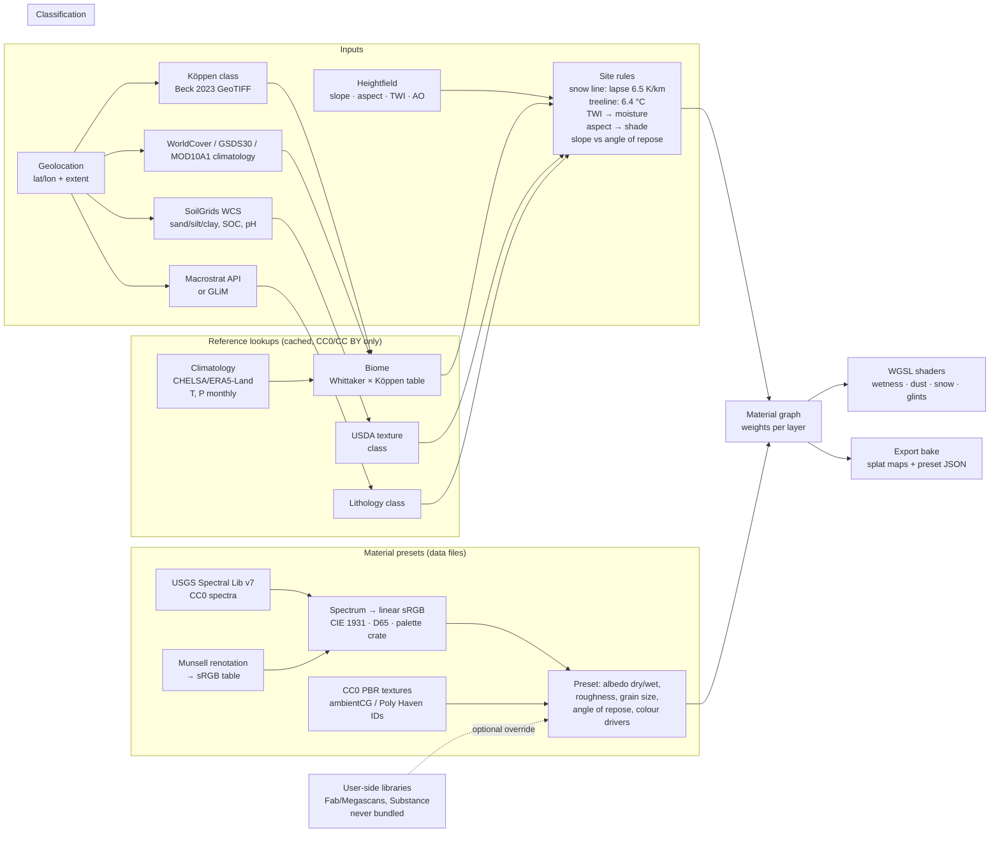

# Jenga Dunia — Material Science & Geomorphology Reference Research

Accessed: 2026-10-19. Target: MIT-licensed, commercially usable Rust/wgpu procedural terrain tool.

**Labels used throughout**

- **VERIFIED** — the primary page (licence page, repo, data record, crates.io API) was fetched in this session and the statement was read there.
- **REPORTED** — stated by a secondary source (search snippet, mirror, forum, third-party catalogue) or well-established bibliographic fact not re-fetched here.
- **UNVERIFIED** — could not be confirmed; treat as a gap.

**Core licence rule for this project.** "Redistribute in repo/installer" means: can we commit the files to an MIT repo or ship them in a binary without a separate agreement. Only CC0 / public-domain / permissive-attribution (CC BY, MIT, BSD) sources qualify. CC BY-SA, CC BY-NC, GPL and all proprietary EULAs do **not** qualify for bundling; they can still be used as *optional user-side downloads* fetched by the user into their own cache, or as *reference reading* whose results are re-derived.

---

## Part A — Reference data for ground materials

### A1. Measured PBR texture libraries

| Source | Licence (exact) | Licence URL | Commercial | Redistribute in repo/installer? | Attribution | What it provides | Label |
|---|---|---|---|---|---|---|---|
| **ambientCG** https://ambientcg.com | CC0 1.0 Universal | https://docs.ambientcg.com/license/ → https://creativecommons.org/publicdomain/zero/1.0/ | Yes | **Yes** — page says you may "copy, modify, distribute… including commercially" and "include the raw files in a project such as a video game" | Not required; suggested text: "Created using <asset name> from ambientCG.com, licensed under the Creative Commons CC0 1.0 Universal License." | ~2000+ PBR materials, 1K–8K (some 16K), maps: Color, Normal (GL/DX), Roughness, Displacement, AO, sometimes Metalness/Opacity. Ground/Rock/Gravel/Sand/Snow/Mud/Grass/Moss categories exist. | VERIFIED (licence page); category list REPORTED |
| **Poly Haven** https://polyhaven.com | CC0 1.0 | https://polyhaven.com/license | Yes | **Yes** — "You can redistribute them… include them in a product you sell" | Not required; "appreciated". ToS forbids scraping the *website* (3.2) — download via their public API or manually, not by crawling. | Textures (1K–8K, also 16K for some), HDRIs (critical for sky/lighting validation), models. Maps: Diffuse, Normal, Rough, Disp, AO, ARM. Rock, Gravel, Soil, Sand, Snow, Grass, Moss. | VERIFIED (licence); API scraping caveat VERIFIED |
| **cgbookcase** (Dorian Zgraggen) https://www.cgbookcase.com | Site says "PBR Textures, free for any purpose", "100% free, no restrictions". CC0 stated by author in 2018 BlenderNation post and CG Channel 2019. No licence page found on site today. | https://www.blendernation.com/2018/09/14/250-free-cc0-high-quality-pbr-textures-from-cgbookcase-com/ | Yes | **Probably yes** (CC0), but no current licence page → get written confirmation or snapshot the page before bundling | None required | ~700 tileable PBR textures, 2K–4K; ground, rock, grass, soil, bark. | REPORTED (CC0); site wording VERIFIED |
| **3DAssets.one / textures.one** https://3dassets.one | Aggregator only — hosts no files; each result carries the *source site's* licence | n/a | Depends on source | Not applicable (no files) | n/a | Search engine over ambientCG, Poly Haven, cgbookcase, ShareTextures and others. Useful as a discovery index; filter to CC0 sources. | REPORTED |
| **TextureCan** https://texturecan.com | CC0 1.0 Universal | https://texturecan.com/terms/ | Yes | **Yes** — "The textures are allowed to be redistributed together with your projects and 3D assets" | Not required | PBR textures (ground, rock, sand, soil), mostly 2K–4K; Color/Normal/Rough/Disp/AO. | VERIFIED |
| **ShareTextures** https://www.sharetextures.com | "Custom CC0" — CC0 **with restrictions**: no redistribution on other websites/plugins/collections without written permission; no automated downloads/hotlinking/embedding in third-party apps (Blender add-ons named) | https://www.sharetextures.com/p/license | Yes (use in projects) | **No** (collections/plugins prohibited) — user-side manual download only | Not required | ~1000+ PBR textures & models | VERIFIED |
| **texturelabs** https://texturelabs.org | Proprietary free licence: commercial use OK; **no** sublicensing/resale/sharing/redistribution "even for free"; no texture packs; no AI training | https://texturelabs.org/terms/ | Yes | **No** | Not required | Design-oriented grunge/surface photos, less PBR-complete (mostly albedo-only) | VERIFIED |
| **Quixel Megascans / Fab** https://www.fab.com | Fab Standard License (EULA at https://www.fab.com/eula — returned HTTP 403 to automated fetch). Epic FAQ: assets claimed on Fab usable "in any tool or engine"; legacy Quixel.com/Bridge library stays under Epic Content License (UE-only). Forum quoting EULA: may sell packaged products containing assets, **may not** resell/redistribute source assets in any form. From 2025 Megascans is paid on Fab except some free items. Personal vs Professional tier differ by revenue only. | https://support.fab.com/s/article/Fab-Transition-FAQs (fetch failed: TLS); https://www.licenseorg.com/guide/3d-assets/fab (secondary) | Yes, for the licensee | **No.** Cannot be bundled in an MIT repo; distributing in a form where textures are extractable is prohibited. **User-side only**: the user claims assets under their own Fab account and points Jenga Dunia at their local Bridge/Fab library. Do not ship an auto-downloader. | None required | Highest-quality scanned ground/rock/snow/sand materials, 1K–8K, full map sets, atlases, scatter assets | REPORTED (EULA text not read directly) |
| **Adobe Substance 3D Assets** | Adobe Substance 3D Assets Additional Terms (2022-03-22): perpetual licence to use/modify and distribute **only as part of a Modified Work or Larger Work**; no standalone sharing/sale; asset must not be the primary value of the distributed work | https://wwwimages2.adobe.com/content/dam/cc/en/legal/servicetou/Adobe-Substance-3D-Assets-Addl-Terms-en_US-20220322.pdf | Yes (subscribers) | **No** — user-side only | None | Procedural .sbsar materials; needs Substance engine (proprietary) to render — not usable in a wgpu pipeline without baking | REPORTED |
| **NASA imagery** | US Government work — "generally not subject to copyright in the United States"; NASA insignia/logos excluded; no implied endorsement; identifiable people need clearance for commercial use | https://www.nasa.gov/nasa-brand-center/images-and-media/ | Yes (with restrictions above) | **Yes** for imagery (not logos) — acknowledge "NASA" as source; check for third-party copyright marks | "Image: NASA" (recommended, not mandated) | Satellite imagery, Blue Marble, MODIS/Landsat composites usable as macro-colour references | VERIFIED |
| **USGS imagery / data** | US public domain (17 U.S.C. §105) unless marked; USGS Spectral Library data release carries explicit CC0 1.0 | https://www.usgs.gov/data/usgs-spectral-library-version-7-data | Yes | **Yes** | Cite dataset DOI | Landsat, NAIP, 3DEP, spectral library | VERIFIED for Spectral Library; general USGS PD REPORTED |

**Practical recommendation.** Bundle *nothing* in the repo except small CC0 reference swatches (ambientCG / Poly Haven / TextureCan, ≤1K, with a `SOURCES.md` listing asset IDs). Ship a "Material Library" downloader that fetches ambientCG/Poly Haven assets on demand through their public APIs (both permit this; Poly Haven asks not to crawl the website — use `api.polyhaven.com`). Treat Fab/Megascans and Substance as **user-managed external libraries**: a folder-import path, never an embedded fetch.

### A2. Spectral / measured reflectance of soils and rocks

| Source | What | Licence | Commercial / redistribute | Attribution | Label |
|---|---|---|---|---|---|
| **USGS Spectral Library Version 7** (Kokaly et al. 2017), Data Series 1035 + data release DOI 10.5066/F7RR1WDJ | Reflectance spectra 0.2–200 µm for minerals, rocks, soils, natural mixtures, vegetation, man-made materials; lab + field spectrometers. Convolved versions for ASD, AVIRIS, etc. | **CC0 1.0 Universal** ("This work is marked with CC0 1.0 Universal") | Yes / **Yes** | Kokaly, R.F., et al., 2017, USGS Spectral Library Version 7 Data: U.S. Geological Survey data release, https://doi.org/10.5066/F7RR1WDJ | VERIFIED (https://www.usgs.gov/data/usgs-spectral-library-version-7-data; report https://pubs.usgs.gov/publication/ds1035) |
| **ECOSTRESS Spectral Library v1.0** (JPL; supersedes ASTER Spectral Library 2.0) https://speclib.jpl.nasa.gov | >3400 spectra of natural and man-made materials (JHU, JPL, USGS sources); 0.4–15.4 µm; ~1100 vegetation/NPV spectra added | "Copyright © 2017, California Institute of Technology. ALL RIGHTS RESERVED." Reproduction notice: "Reproduced from the ECOSTRESS Spectral Library through the courtesy of the Jet Propulsion Laboratory, California Institute of Technology, Pasadena, California." No open licence stated; download via order form. | Use for research is customary; **do not redistribute raw spectra**. Deriving a handful of sRGB albedo numbers and citing is low-risk but not explicitly licensed → prefer USGS v7 for anything bundled. | Meerdink et al. 2019, *RSE* 230:111196; Baldridge et al. 2009, *RSE* 113:711–715 | VERIFIED (home page) |
| **ICRAF-ISRIC Soil VNIR/MIR Spectral Library** https://data.isric.org (records 1b65024a-…, 1081ac75-…) | 4,438 soils from ISRIC World Soil Reference archive, VNIR (0.35–2.5 µm) + MIR spectra, with soil property data | ISRIC record: licence not shown in snippet; mirror (data.moa.gov.et) lists **CC BY 4.0** for MIR record, none for VNIR | Likely yes / likely yes with attribution — confirm on ISRIC record | ICRAF & ISRIC (2010/2021). "ICRAF-ISRIC Soil VNIR Spectral Library", World Agroforestry Centre & ISRIC | REPORTED |
| **Open Soil Spectral Library (OSSL)** https://soilspectroscopy.github.io/ossl-manual/ | Harmonised global soil spectra (incl. ICRAF-ISRIC, KSSL, LUCAS where allowed) + calibration models | Woodwell announcement: data & software **MIT**, versioned data copy on Zenodo **CC BY**. Aggregator lists repo licence "other" → check the LICENSE file. | Yes / yes with attribution (CC BY) | Safanelli et al. 2025, *PLOS ONE* (OSSL paper) | REPORTED |
| **LUCAS Topsoil (2009/2015/2018)** ESDAC https://esdac.jrc.ec.europa.eu | ~20k EU topsoil samples with lab properties and VNIR spectra | **Per-request JRC licence**: free, but access limited to licensee and organisation staff "need-to-know", **confidentiality** clause; publications must acknowledge ESDAC | Research use / **No redistribution** | "…LUCAS topsoil data provided by the European Soil Data Centre (ESDAC)…" prescribed sentence | VERIFIED (licence PDFs) |
| **Munsell Soil Colour** — renotation data (Newhall, Nickerson & Judd 1943) via RIT Munsell Color Science Lab `all.dat` / `real.dat` https://www.rit.edu/science/munsell-color-science-lab-educational-resources | xyY (Illuminant C) for every Munsell hue/value/chroma; `real.dat` = inside MacAdam limits | No licence stated; "available for download… as is" | Historical OSA data widely redistributed (e.g. in `colour-science` Python, BSD-3) → low risk, but **UNVERIFIED** as a formal licence | Newhall, S.M., Nickerson, D., Judd, D.B. (1943). Final report of the O.S.A. subcommittee on the spacing of the Munsell colors. *JOSA* 33:385–418 | VERIFIED (files exist, no terms); legal status UNVERIFIED |
| **Munsell → sRGB open tables / code** | R `aqp::munsell2rgb()` (GPL-3, lookup table of common soil colours → sRGB/CIELAB D65); Centore (2013) "Conversions between the Munsell and sRGB colour systems" tables (PDF) | aqp: GPL-3 (study only); Centore tables: no licence stated | aqp code cannot be copied into MIT; **regenerate** the table yourself from renotation data + the CIE pipeline below | — | REPORTED |
| **Colour-space-for-soil reference** | Viscarra Rossel, Minasny, Roudier, McBratney (2006) "Colour space models for soil science", *Geoderma* 133:320–337 — shows Munsell vs CIELAB vs RGB for soil; recommends CIELAB; links vis-NIR spectra to colour. Torrent, Schwertmann et al. (1983) *Soil Science* "Quantitative relationships between soil colour and hematite content". | Papers (read, don't copy) | — | — | REPORTED |

**Spectrum → sRGB albedo in five steps (CIE 1931, D65).**
1. Resample the measured diffuse reflectance R(λ) (0–1) to 5 nm from 380–780 nm (USGS v7 soil/rock spectra cover this; pad or truncate outside).
2. Compute tristimulus X = k ∫ R(λ) S_D65(λ) x̄(λ) dλ, likewise Y, Z with the CIE 1931 2° colour-matching functions and the D65 relative SPD; k = 1 / ∫ S_D65(λ) ȳ(λ) dλ so a perfect white gives Y = 1. (CIE 015:2018 *Colorimetry*; Wyszecki & Stiles 1982.)
3. Convert XYZ (D65) → linear sRGB with the IEC 61966-2-1:1999 matrix: R = 3.2406X − 1.5372Y − 0.4986Z; G = −0.9689X + 1.8758Y + 0.0415Z; B = 0.0557X − 0.2040Y + 1.0570Z. (No chromatic adaptation needed because both are D65; if the data are Illuminant C — Munsell renotation — apply a Bradford C→D65 transform first.)
4. Clamp negatives to 0 (out-of-gamut), keep **linear** values as the PBR base colour / albedo; the Y you computed is the photopic-weighted "luminance albedo". Only apply the sRGB transfer function when writing an 8-bit texture.
5. Sanity check: broadband solar albedo ≠ Y (it includes NIR where soils/snow differ strongly). If you need energy-balance albedo (e.g. snowmelt), integrate R(λ) against the solar spectrum 0.3–3 µm separately.
Citations: CIE 015:2018; IEC 61966-2-1:1999 (sRGB); Wyszecki & Stiles, *Color Science* 2nd ed. (1982); Centore (2013). The `palette` crate (Part D) implements steps 3–4 (`Xyz` → `LinSrgb` → `Srgb`); steps 1–2 are ~30 lines with the CIE 1931 2° table (public data, e.g. from CIE or `colour-science`).

### A3. Global soil, geology, climate and cover datasets (for location → biome/material)

| Dataset | Provides | Licence | Commercial | Redistribute? | Attribution | Label |
|---|---|---|---|---|---|---|
| **SoilGrids 2.0** (ISRIC) https://soilgrids.org, docs https://docs.isric.org/globaldata/soilgrids/ | 250 m global rasters at 6 depths: sand/silt/clay %, bulk density, SOC, pH, CEC, coarse fragments, WRB class probabilities; WCS/WMS + COG download | **CC BY 4.0** ("SoilGrids products… provided under CC BY 4.0 since 2019") | Yes | Yes (attribution) — but tiles are huge; fetch on demand via WCS | Poggio, L. et al. (2021) SoilGrids 2.0: producing soil information for the globe with quantified spatial uncertainty. *SOIL* 7:217–240. https://doi.org/10.5194/soil-7-217-2021 ; "SoilGrids © ISRIC, CC BY 4.0" | VERIFIED (ISRIC FAQ/docs snippets; SOIL paper) |
| **HWSD v2.0** (FAO/IIASA 2023) https://www.fao.org/soils-portal/data-hub/soil-maps-and-databases/harmonized-world-soil-database-v20/en/ | 30 arc-sec soil mapping units with texture, OC, pH etc. | Publication: CC BY-NC-SA 3.0 IGO; dataset: FAO terms — "Requests for commercial use should be submitted via www.fao.org/contact-us/licence-request" | **Needs FAO permission** | No | FAO & IIASA (2023). Harmonized World Soil Database version 2.0. Rome and Laxenburg. https://doi.org/10.4060/cc3823en | REPORTED → prefer SoilGrids |
| **USDA soil texture triangle** (12 classes: sand, loamy sand, sandy loam, loam, silt loam, silt, sandy clay loam, clay loam, silty clay loam, sandy clay, silty clay, clay) | Classification rule from sand/silt/clay % | US Government work → public domain (NRCS) | Yes | Yes (re-implement the polygon boundaries; Soil Survey Manual, USDA Handbook 18) | USDA-NRCS Soil Survey Manual | REPORTED (class list verified; PD status standard for USDA works) |
| **GLiM – Global Lithological Map v1.0** (Hartmann & Moosdorf 2012) https://doi.pangaea.de/10.1594/PANGAEA.788537 | 1,235,400 polygons from 92 regional maps, avg scale 1:3.75 M; 16 first-level classes (REPORTED: su unconsolidated sediments, ss siliciclastic, sm mixed sedimentary, sc carbonate, py pyroclastic, ev evaporite, mt metamorphic, pa/pi/pb acid/intermediate/basic plutonic, va/vi/vb acid/intermediate/basic volcanic, ig ice, wb water, nd no data) + 12 and 14 sub-classes; 0.5° gridded version on PANGAEA, full GIS files via a Dropbox link | **CC BY 3.0 Unported** | Yes | Yes with attribution (full vector set ~ hundreds of MB → optional download) | Hartmann, J., Moosdorf, N. (2012). The new global lithological map database GLiM. *G³* 13, Q12004. https://doi.org/10.1029/2012GC004370 ; data https://doi.org/10.1594/PANGAEA.788537 | VERIFIED (licence + citation); class codes REPORTED |
| **Macrostrat** https://macrostrat.org (API https://macrostrat.org/api) | Geologic map units (lithology, age) worldwide at multiple scales via REST API; `/geologic_units/map?lat=&lng=` returns lithology for a point | **CC BY 4.0** ("All data are provided under CC-BY-4.0"); some services (paleogeography) ask for extra citation | Yes | API responses can be cached; cite Macrostrat + original map references returned by the API | "Data from Macrostrat (https://macrostrat.org), CC BY 4.0" + Peters, Husson & Czaplewski (2018) *GGG* | VERIFIED |
| **OneGeology** https://onegeology.org | Portal to national geological survey WMS layers at ~1:1 M | **Per-provider** — e.g. BGS layers under UK Open Government Licence ("Contains British Geological Survey materials © UKRI [year]"); other surveys vary | Varies | No (WMS imagery only) | Per layer | REPORTED |
| **USGS MRDS (Mineral Resources Data System)** https://mrdata.usgs.gov/mrds/ (shapefile mrds-trim.zip) | Point data for mineral occurrences/commodities | USGS public domain (REPORTED) | Yes | Yes | USGS MRDS | REPORTED |
| **GSDS30 – Global Sand Dune/Sheet 30 m map (2017)** https://zenodo.org/records/10441041 | 316 GeoTIFF tiles; classes 1 shifting dune/sheet, 2 semi-fixed/fixed, 3 other | **CC BY 4.0** | Yes | Yes with attribution (1.1 GB → optional) | Zheng, Z., Yu, J., Zhang, X., Du, S. (2023). GSDS30. Zenodo. https://doi.org/10.5281/zenodo.10441041 | VERIFIED |
| Gunn et al. (2026) global dune map, *Nature Communications* (Monash) 0.1° presence grid | Dune presence + types | Licence not found in snippets | UNVERIFIED | — | DOI 10.1038/s41467-026-75466-y | UNVERIFIED |
| **MODIS MOD10A1 v6.1 snow cover** (NSIDC) https://nsidc.org/data/mod10a1 | Daily 500 m NDSI snow cover, albedo | NASA Earth science data are free and open; NSIDC requires citation as condition of use | Yes | Yes (but 500 m daily global is huge → derive monthly climatology) | Hall, D.K., Riggs, G.A. (2021). MODIS/Terra Snow Cover Daily L3 Global 500m SIN Grid, Version 61. NSIDC. https://doi.org/10.5067/MODIS/MOD10A1.061 | REPORTED |
| **ESA WorldCover / Copernicus Global Land Cover** | 10 m / 100 m land cover | CC BY 4.0 (mention only, known) | Yes | Yes | ESA WorldCover 2021 © ESA WorldCover project / Contains modified Copernicus Sentinel data | (known) |
| **Köppen–Geiger 1 km, Beck et al. 2018 (V1) and 2023 (V3)** https://www.gloh2o.org/koppen/ ; figshare https://doi.org/10.6084/m9.figshare.6396959 | 30 climate classes GeoTIFF (uint8), present + future periods, confidence maps | Page: "Freely use, adapt, and share these maps under **CC BY 4.0**… for both commercial and non-commercial purposes" — **but** the licence hyperlink on the page points to CC BY-**NC** 4.0 (inconsistency). Figshare V1 record shows no licence in snippets (figshare default is CC BY 4.0). | Yes per page text; confirm | Yes with attribution (≈70 MB zip) — **recommend emailing authors for clarification before bundling** | Beck, H.E. et al. (2018). *Sci. Data* 5:180214; Beck, H.E. et al. (2023). *Sci. Data* 10:724. https://doi.org/10.1038/s41597-023-02549-6 | VERIFIED (page text, with flagged inconsistency) |
| **WorldClim 2.1** https://www.worldclim.org | 30 s–10 min monthly tmin/tmax/prec, 19 bioclim vars | "freely available for academic use and other non-commercial use. **Redistribution or commercial use is not allowed without prior permission.**" | **No** | **No** | Fick & Hijmans 2017, *Int. J. Climatol.* 37:4302–4315 | VERIFIED (about page) — third-party catalogues say CC BY-SA 4.0; the authoritative page says non-commercial |
| Alternatives to WorldClim for a commercial tool | **CHELSA v2.1** (CC0 per its site — REPORTED, verify at https://chelsa-climate.org), **ERA5-Land** monthly (Copernicus licence: free, commercial OK, attribution — REPORTED), **TerraClimate** (CC0 — REPORTED). | — | — | — | REPORTED |

### A4. Rock-type appearance references

Primary textbook anchors (REPORTED bibliographic facts): Huggett, R.J. (2017) *Fundamentals of Geomorphology*, 4th ed., Routledge, ISBN 9781138940659 (5th ed. 2023 with E. Shuttleworth, ISBN 9781032169637); Bierman, P.R. & Montgomery, D.R. (2020) *Key Concepts in Geomorphology*, 2nd ed., W.H. Freeman/Macmillan (edition details UNVERIFIED in this session). Public photo/descriptive references: USGS "Geology and Ecology of National Parks" pages, BGS "Discovering Geology" (both open text; BGS imagery under OGL), Wikimedia Commons (per-file licence).

| Lithology (GLiM code) | Typical fresh colour → weathered colour; drivers | Structure that drives mesostructure | Notes for shading |
|---|---|---|---|
| Granite (pa) | Light grey/pink/white speckled (quartz, feldspar, biotite) → tan/brown rind from biotite/feldspar oxidation; grus (sandy) weathering | Widely spaced orthogonal joints; sheeting (exfoliation) joints parallel to surface → domes, tors, corestones | High-frequency speckle albedo; roughness moderate; spheroidal weathering rounds block edges |
| Basalt (vb) | Dark grey/black → brown/red-brown (olivine/pyroxene → iron oxides); vesicular surfaces | Columnar jointing (polygonal, ~0.3–2 m columns), flow-top rubble (aa) vs ropy (pahoehoe) | Low albedo (~0.05–0.1 dry); roughness high; strongly darkens when wet |
| Sandstone (ss) | Yellow/buff/red/white depending on cement (hematite = red, goethite = yellow-brown, silica = white) → case-hardening, desert varnish (Mn/Fe) dark patina on exposed faces | Bedding (horizontal to cross-bedded), vertical joints → cliffs, slot canyons, arches; honeycomb/tafoni weathering | Strong banded stratification in displacement; aeolian cross-bed sets at 20–30° |
| Limestone (sc) | Light grey/cream/white → grey-black (lichen, soot, biological pitting), karren grooves | Bedding + 2 joint sets → clints and grikes, pavements; dissolution forms | High albedo dry, pits and solution runnels; chemical weathering dominant (karst, Part C) |
| Shale / mudstone (ss/sm) | Grey/black (organic) or red/green (Fe oxidation state) → flaky, crumbly | Fissile laminae; weathers to badlands, slopes at low angle | Low cohesion, low angle of repose; smooth albedo with fine lamination |
| Slate (mt) | Grey/blue-grey/green/purple | Slaty cleavage → platy scree | Low roughness per plate, high anisotropy |
| Gneiss (mt) | Banded light/dark (felsic/mafic layers) | Foliation, folded bands; blocky joints | Banded albedo following folded foliation |
| Schist (mt) | Silvery/greenish (mica, chlorite) → rusty | Foliation, glittering mica | Candidate for glint/sparkle shading (micro-facets, Part B8) |

Colour drivers (REPORTED, consistent across sources): **hematite** → red hue (+a*), **goethite** → yellow-brown (+b*); hematite converts to goethite in cooler, wetter climates (Schwertmann 1971, *Nature* 232:624); **organic matter** darkens (lower L*) and desaturates topsoil (Viscarra Rossel et al. 2006); **moisture** darkens all porous materials (see B9 — Ångström 1925; Twomey, Bohren & Mergenthaler 1986 *Appl. Opt.* 25:431; Lekner & Dorf 1988 *Appl. Opt.* 27:1278; Zhang & Voss 2006 *Appl. Opt.* 45:7924 showing neither theory alone fits all measurements). **Desert varnish** (Mn-Fe oxide + clay coating) blackens exposed rock faces in arid regions — orient by exposure, not by lithology.

---

## Part B — Environmental shader techniques (survey with citations)

### B5. Water

| Technique | Reference | Open implementation (licence) | Jenga Dunia use |
|---|---|---|---|
| FFT ocean spectrum (Phillips/JONSWAP, choppy displacement) | Tessendorf, J. (2001) "Simulating Ocean Water", SIGGRAPH course notes (revisions 2002/2004: https://jtessen.people.clemson.edu/reports/papers_files/coursenotes2004.pdf) | GodotOceanWaves (2Retr0, MIT — REPORTED); jb361/ocean-waves (REPORTED); Crest (wave-harmonic/crest, **MIT**, built-in RP only — VERIFIED) | Ocean/large lakes; bake to displacement + normal + foam mask for export |
| Gerstner (trochoidal) waves | Finch, M. (2004) "Effective Water Simulation from Physical Models", *GPU Gems* ch. 1 (NVIDIA, free online) | three.js `Ocean`/`Water` examples (MIT — REPORTED) | Cheap viewport preview; rivers/lakes with few waves |
| Flow maps | Vlachos, A. (2010) "Water Flow in Portal 2", SIGGRAPH Advances in Real-Time Rendering course | — | Rivers: flow direction from D8/D∞ (Part C) → UV advection; combine with Jenga Dunia flow-accumulation output |
| Shallow water foam / shoreline | Crest "foam from Jacobian" (MIT); Unreal Water system docs (https://dev.epicgames.com/documentation/en-us/unreal-engine/water-system-in-unreal-engine, docs only) | Crest | Foam ∝ negative Jacobian of displacement + depth < threshold + flow speed |
| Fresnel | Schlick, C. (1994) "An Inexpensive BRDF Model for Physically-based Rendering", *CGF* 13(3): F = F0 + (1−F0)(1−cosθ)^5, F0(water, n=1.333) ≈ 0.02 | — | WGSL one-liner |
| Refraction | Snell's law with n = 1.333; screen-space refraction offset by normal × depth | — | Viewport only |
| Absorption (Beer–Lambert) | Pope, R.M. & Fry, E.S. (1997) "Absorption spectrum (380–700 nm) of pure water. II. Integrating cavity measurements", *Appl. Opt.* 36:8710–8723. Minimum 0.0044 ± 0.0006 m⁻¹ at 418 nm; coefficients rise to ~0.4–0.6 m⁻¹ by 700 nm (REPORTED magnitude; full table at https://omlc.org/spectra/water/abs/pope97.html) | OMLC data page (data tabulated, no licence stated) | Transmittance T = exp(−a(λ)·d); use per-channel a ≈ (R 0.4, G 0.07, B 0.005) m⁻¹ pure water, scale up for turbidity/CDOM. Deep lakes read blue, shallow sediment-laden rivers brown/green. |
| Caustics | Cheap: animated Voronoi/normal-projected texture; physically: Shadertoy-style projected refracted grid | — | Viewport nice-to-have |
| River vs lake vs ocean | River: flow-map + slope-driven turbulence + foam at rapids (Froude > 1); lake: wind-fetch Gerstner, low amplitude, strong reflection; ocean: FFT spectrum + swell + shore foam | — | Decide by Jenga Dunia water-body classification (closed basin vs channel vs sea-level sink) |

### B6. Sky / atmosphere

| Model | Reference | Code / licence | Notes |
|---|---|---|---|
| Hillaire 2020 | Hillaire, S. (2020) "A Scalable and Production Ready Sky and Atmosphere Rendering Technique", *CGF* 39(4):13–22, EGSR 2020. https://doi.org/10.1111/cgf.14050 | Reference GLSL in UE; many permissive re-implementations (e.g. Bevy's `bevy_pbr` atmosphere, MIT/Apache — REPORTED) | Best fit for wgpu: small LUTs (transmittance, multi-scattering, sky-view), dynamic composition, runs on mobile. **Recommended default.** |
| Bruneton 2008 / 2017 | Bruneton, E. & Neyret, F. (2008) "Precomputed Atmospheric Scattering", *CGF* 27(4), EGSR 2008; Bruneton (2017) "A Qualitative and Quantitative Evaluation of 8 Clear Sky Models", *IEEE TVCG* 23(12) | https://github.com/ebruneton/precomputed_atmospheric_scattering — **BSD** (VERIFIED) | Ground truth / baking reference; 4-D LUTs heavier than Hillaire |
| Hošek–Wilkie | Hošek, L. & Wilkie, A. (2012) "An Analytic Model for Full Spectral Sky-Dome Radiance", *ACM TOG* 31(4); (2013) "Adding a Solar Radiance Function to the Hošek Skylight Model", *IEEE CG&A* | Sample C code v1.4a from https://cgg.mff.cuni.cz/projects/SkylightModelling/ — page states no licence, but the source headers (as carried in Blender's `sky_model.cpp`) say **BSD-3-Clause** (VERIFIED via Blender tree) | Analytic, ground-only, clear sky; cheap for export-time HDRI baking |
| Preetham | Preetham, A.J., Shirley, P., Smits, B. (1999) "A Practical Analytic Model for Daylight", SIGGRAPH 99 | Public formulae | Legacy; inaccurate near horizon/low turbidity |
| Night sky / moon | Jensen et al. (2001) "A Physically-Based Night Sky Model", SIGGRAPH 2001 (REPORTED); moon as sun-lit sphere with Hapke-like phase; star catalogue: Yale Bright Star Catalog (public domain — REPORTED) | — | Use same Hillaire LUTs with moon as second light |
| Clouds | Schneider, A. & Vos, N. (2017) "Nubis: Authoring Real-Time Volumetric Cloudscapes with the Decima Engine", SIGGRAPH Advances course (slides https://advances.realtimerendering.com/s2017/); Schneider (2023) "Nubis Cubed"; Perlin–Worley noise | Slides only (no code licence) | Raymarch 3-D noise, weather map (coverage/type/precip) texture — the weather map is a natural output of the climate layer |
| Weather-driven sky | Combine Köppen/climate lookup → turbidity, cloud coverage, aerosol (dust storms = high Mie, desert ochre) | — | Parameterise Hillaire's Mie/Rayleigh/ozone densities |

### B7. Wind

- **Vegetation animation:** Sousa, T. (2008) "Vegetation Procedural Animation and Shading in Crysis", *GPU Gems 3* ch. 16 (https://developer.nvidia.com/gpugems/GPUGems3/gpugems3_ch16.html, free online) — main bend + detail bend per vertex, wind summed per instance in world space. Also Habel et al., *GPU Gems 3* ch. 6 "GPU-Generated Procedural Wind Animations for Trees". VERIFIED (chapter exists online).
- **Grass bending:** same vertex-bend with per-blade phase offset; Ghost of Tsushima "Procedural Grass" (GDC 2021, slides) — REPORTED.
- **Divergence-free wind fields:** Bridson, R., Hourihan, J., Nordenstam, M. (2007) "Curl-Noise for Procedural Fluid Flow", *ACM TOG* 26(3), Art. 46 — velocity = curl of a noise potential; respects obstacles via modulated potential. VERIFIED. Terrain coupling: ramp potential by elevation to accelerate over ridges (simple orographic lift), damp in lee.
- **Dust / sand storms:** GPU particles advected by the curl field + height fog with increased Mie scattering and ochre albedo; Wentworth grain size (B9) decides what gets lofted: silt/clay (< 62.5 µm) → suspension, fine sand → saltation ≤ ~1 m height (Bagnold 1941 *The Physics of Blown Sand and Desert Dunes* — REPORTED).
- **Wind–erosion coupling:** aeolian transport direction from the same wind field drives dune orientation (Part C).

### B8. Snow & ice

- **Accumulation geometry:** v. Festenberg, N. & Gumhold, S. (2009) "A Geometric Algorithm for Snow Distribution in Virtual Scenes", Eurographics Workshop on Natural Phenomena; follow-up (2011) "Diffusion-Based Snow Cover Generation", *CGF* 30(6):1837–1849. VERIFIED. Heightfield form: snow depth ∝ clamp(dot(N, up)) × sky-visibility (AO) × wind-shelter.
- **Snow optics:** Wiscombe, W.J. & Warren, S.G. (1980) "A Model for the Spectral Albedo of Snow. I: Pure Snow", *J. Atmos. Sci.* 37:2712–2733; Warren (1982) "Optical properties of snow", *Rev. Geophys.* 20:67–89. Visible albedo of pure snow 0.97–0.99 nearly independent of grain size; NIR albedo strongly grain-size dependent; departs from Lambertian at high solar zenith (forward peak). VERIFIED (via abstracts/snippets).
- **Subsurface:** Jensen, H.W., Marschner, S.R., Levoy, M., Hanrahan, P. (2001) "A Practical Model for Subsurface Light Transport", SIGGRAPH 2001 (dipole BSSRDF) — note the dipole paper is 2001, not 1999; for real time use screen-space SSS or wrap lighting. REPORTED.
- **Sparkle / glints:** Zirr, T. & Kaplanyan, A. (2016) "Real-time Rendering of Procedural Multiscale Materials", I3D 2016 — bi-scale NDF, includes a grainy-snow terrain demo at 7.8 ms on GTX 980; code + Shadertoy linked from NVIDIA page. VERIFIED. Physically-based alternative: Chermain et al. (2020) "Procedural Physically based BRDF for Real-Time Rendering of Glints", *CGF* 39(7).
- **Ice:** refraction n ≈ 1.31; absorption coefficient of ice is like water with minimum in blue (Warren & Brandt 2008 *JGR* 113:D14220 — REPORTED) → thick clear ice reads blue; bubbly glacier ice white.
- **Melt / wetness:** blend snow albedo 0.8–0.9 (fresh) → 0.4–0.6 (old/wet) (Wikipedia albedo table + Warren 1982; REPORTED values), roughness up, add specular water layer.
- **Snow line rule-of-thumb:** ISA lapse rate 6.5 K/km (ICAO 1993 *Manual of the ICAO Standard Atmosphere*; environmental lapse rate varies 4–9 K/km). Snow probability = f(T_mean_month − 6.5·Δz/1000, aspect, slope). Treeline isotherm (also a proxy for permanent snow upper bound ≈ +500–1000 m): Körner & Paulsen (2004) *J. Biogeogr.* 31:713–732 — growing-season **soil** temp 6.7 ± 0.8 °C; Paulsen & Körner (2014) *Alp. Bot.* — **air** temp 6.4 °C over a ≥94-day season. VERIFIED.

### B9. Wet/dry & dust

- **Wetness darkening:** Ångström (1925) first explanation; Twomey, Bohren & Mergenthaler (1986) *Appl. Opt.* 25:431–437 (multiple-scattering: lower index contrast → more forward scattering); Lekner & Dorf (1988) *Appl. Opt.* 27:1278–1280 (total internal reflection in water film; effect strongest for weakly absorbing materials); Zhang & Voss (2006) *Appl. Opt.* 45:7924 (measurements; neither theory alone fits). Shader form (Lekner–Dorf closed form): ρ_wet ≈ ρ_dry·(1−F_w) / (1 − ρ_dry·R_i) adjusted by water/material index ratio; practical: albedo × (1 − 0.5·wetness), roughness × (1 − 0.8·wetness), add F0 = 0.02 water layer. Recent: "A Micro-Ellipsoid Model for Wet Porous Materials Rendering" (arXiv 2401.15628). VERIFIED (bibliography).
- **Puddles:** mask = wetness × (1 − slope) × curvature-concave; flatten normals inside mask.
- **Dust accumulation:** mask = clamp(dot(N, up)) × sky visibility (AO) × (1 − wind exposure); dust albedo from local soil colour (A2).
- **Grain sizes (Udden–Wentworth):** Wentworth, C.K. (1922) "A Scale of Grade and Class Terms for Clastic Sediments", *J. Geol.* 30:377–392. Clay < 3.9 µm; silt 3.9–62.5 µm; very fine sand 62.5–125 µm; sand 62.5 µm–2 mm; granule 2–4 mm; pebble 4–64 mm; cobble 64–256 mm; boulder > 256 mm. VERIFIED (via Wikipedia "Grain size" and Blair & McPherson 1999 *J. Sediment. Res.* 69:6–19, who note the scale under-resolves gravel).
- **Angle of repose (defaults for thermal erosion):** Wikipedia "Angle of repose" table (REPORTED; compiled from engineering handbooks): dry sand ~34°; wet sand 45°; crushed gravel 45°; natural gravel with sand 25–30°; snow 38°; earth/soil 30–45°; clay 25–40°. Carrigy, M.A. (1970) "Experiments on the angles of repose of granular materials", *Sedimentology* 14:147–158: dry sand 30–35°, dependent on grain angularity (REPORTED). Static vs dynamic angle differs by ~5–10° (REPORTED). Talus/scree slopes typically 30–38° (Huggett 2017 — REPORTED; "needs measurement" for a definitive value).

### B10. Vegetation ground cover

- **Moisture/aspect/altitude:** Topographic Wetness Index TWI = ln(a / tan β) (Beven & Kirkby 1979 *Hydrol. Sci. Bull.* 24:43–69 — REPORTED) → grass/moss probability; aspect: pole-facing slopes cooler/wetter (moss, lichen on shaded rock), equator-facing drier (grass, xerophytes).
- **Treeline / vegetation ceilings:** Körner & Paulsen 2004 / Paulsen & Körner 2014 (B8). Lichen persists above snowline on rock; moss needs persistent moisture and shade.
- **Biomes:** Whittaker, R.H. (1975) *Communities and Ecosystems*, 2nd ed. — biome diagram on mean annual temperature × mean annual precipitation (tundra, taiga, temperate forest, temperate grassland, desert, tropical rainforest, tropical seasonal forest/savanna, woodland/shrubland, temperate rainforest). VERIFIED (concept); Ricklefs' textbook redraws it (UNVERIFIED edition). Köppen classes (A3) map onto Whittaker biomes with a lookup table.
- **Palette source:** derive ground-cover base colours from USGS v7 vegetation spectra (CC0) via the A2 pipeline; cross-check against Poly Haven/ambientCG grass/moss albedo.

---

## Part C — Geographical processes reference (brief, for node-fidelity docs)

Erosion literature (Mei, Šťava, Cordonnier) intentionally omitted. Textbook anchors: Huggett (2017) *Fundamentals of Geomorphology* 4th ed. (REPORTED chapter mapping); Bierman & Montgomery *Key Concepts in Geomorphology*; USGS and BGS "Discovering Geology" web pages (open text).

| Process family | Landforms / sub-types | Formation conditions (one line) | Citation anchor |
|---|---|---|---|
| **Weathering** | Physical (frost wedging, thermal expansion, salt crystallisation, unloading/exfoliation), chemical (dissolution, hydrolysis, oxidation, hydration), biological (root wedging, lichen acids) | Frost: freeze–thaw cycles crossing 0 °C with available water; chemical: warm + wet; salt: arid coasts/deserts | Huggett ch. "Weathering and related landforms"; USGS |
| **Mass wasting** | Rockfall, topple, slide (rotational/translational), flow (debris, earth, mud), creep, avalanche | Slope > friction angle, pore-pressure rise (rain), undercutting; creep from freeze–thaw/wet–dry heave | Varnes (1978) classification; Hungr, Leroueil & Picarelli (2014) *Landslides* 11:167–194 (REPORTED) |
| **Fluvial** | Meanders (sinuosity > 1.5), braided rivers (high bedload, variable discharge, weak banks), deltas (Gilbert-type, bird's-foot, arcuate), alluvial fans (mountain-front, sudden gradient loss), terraces (incision after aggradation), knickpoints | Meander wavelength ≈ 11 × channel width (Leopold & Wolman 1960 *GSA Bull.* 71:769 — REPORTED) | Huggett ch. "Fluvial landscapes"; Bierman & Montgomery ch. 6 |
| **Glacial** | Cirques, arêtes, horns, U-shaped troughs, hanging valleys, roches moutonnées, moraines (lateral/medial/terminal), drumlins (streamlined, long axis ∥ flow), eskers, kettles, outwash plains | Ice persists where accumulation > ablation (ELA); valley cross-section tends to parabolic | Huggett ch. "Glacial and glaciofluvial landscapes" |
| **Aeolian** | Barchan (uni-directional wind, limited sand, horns downwind), transverse (abundant sand, uni-directional), linear/seif (bimodal winds), star (multi-directional), parabolic (vegetated, arms upwind); loess | Slip face at angle of repose ~32–34°; dune height ∝ sand supply | Bagnold (1941); McKee (1979) *A Study of Global Sand Seas*, USGS PP 1052 (public domain — REPORTED); Huggett ch. "Aeolian landscapes" |
| **Coastal** | Cliffs + wave-cut platforms + notch, caves/arches/stacks, beaches (reflective vs dissipative), spits/bars/tombolos (longshore drift), barrier islands, deltas, estuaries | Erosion dominant on exposed rocky coasts; deposition where longshore drift slows | Huggett ch. "Coastal landscapes"; BGS |
| **Karst** | Sinkholes (dolines: solution, collapse, suffosion), caves, karren, poljes, tower karst, cockpit karst | Soluble rock (limestone/dolomite/gypsum), moderate-high precipitation, jointing | Ford & Williams (2007) *Karst Hydrogeology and Geomorphology* (REPORTED); USGS karst pages |
| **Volcanic** | Shield (low slopes 2–10°, basaltic), stratovolcano (steep 30°+, andesitic, layered), cinder cones (~30–33°, angle of repose of scoria), calderas (collapse after evacuation), lava fields (aa/pahoehoe), lava domes, maars | Slope controlled by lava viscosity (SiO₂ content) | USGS Volcano Hazards Program; Huggett ch. "Volcanoes and volcanic landforms" |
| **Periglacial** | Patterned ground (sorted circles/polygons/stripes, ice-wedge polygons), pingos, solifluction lobes, thermokarst, blockfields | Permafrost or deep seasonal frost; polygon size 10–30 m for ice wedges (REPORTED) | French (2017) *The Periglacial Environment* 4th ed. (REPORTED); Huggett |

### Open geomorphology / GIS software — licences and algorithms

| Software | Licence | Can we depend on it? | Algorithms worth studying / porting | Label |
|---|---|---|---|---|
| **WhiteboxTools** (Rust) https://github.com/jblindsay/whitebox-tools | **MIT** | Yes — Rust, MIT; can vendor code or link | D8/D∞/FD8 flow routing (REPORTED names), flow accumulation, breach/fill depressions, wetness index, multi-scale topographic position, geomorphons (REPORTED tool), hillshade, curvatures, stream extraction | VERIFIED licence; tool names partly REPORTED |
| **Landlab** (Python) https://github.com/landlab/landlab | **MIT** | Yes (study/port; Python) | Component library: FlowAccumulator, StreamPowerEroder, LinearDiffuser, DepressionFinder, SoilInfiltration, etc. (component names REPORTED) | VERIFIED licence |
| **RichDEM** (C++/Python) https://github.com/r-barnes/richdem | **GPL-3.0** | Study only; do not copy code | Priority-Flood depression filling (Barnes, Lehman & Mulla 2014 *Comput. Geosci.* 62:117–127 — algorithm paper is citable and re-implementable), D8/D∞ (Tarboton 1997), Zevenbergen & Thorne (1987) curvature, Horn (1981) slope | VERIFIED |
| **Fastscapelib** (C++/Python) https://github.com/fastscape-lem/fastscapelib | **GPL-3.0** (as fetched 2026-10-19) | Study only | Implicit stream-power solver (Braun & Willett 2013 *Geomorphology* 180–181:170–179 — re-implementable from paper), flow routing on grids/meshes | VERIFIED |
| **TopoToolbox** (MATLAB) https://github.com/TopoToolbox/topotoolbox; **pytopotoolbox** | `gpl.txt` in repo → GPL (version UNVERIFIED); pytopotoolbox GPL-3.0 (REPORTED) | Study only | FLOWobj (MFD, D∞), STREAMobj, chi transform, ksn, knickpoint finder | VERIFIED (file presence) |
| **pysheds** (Python) https://github.com/mdbartos/pysheds | **GPL-3.0** | Study only | D8/D∞/MFD flow direction, accumulation, catchment, HAND | VERIFIED |
| **TauDEM** (C++ MPI) https://hydrology.usu.edu/taudem/ | **GPL-3** (official licence page; multi-licensing available) | Study only (or ask for alt licence) | D∞ (Tarboton 1997 *WRR* 33:309–319), pit removal, stream definition by drop analysis | VERIFIED via official page snippet |
| **SAGA GIS** | Modules + GUI **GPL-2**; API **LGPL-2.1** | Study only (LGPL API could be dynamically linked, but modules are GPL) | Terrain analysis: TWI, LS factor, channel network, Geomorphons (`ta_morphometry`), fill sinks (Wang & Liu), hydrology | VERIFIED (Debian copyright, OSGeo4W) |
| **GRASS GIS** | **GPL-2+** (REPORTED, standard) | Study only | r.geomorphon (Jasiewicz & Stepinski 2013 *Geomorphology* 182:147–156: 498 ternary patterns → 10 landforms: flat, peak, ridge, shoulder, spur, slope, hollow, footslope, valley, pit — class names REPORTED), r.terraflow, r.watershed, r.sim.water | REPORTED |

**Key take-away:** WhiteboxTools and Landlab are the only MIT options; everything else must be re-implemented from the *papers* (which are freely citable) rather than from the GPL code. Priority-Flood (Barnes 2014), D∞ (Tarboton 1997), geomorphons (Jasiewicz & Stepinski 2013) and implicit stream power (Braun & Willett 2013) are all short enough to port from the paper text.

---

## Part D — Rust crates for colour & material science

| Crate | Version (crates.io, 2026-10-19) | Licence | Use | Label |
|---|---|---|---|---|
| **palette** | 0.7.7 | **MIT OR Apache-2.0** | XYZ/Lab/LCh/sRGB/linear sRGB/Oklab; `Xyz<D65>` → `LinSrgb` for the spectrum pipeline; `no_std` capable | VERIFIED |
| **colorgrad** | 0.9.0 | **MIT OR Apache-2.0** | Colour scales/gradients (biome palettes, elevation ramps) | VERIFIED |
| **ocio** (doubleailes/ocio-rs) | 0.2.2 (released 2026-10-18 — very new) | **MIT AND BSD-3-Clause** | "Pure Rust port of OpenColorIO" — can load OCIO configs (incl. AgX/ACES configs) without C++; maturity UNVERIFIED | VERIFIED metadata |
| **ocio-rs** / **ocio-sys** (shaloong) | 0.2.1 | **BSD-3-Clause** | FFI bindings to OpenColorIO 2.5.2 (C++ build dependency — heavy for an MIT tool but licence-compatible) | VERIFIED metadata |
| **opencolorio** / **opencolorio-sys** | 0.1.0 / 0.0.0 (2020) | not stated | Placeholder crates — ignore | VERIFIED |
| OpenColorIO itself | 2.5.x | BSD-3-Clause (ASWF) | Reference colour management; ACES configs (aces-dev, ASWF licence — REPORTED) | REPORTED |

**Tonemapping references.**
- **AgX** — Troy Sobotka, https://github.com/sobotka/AgX (OCIO config + LUTs). **No licence file or README licence statement** (VERIFIED) → treat as *all rights reserved* for the LUTs; the maths (log2 encoding over ~−12.47…+4.03 stops, sigmoid "inset" matrix, outset) is public and has permissive re-implementations: Blender 4.0+ AgX (Blender tree is GPL-2+/3 — study only; the Blender OCIO config files are part of the GPL tree — UNVERIFIED whether configs carry a separate licence), Godot 4.3+ `AGX` tonemapper (Godot is **MIT** — REPORTED; port from there), EaryChow/AgX-Blender (licence UNVERIFIED). Recommendation: implement AgX from the Godot MIT shader (~40 lines WGSL) and cite Sobotka.
- **ACES** — Academy Color Encoding System, aces-dev (https://github.com/ampas/aces-dev, Academy licence, permissive — REPORTED); real-time fit: Stephen Hill's ACES fitted curve (public, used in UE/Unity, MIT-equivalent — REPORTED); Narkowicz 2015 curve (blog, public).
- **Khronos PBR Neutral** (2023) — Khronos, Apache-2.0 (REPORTED); good for "true colour" material preview where hue preservation matters for soil-colour fidelity.

---

## (a) Data / licence table

| Source | Type | Licence | Commercial OK | Redistribute in repo/installer? | Attribution | Label |
|---|---|---|---|---|---|---|
| ambientCG | PBR textures | CC0 1.0 | Yes | Yes | optional ("…from ambientCG.com, CC0") | VERIFIED |
| Poly Haven | PBR textures, HDRIs | CC0 1.0 | Yes | Yes | optional | VERIFIED |
| TextureCan | PBR textures | CC0 1.0 | Yes | Yes | optional | VERIFIED |
| cgbookcase | PBR textures | CC0 (author statement); site: "free for any purpose" | Yes | Probably (confirm) | optional | REPORTED |
| ShareTextures | PBR textures | "Custom CC0" with no-redistribution clause | Yes | **No** | optional | VERIFIED |
| texturelabs | surface photos | Proprietary free | Yes | **No** | none | VERIFIED |
| Quixel Megascans / Fab | scanned PBR | Fab Standard License | Yes (licensee) | **No** — user-side | none | REPORTED |
| Adobe Substance 3D Assets | procedural materials | Adobe Addl Terms | Yes (subscriber) | **No** | none | REPORTED |
| NASA imagery | imagery | US PD (no logos) | Yes | Yes | "NASA" | VERIFIED |
| USGS Spectral Library v7 | spectra | CC0 1.0 | Yes | Yes | Kokaly et al. 2017 DOI 10.5066/F7RR1WDJ | VERIFIED |
| ECOSTRESS Spectral Library | spectra | © Caltech, all rights reserved; courtesy notice | Grey | **No** | Meerdink et al. 2019; Baldridge et al. 2009 | VERIFIED |
| ICRAF-ISRIC spectral library | soil spectra | CC BY 4.0 (mirror) | Likely | Likely (attribution) | ICRAF/ISRIC | REPORTED |
| OSSL | soil spectra + models | MIT (code/data), CC BY (Zenodo) | Yes | Yes | Safanelli et al. 2025 | REPORTED |
| LUCAS topsoil | soil data/spectra | JRC per-request, confidential | No | **No** | ESDAC sentence | VERIFIED |
| Munsell renotation (RIT) | colour table | none stated, "as is" | Likely (1943 OSA data) | Likely (regenerate) | Newhall et al. 1943 | UNVERIFIED |
| SoilGrids 2.0 | soil rasters | CC BY 4.0 | Yes | Yes (on-demand) | Poggio et al. 2021 | VERIFIED |
| HWSD v2 | soil map | FAO; commercial by request | No (without permission) | No | FAO & IIASA 2023 | REPORTED |
| USDA texture triangle | classification | US PD | Yes | Yes | USDA-NRCS | REPORTED |
| GLiM | lithology | CC BY 3.0 | Yes | Yes | Hartmann & Moosdorf 2012 | VERIFIED |
| Macrostrat API | geology | CC BY 4.0 | Yes | Cache OK | Macrostrat + source refs | VERIFIED |
| OneGeology | WMS | per provider (BGS: OGL) | Varies | No | per layer | REPORTED |
| USGS MRDS | mineral points | US PD | Yes | Yes | USGS | REPORTED |
| GSDS30 | dune map | CC BY 4.0 | Yes | Yes | Zheng et al. 2023 | VERIFIED |
| MODIS MOD10A1 | snow cover | NASA open; cite | Yes | Yes (derived) | Hall & Riggs 2021 | REPORTED |
| ESA WorldCover | land cover | CC BY 4.0 | Yes | Yes | ESA | known |
| Köppen–Geiger (Beck 2018/2023) | climate classes | CC BY 4.0 (page text; link says NC) | Yes (confirm) | Yes (confirm) | Beck et al. 2018/2023 | VERIFIED w/ flag |
| WorldClim 2.1 | climate | non-commercial, no redistribution | **No** | **No** | Fick & Hijmans 2017 | VERIFIED |
| CHELSA / ERA5-Land / TerraClimate | climate | CC0 / Copernicus / CC0 | Yes | Yes | per dataset | REPORTED |
| Bruneton atmosphere | code | BSD | Yes | Yes | Bruneton 2008/2017 | VERIFIED |
| Hošek–Wilkie code | code | BSD-3-Clause | Yes | Yes | Hošek & Wilkie 2012 | VERIFIED (via Blender headers) |
| Crest (built-in RP) | code | MIT | Yes | Yes | wave-harmonic | VERIFIED |
| WhiteboxTools, Landlab | code | MIT | Yes | Yes | authors | VERIFIED |
| RichDEM, Fastscapelib, pysheds, TauDEM, TopoToolbox, SAGA, GRASS | code | GPL (SAGA API LGPL) | — | **No** (study only) | — | VERIFIED/REPORTED |
| palette, colorgrad | crate | MIT OR Apache-2.0 | Yes | Yes | — | VERIFIED |
| ocio (pure Rust), ocio-rs | crate | MIT AND BSD-3 / BSD-3 | Yes | Yes | — | VERIFIED |
| sobotka/AgX LUTs | LUT/config | **none stated** | Unclear | **No** | Sobotka | VERIFIED (absence) |

## (b) Material parameter reference table

Albedo = linear visible (approx. photopic) reflectance unless noted; "broadband" = solar 0.3–3 µm. Sources: Wikipedia "Albedo" sample table (REPORTED, secondary); DTIC AD0643649 terrain reflectance table (REPORTED); Warren 1982 / Wiscombe & Warren 1980 (snow); Wikipedia "Angle of repose" table and Carrigy 1970 (angles); Wentworth 1922 (grain size). Roughness (GGX α) has no measured public dataset for these classes → "needs measurement" (derive from ambientCG/Poly Haven roughness-map means as a stopgap and record the asset ID).

| # | Material | Dry albedo | Wet albedo | Roughness (GGX) | Typical grain size | Angle of repose | Notes / sources |
|---|---|---|---|---|---|---|---|
| 1 | Fresh snow | 0.80–0.90 (broadband); visible 0.97–0.99 pure | 0.40–0.80 (old/melting) | needs measurement (near-Lambertian + forward peak; add glints) | grains 0.1–1 mm (REPORTED) | 38° (Wikipedia table) | Wikipedia; Warren 1982; Wiscombe & Warren 1980 |
| 2 | Old / firn snow | 0.40–0.70 | 0.40 | needs measurement | 1–3 mm | ~35–40° (needs measurement) | Warren 1982 |
| 3 | Glacier ice (bubbly) | 0.30–0.50 (REPORTED) | lower | needs measurement | n/a | n/a | blue when clear (Warren & Brandt 2008) |
| 4 | Dry quartz sand (desert) | 0.18 (DTIC "sand, dry") to 0.40 (Wikipedia "desert sand") | 0.09 (DTIC "sand, wet"); 0.11–0.20 white wet sand | needs measurement | 62.5 µm–2 mm (Wentworth); dune sand mostly 0.1–0.3 mm (REPORTED) | 34° dry (Wikipedia); 30–35° (Carrigy 1970); 45° wet | Wet darkening ~50 % consistent with Lekner & Dorf |
| 5 | Beach sand (mixed) | 0.25–0.32 (forum compilation — low confidence) | 0.11–0.20 | needs measurement | 0.1–1 mm | 30–35° | needs measurement for albedo |
| 6 | Gravel (crushed) | needs measurement (≈0.15–0.25 est.) | darker | needs measurement | 2–64 mm | 45° crushed; 25–30° natural gravel+sand (Wikipedia) | angle from Wikipedia table |
| 7 | Bare soil, loam | 0.17 (Wikipedia); 0.07–0.20 range (DTIC bare ground) | ~half of dry (Twomey 1986 / Lekner & Dorf) | needs measurement | silt/clay/sand mix (USDA triangle) | 30–45° earth (Wikipedia) | colour: hematite red / goethite yellow / OM dark |
| 8 | Clay / mud | 0.10–0.15 (needs measurement) | 0.05–0.08 | low when wet (glossy film) | < 3.9 µm clay, < 62.5 µm silt | 25–40° clay (Wikipedia) | cracks on drying (polygons) |
| 9 | Peat / organic topsoil | 0.05–0.10 (needs measurement) | darker | needs measurement | fibrous | n/a | very dark, high water retention |
| 10 | Granite (fresh) | needs measurement (≈0.25–0.35 est.) | darker | needs measurement | crystals 1–10 mm | talus 30–38° (REPORTED) | speckle; grus weathering |
| 11 | Basalt | 0.05–0.10 (REPORTED, dark volcanic) | ~0.04 | high | vesicular | scoria cones ~30–33° (REPORTED) | strong wet darkening |
| 12 | Sandstone | needs measurement (0.20–0.40 est. by cement colour) | darker | needs measurement | sand grains cemented | cliff-forming; talus 30–38° | red (hematite)/buff (goethite) |
| 13 | Limestone | needs measurement (≈0.30–0.50 est. fresh, 0.15–0.25 weathered/lichen) | darker | needs measurement | micritic/crystalline | talus 30–38° | karst pitting |
| 14 | Green grass | 0.25 (Wikipedia); 0.14–0.37 (DTIC, various) | slightly lower | needs measurement | n/a | n/a | strong NIR plateau (not in visible albedo) |
| 15 | Moss | needs measurement (≈0.10–0.15 est.) | darker | needs measurement | n/a | n/a | shaded, moist, pole-facing |
| 16 | Lichen (crustose on rock) | needs measurement | — | needs measurement | n/a | n/a | grey-green/orange patches on exposed rock |
| 17 | Scree / talus | needs measurement | darker | high | 64–256 mm cobbles to boulders | 30–38° (REPORTED; needs measurement) | angle set by block angularity |

Values marked "est." are *not* citations — they are placeholders to be replaced by the spectrum pipeline on USGS v7 samples (e.g. USGS v7 has granite, basalt, sandstone, limestone, several soils and vegetation spectra).

## (c) Architecture notes — "Material Science" reference layer

**Principle.** Keep the reference layer *data-only and swappable*: it emits a small typed struct (`SiteContext`) per world-space sample that the material graph consumes. No network calls inside shader evaluation; lookups happen at project load or on a coarse grid (e.g. 1 sample per 250 m, matching SoilGrids).

**Layer contract.**
1. `GeoRef` (optional): lat/lon/extent. If absent, the user picks a Köppen class + lithology manually; everything downstream is identical.
2. `ReferenceProvider` trait with `fn site(&self, lat, lon) -> SiteContext` implemented by (a) `OfflineProvider` reading bundled coarse rasters (Köppen 1 km, GLiM 0.5°, GSDS30 downsampled — all CC BY/CC0), (b) `OnlineProvider` hitting SoilGrids WCS + Macrostrat API with a disk cache. Attribution strings travel with the data (`SiteContext.sources: Vec<Attribution>`) and are written into the project file and export metadata automatically — that satisfies CC BY without user effort.
3. `SiteContext { koppen: u8, biome: Biome, texture: UsdaClass, sand_silt_clay: [f32;3], soc: f32, lithology: GlimClass, dune_class: u8, snow_months: u8, t_month: [f32;12], p_month: [f32;12] }`.
4. `MaterialPreset` is a TOML/RON record generated offline by a `jd-matsci` build tool from USGS v7 spectra (CC0) + the table in (b). Fields: `albedo_dry: [f32;3]` (linear), `albedo_wet`, `roughness`, `grain_size_mm`, `angle_of_repose_deg`, `wet_darkening: f32` (Lekner–Dorf fit), `texture_refs: Vec<AssetId>` (ambientCG/Poly Haven IDs resolved by the downloader, never committed as binaries beyond small swatches).
5. Rule nodes in the existing material graph consume `SiteContext` + DEM derivatives: `SnowLine(lapse_rate, t_month)`, `Treeline(6.4 °C)`, `Moisture(TWI, p_month)`, `Exposure(aspect, lat)`, `ReposeMask(slope, preset.angle_of_repose)` — these are plain scalar nodes, so the graph stays usable without any geodata.
6. Thermal-erosion node defaults read `angle_of_repose_deg` from the active preset instead of a hard-coded 30°.
7. Export: splat weights + preset JSON + attribution file. Viewport shaders implement B5–B9 against the same preset struct, so viewport and bake agree.

**Licensing guard-rails baked into the layer.** Bundled rasters: Köppen (CC BY 4.0 — confirm the NC-link inconsistency with authors first), GLiM (CC BY 3.0), GSDS30 (CC BY 4.0), USGS spectra (CC0). Fetched-on-demand: SoilGrids (CC BY 4.0), Macrostrat (CC BY 4.0), CHELSA/ERA5-Land. Explicitly **excluded** from any automated path: WorldClim (non-commercial), HWSD (FAO permission), LUCAS (confidential), ECOSTRESS (Caltech ©), Fab/Megascans and Substance (EULA), ShareTextures/texturelabs (no-redistribution), GPL geomorphology code (re-implement from papers).

---

## Gaps / follow-ups

1. **Fab EULA text** not read directly (HTTP 403); redistribution prohibition is from Epic forum/FAQ summaries — have a human read https://www.fab.com/eula before documenting "user-side only" as policy.
2. **Köppen Beck 2023** page text says CC BY 4.0 but links CC BY-NC 4.0 — email authors (gloh2o) or use the figshare licence field.
3. **cgbookcase** has no live licence page — snapshot or email Dorian Zgraggen.
4. **Munsell renotation data** carries no explicit licence — regenerate your own Munsell→sRGB table and cite Newhall 1943 + Centore 2013.
5. **Roughness** values for all 17 materials are unmeasured in public literature — plan a small measurement/derivation pass from CC0 roughness maps and record provenance.
6. **Angle of repose for talus/snow** has only handbook/Wikipedia figures — Carrigy 1970 is the citable sand value; for scree and snow mark "needs measurement" in UI tooltips.
7. **ICRAF-ISRIC / OSSL licences** reported via mirrors — confirm on ISRIC Data Hub record and the OSSL repo LICENSE.
8. **AgX**: Sobotka repo unlicensed — port from Godot (MIT) and cite.
9. **ocio pure-Rust crate** is one day old at access date — evaluate before depending; `palette` alone covers the colour pipeline needed here.
