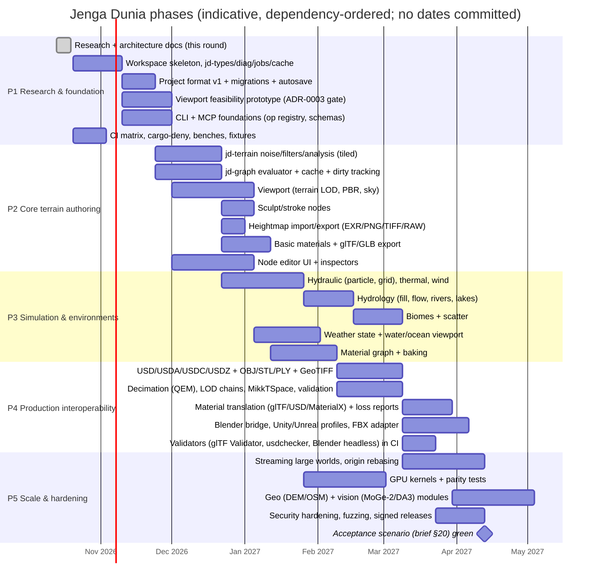

# Roadmap

Phases follow the brief §19. Each phase ends with a complete, testable end-to-end workflow, not isolated features. Backlog detail and status live in `memory/todo.md`; this file is the stable high-level plan.

## Phase exit criteria

| Phase | Exit criteria |
|---|---|
| P1 | Docs reviewed; workspace builds on 3 OSes; `jd diag env` works; viewport prototype decision recorded in ADR-0003 with measurements; op registry generates CLI + MCP + TS types; S1 bench runs in CI |
| P2 | Generate a 4k terrain with noise + filters in GUI, CLI and MCP from the same project; view it; export EXR/R16/GLB validated; project reopens after crash via journal |
| P3 | Erosion + hydrology + biomes + scatter + weather preview on S2; masks exported; determinism tests pass |
| P4 | Interop matrix rows for glTF, USD, OBJ, heightmaps, weightmaps marked verified with validator output; Blender headless round-trip test; Unity/Unreal import procedures documented and tested where tooling exists |
| P5 | 16k tiled world under 4 GB; GPU vs CPU parity; acceptance scenario §20 fully green or with explicitly listed UNVERIFIED items; signed releases |

## Classification of backlog items

`completed` · `in-progress` · `experimental` (usable, not production-ready) · `planned` · `deferred` (with reason). Experimental features are labelled in the UI and in `jd --features`.
