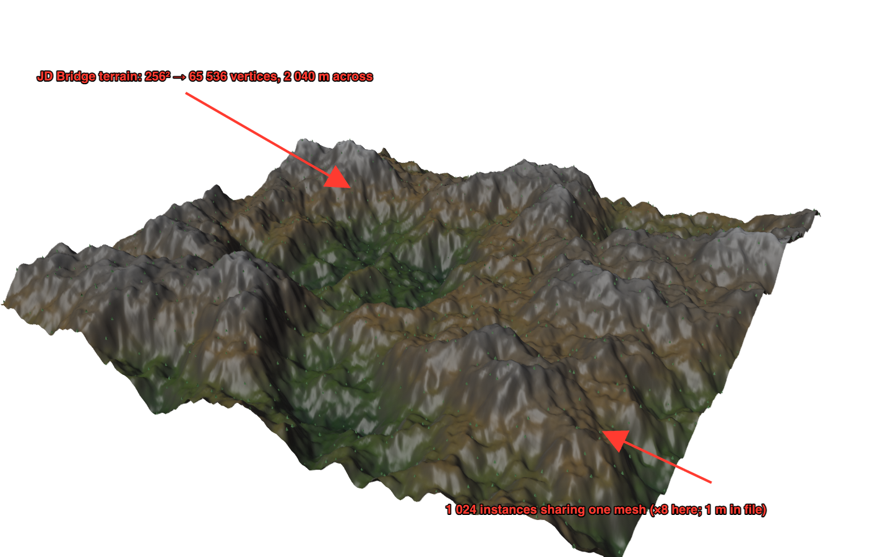

# Blender bridge

Jenga Dunia ships a small Blender add-on, **Jenga Dunia Bridge** (`integrations/blender/jenga_dunia_bridge/`), that imports a project into Blender through the `jd` command-line tool: it runs `jd export mesh` (textured glTF, metres, +Y up, world-centred) and, optionally, `jd op terrain.scatter … .glb` (instances via `EXT_mesh_gpu_instancing`), then imports both with Blender's own glTF importer into a collection named after the project. Nothing is linked: the add-on is GPL-3.0-or-later (Blender's add-on licence requirement) and talks to the MIT core only through the CLI's JSON envelopes.

## Install

1. Build the package (Blender 4.2+ ships the packager): `blender --command extension build --source-dir integrations/blender/jenga_dunia_bridge --output-dir dist` → `dist/jenga_dunia_bridge-0.0.1.zip` (3.2 KB).
2. In Blender: **Edit ▸ Preferences ▸ Get Extensions ▸ ⌄ ▸ Install from Disk…**, pick the zip.
3. Tell the add-on where `jd` is: **Preferences ▸ Add-ons ▸ Jenga Dunia Bridge ▸ jd executable** (or put `jd` on PATH / set `JD_BIN`). The preferences panel shows which binary it detected.

## Use

**File ▸ Import ▸ Jenga Dunia project (.jdproj)** — select the `project.json` inside the `.jdproj` folder. Options in the file browser's side panel: **Layer** (default `height`), **Grid step** (0 = automatic, ≈ 1 M vertices), **Baked texture**, **Scatter mask** (a 0..1 layer; empty = no instances), **Spacing (m)**, **Seed**. The import creates collection `JD <project>` with the terrain object `JD <project> terrain` and, when a mask is given, one proxy mesh instanced per point (`JD <project> <mask> …`). Replace the 1 m proxy with your asset: all instances share one mesh datablock, so swapping the mesh data swaps every tree.



## Headless round-trip test

`integrations/blender/test_bridge.py` is the verification: it creates a fresh 2 048 m / 256² project with `jd`, evaluates it, imports it through the operator with instances scattered from the `height` layer, and checks the scene.

```
$ blender -b --python-exit-code 1 --python integrations/blender/test_bridge.py -- target/debug/jd render.png
BRIDGE OK {"terrain": "JD Bridge terrain", "vertices": 65536, "dimensions_m": [2040.0, 2040.0, 400.6],
           "instances": 1024, "shared_mesh": "proxy", "surface_samples": 25, "max_height_error_m": 0.709}
```

Run on Blender 5.2.0 LTS (macOS). The mesh spans 2 040 m because vertices sit at cell centres ((256 − 1)/256 × 2 048); every one of the 1 024 candidates (64 m grid) was kept because the mask layer (`height`, clamped to 0..1) is ≥ 1 everywhere; a vertical ray from each of 25 sampled instances hits the terrain within 0.71 m of the instance base. The picture above is that test's render with the proxies scaled ×8 (1 m is sub-pixel on a 2 km world).

`blender --command extension validate integrations/blender/jenga_dunia_bridge` passes (`Success parsing TOML`). CI does not run Blender; run the test locally after changing the bridge or the exporters.
