# CLI quickstart — `jd`

Status: Phase 1 (project management and diagnostics). Terrain generation, export and the desktop app arrive in Phase 2. Every output below was produced by the real binary on 2026-10-19 (macOS, Apple Silicon); ids and paths will differ on your machine.

## Build

```sh
cargo build --release -p jd-cli -p jd-mcp
./target/release/jd --help
```

## 1. Create a project

A project is a **directory** (`project.json`, `graph.json`, `scene.json`, `assets/`, `cache/`, `journal/`, …) — see `docs/spec/project-format.md`.

```
$ jd new ~/Worlds/Hills.jdproj --extent 2048 --resolution 1024 --seed 7
ok  project.create
{
  "project_id": "01M5A8NQE0HZV13SJFG7GV1B2P",
  "name": "Hills",
  "path": "~/Worlds/Hills.jdproj",
  "world": {
    "extent_m": [2048.0, 2048.0],
    "resolution_px": [1024, 1024],
    "tile_size": 512,
    "halo": 4,
    "origin": [0.0, 0.0],
    "seed": 7
  },
  "schema_version": 1,
  "dirty": false,
  "pending_journal": 0
}
```

## 2. Open it

```
$ jd open ~/Worlds/Hills.jdproj
ok  project.open
{ ... same summary ... }
```

If the app or a script crashed with unsaved changes, `open` warns `W_RECOVERY_AVAILABLE`; replay them with:

```
$ jd open ~/Worlds/Hills.jdproj --recover
```

## 3. Run any operation (scripting / agents)

Everything the GUI and the MCP server can do is an *operation*. `jd op` invokes one by id with JSON parameters; `--json` prints one envelope per line (NDJSON) so scripts can parse it.

```
$ jd op project.set_name --project ~/Worlds/Hills.jdproj --params '{"name":"Green Hills"}' --save --json
{"op":"project.open","schema_version":1,"request_id":"01M5A8NQF7RDN5JKK9ZBG8NGFG","status":"ok","result":{...}}
{"op":"project.set_name","schema_version":1,"request_id":"01M5A8NQFCYE81XEP1EM8SW2GR","status":"ok","result":{"name":"Green Hills",...}}
{"op":"project.save","schema_version":1,"request_id":"01M5A8NQFGZKV78R22PJ39KT62","status":"ok","result":{...,"dirty":false}}
```

List operations and print a schema:

```
$ jd schema --list
[
  { "id": "diag.env",       "description": "Report host environment and detected tools", "scope": "none" },
  { "id": "project.close",  "description": "Close the open project (unsaved changes stay in the journal)", "scope": "project-read" },
  { "id": "project.create", ... }, { "id": "project.info", ... }, { "id": "project.open", ... },
  { "id": "project.recover", ... }, { "id": "project.save", ... }, { "id": "project.set_name", ... }
]
$ jd schema project.create      # full request/result JSON Schema
```

Long operations register a job: `jd op jobs.list` shows running jobs with progress (`done/total`, current node) and `jd op jobs.cancel --params '{"id":1}'` stops one with `E_CANCELLED` (exit code 5). In one CLI process this is mostly useful to agents driving the MCP server, where `jobs.list` / `jobs.cancel` are tools like any other.

**Detached evaluation for agents.** In a long-lived process (the MCP server, the desktop app) `graph.evaluate_async` returns immediately with `status: accepted` and a `job_id`; `jobs.list` shows its progress, `jobs.cancel {id}` stops it, and `jobs.result {id}` hands over the finished op's envelope exactly once (`state: running | done | unknown`). Driven through the real MCP server on a 1024² world:

```
graph.evaluate_async → status accepted, job_id 1, returned after 3 ms
jobs.result 1        → running 0/2 jd.noise.fbm@1 … running 1/2 jd.output.height@1
jobs.result 1        → done after 444 ms: envelope status ok, layers ["height"]
jobs.result 1        → unknown (collected once)
graph.evaluate_async (hydraulic × 2000) → job_id 2; jobs.list: 2:graph.evaluate 1/3 jd.erosion.hydraulic@1
jobs.cancel 2        → true; jobs.result 2 → done: status error, E_CANCELLED, details.job_id 2
```

Detached jobs run on a bounded pool (half the cores) in submission order; extra ones wait with `state: queued` in `jobs.list`, and cancelling a queued job ends it without running. Pass `timeout_s` to `graph.evaluate_async` to have the job cancelled at a deadline — `jobs.result` then reports `E_TIMEOUT` with the job id. `priority: "high"` (or `"low"`; default `normal`) moves a job ahead of (or behind) the other queued jobs — it never interrupts one that is already running; `jobs.list` shows each job's `priority`. Driven through the real MCP server on a 10-core Mac (5 slots), 512² hydraulic × 4000 per job:

```text
submitted 7 jobs in 59 ms: running 1,2,3,4,5, queued normal 6, queued high 7
jobs.list: 1:rn 2:rn 3:rn 4:rn 5:rn 6:qn 7:qh        (id:state priority)
after cancelling 1 → 2:rn 3:rn 4:rn 5:rn 6:qn 7:rh   (high took the freed slot; normal still queued)
priority=urgent → E_INPUT_INVALID must be one of low, normal, high
```

(One CLI invocation is one process, so `jd op graph.evaluate_async` alone is not useful — the job dies with the process; use `jd op graph.evaluate`.)

## 4. Generate terrain and export a heightmap

`jd terrain generate` opens the project, generates a noise heightfield for the project's world (extent, resolution, tiles from `project.json`) and optionally exports it in one go. The format follows the extension: `.exr` (32-bit float, exact), `.tif` (32-bit float TIFF, exact — GIS/DCC tools), `.png` (16-bit, quantised), `.r16` (Unity/Unreal raw), `.r32` (raw float).

```
$ jd terrain generate --project ~/Worlds/Hills.jdproj --seed 1 --fractal ridged --out ridges.exr
ok  project.open
{ ... }
ok  terrain.generate
{
  "layer": "height",
  "size_px": [4096, 4096],
  "tile_size": 512,
  "halo": 4,
  "stats": { "min": 42.47209, "max": 500.00003, "mean": 221.9, "non_finite": 0 },
  "content_hash": "…blake3…",
  "duration_ms": 157
}
ok  terrain.export_heightmap
{
  "path": "~/Worlds/Hills.jdproj/exports/ridges.exr",
  "sidecar": "~/Worlds/Hills.jdproj/exports/ridges.exr.jd-height.json",
  "format": "exr", "size_px": [4096, 4096], "range_m": [42.47209, 500.00003],
  "quantisation_step_m": 0.0, "flip_y": true, "bytes": 62666077
}
```

Options: `--kind open_simplex2|open_simplex2s|perlin|value|value_cubic|cellular`, `--fractal none|fbm|ridged|ping_pong`, `--feature-size <m>`, `--octaves 1..16`, `--min/--max <m>`, `--layer <name>`.

Quantised formats warn so nothing is lost silently, and the sidecar records the range needed to reconstruct heights:

```
$ jd terrain generate --project ~/Worlds/Hills.jdproj --out h.png
warning  W_EXPORT_LOSS: Png16 quantises heights to 0.0064 m steps; range recorded in the sidecar
```

Same seed → same `content_hash`, on any thread count and tile size (tested). Measured on an Apple Silicon laptop (10 cores): 4096² generation 157 ms, whole command 0.42 s, peak RSS 235 MB; the EXR is read by macOS ImageIO as 4096×4096, 32 bits/sample, and the PNG as 16-bit grayscale.

### Export the terrain as a mesh (glTF binary)

```
$ jd --json export mesh --project M.jdproj terrain.glb
{"op":"terrain.export_mesh","status":"ok","result":{"path":"M.jdproj/exports/terrain.glb","format":"glb",
  "vertices":262144,"triangles":522242,"step":1,"bytes":14656644,"extent_m":[2048.0,2048.0]}}
```

(512² world.) `.glb` is the default; `.obj`, `.stl` and `.ply` work the same way (below). The `.glb` is a single grid mesh in metres, +Y up, centred on the world like the viewport, with normals, UVs and a PBR material whose base colour is a baked texture — the viewport's hypsometric ramp (lowland green → ochre → rock → snow) blended towards rock on steep slopes, one texel per vertex — so it opens looking like the app in Blender, three.js or any glTF 2.0 importer. `--no-texture` (op param `texture: false`) writes the flat material instead. The Khronos glTF Validator reports 0 errors and 0 warnings for both (CI runs it on every push); on a 512² world the texture adds 0.42 MB to a 14.7 MB mesh.

**Decimation (LOD meshes).** `--target-triangles N` (op param `target_triangles`) collapses the sampled grid with quadric edge collapse (Garland–Heckbert) before writing: flat ground ends up as a few large triangles, ridges and gullies keep theirs, the footprint is pinned, and every face stays up-facing so the result is still a heightfield. Works for `.glb`, `.obj`, `.stl`, `.ply`, `.usda` and `.usdz`; `.fbx` keeps its quad grid (use `--step`). The GLB gets planar UVs, tangents and the full-field material maps, so a 60 k-triangle LOD still shades like the full mesh.

```
$ jd --json export mesh --project Bio.jdproj --layer land land-full.glb                           # 262 144 vertices, 522 242 triangles, 20.1 MB, 0.7 s
$ jd --json export mesh --project Bio.jdproj --layer land --target-triangles 60000 land-qem.glb  #  31 023 vertices,  60 000 triangles,  3.4 MB, 12.7 s (debug build)
```

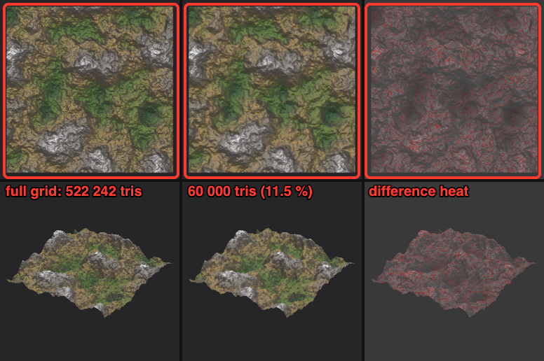

Judged by an independent tool (Optima's `compare` of the two files, 40 000 surface samples, LOD preset): mean surface distance 0.00025 of the bounding diagonal (1.8 m on a 7.3 km diagonal), 99th percentile 0.0013 (9.4 m), Hausdorff 0.0031 (22.7 m, one point on a ridge), area ratio 1.016, silhouette IoU 1.00 (top) / 0.9996 (oblique), SSIM 0.96 / 0.99 — verdict pass. The Khronos validator reports 0 errors, 0 warnings. Decimation is O(n log n) on a global heap; thin the grid with `--step` first for worlds above ~1 M triangles.

**Normal and roughness maps.** The textured `.glb` also carries a tangent-space normal map and a roughness map baked from the *full-resolution* field (one texel per sample, capped at 2048 per side), plus a `TANGENT` attribute so the normal map needs no runtime tangent generation. That is what makes `--step` useful: a decimated mesh keeps the fine relief in shading. Roughness is a stated rule, not a measurement — 0.92 on flat ground falling to 0.62 on steep rock, 0.6 above the snow line (metallic 0).

```
$ jd --json export mesh --project Bio.jdproj --layer land --step 8 land-step8.glb
{"...","vertices":4225,"triangles":8192,"step":8,"bytes":1200852,"texture_px":[65,65],"normal_px":[512,512]}
```

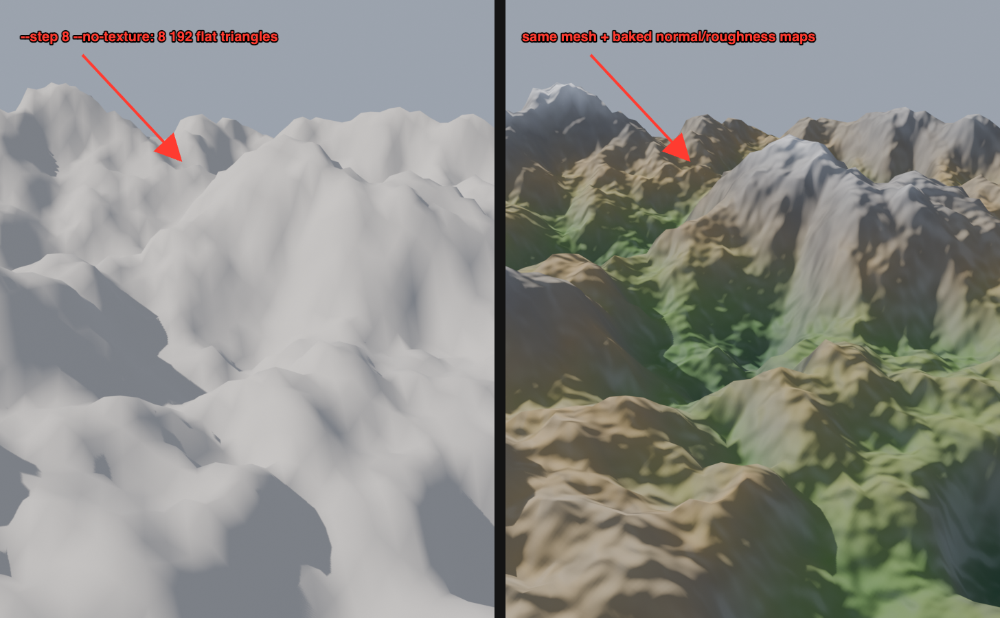

Same 512² world at step 8: the flat file is 0.23 MB, the textured one 1.20 MB (normal 0.60 MB, roughness 0.29 MB, albedo 8 KB). Validator: 0 errors, 0 warnings (one `IMAGE_NPOT_DIMENSIONS` info for the 65² albedo). Blender 5.2 wires Base Color, Roughness, Metallic and Normal (through a Normal Map node) on import; Optima reads `hasTangents: true` and the three textures. Written for GLB only; the FBX export keeps the albedo alone.


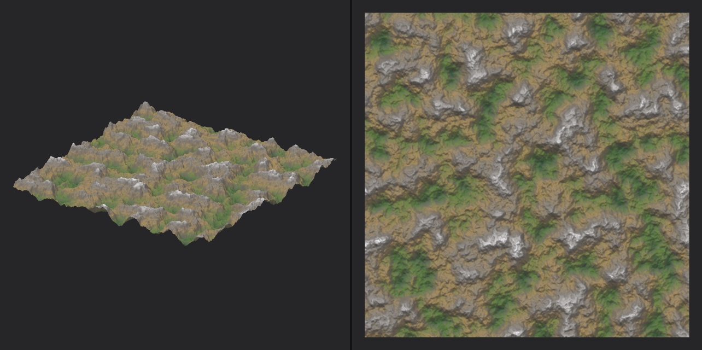

*The exported `terrain.glb` opened in a third-party viewer (Optima), not in Jenga Dunia — the colours come from the embedded texture alone.*

The same command writes **OBJ**, binary **STL** and binary **PLY** by extension — `jd export mesh --project X.jdproj terrain.obj` (positions, UVs, normals, `v/vt/vn` faces, no MTL), `terrain.stl` (face normals, the usual unwelded STL vertices) and `terrain.ply` (normals plus the hypsometric colours as per-vertex RGB, for MeshLab/CloudCompare/Blender). All three share the GLB's grid, frame (metres, +Y up, south at +Z) and `--step` decimation. On the 512² world at step 2 (66 049 vertices, 131 072 triangles): OBJ 11.9 MB in 0.11 s, STL 6.25 MB in 0.12 s, PLY 3.33 MB in 0.08 s (debug build); an external importer reports 0 flipped, degenerate or non-manifold faces for each.

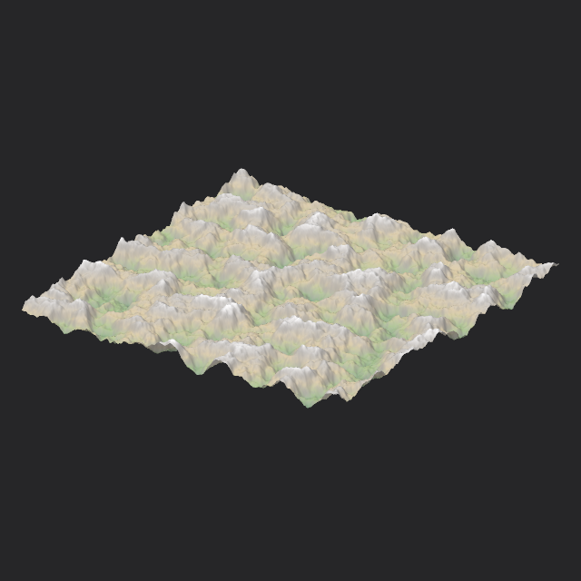

**OpenUSD.** `terrain.usda` writes an ASCII USD stage (`metersPerUnit = 1`, `upAxis = "Y"`, `defaultPrim = "Terrain"`, a `Mesh` with points, triangles, vertex normals, `primvars:st` and hypsometric `primvars:displayColor`); `terrain.usdz` packages it with the system `usdzip` (Apple USD Tools on macOS 27, OpenUSD elsewhere — `E_DEPENDENCY_MISSING` names the install when it is absent). Both pass `usdchecker` ("Success!") on the 512² world at step 4 (16 641 vertices: 2.45 MB, 0.07 s for `.usda`, 0.14 s for `.usdz`). USDA is text — for large worlds export `.glb` or `.ply`, or let `usdcrush` compress the package.

**FBX — our own writer, no SDK.** `terrain.fbx` writes Kaydara FBX Binary 7.4 from scratch (`crates/jd-terrain/src/fbx.rs`, ~500 lines, no dependency): the grid as *quads* (`PolygonVertexIndex` with the negated last corner), per-vertex normals (`ByVertice`), UVs as `ByPolygonVertex`/`IndexToDirect` (the layout the FBX SDK and Blender write, and the only one some readers accept), one Phong material, and — unless `--no-texture` — the baked albedo embedded as a `Video`/`Texture` pair on `DiffuseColor`. `UnitScaleFactor = 100` declares the unit as 100 cm, so the mesh stays in metres; axes are +Y up like the other exporters. FBX has no public specification, so the file is verified by two independent clean-room readers rather than a validator:

```
$ jd --json export mesh --project Bio.jdproj --layer land land.fbx
{"op":"terrain.export_mesh","status":"ok","result":{"path":".../exports/land.fbx","format":"fbx","vertices":262144,"triangles":522242,"step":1,"bytes":25484444,...}}
```

| Reader | What it saw (512² world, step 1) |
|---|---|
| Blender 5.2 `import_scene.fbx` | 1 object `terrain`, 262 144 vertices, 261 121 polygons all quads, 5 110 × 5 110 m footprint, 1 033 m height range, UV layer `map1` in 0..1, material `terrain` with one image-texture node, embedded `terrain-albedo.png` 512² unpacked |
| Optima (independent Rust parser) | 262 144 vertices, 261 121 authored quads, 0 degenerate / flipped / non-manifold, bounding box ±2 555 m × 52..1 085 m, `hasUvs: true`, `textured: true`, PNG 512² |

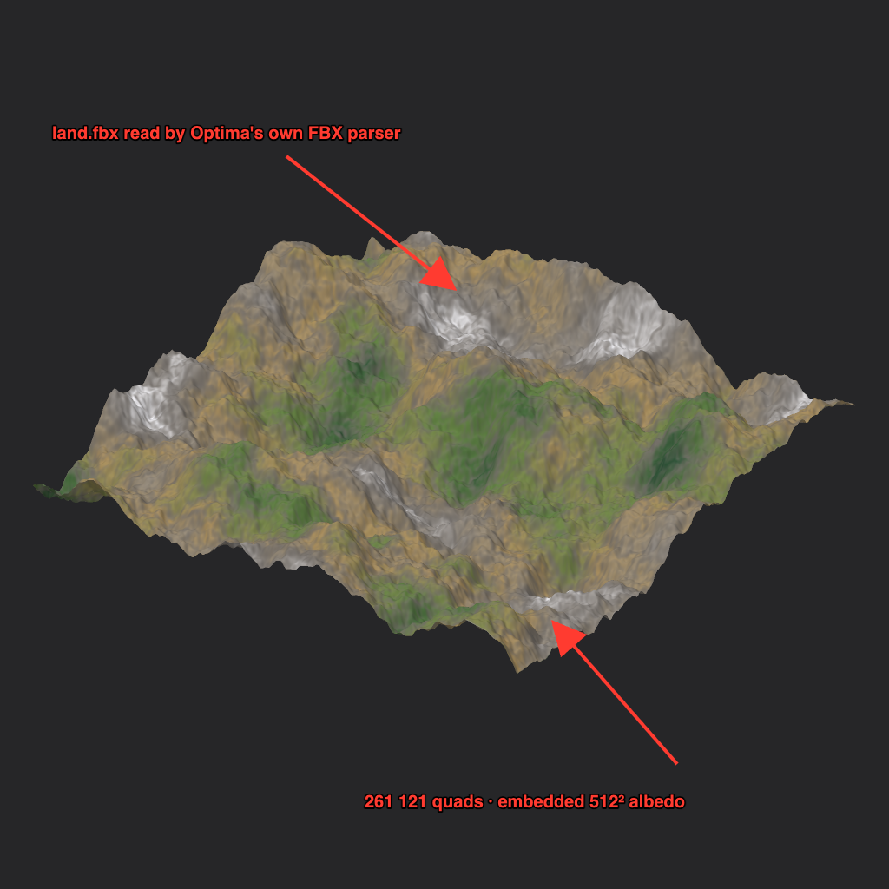

The unit test (`fbx::tests`) walks the written record tree with a tiny independent reader: every record's end offset lands exactly on the next record, the footer sits at a 16-byte boundary, and the first quad is `0, 1, 10, -(9+1)`. 0.33 s for the 25 MB file in a debug build. Not written: animation, skinning, cameras, multiple materials — this is the FBX surface a terrain tool needs.

**FBX in: the reader.** The same module reads binary FBX back (7.4 and 7.5 layouts, raw or zlib arrays, every `Geometry`/`Mesh` with its `Model` translation/rotation/scaling, `UnitScaleFactor` and up axis) and rasterises the mesh onto a height grid over its footprint, so a terrain sculpted in Blender or Maya comes home through `jd.input.heightmap@1`: copy the file into the project with `project.import_asset`, reference it by name, optionally pass `size_px` (default ≈ one cell per vertex), and the node resamples it onto the world like any other heightmap. Verified as a full round trip — Jenga Dunia → `land.fbx` → Blender 5.2 import → Blender's own FBX exporter (zlib arrays, `Lcl Scaling` 100, cm units) → our reader — diffed against the original layer in a graph (`land − fbx_in`):

```
$ jd op project.import_asset --project Bio.jdproj --params '{"path":"/abs/blender-out.fbx","name":"blender-out.fbx"}'
$ jd op graph.add_node --project Bio.jdproj --save --params '{"kind":"jd.input.heightmap@1","params":{"path":"blender-out.fbx","size_px":[512,512]}}'
# fbx_in = input.heightmap.out; fbx_diff = add(land, scale(fbx_in, -1))
land      min 51.978  max 1085.047  mean 567.398
fbx_in    min 51.978  max 1085.047  mean 567.398
fbx_diff  min -0.0    max 0.0       mean -0.0
```

Blender stores positions as 32-bit floats in centimetres, so boundary vertices jitter by ~0.2 mm; the rasteriser's coverage test has ~1 cm of slack for exactly that (a strict test left the north and south edge rows uncovered on the first run). A third-party FBX 7500 file written by another tool (a 23 MB zlib-compressed character from Optima's samples) parses in 0.37 s — nonsense as terrain, but it proves the 64-bit record layout and compressed arrays. ASCII FBX is refused with `E_FORMAT_UNSUPPORTED`. The reader is hardened for untrusted files: record nesting is capped at 64 levels, an array may declare at most 1 GiB and its zlib stream is read only up to the declared size, and a 256-case property test corrupts a valid file at random (flipped bytes, truncation, a spliced 2³¹-element array header) and requires a clean `Ok` or `Err` every time — never a panic or a runaway allocation.
 Worlds above ~1 M vertices are sampled every `step` pixels (`W_MESH_DECIMATED`); pass `--step 1` for the full grid.

### Hydrology recipe: rivers, lakes and wetness

```
$ jd --json new Rivers.jdproj --extent 4096 --resolution 512
$ jd op graph.add_node --project Rivers.jdproj --save --params '{"kind":"jd.hydrology.rivers@1","params":{"threshold":0.6,"depth_m":25}}'
$ jd op graph.add_node --project Rivers.jdproj --save --params '{"kind":"jd.output.height@1","params":{"layer":"rivers"}}'
$ jd op graph.add_node --project Rivers.jdproj --save --params '{"kind":"jd.hydrology.wetness@1"}'
$ jd op graph.add_node --project Rivers.jdproj --save --params '{"kind":"jd.output.height@1","params":{"layer":"wetness"}}'
# connect noise.out → rivers.in, rivers.out → height.in, rivers.rivers → rivers-output.in,
# rivers.out → wetness.in, wetness.out → wetness-output.in (graph.connect with from_port / to_port)
$ jd --json op graph.evaluate --project Rivers.jdproj
{"op":"graph.evaluate","status":"ok","result":{"lod":0,"duration_ms":663,
  "nodes":[{"kind":"jd.noise.fbm@1","duration_ms":197,...},{"kind":"jd.hydrology.rivers@1","duration_ms":321,...},
           {"kind":"jd.hydrology.wetness@1","duration_ms":143,...}, ...],
  "layers":{"height":"…","rivers":"…","wetness":"…"}}}
$ jd op terrain.stats --project Rivers.jdproj --params '{"layer":"rivers"}'    # min 0, max 0.844, mean 0.002
$ jd op terrain.export_heightmap --project Rivers.jdproj --params '{"layer":"rivers","path":"rivers.png","format":"png16","range_m":[0,1]}'
```

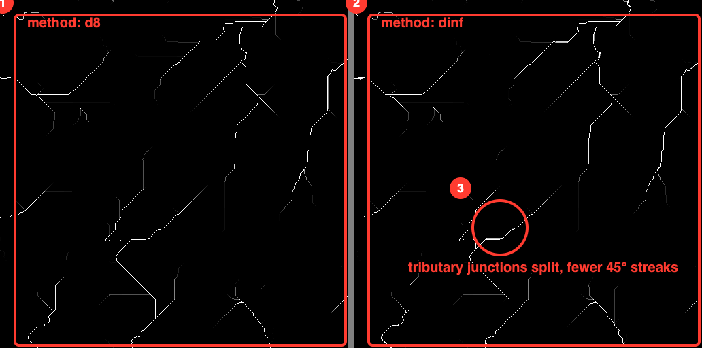

Measured on this 512² world (debug build): the rivers node takes 329 ms with `d8`, 333 ms with `dinf` and 372 ms with `mfd`; the share of channel cells sitting on a perfectly straight two-neighbour run is 77 % (d8), 68 % (dinf) and 20 % (mfd), and the river mask covers 3 167 / 3 288 / 4 614 cells respectively. `d8` and `dinf` stay close — the fill step and the threshold dominate the drainage pattern — so switch to `dinf` when you see parallel 45° streaks on planar slopes; `mfd` gives the widest, most natural-looking valleys at the cost of sharper channel edges.

### Sea level and coastlines

```
$ jd op graph.add_node --project Coast.jdproj --save --params '{"kind":"jd.hydrology.sea_level@1","params":{"level_m":0,"shore_m":5}}'
$ jd op graph.add_node --project Coast.jdproj --save --params '{"kind":"jd.output.height@1","params":{"layer":"ocean"}}'
$ jd op graph.add_node --project Coast.jdproj --save --params '{"kind":"jd.output.height@1","params":{"layer":"depth"}}'
# noise.out → sea_level.in, sea_level.ocean → ocean-output.in, sea_level.depth → depth-output.in
$ jd --json op graph.evaluate --project Coast.jdproj
$ jd export heightmap --project Coast.jdproj --layer ocean ocean.png
```

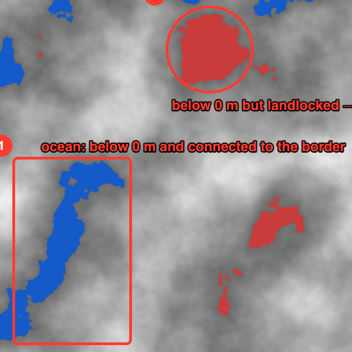

`ocean` is 1 only where the terrain is below `level_m` **and** connected to the field border through such cells, so inland basins below sea level stay dry (fill them with `jd.hydrology.fill@1` or raise them instead); `shore_m` fades the mask to 0 over that many metres above the level for soft beaches, and `depth` is the water column in metres. On the 512² world above (noise −150..350 m, level 0 m): 24 836 cells lie below 0 m, 13 691 of them are ocean and 11 176 are landlocked; the node took 73 ms (debug build).


(512² world, debug build.) `jd.hydrology.rivers` fills depressions, routes flow (`method` `d8` by default; `dinf` — Tarboton's D∞, which splits flow between two downslope neighbours and removes D8's parallel-line streaks; `mfd` — Freeman's multiple flow direction, sharing flow among all lower neighbours by slope^1.1 for the most diffuse, hillslope-like pattern) and incises channels where accumulation is high; `wetness` is the topographic wetness index. Every output node publishes its own layer, so the desktop's layer picker shows **height**, **rivers** and **wetness** side by side, and each can be exported as a mask.

### Droplet (particle) erosion

```
$ jd op graph.add_node --project Drop.jdproj --save --params '{"kind":"jd.erosion.droplet@1","params":{"droplets":400000,"seed":1}}'
$ jd op graph.add_node --project Drop.jdproj --save --params '{"kind":"jd.output.height@1","params":{"layer":"delta"}}'
# noise.out → droplet.in, droplet.out → height output, droplet.delta → delta output
```

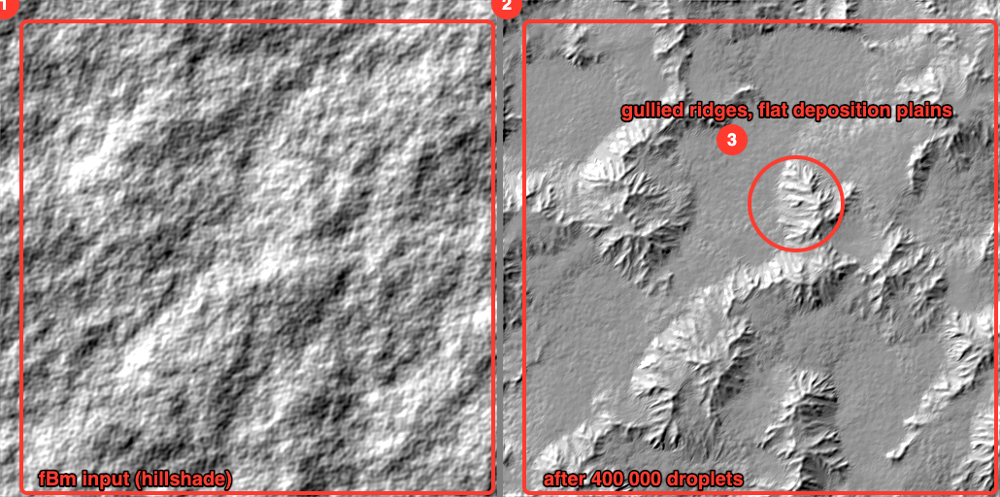

`jd.erosion.droplet@1` is the Lagrangian model from Beyer's 2015 thesis that most terrain tools ship: each seeded droplet starts with water and speed, follows the slope with `inertia`, carries sediment up to `capacity × slope × speed × water`, erodes the deficit through a `radius` brush, deposits the surplus (and fills pits it runs into), evaporates and dies — dropping what it carries where it stops, so the mass balance holds exactly (what left the surface is deposited elsewhere or reported as lost off the map). Heights are normalised to the field's range internally, so Beyer's default `capacity`/`erode`/`deposit` behave the same on any terrain. Aim for **1–2 droplets per cell** (default 200 000): fewer only lowers slopes diffusely. Results are deterministic per `seed`. On the 512² world above 400 000 droplets took 1.13 s (release); 1024² with 1.5 M droplets 4.6 s and 48 MB. Pair with `jd.erosion.thermal@1` to soften the gully walls.

### Terraces and curvature

```
$ jd op graph.add_node --project Tc.jdproj --save --params '{"kind":"jd.filter.terrace@1","params":{"step_m":40,"softness":0.25}}'
$ jd op graph.add_node --project Tc.jdproj --save --params '{"kind":"jd.analysis.curvature@1","params":{"radius_px":6,"scale":0.0015}}'
```

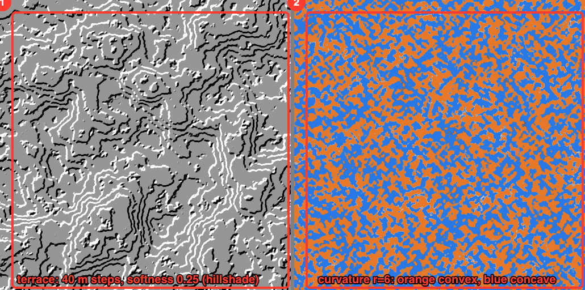

`jd.filter.terrace@1` keeps each tread flat and spends the last `softness` fraction of every step on a smoothstep riser (softness 0 = hard cliffs, 1 = untouched). `jd.analysis.curvature@1` is the Laplacian of height in 1/m over a `radius_px` stencil, mapped to −1..1 by `scale` — ridges and convex breaks positive, valleys and hollows negative; on raw fBm it reacts to every bump (as above), so for rock-exposure or sediment masks blur first or use a larger radius. Both run in tens of milliseconds at 512² (39 ms and 65 ms, debug).

### Fluvial erosion (stream power)

```
$ jd op graph.add_node --project Sp.jdproj --save --params '{"kind":"jd.erosion.stream_power@1","params":{"k":0.002,"m":0.5,"iterations":20,"method":"mfd"}}'
$ jd op graph.add_node --project Sp.jdproj --save --params '{"kind":"jd.output.height@1","params":{"layer":"incision"}}'
# noise.out → stream_power.in, stream_power.out → height output, stream_power.incision → incision output
```

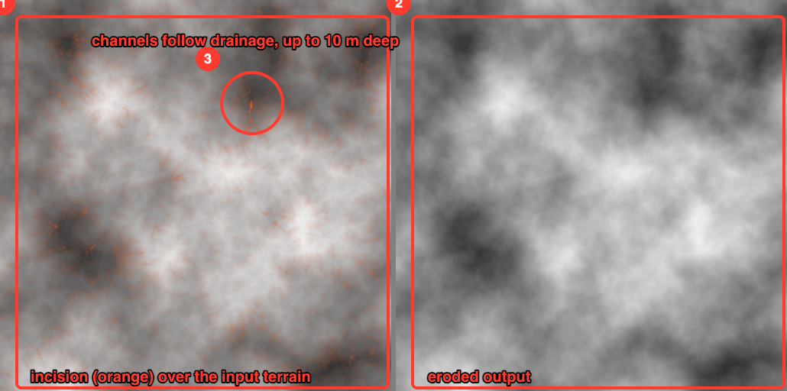

`jd.erosion.stream_power@1` is the river-carving law from geomorphology: each step lowers a cell by `K · A^m · S` where `A` is its drainage area (from `method`: d8, dinf or mfd) and `S` the slope to its steepest neighbour, solved implicitly from the outlets upstream so it is unconditionally stable — a cell never drops below its receiver, however large `K` or the step count. `uplift_m` raises the whole field per step (outlets included) for steady-state landscapes. On this 512² world (10 m cells, `k` 0.002, 20 steps, MFD) the incision map peaks at 10.4 m (mean 0.5 m) along the drainage network; 2048² × 20 steps takes 4.0 s and 321 MB in a release build (each step re-sorts the field for the drainage area). Pair it with `jd.erosion.thermal@1` for hillslope diffusion.

### Biomes from rules

```
$ jd op graph.add_node --project Bio.jdproj --save --params '{"kind":"jd.analysis.slope@1"}'
$ jd op graph.add_node --project Bio.jdproj --save --params '{"kind":"jd.biome.classify@1","params":{"rules":[
    {"name":"rock","slope":[0.6,2.0]},
    {"name":"snow","height_m":[900,1e9]},
    {"name":"beach","height_m":[-1e9,5]},
    {"name":"grassland","height_m":[5,300]},
    {"name":"forest","height_m":[300,900]}]}}'
$ jd op graph.add_node --project Bio.jdproj --save --params '{"kind":"jd.mask.class@1","params":{"id":1}}'   # rock mask
# noise.out → slope.in; noise.out → classify.height; slope.out → classify.slope; classify.biome → mask.classes
```

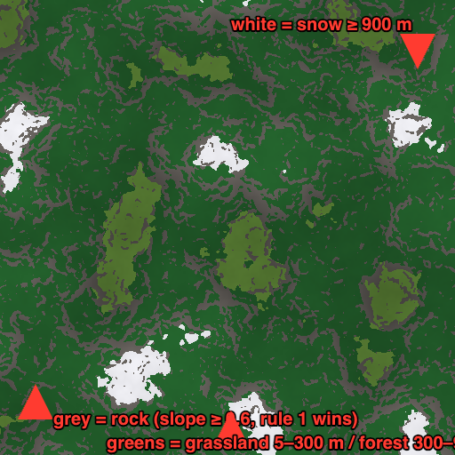

`jd.biome.classify@1` tries its rules in order on every cell — each rule is a set of half-open ranges on `height_m`, `slope` (the 0..1 steepness from `jd.analysis.slope@1`) and `wetness` (`jd.hydrology.wetness@1`); the first match gives the cell that rule's 1-based id, 0 means no rule matched, and a rule that mentions an input you have not connected never matches. With no rules the temperate default above is used. `jd.mask.class@1 {id}` turns one class into a 0/1 mask for materials, scatter or export.

**Scatter instances from a mask.** `terrain.scatter` places points over the world from any 0..1 layer used as a density: one jittered candidate per `spacing_m` cell, kept with probability equal to the mask value, heights sampled from `height` (default the `height` layer), written as `.csv` (`u,v,z,r` — easting, northing from the south edge, height, a per-point 0..1 random for scale/rotation) or `.json`. Deterministic by `seed`.

```
$ jd op graph.add_node --project Bio.jdproj --save --params '{"kind":"jd.output.height@1","params":{"layer":"forest"}}'   # mask.class(5).out → it
$ jd --json op terrain.scatter --project Bio.jdproj --params '{"mask":"forest","height":"land","spacing_m":40,"seed":1,"path":"trees.csv"}'
{"op":"terrain.scatter","status":"ok","result":{"path":".../exports/trees.csv","count":10966,"bytes":431943,"spacing_m":40.0}}
```

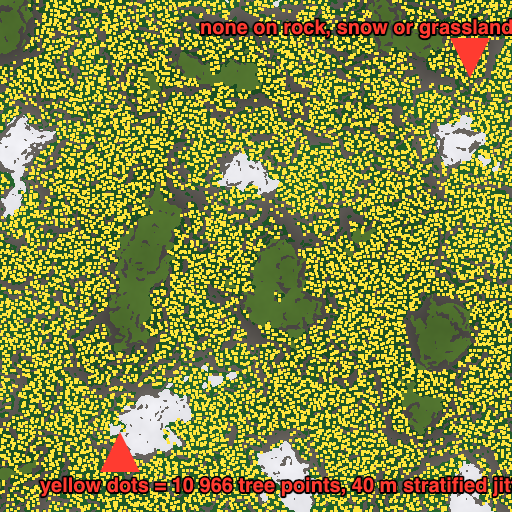

**Instances as a GLB.** Give `terrain.scatter` a `.glb` path and it writes one 1 m proxy pyramid instanced with `EXT_mesh_gpu_instancing`: per instance a translation in the terrain-mesh frame (metres, +Y up, world-centred — drop it next to `jd export mesh` output and the points sit on the surface), a yaw from `r` and a 0.75..1.25 uniform scale. Engines and DCCs that read the extension (Blender, three.js, glTFast) swap the proxy for the real asset and keep the transforms.

```
$ jd --json op terrain.scatter --project Bio.jdproj --params '{"mask":"forest","height":"land","spacing_m":40,"seed":1,"path":"trees.glb"}'
{"op":"terrain.scatter","status":"ok","result":{"path":".../exports/trees.glb","count":10966,"bytes":440156,"spacing_m":40.0}}
```

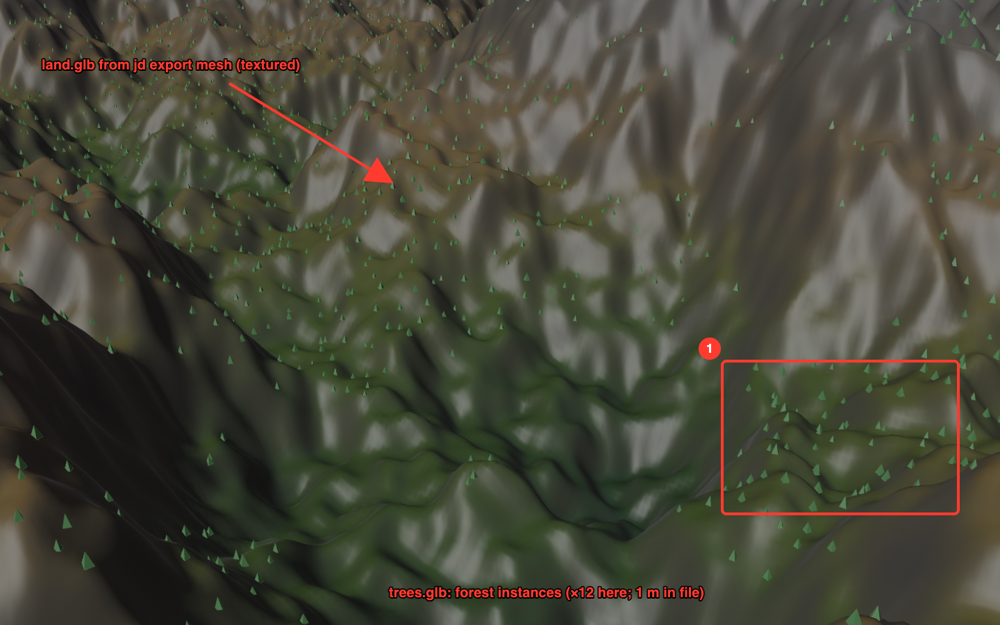

Verified by importing `trees.glb` and `land.glb` into Blender 5.2 headless: 10 966 instance objects sharing one mesh datablock, 393 distinct yaws, scales 0.75–1.25, heights 293–907 m (the forest rule is 300–900 m sampled at jittered points), and a vertical ray from above 20 of 21 sampled instances hits the terrain within 0.55 m of the instance base (the picture scales the proxies ×12 in Blender; 1 m pyramids are sub-pixel on a 5 km world). The Khronos validator reports 0 errors / 0 warnings on the container and accessors but cannot validate the extension itself (`UNSUPPORTED_EXTENSION` info).

On the 5 120 m world above the 40 m grid has 128² = 16 384 candidates and the forest mask covers 66.8 % of the area — 10 966 points, i.e. the expected share, in 30 ms including the file write. A spacing finer than the layer's sample spacing is refused (`spacing_m … must be ≥ the sample spacing (10 m)`). On the 512² world shown (heights −50..1200 m): rock 21.6 %, snow 4.4 %, grassland 7.2 %, forest 66.8 %; classify took 61 ms (debug). In the desktop the rules are a table in the inspector (add a row, type `min,max` ranges; see the desktop guide).

### Wind: dunes from a sand sheet

```
$ jd new Dunes.jdproj --extent 2560 --resolution 256
$ jd op graph.set_param --project Dunes.jdproj --save --params '{"id":"<noise>","key":"height_range_m","value":[100,106]}'
$ jd op graph.add_node --project Dunes.jdproj --save --params '{"kind":"jd.erosion.aeolian@1","params":{"iterations":200,"wind_azimuth_deg":270,"seed":3}}'
# noise.out → aeolian.in; aeolian.out → height output (and noise.out → a second output `sheet` to compare)
sheet   min 100.587  max 105.473  mean 102.9949
height  min  74.124  max 119.114  mean 102.9949      ← same mean to four decimals: every slab is moved, none made or lost
aeolian node 14.5 s for 256² × 200 steps (debug build; 10 m cells, default 2.5 m slabs and 40 m hops)
```

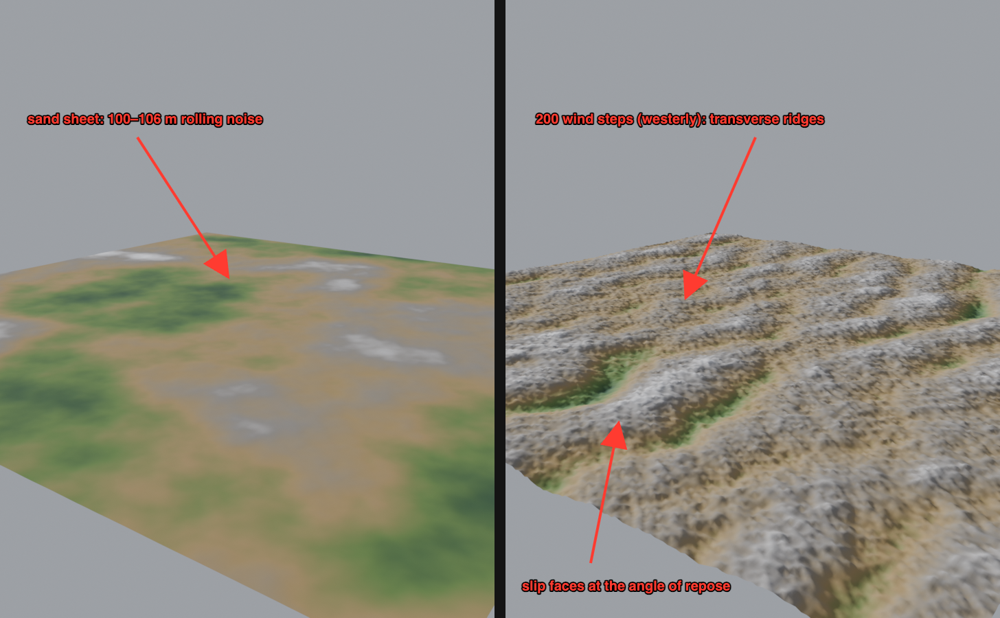

`jd.erosion.aeolian@1` is Werner's slab model (1995), the cellular automaton behind dune simulation: every step visits each cell in a seeded shuffle; a cell that holds sand and is not in a *wind shadow* (a lee slope steeper than `shadow_deg` seen along the wind) loses a slab of `slab_m`, which hops `hop_m` downwind and sticks with probability `deposit_on_sand` on sand, `deposit_on_bare` on bare ground, always in a shadow; after every move the angle of repose (`repose_deg`, 34° for dry sand) is enforced around the changed cell — down from it and down onto it from an uphill neighbour — which is where the slip faces come from. It is a *lattice* model: a slab has to be comparable to `cell × tan(shadow_deg)` for shadows to form at all (0.3 m slabs on 10 m cells only roughened the sheet into hummocks in the first run), so the defaults follow the sample spacing — slab = cell / 4, hop = 4 cells — and the unit test checks that the along-wind roughness ends up more than twice the across-wind roughness, i.e. ridges transverse to the wind. The optional `sand` input (0..1) scales erodibility and marks what counts as sand, so a mask from `jd.biome.classify@1` keeps rock in place. The field wraps around at its edges so the mass balance is exact (above: identical means). The result depends only on `seed`. One wind direction and one grain size for now; bimodal winds (seif dunes) and vegetation anchoring belong to the weather timeline.

### Coastal erosion

```
$ jd new Coast.jdproj --extent 2560 --resolution 256        # noise −60..240 m, sea at 60 m → 28 % ocean
$ jd op graph.add_node --project Coast.jdproj --save --params '{"kind":"jd.erosion.coastal@1","params":{"level_m":60,"band_m":8,"iterations":120,"rate_m":0.4}}'
# noise.out → coastal.in; coastal.out → height; coastal.shore → a `shore` output
before  min -30.3  max 213.64  mean 90.4077
height  min -30.3  max 213.64  mean 90.4077          ← identical mean: eroded 8 457.4 m·cells, deposited 8 457.3
2 534 cells cut (deepest 8.2 m) · 3 799 cells filled (highest 9.9 m) · 1 742 land cells became sea, 243 sea cells became land
coastal node 3.6 s for 256² × 120 steps (debug build)
```

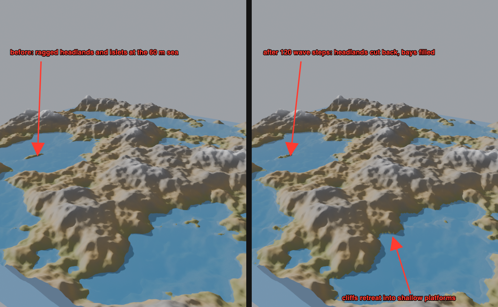

`jd.erosion.coastal@1` re-floods the ocean from the field border every step (the same rule as `jd.hydrology.sea_level@1`, so inland basins are not coasts), then every land cell within `band_m` above `level_m` that touches the sea loses `rate_m × exposure` (exposure = share of its eight neighbours that are ocean) down to one step below the level, and that material is shared among those ocean neighbours. A cut cell floods on the next step and exposes the one behind it — cliff retreat with a wave-cut platform just under the surface — while the deposits build beaches that can rise above the level and become land again. The `shore` output is the wave work per cell normalised to the busiest one, a ready mask for beach and cliff materials. No fetch, wave direction or longshore drift yet, so spits, bars and deltas are a later term.

### Waves: wind speed and fetch

```
$ jd op ocean.waves --params '{"wind_speed_mps":20}'                  # a gale with unlimited fetch
significant_height_m 9.84   peak_period_s 15.6   wavelength_m 380.0   breaking_depth_m 12.6   fully_developed true
$ jd op ocean.waves --params '{"wind_speed_mps":20,"fetch_km":100}'   # the same wind 100 km from the weather shore
significant_height_m 3.23   peak_period_s 7.85   wavelength_m 96.3    breaking_depth_m 4.1    fully_developed false
$ jd op ocean.waves --params '{"wind_speed_mps":3}'                   # a breeze
significant_height_m 0.22   peak_period_s 2.34   wavelength_m 8.6     breaking_depth_m 0.3    fully_developed true
```

`ocean.waves` is the wind sea of the forecasting curves: JONSWAP fetch-limited growth (Hasselmann et al. 1973, in its U10 form — Hs = 1.6·10⁻³ √χ U²/g, Tp = 0.2857 χ^⅓ U/g with χ = gF/U²) capped at the fully developed Pierson–Moskowitz sea (Hs ≈ 0.0246 U², Tp ≈ 0.78 U), the wavelength from deep-water dispersion L = g Tp²/2π, and the depth at which such waves break (H/d = 0.78). The result also lists three Gerstner components — 0.4, 0.2 and 0.1 Hs at L, L/2.2 and L/5, spread 0°, +25° and −35° about the downwind direction, each with its phase speed — which is exactly what the desktop viewport animates. The sea-level node carries the same `wind_speed_mps`, `fetch_km` (omit for a fully developed sea) and `wind_azimuth_deg` parameters, validated at evaluation like any other; a negative wind or a zero fetch is `E_INPUT_INVALID`. Not modelled: swell from elsewhere, refraction and shadowing by the coast, wave-height bakes.

### Seabed: what lies under the water

```
$ jd op graph.add_node --project Coast.jdproj --save --params '{"kind":"jd.biome.seabed@1","params":{"level_m":60,"sand_max_depth_m":25,"mud_min_depth_m":50,"rock_slope_deg":30}}'
# coastal.out → seabed.in; coastal.shore → seabed.shore; seabed.seabed → an output, then jd.mask.class@1 {id: 1..4} for sand / rock / mud / reef masks
seabed node 262 ms (256²)
share of the classified floor (60 m sea, 28 % of the world):  sand 50.6 %  rock 38.7 %  mud 10.8 %  reef 0 %
at rock_slope_deg 20 the same floor reads                    sand 27.6 %  rock 66.9 %  mud 5.6 %
```

`jd.biome.seabed@1` classifies every ocean cell (below `level_m` and connected to the border, like the sea-level node) by depth and slope with the rules coastal geomorphology gives: submarine slopes steeper than `rock_slope_deg` hold no sediment and read **rock** (2); the floor deeper than `mud_min_depth_m` is still enough for fines to settle, **mud** (3); the shelf above the wave base `sand_max_depth_m` is wave-sorted **sand** (1); and a gentle shelf inside `reef_depth_m` that is more than `river_reach_m` from any cell of the optional `rivers` or `shore` masks becomes **reef** (4) — reefs need clear, sediment-free water, so on the steep coastal world above, whose shallow shelves are all within reach of wave-worked cliffs, no reef forms. Land is 0. The class map works with `jd.mask.class@1` exactly like the land biomes, so each bed gets its own material, scatter (kelp, boulders) and colour overlay. No sediment transport or currents yet.

### Bathymetry: sediment fills the floor

```
$ jd op graph.add_node --project Coast.jdproj --save --params '{"kind":"jd.ocean.bathymetry@1","params":{"level_m":250,"smooth_m":200,"max_fill_m":20}}'
# rivers.out → bathymetry.in; seabed.seabed → bathymetry.seabed; bathymetry.out → an output
bathymetry node 56 ms (128², default world, 250 m sea)
before  min 42.548  max 412.711  mean 229.370
after   min 42.548  max 412.711  mean 230.109      (+0.74 m averaged over the world: ~10 m of sediment on the 7 % of cells that are sand or mud)
```

`jd.ocean.bathymetry@1` takes the terrain and a `seabed` class map and raises every **sand** (1) or **mud** (3) cell towards the local mean height over `smooth_m` (a summed-area box filter, O(N)), never lowering a cell, never by more than `max_fill_m`, and never above `level_m` — sediment settles into hollows and levels the shelf, it does not build above the water. Rock (2), reef (4) and land keep the shape erosion gave them, so the chain coastal → seabed → bathymetry turns a noisy flooded landscape into a floor with smooth sediment plains between rock outcrops. `strength` (0..1) scales the fill. Not modelled: transport along the slope, sorting by grain size, a sediment budget.

### Snow cover

```
$ jd op graph.add_node --project Bio.jdproj --save --params '{"kind":"jd.climate.snow@1","params":{"snow_line_m":700,"transition_m":120,"wind_azimuth_deg":270,"wind_strength":0.7}}'
$ jd op graph.add_node --project Bio.jdproj --save --params '{"kind":"jd.output.height@1","params":{"layer":"snow"}}'
# land source → snow.in; snow.snow → the output
land          min 51.978  max 1085.047  mean 567.398
snow_default  min 0.0     max 0.999     mean 0.038      (snow_line_m 800, transition 150, sun from the south at 0.5)
snow_windy    min 0.0     max 0.995     mean 0.041      (snow line 700 ± 120, west wind scouring at 0.7)
```

`jd.climate.snow@1` is a static cover mask from the height layer alone — the heightfield form of the snow-distribution literature (`docs/research/materials-geomorphology.md`): a smooth band around `snow_line_m` (half cover at the line, `transition_m` wide), retention falling linearly to zero at `max_slope_deg` (cliffs hold nothing), slopes whose downslope direction faces `sun_azimuth_deg` losing up to `sun_strength` of their cover, and slopes facing into `wind_azimuth_deg` scoured by up to `wind_strength`. Directional terms fade in with the gradient so flat ground never flickers. The mask is 0..1 like `rivers` or a class mask: colour the viewport by it, scatter from it, or feed it to biome rules via `jd.mask.class@1`-style multiplies. On the 5 120 m / 512² biome world the node takes 67 ms; coverage 3.8 % (default) → 4.1 % with the lower, wind-scoured line (the west wind strips the west-facing flanks and leaves more on the lee). Not modelled: sky visibility, melt over time, drifting — see the research notes for the next terms.

### Export for Unity or Unreal

```
$ jd --json op terrain.export_profile --project Bio.jdproj --params '{"profile":"unreal","dir":"unreal","layer":"land","masks":["forest"]}'
{"op":"terrain.export_profile","status":"ok","result":{"profile":"unreal","dir":".../exports/unreal",
  "files":["heightmap.png","heightmap.png.jd-height.json","weight_forest.png","README.md"],"size_px":[512,512],
  "settings":{"min_m":51.98,"max_m":1085.05,"unreal_z_scale":201.771,"unreal_location_z_cm":56851.2}},
  "warnings":[{"code":"W_ENGINE_SIZE","message":"Unreal's recommended overall resolutions are 127/253/505/1009/2017/4033/8129; this is 512×512 — …"}]}
$ jd op terrain.export_profile --project Bio.jdproj --params '{"profile":"unity","dir":"unity","layer":"land","masks":["forest"]}'
```

`terrain.export_profile` writes one folder an engine importer can take as-is: **Unreal** gets a 16-bit PNG heightmap with row 0 = north, one 8-bit grayscale weightmap per mask layer at the same resolution, and a README with the Landscape numbers computed from the data — Z scale = (max − min) × 100 / 512 (201.771 here for 52…1085 m) and the Z location that puts mid-grey at the mid height; **Unity** gets `heightmap.r16` (16-bit little-endian, row 0 = south, so *Flip Vertically: off*, Byte Order *Windows*), the weightmaps, and the Terrain Height (1033.07 m) plus the y offset (51.98 m). Sizes an engine does not like are reported as `W_ENGINE_SIZE` (Unity wants 2ⁿ+1 squares, Unreal 1009/2017/4033/8129 — use the world presets). The engine-side steps follow the Unity 6 manual and the Unreal 5 Landscape guide but are **UNVERIFIED** until someone imports once; the README says so.

### Bring in a real DEM or engine heightmap

```
$ jd op project.import_asset --project K.jdproj --params '{"path":"~/Downloads/srtm_tile.tif"}'
$ jd op graph.add_node --project K.jdproj --save \
    --params '{"kind":"jd.input.heightmap@1","params":{"path":"srtm_tile.tif"}}'
```

The input node reads from the project's `assets/` only (no absolute paths, no `..`), accepts PNG 16-bit, EXR, TIFF (f32/u16/u8) and headerless RAW (`size_px` required), maps quantised files through `range_m`, and resamples bilinearly onto the world grid. Wire it to filters, erosion or an output like any generator.

**GeoTIFF DEMs.** `project.import_asset` reports what a GeoTIFF says about itself — `geo.pixel_scale` (ground size of a pixel in the file's CRS units), `geo.tiepoint` (raster → model coordinates) and `geo.nodata` (`GDAL_NODATA`) — so you can size the world to match (64 px × 30 m = 1 920 m here):

```
$ jd --json op project.import_asset --project Geo.jdproj --params '{"path":"/data/dem.tif"}'
{"op":"project.import_asset","status":"ok","result":{"name":"dem.tif","bytes":12548,
  "geo":{"pixel_scale":[30.0,30.0],"tiepoint":[0,0,0,500000.0,4000000.0,0],"nodata":-9999.0}}}
```

Void cells (the file's nodata value, an explicit `nodata` parameter on the input node, or non-finite samples) are filled with the lowest valid height so erosion and hydrology never see −9999 m cliffs; a file that is entirely void is an error (`E_FORMAT_CORRUPT`). Verified on a 64×48 GeoTIFF with an 8×8 void block: `terrain.stats` of the imported layer reports min 80.08 m (the lowest real sample), max 319.99 m, 0 non-finite. Projections are not applied — the file's grid is resampled onto the world as-is; CRS-aware import comes with `jd-geo`. The same tags are **written** on export: a `.tif` from `jd export heightmap` / `jd terrain generate --out x.tif` carries `ModelPixelScaleTag` (the sample spacing), `ModelTiepointTag` (the north-west corner, from the project's `origin` + extent) and GeoKeys for the project's `crs` when it is `EPSG:<code>` (projected or geographic), and is always written north-up. Round trip checked: a project created with `origin [500000, 4000000]`, 128 px × 30 m and `crs EPSG:32637` exports a GeoTIFF whose tags read back as scale 30/30, tie point (500000, 4003840) and EPSG 32637 through `project.import_asset`; QGIS/GDAL place it accordingly. Pass `"georeference": false` in the export options for a plain TIFF.

## 5. Build a procedural graph

Terrain is really a **graph** (`graph.json` in the project): generator → filters → output. Every graph change is a journaled operation (crash-safe, undoable later); evaluation is incremental — unchanged nodes are served from cache by content hash.

```
$ jd op graph.kinds | head          # node kinds with ports and parameter schemas
$ jd --json op graph.add_node --project G.jdproj --save \
    --params '{"kind":"jd.noise.fbm@1","params":{"seed":9,"fractal":"ridged","height_range_m":[0,300]}}'
{"op":"graph.add_node", ..., "result":{"id":"01M5AYXA8NG9R58WS7RRM2RMRM"}}
$ jd op graph.add_node --project G.jdproj --save --params '{"kind":"jd.filter.blur@1","params":{"radius":2}}'
$ jd op graph.add_node --project G.jdproj --save --params '{"kind":"jd.output.height@1"}'
$ jd op graph.connect  --project G.jdproj --save --params '{"from":"<noise id>","to":"<blur id>","to_port":"in"}'
$ jd op graph.connect  --project G.jdproj --save --params '{"from":"<blur id>","to":"<output id>","to_port":"in"}'
$ jd --json op graph.evaluate --project G.jdproj --params '{"lod":0}'
{"op":"graph.evaluate","status":"ok","result":{"lod":0,"duration_ms":20,
  "nodes":[{"kind":"jd.noise.fbm@1","duration_ms":15,"cached":false,"hash":"…"},
           {"kind":"jd.filter.blur@1","duration_ms":3,"cached":false,"hash":"…"},
           {"kind":"jd.output.height@1","duration_ms":0,"cached":false,"hash":"…"}],
  "layers":{"height":"55fcde70c90c7fd7…"}}}
```

(512² world, release build.) Every mutation is validated **before** it is journaled, so a rejected request never touches the project: unknown kinds (`E_NODE_UNKNOWN`), parameters that do not match the kind's schema, missing nodes or ports, type mismatches (`E_INPUT_INVALID` / `E_GRAPH_TYPE_MISMATCH`) and cycles (`E_GRAPH_CYCLE`). Errors name the node:

```
$ jd --json op graph.set_param --project G.jdproj --params '{"id":"<noise id>","key":"octaves","value":"many"}'
{"op":"graph.set_param","status":"error","error":{"code":"E_INPUT_INVALID",
  "message":"invalid type: string \"many\", expected u8","why":"Parameters must match the node kind's schema.",
  "next":"See graph.kinds for the schema.","details":{"path":"params","node":"01JDGRAPH000000000000N01SE"}}}
$ jd --json op graph.connect --project G.jdproj --params '{"from":"<noise id>","from_port":"nope","to":"<output id>","to_port":"in"}'
{"op":"graph.connect","status":"error","error":{"code":"E_INPUT_INVALID",
  "message":"node 01JDGRAPH000000000000N01SE (jd.noise.fbm@1) has no output `nope`", ...}}
```

Evaluating with an unconnected required input gives `E_GRAPH_MISSING_INPUT`. Before anything runs the core estimates peak memory (every node's outputs plus the heaviest kernel's scratch — hydraulic 40 B/cell, rivers 32, stream power 28, fill/wetness 24, flow 20, sculpt 12, thermal/droplet 8) and refuses with `E_RESOURCE_MEMORY` when it exceeds `settings.memory_budget_bytes` (default 4 GiB), naming the estimate, the budget and the way out (higher `lod`, smaller world, split the graph, raise the budget). `graph.move_node` (editor position) is journaled like every other change, so the desktop canvas layout survives a crash. `graph.append_param` pushes one element onto an array parameter (how the desktop records brush strokes): the journal entry holds just that element, so a long sculpt session grows the write-ahead log linearly instead of re-journaling the whole stroke list each time (20 strokes: 4.7 KB vs 22.8 KB). `graph.undo` / `graph.redo` step through the session's edit history (up to 100 steps) and are journaled as `graph.restore` with the full graph, so recovery replays them too; every `graph.*` response carries `undo_depth` / `redo_depth`. `graph.evaluate` with `lod > 0` publishes a reduced-resolution preview under `<layer>#lod<N>` (e.g. `height#lod1`) and never overwrites the full-resolution layer.

Layers persist in the project's disposable cache (`cache/layers/<blake3>.jdl` + `index.json`, see `docs/spec/project-format.md`), so one invocation can evaluate and the next one export — the same path the desktop app and MCP server use:

```
$ jd --json op graph.evaluate --project G.jdproj
{"op":"graph.evaluate","status":"ok","result":{"lod":0,"duration_ms":194,"layers":{"height":"5e12d1d98c5c7402…"}}}
$ ls G.jdproj/cache/layers
5e12d1d98c5c7402….jdl  index.json
$ jd --json op terrain.export_heightmap --project G.jdproj --params '{"path":"height.exr","format":"exr"}'
{"op":"terrain.export_heightmap","status":"ok","result":{"path":"G.jdproj/exports/height.exr",
  "sidecar":"G.jdproj/exports/height.exr.jd-height.json","format":"exr","size_px":[512,512],
  "range_m":[181.76539611816406,392.8346862792969],"quantisation_step_m":0.0, ...}}
```

(512² world, debug build.) Deleting `cache/` never breaks a project; the next `graph.evaluate` recreates the layers. The cache also trims itself: every write evicts the oldest blobs (by last use) until the store fits `settings.cache_limit_bytes` in `project.json` (default 2 GB), and `jd op project.cache_gc --project X.jdproj` does the same on demand, reporting blobs/bytes kept and evicted. Change the limit (or the autosave interval / preview LOD) with `jd op project.set_settings --project X.jdproj --save --params '{"cache_limit_bytes":536870912}'` — fields left out keep their value, and values out of range are refused with `E_INPUT_INVALID`. Verified with the limit set to three 256² layers: generating five kept exactly three blobs and index entries, the newest layer still read back, the oldest reported `no heightfield layer named h1`.

The first simulation node is thermal erosion. Insert it between the starter noise and output (ids from `graph.list`):

```
$ jd --json op graph.add_node --project K.jdproj --save \
    --params '{"kind":"jd.erosion.thermal@1","params":{"talus_deg":33,"iterations":50}}'
$ jd op graph.connect --project K.jdproj --save --params '{"from":"<noise id>","to":"<thermal id>","to_port":"in"}'
$ jd op graph.connect --project K.jdproj --save --params '{"from":"<thermal id>","to":"<output id>","to_port":"in"}'
$ jd --json op graph.evaluate --project K.jdproj
{"op":"graph.evaluate","status":"ok","result":{"lod":0,"duration_ms":952,
  "nodes":[{"kind":"jd.noise.fbm@1","duration_ms":64,...},{"kind":"jd.erosion.thermal@1","duration_ms":887,...},
           {"kind":"jd.output.height@1","duration_ms":0,...}],"layers":{"height":"…"}}}
```

(2048² world, 50 steps, release build on the M-series reference Mac: 0.98 s wall, 130 MB peak RSS; 512² takes ~65 ms.) Material steeper than `talus_deg` slides to lower neighbours; the step is mass-conserving, so `terrain.stats` reports the same mean before and after.

Built-in kinds today: `jd.noise.fbm@1`, `jd.math.add@1`, `jd.math.multiply@1`, `jd.math.scale@1`, `jd.math.remap@1`, `jd.filter.blur@1`, `jd.filter.terrace@1` (quantise heights into `step_m` steps with a smoothstep riser of `softness` × step, `offset_m` shifts the grid — mesas, paddies, strata), `jd.analysis.curvature@1` (Laplacian over a `radius_px` stencil, mapped to −1..1 by `scale`: +1 convex ridges, −1 concave hollows — blur first or raise the radius for landscape-scale masks), `jd.erosion.thermal@1` (talus angle, iterations, rate — mass-conserving; 2048² × 50 steps ≈ 0.9 s release), `jd.analysis.slope@1` (0..1 steepness mask; multiply it into a layer to attenuate by slope), `jd.erosion.hydraulic@1` (virtual-pipe shallow water with conservative sediment transport; outputs `out`, `water`, `sediment`; 2048² × 100 steps ≈ 2.1 s release), `jd.erosion.droplet@1` (Beyer-style particle erosion: seeded droplets with inertia, capacity, brush erosion and deposition — gullies and fans; outputs `out` and signed `delta`; 1024² × 1.5 M droplets ≈ 4.6 s release), `jd.erosion.stream_power@1` (fluvial incision ∝ drainage area^m × slope, implicit/unconditionally stable, `k`/`m`/`uplift_m`/`iterations`/`method`; outputs `out` and `incision`; 2048² × 20 steps ≈ 4.0 s release), `jd.sculpt.strokes@1` (brush strokes as data: `points` in layer metres, `radius_m`, `mode` raise/smooth/flatten with `strength_m` or `amount`; cost is independent of brush size — a 600 m smooth stroke on 2048² takes 0.7 s in a debug build, down from 70 s), `jd.analysis.flow@1` (flow accumulation, `method` d8 / dinf / mfd, log-scaled 0..1 — rivers/wetness), `jd.hydrology.fill@1` (priority-flood depression filling; outputs the drainable field and `lakes` depth), `jd.hydrology.rivers@1` (carves channels where flow accumulates; outputs carved terrain and a `rivers` mask), `jd.hydrology.wetness@1` (topographic wetness index 0..1 for moisture/biome masks), `jd.hydrology.sea_level@1` (`ocean` mask below `level_m`, border-connected only so inland basins stay dry, soft `shore_m` edge; `depth` in metres), `jd.biome.classify@1` (ordered rules on height / slope / wetness → class-id map; default temperate set), `jd.mask.class@1` (0/1 mask of one class — feed materials and `terrain.scatter`), `jd.input.heightmap@1` (a PNG-16/EXR/TIFF/RAW file from the project's `assets/`, resampled onto the world; `project.import_asset` copies files in), `jd.output.height@1`.

## 6. Diagnostics

```
$ jd diag env
ok  diag.env
{
  "app_version": "0.0.1",
  "os": "Darwin 27.0.1",
  "arch": "aarch64",
  "cpus": 10,
  "memory_total_bytes": 17179869184,
  "memory_available_bytes": 6776995840,
  "cwd": "~/Documents/SoftwareProjects/jenga-dunia",
  "tools": [
    { "name": "blender" },
    { "name": "usdchecker", "path": "/usr/bin/usdchecker" },
    { "name": "usdcat",     "path": "/usr/bin/usdcat" },
    { "name": "usdzip",     "path": "/usr/bin/usdzip" },
    { "name": "gltf-validator" }, { "name": "gltf-transform" }, { "name": "toktx" }
  ]
}
```

A tool without `path` was not found on `PATH`; exporters that need it will report `E_DEPENDENCY_MISSING` with install hints.

```
$ jd --json diag bench s1 | tail -1
{"op":"diag.bench","status":"ok","result":{"scene":"s1","size_px":1024,
  "stages":[{"name":"noise.fbm","ms":30.0},{"name":"noise.ridged","ms":25.3},{"name":"math.add","ms":1.5},{"name":"erosion.thermal×50","ms":250.9}],
  "total_ms":307.6,"peak_rss_bytes":45219840,"profile":"release","content_hash":"859db903b963db8a…"}}
```

`jd diag bench` runs a benchmark scene from `docs/spec/performance-targets.md` with the real kernels (S1: 1024² fBm + ridged noise, add, 50 thermal steps) and reports wall time per stage, the process's peak resident memory and the content hash of the result — the same hash on every machine means the kernels are deterministic. `--size 2048` scales the scene; `profile` says `debug` when the binary is not optimised (those numbers are not comparable). CI runs S1 on every push as a smoke with a 15 s / 1 GB budget.

## Errors and exit codes

Errors always say what happened, why it matters and what to do next, with a stable code (`docs/spec/error-codes.md`):

```
$ jd open /nowhere.jdproj
error  project.open  E_PROJECT_CORRUPT: cannot read project.json: No such file or directory (os error 2)
  why:  The project directory is missing a required document.
  next: Restore the file from a backup or recreate the project.
$ echo $?
1
```

| Exit | Meaning |
|---|---|
| 0 | ok |
| 1 | generic / internal / corrupt project |
| 2 | invalid input or unknown operation |
| 3 | unsupported or corrupt file format |
| 4 | out of memory / disk |
| 5 | cancelled or timed out |
| 6 | validation or compatibility failure |
| 7 | permission denied / licence not accepted |

Set `JD_LOG=debug` (or `--log`) for structured logs on stderr.
