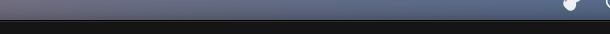

# Desktop app (Phase 2, early)

Status: first working build. One window, native macOS title bar, dark theme (Host Grotesk, Lucide icons). The layout follows World Creator's left-to-right workflow — project on the left, viewport in the centre, terrain/noise controls and export on the right, operations log at the bottom — and will grow into the full workspace of `docs/architecture/12-ui-workspace.md` (node editor, sculpting, materials, environment, jobs).


*Real screenshot of the running app on macOS (2026-10-19). The header reports the viewport backend: here **WebGPU** inside the system WebView.*


*After **Terrain → Generate Terrain** (⌘G) and **File → Export Heightmap…** (⌘E), driven through the native menu bar: 2048² OpenSimplex2 fBm, 2.09 M viewport triangles; `exports/height.exr` validated by macOS ImageIO as 2048×2048, 32 bits/sample. Release build on Apple Silicon: generation 58–63 ms, 2 MB preview to the viewport in 6 ms (the screenshot above was taken from a debug build, hence its slower readout).*



## Native integration

- Menu bar: **Jenga Dunia** (About, Services, Hide, Quit) · **File** (New… ⌘N, Open… ⌘O, Save ⌘S, Export Heightmap… ⌘E, Close Window ⌘W) · **Edit** (Undo/Redo/Cut/Copy/Paste/Select All) · **Terrain** (Generate ⌘G, Evaluate Graph ⌘R) · **Window** (Minimize, Zoom, Full Screen). Menu actions run the same operations as the buttons.
- Native file dialogs (tauri-plugin-dialog): **New…** asks where to create the `.jdproj` directory, **Open…** picks an existing one, **Export Heightmap…** is a save dialog with EXR / PNG 16-bit / RAW filters. The folder buttons next to the Path and File fields open the same dialogs; typed paths still work (and are what the tests drive).
- Launch with a project: `jd-app ~/Worlds/Hills.jdproj` (or double-click a `.jdproj` once the bundle's file association is registered) opens it before the window appears.
- Dark window theme, native title bar, Host Grotesk typography.

## Run from source

```sh
cargo build -p jd-mcp            # not needed by the app; used by the UI end-to-end tests
cd apps/desktop && pnpm install && pnpm tauri dev
```

## Tutorial: first terrain in four steps


1. **Path** — type the project directory (it is created on disk as a `.jdproj` folder).
2. **New (⌘N)** — or **Open (⌘O)** for an existing project; the header shows `name — resolution² · extent m`.
3. **Generate (⌘G)** — after choosing lattice, fractal, seed, feature size, octaves, lacunarity, gain and height range.
4. **Export heightmap (⌘E)** — `.exr` (exact), `.png`/`.r16` (16-bit, warns about quantisation), `.r32` (exact).
5. **Log** — every operation with warnings and errors (stable code, why, what to do next).


1. Viewport readout: backend (WebGPU here), triangle count, preview size and transfer time.
2. Layer statistics: min/max/mean height, generation time and the content hash — the same seed and parameters always give the same hash.
3. Export writes `exports/<file>` plus a `.jd-height.json` sidecar (size, range, flip, byte order).

*Annotations are generated from the real screenshots by `apps/desktop/scripts/annotate.mjs` from the `.annot.json` specs next to the images, so they can be regenerated whenever the UI changes.*

**Screen recording:** [`videos/first-terrain.mp4`](videos/first-terrain.mp4) (14 s, 1440×892) — the real app opened with a project, **Terrain → Generate Terrain** and **File → Export Heightmap…** triggered through the native menu bar, terrain appearing in the WebGPU viewport, `height.exr` written. Recorded with macOS `screencapture -V`; the menu actions were driven by System Events so the recording is reproducible.

## Tutorial: the node graph

Every project starts with a two-node graph (`Noise → Height`), the same `graph.json` the CLI and MCP server edit. The panel under the viewport is that graph; **Hide graph** collapses it.


1. **Add** — pick a kind from the list (`graph.kinds` drives it) and click **Add**; the node is placed to the right of the graph and the view re-fits.
2. **Evaluate** — or **Terrain → Evaluate Graph (⌘R)**. Unchanged nodes are served from cache (the log shows `graph.evaluate: ok`; the stats panel and viewport update from the `height` output).
3. **Nodes** — click to select, drag to move (the position is saved in the project), **Delete**/**Backspace** removes the node and its edges.
4. **Inspector** — the selected node's parameters, generated from the kind's JSON schema (enums become drop-downs, defaults show as placeholders). Leaving a field applies `graph.set_param`; an invalid value is rejected by the core before anything is journaled and the reason appears in the log.
5. **Viewport readout** — backend, triangle count and preview transfer for the evaluated layer.

Connect nodes by dragging from an output handle (right) to an input handle (left); an input holds one edge, so dropping a new connection replaces the old one. Cycles, wrong ports and type mismatches are refused by the core (`E_GRAPH_CYCLE`, `E_INPUT_INVALID`, `E_GRAPH_TYPE_MISMATCH`). Evaluating while a required input is unconnected reports `E_GRAPH_MISSING_INPUT` with the node and port.


**Screen recording:** [`videos/graph-editor.mp4`](videos/graph-editor.mp4) (16 s, 1440×900) — the whole flow above: edit the seed, add a blur node, connect it by dragging the handles, move a node, evaluate, delete with the keyboard. It is the UI-driven test `apps/desktop/e2e/graph.spec.ts` running against the real core, recorded with `JD_VIDEO=1 pnpm exec playwright test e2e/graph.spec.ts` (actions slowed to human pace), so it is regenerated whenever the editor changes.

## Workflow

1. **Project** — **File → New… (⌘N)** and choose where the `.jdproj` directory goes, or type a path (e.g. `~/Worlds/Hills.jdproj`) and click **New**; **Open… (⌘O)** or the folder button picks an existing project. Set extent (m) and resolution (px) before creating. The header shows `name — resolution² · extent m`; the panel shows the project id, dirty flag and pending journal entries.
2. **Terrain · Noise** — choose lattice and fractal, seed, feature size, octaves, lacunarity, gain, height range; click **Generate**. Stats (min/max/mean, time, content hash) appear under the button and the viewport shows the terrain. Drag to orbit, wheel to zoom.
3. **Export** — **File → Export Heightmap… (⌘E)** or the folder button opens a save dialog (the extension picks the format: `.exr`, `.png`, `.r16`, `.r32`); typing a relative name and clicking **Export heightmap** writes into the project's `exports/`. Every export gets a `.jd-height.json` sidecar. Quantised formats log a `W_EXPORT_LOSS` warning.
4. **Save** — writes `project.json`/`graph.json`/`scene.json` atomically and clears the journal.

Every button calls the same operation the CLI and MCP server expose (`jd schema --list`), so anything you do here can be scripted.

## How the UI is tested

| Level | What | Where |
|---|---|---|
| Component (jsdom) | the real `App` with `invoke` mocked at the Tauri boundary: create → generate → stats → preview → export warning; error display | `apps/desktop/src/App.test.tsx` (`pnpm test`) |
| End-to-end (Chromium) | the real frontend driven by Playwright with `invoke` bridged to the **real Rust core** via `jd-mcp` (MCP over stdio): project files appear on disk, the viewport reports its backend and triangle count, a 16-bit PNG is written | `apps/desktop/e2e/terrain.spec.ts` (`pnpm test:e2e`) |
| End-to-end, node graph | starter graph drawn from `graph.json`; edit a parameter, add a node, connect it by dragging handles, drag a node, evaluate, delete with the keyboard; the project's `journal/ops.ndjson` is read back and must list exactly `set_param, add_node, connect, move_node, remove_node` | `apps/desktop/e2e/graph.spec.ts` |
| Native window | screenshots of the real Tauri app on macOS; interaction recording requires Accessibility permission for the automating process | this page |

Known limits of this build: no sculpting, one output layer, no undo of graph edits yet (the journal records them). The tutorial images are the real app annotated by `scripts/annotate.mjs`; the Figma file linked in the brief is the design reference and receives the same screenshots once the connector is authorised.
