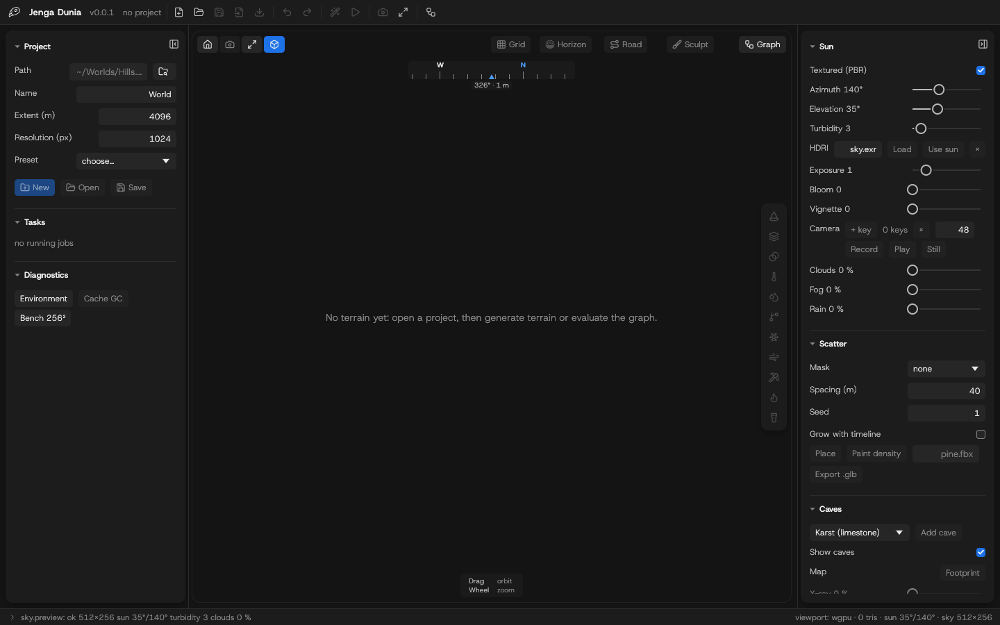
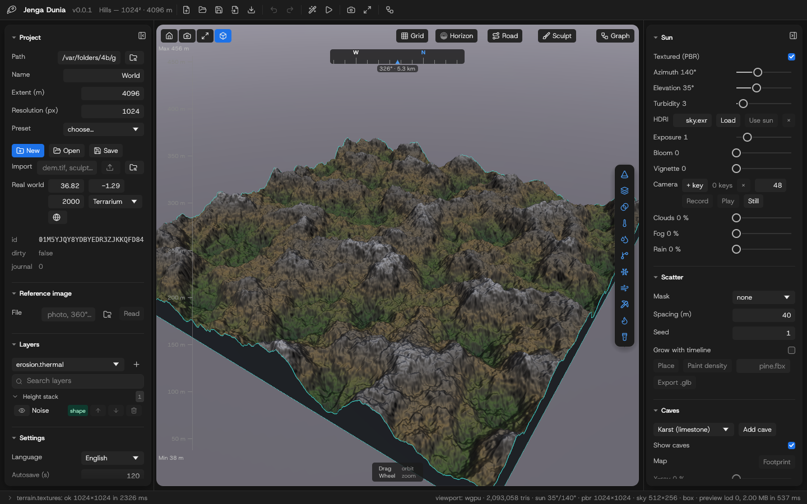
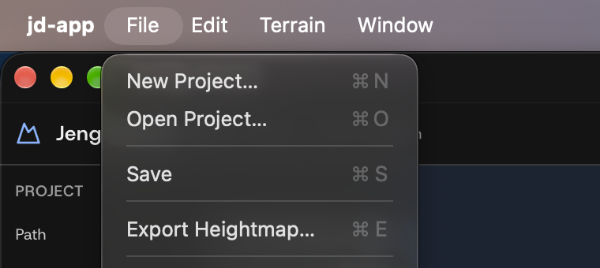
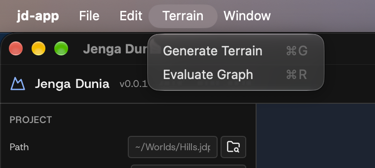
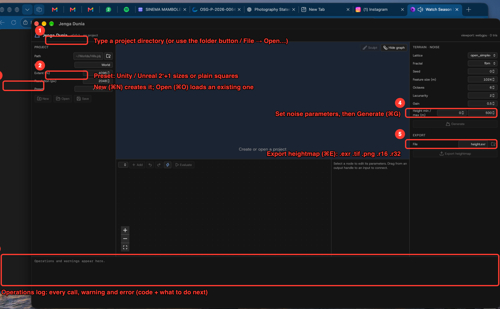
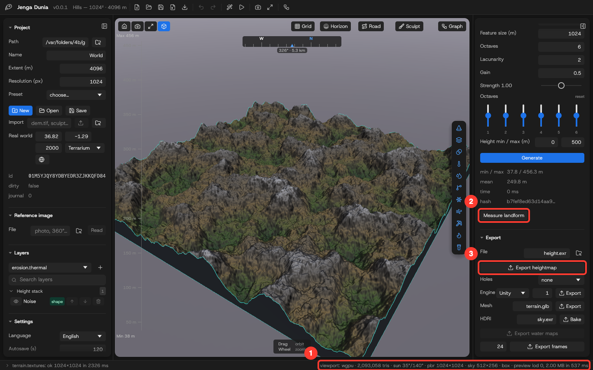
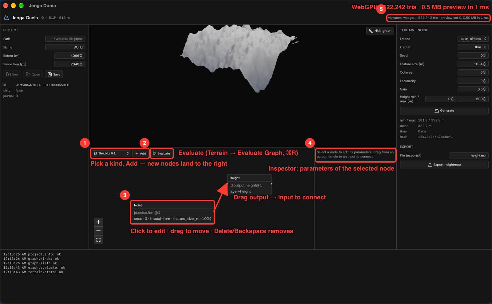
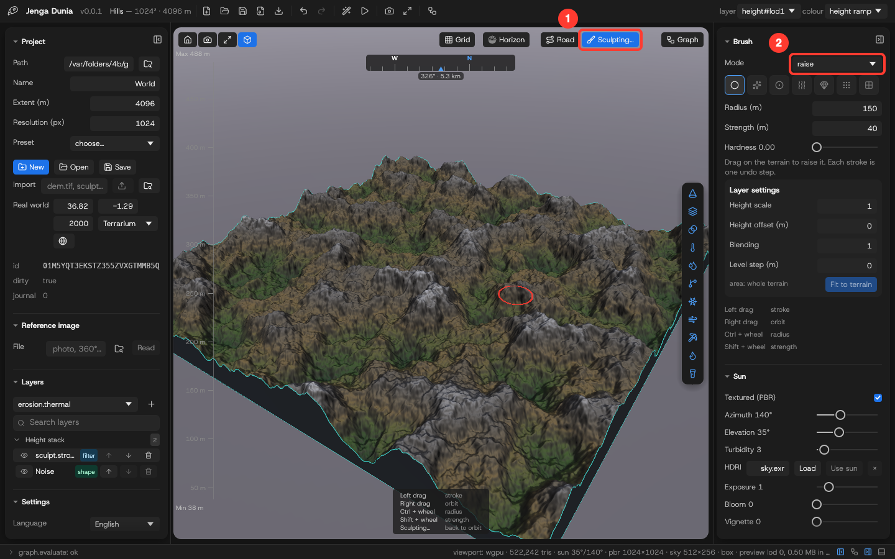

# Desktop app (Phase 2, early)

Status: first working build. One window, native macOS title bar, dark theme (Host Grotesk, Lucide icons). The layout follows World Creator's left-to-right workflow — project on the left, viewport in the centre, terrain/noise controls and export on the right, operations log at the bottom — and will grow into the full workspace of `docs/architecture/12-ui-workspace.md` (node editor, sculpting, materials, environment, jobs).



*Real screenshot of the running app on macOS (2026-10-20, v0.0.1). The header reports the viewport backend: here **WebGPU** inside the system WebView.*



*After **Terrain → Generate Terrain** (⌘G) driven through the native menu bar on a 512² project (release build, Apple Silicon): generation 15 ms, 0.5 MB preview to the WebGPU viewport in 1 ms, 522 242 triangles. Earlier measurement at 2048²: generation 58–63 ms, 2 MB preview in 6 ms; `exports/height.exr` validated by macOS ImageIO as 2048×2048, 32 bits/sample.*




*The Edit menu adds **Undo Graph Edit** (⌥⌘Z) and **Redo Graph Edit** (⇧⌥⌘Z) below the WebView's Undo/Redo.*

## Native integration

- Menu bar: **Jenga Dunia** (About, Services, Hide, Quit) · **File** (New… ⌘N, Open… ⌘O, Save ⌘S, Export Heightmap… ⌘E, Close Window ⌘W) · **Edit** (Undo/Redo/Cut/Copy/Paste/Select All) · **Terrain** (Generate ⌘G, Evaluate Graph ⌘R) · **Window** (Minimize, Zoom, Full Screen). Menu actions run the same operations as the buttons.
- Native file dialogs (tauri-plugin-dialog): **New…** asks where to create the `.jdproj` directory, **Open…** picks an existing one, **Export Heightmap…** is a save dialog with EXR / PNG 16-bit / RAW filters. The folder buttons next to the Path and File fields open the same dialogs; typed paths still work (and are what the tests drive).
- Launch with a project: `jd-app ~/Worlds/Hills.jdproj` (or double-click a `.jdproj` once the bundle's file association is registered) opens it before the window appears.
- Window position, size and maximised state are restored on the next launch (`tauri-plugin-window-state`; verified natively: move/resize → Quit → relaunch restores the exact bounds).
- Dark window theme, native title bar, Host Grotesk typography.

## Run from source

```sh
cargo build -p jd-mcp            # not needed by the app; used by the UI end-to-end tests
cd apps/desktop && pnpm install && pnpm tauri dev
```

## Build the app bundle

```sh
cd apps/desktop && pnpm tauri build --no-sign
# → target/release/bundle/macos/Jenga Dunia.app (18 MiB) and dmg/Jenga Dunia_0.0.1_aarch64.dmg (7 MiB)
```

The bundle is **unsigned** (no Apple developer account yet): macOS Gatekeeper will ask you to confirm the first launch of a downloaded copy; a locally built bundle runs directly. `src-tauri/Info.plist` (merged by the bundler) declares `.jdproj` as a **package** document type (`LSTypeIsPackage`, UTI `com.seedexr.jengadunia.project`), so Finder treats the project folder as a single document owned by Jenga Dunia: double-click, **Open With**, or a plain `open My.jdproj` launches the app with that project — macOS hands the document over as an Apple Event, which the app handles alongside the `jd-app My.jdproj` launch argument used on Linux/Windows and from the CLI. Verified on macOS 27 (2026-10-20) after `lsregister -f "Jenga Dunia.app"`: `open H512.jdproj` started the app, opened the project and live-previewed it; the app menu reads **Jenga Dunia**.

Logs: `~/Library/Logs/com.seedexr.jengadunia/jd-app.log` on macOS (`$XDG_DATA_HOME/com.seedexr.jengadunia/logs` on Linux, `%LOCALAPPDATA%\com.seedexr.jengadunia\logs` on Windows), plus stderr; `JD_LOG=debug` raises the level.

## Tutorial: first terrain in four steps



1. **Path** — type the project directory (created on disk as a `.jdproj` folder), or use the folder button / **File → Open…** for a native dialog.
2. **Preset** — Unity 1025²/2049²/4097², Unreal 2049²/4033² or plain squares fill resolution and extent.
3. **New (⌘N)** — or **Open (⌘O)** for an existing project; the header shows `name — resolution² · extent m`.
4. **Generate (⌘G)** — after choosing lattice, fractal, seed, feature size, octaves, lacunarity, gain and height range.
5. **Export heightmap (⌘E)** — `.exr`/`.tif`/`.r32` (exact), `.png`/`.r16` (16-bit, warns about quantisation).
6. **Log** — every operation with warnings and errors (stable code, why, what to do next).



1. Viewport readout: backend (WebGPU here), triangle count, preview size and transfer time. Shading is a preview: altitude tint (valley green → rock → snow), steep faces towards rock grey, sky with distance fog.
2. Layer statistics: min/max/mean height, generation time and the content hash — the same seed and parameters always give the same hash.
3. Export writes `exports/<file>` plus a `.jd-height.json` sidecar (size, range, flip, byte order); the folder button opens a native save dialog.
4. **Sculpt** switches the viewport to brush strokes (tutorial below).

*Annotations are generated from the real screenshots by `apps/desktop/scripts/annotate.mjs` from the `.annot.json` specs next to the images, so they can be regenerated whenever the UI changes.*

**Screen recording:** [`videos/first-terrain.mp4`](videos/first-terrain.mp4) (14 s, 1440×892) — the real app opened with a project, **Terrain → Generate Terrain** and **File → Export Heightmap…** triggered through the native menu bar, terrain appearing in the WebGPU viewport, `height.exr` written. Recorded with macOS `screencapture -V`; the menu actions were driven by System Events so the recording is reproducible.

**Screen recording (v0.0.1):** [`videos/graph-erosion-native.mp4`](videos/graph-erosion-native.mp4) (16 s, 1440×892) — the current build opened on a `noise → hydraulic erosion → height` project: the live preview shows the eroded terrain as the project loads, **Terrain → Generate Terrain** replaces it with the raw noise field, **Terrain → Evaluate Graph** brings the eroded result back from cache. Native window, release build, menu actions driven by System Events.

## Tutorial: the node graph

Every project starts with a two-node graph (`Noise → Height`), the same `graph.json` the CLI and MCP server edit. The panel under the viewport is that graph; **Hide graph** collapses it.



1. **Add** — pick a kind from the list (`graph.kinds` drives it) and click **Add**; the node is placed to the right of the graph and the view re-fits.
2. **Undo · Redo · ⚡ · Evaluate** — the toolbar's history buttons, the live-preview toggle and full-resolution evaluation, also **Terrain → Evaluate Graph (⌘R)**. With **live preview** (⚡, on by default) every edit re-evaluates at preview resolution (≤ 512², published as `height#lod<N>`) so the viewport follows your changes; unchanged nodes come from cache. A half-wired graph pauses the live preview with a `live preview waiting: input … not connected` line instead of an error. Export always evaluates at full resolution first.
3. **Nodes** — click to select, drag to move (the position is saved in the project), **Delete**/**Backspace** removes the node and its edges. The ↶ ↷ buttons (or **Edit → Undo/Redo Graph Edit**, ⌥⌘Z / ⇧⌥⌘Z) step through the edit history; ⌘Z alone stays with the text fields. The capture shows a `noise → hydraulic erosion → height` graph (the hydraulic node overlaps the noise node because it was added from the CLI without a position).
4. **Inspector** — the selected node's parameters, generated from the kind's JSON schema (enums become drop-downs, defaults show as placeholders). Leaving a field applies `graph.set_param`; an invalid value is rejected by the core before anything is journaled and the reason appears in the log.
5. **Viewport readout** — backend, triangle count and preview transfer for the evaluated layer (here the hydraulically eroded 512² terrain, live-previewed when the project opened). When the graph publishes more than one layer (e.g. a second output node named `water` fed by the hydraulic node's `water` port, or `slope` from the slope mask), a **layer** picker appears in the header; the viewport and stats follow the chosen layer, and live previews keep showing it.

6. **Sculpt** — enters sculpt mode (next tutorial).

Undo and redo are operations like everything else (`graph.undo` / `graph.redo`, journaled as `graph.restore`), so a crash in the middle of undoing recovers to exactly what you saw. Connect nodes by dragging from an output handle (right) to an input handle (left); an input holds one edge, so dropping a new connection replaces the old one. Cycles, wrong ports and type mismatches are refused by the core (`E_GRAPH_CYCLE`, `E_INPUT_INVALID`, `E_GRAPH_TYPE_MISMATCH`). Evaluating while a required input is unconnected reports `E_GRAPH_MISSING_INPUT` with the node and port.


**Screen recording:** [`videos/graph-editor.mp4`](videos/graph-editor.mp4) (17 s, 1440×900) — the whole flow above: edit the seed, add a blur node, connect it by dragging the handles, move a node, evaluate, delete with the keyboard, undo and redo. It is the UI-driven test `apps/desktop/e2e/graph.spec.ts` running against the real core, recorded with `JD_VIDEO=1 pnpm exec playwright test e2e/graph.spec.ts` (actions slowed to human pace), so it is regenerated whenever the editor changes.

## Tutorial: sculpting

1. Click **Sculpt** (top of the viewport). If the graph has no stroke node yet, a `jd.sculpt.strokes` node is inserted in front of the output and selected; the button reads **Sculpting…** and a **Brush** panel (radius, strength in metres; negative strength digs) appears on the right.
2. Drag on the terrain. The pointer is projected onto the surface and the path becomes one stroke (`points` in layer metres, radius, strength) appended to the node's `strokes` parameter — a journaled `graph.set_param`, so the live preview updates and **Undo** removes the whole stroke.
3. Click **Sculpting…** to go back to orbiting. Strokes are data in `graph.json`: the CLI and MCP see the same node, and re-evaluating anywhere replays them identically.



*This capture is the UI-driven test (`e2e/sculpt.spec.ts`, Chromium + the real core) rather than the native window; the native screenshots are re-shot when the display is available.*

## Workflow

1. **Project** — **File → New… (⌘N)** and choose where the `.jdproj` directory goes, or type a path (e.g. `~/Worlds/Hills.jdproj`) and click **New**; **Open… (⌘O)** or the folder button picks an existing project. Set extent (m) and resolution (px) before creating, or pick a **Preset** (Unity 1025²/2049²/4097², Unreal 2049²/4033², plain 512²–4096²); engines want 2ⁿ+1 samples so quads line up with their patch grids. The header shows `name — resolution² · extent m`; the panel shows the project id, dirty flag and pending journal entries.
2. **Terrain · Noise** — choose lattice and fractal, seed, feature size, octaves, lacunarity, gain, height range; click **Generate**. Stats (min/max/mean, time, content hash) appear under the button and the viewport shows the terrain with a preview shading: hypsometric tint by altitude (valley green → ochre → rock → snow), steep faces towards rock grey, sky background with distance fog. Drag to orbit, wheel to zoom. Real materials come from the material graph later.
3. **Export** — **File → Export Heightmap… (⌘E)** or the folder button opens a save dialog (the extension picks the format: `.exr`, `.tif`, `.png`, `.r16`, `.r32`); typing a relative name and clicking **Export heightmap** writes into the project's `exports/`. Every export gets a `.jd-height.json` sidecar. Quantised formats log a `W_EXPORT_LOSS` warning.
4. **Save** — writes `project.json`/`graph.json`/`scene.json` atomically and clears the journal.

Every button calls the same operation the CLI and MCP server expose (`jd schema --list`), so anything you do here can be scripted.

## How the UI is tested

| Level | What | Where |
|---|---|---|
| Component (jsdom) | the real `App` with `invoke` mocked at the Tauri boundary: create → generate → stats → preview → export warning; error display | `apps/desktop/src/App.test.tsx` (`pnpm test`) |
| End-to-end (Chromium) | the real frontend driven by Playwright with `invoke` bridged to the **real Rust core** via `jd-mcp` (MCP over stdio): project files appear on disk, the viewport reports its backend and triangle count, a 16-bit PNG is written | `apps/desktop/e2e/terrain.spec.ts` (`pnpm test:e2e`) |
| End-to-end, node graph | starter graph drawn from `graph.json`; edit a parameter, add a node, connect it by dragging handles, drag a node, evaluate, delete with the keyboard; the project's `journal/ops.ndjson` is read back and must list exactly `set_param, add_node, connect, move_node, remove_node` | `apps/desktop/e2e/graph.spec.ts` |
| Native window | screenshots of the real Tauri app on macOS; interaction recording requires Accessibility permission for the automating process | this page |

Known limits of this build: no sculpting, one output layer, no undo of graph edits yet (the journal records them). The tutorial images are the real app annotated by `scripts/annotate.mjs`; the Figma file linked in the brief is the design reference and receives the same screenshots once the connector is authorised.
