# Desktop app (Phase 2, early)

Status: first working build. One window, native macOS title bar, dark theme (Host Grotesk, Lucide icons). The layout follows World Creator's left-to-right workflow — project on the left, viewport in the centre, terrain/noise controls and export on the right, operations log at the bottom — and will grow into the full workspace of `docs/architecture/12-ui-workspace.md` (node editor, sculpting, materials, environment, jobs).


*Real screenshot of the running app on macOS (2026-10-20, v0.0.1). The header reports the viewport backend: here **WebGPU** inside the system WebView.*


*After **Terrain → Generate Terrain** (⌘G) driven through the native menu bar on a 512² project (release build, Apple Silicon): generation 15 ms, 0.5 MB preview to the WebGPU viewport in 1 ms, 522 242 triangles. Earlier measurement at 2048²: generation 58–63 ms, 2 MB preview in 6 ms; `exports/height.exr` validated by macOS ImageIO as 2048×2048, 32 bits/sample.*


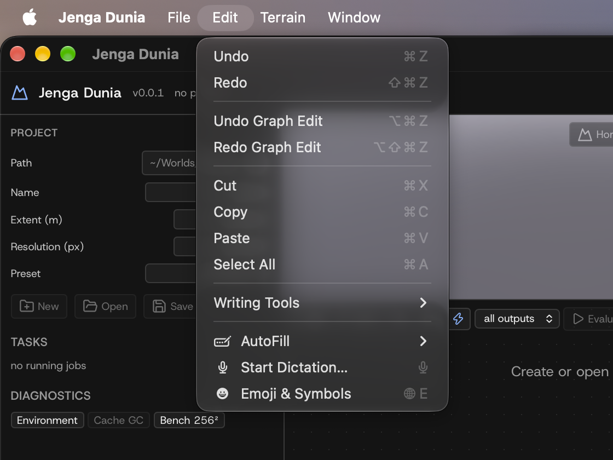

*The Edit menu adds **Undo Graph Edit** (⌥⌘Z) and **Redo Graph Edit** (⇧⌥⌘Z) below the WebView's Undo/Redo (native capture of the v0.0.1 bundle, 2026-10-21).*

## Native integration

- Menu bar: **Jenga Dunia** (About, Services, Hide, Quit) · **File** (New… ⌘N, Open… ⌘O, Save ⌘S, Export Heightmap… ⌘E, Close Window ⌘W) · **Edit** (Undo/Redo/Cut/Copy/Paste/Select All) · **Terrain** (Generate ⌘G, Evaluate Graph ⌘R) · **Window** (Minimize, Zoom, Full Screen). Menu actions run the same operations as the buttons.
- Native file dialogs (tauri-plugin-dialog): **New…** asks where to create the `.jdproj` directory, **Open…** picks an existing one, **Export Heightmap…** is a save dialog with EXR / PNG 16-bit / RAW filters. The folder buttons next to the Path and File fields open the same dialogs; typed paths still work (and are what the tests drive).
- Launch with a project: `jd-app ~/Worlds/Hills.jdproj` (or double-click a `.jdproj` once the bundle's file association is registered) opens it before the window appears.
- Window position, size and maximised state are restored on the next launch (`tauri-plugin-window-state`; verified natively: move/resize → Quit → relaunch restores the exact bounds).
- Dark window theme, native title bar, Host Grotesk typography.
- App icon: the brand mark on the brand gradient. macOS 26 and later draw the Icon Composer document `src-tauri/icons/icon.icon` (compiled into `Resources/Assets.car`, named by `CFBundleIconName`), so the system supplies the glass shape and the icon fills the Dock tile like every other app; a legacy `.icns` alone is shrunk onto a grey plate there. macOS 15 and earlier, Windows and Linux use `icon.icns` / `icon.ico` / the PNG sizes, regenerated by `scripts/app-icon.sh` (needs Xcode 26 for `actool`; the compiled catalog is committed).

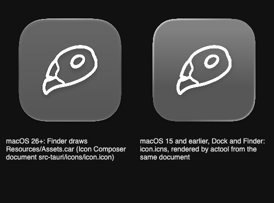

## Run from source

```sh
cargo build -p jd-mcp            # not needed by the app; used by the UI end-to-end tests
cd apps/desktop && pnpm install && pnpm tauri dev
```

## Build the app bundle

```sh
cd apps/desktop && pnpm tauri build --no-sign
# → target/release/bundle/macos/Jenga Dunia.app (18 MiB) and dmg/Jenga Dunia_0.0.1_aarch64.dmg (7 MiB)
```

The bundle is **unsigned** (no Apple developer account yet): macOS Gatekeeper will ask you to confirm the first launch of a downloaded copy; a locally built bundle runs directly. `src-tauri/Info.plist` (merged by the bundler) declares `.jdproj` as a **package** document type (`LSTypeIsPackage`, UTI `com.seedexr.jengadunia.project`), so Finder treats the project folder as a single document owned by Jenga Dunia: double-click, **Open With**, or a plain `open My.jdproj` launches the app with that project — macOS hands the document over as an Apple Event, which the app handles alongside the `jd-app My.jdproj` launch argument used on Linux/Windows and from the CLI. Verified on macOS 27 (2026-10-20) after `lsregister -f "Jenga Dunia.app"`: `open H512.jdproj` started the app, opened the project and live-previewed it; the app menu reads **Jenga Dunia**.

Logs: `~/Library/Logs/com.seedexr.jengadunia/jd-app.log` on macOS (`$XDG_DATA_HOME/com.seedexr.jengadunia/logs` on Linux, `%LOCALAPPDATA%\com.seedexr.jengadunia\logs` on Windows), plus stderr; `JD_LOG=debug` raises the level.

## Tutorial: first terrain in four steps


1. **Path** — type the project directory (created on disk as a `.jdproj` folder), or use the folder button / **File → Open…** for a native dialog.
2. **Preset** — Unity 1025²/2049²/4097², Unreal 2049²/4033² or plain squares fill resolution and extent.
3. **New (⌘N)** — or **Open (⌘O)** for an existing project; the header shows `name — resolution² · extent m`.
4. **Generate (⌘G)** — after choosing lattice, fractal, seed, feature size, octaves, lacunarity, gain and height range, or a **Preset** (Mountains 0..500 m, Ridged alpine 0..1200 m, Rolling hills 0..150 m, Desert plain 0..40 m) that fills those fields.
5. **Export heightmap (⌘E)** — `.exr`/`.tif`/`.r32` (exact), `.png`/`.r16` (16-bit, warns about quantisation).
6. **Log** — every operation with warnings and errors (stable code, why, what to do next).


1. Viewport readout: backend (WebGPU here), triangle count, preview size and transfer time. Shading is a preview: altitude tint (valley green → rock → snow), steep faces towards rock grey, sky with distance fog.
2. Layer statistics: min/max/mean height, generation time and the content hash — the same seed and parameters always give the same hash.
3. Export writes `exports/<file>` plus a `.jd-height.json` sidecar (size, range, flip, byte order); the folder button opens a native save dialog.
4. **Sculpt** switches the viewport to brush strokes (tutorial below).

*Annotations are generated from the real screenshots by `apps/desktop/scripts/annotate.mjs` from the `.annot.json` specs next to the images, so they can be regenerated whenever the UI changes.*

**Screen recording:** [`videos/first-terrain.mp4`](videos/first-terrain.mp4) (14 s, 1440×892) — the real app opened with a project, **Terrain → Generate Terrain** and **File → Export Heightmap…** triggered through the native menu bar, terrain appearing in the WebGPU viewport, `height.exr` written. Recorded with macOS `screencapture -V`; the menu actions were driven by System Events so the recording is reproducible.

**Screen recording (v0.0.1):** [`videos/graph-erosion-native.mp4`](videos/graph-erosion-native.mp4) (16 s, 1440×892) — the current build opened on a `noise → hydraulic erosion → height` project: the live preview shows the eroded terrain as the project loads, **Terrain → Generate Terrain** replaces it with the raw noise field, **Terrain → Evaluate Graph** brings the eroded result back from cache. Native window, release build, menu actions driven by System Events.

## Tutorial: the node graph

Every project starts with a two-node graph (`Noise → Height`), the same `graph.json` the CLI and MCP server edit. The panel under the viewport is that graph; **Hide graph** collapses it.

**Layout and docking.** The three columns and the graph strip are resizable with native handles: drag the bottom-right corner of the left or right panel sideways (200–520 px and 220–560 px) and the corner of the graph panel up or down (160 px to 70 % of the window); **Hide graph** gives the viewport the whole height. Each side panel has a collapse button in its top corner that folds it to a 24 px strip (the strip's button brings it back), and the button under **Hide graph** docks the graph **beside** the viewport (a column you resize sideways, 280 px to 60 % of the window) or back **under** it. Sizes, collapsed panels and the graph's dock persist in the browser store, so the layout comes back on the next launch (UI-driven check: `apps/desktop/e2e/settings.spec.ts` reads the panels' `resize` style and reloads after a resize; `e2e/docking.spec.ts` collapses, docks, reloads).

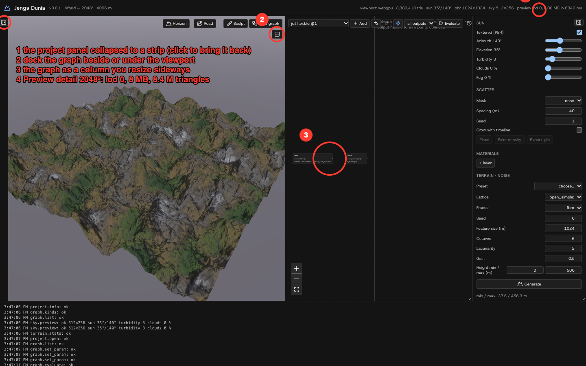

**Preview detail.** The viewport shows a preview of at most **1024²** samples (about 2 MB a transfer and 2 M triangles) whatever the world's size — a 4096² world previews at lod 2. Settings ▸ **Preview detail** switches to **2048²** for worlds above 1024² when the fine ridges matter more than the frame rate: 4× the samples, 8 MB a transfer, about 8 M triangles, and the PBR maps bake at 2048 too; the header's `preview lod N, X MB` says what came across. The choice is an app setting in the browser store.


1. **Add** — pick a kind from the list (`graph.kinds` drives it) and click **Add**; the node is placed to the right of the graph and the view re-fits.
2. **Undo · Redo · ⚡ · Evaluate** — the toolbar's history buttons, the live-preview toggle and full-resolution evaluation, also **Terrain → Evaluate Graph (⌘R)**. While an evaluation runs, the header shows the job (`graph.evaluate · node 2/4 hydraulic · 3.2 s`) with a **Cancel** button; cancelling stops at the next node or erosion iteration and logs `E_CANCELLED` — nothing is published. With **live preview** (⚡, on by default) every edit re-evaluates at preview resolution (≤ 512², published as `height#lod<N>`) so the viewport follows your changes; unchanged nodes come from cache. A half-wired graph pauses the live preview with a `live preview waiting: input … not connected` line instead of an error. Export always evaluates at full resolution first.
3. **Nodes** — click to select, drag to move (the position is saved in the project), **Delete**/**Backspace** removes the node and its edges. The ↶ ↷ buttons (or **Edit → Undo/Redo Graph Edit**, ⌥⌘Z / ⇧⌥⌘Z) step through the edit history; ⌘Z alone stays with the text fields. The capture shows a `noise → hydraulic erosion → height` graph (the hydraulic node overlaps the noise node because it was added from the CLI without a position).
4. **Inspector** — the selected node's parameters, generated from the kind's JSON schema (enums become drop-downs, defaults show as placeholders). Leaving a field applies `graph.set_param`; an invalid value is rejected by the core before anything is journaled and the reason appears in the log.
5. **Viewport readout** — backend, triangle count and preview transfer for the evaluated layer (here the hydraulically eroded 512² terrain, live-previewed when the project opened). When the graph publishes more than one layer (e.g. a second output node named `water` fed by the hydraulic node's `water` port, or `slope` from the slope mask), a **layer** picker appears in the header; the viewport and stats follow the chosen layer, and live previews keep showing it.

6. **Sculpt** — enters sculpt mode (next tutorial).

Undo and redo are operations like everything else (`graph.undo` / `graph.redo`, journaled as `graph.restore`), so a crash in the middle of undoing recovers to exactly what you saw. The history keeps up to 100 graph snapshots and at most 64 MiB of them: ordinary graphs are kilobytes and keep all 100; a sculpt session with hundreds of long strokes (500 strokes × 50 points serialise to 2 MiB) keeps about 30 steps. Connect nodes by dragging from an output handle (right) to an input handle (left); an input holds one edge, so dropping a new connection replaces the old one. Cycles, wrong ports and type mismatches are refused by the core (`E_GRAPH_CYCLE`, `E_INPUT_INVALID`, `E_GRAPH_TYPE_MISMATCH`). Evaluating while a required input is unconnected reports `E_GRAPH_MISSING_INPUT` with the node and port.

**Autosave.** Every edit is journaled first (crash-safe), and `settings.autosave_interval_s` seconds after the last edit (project.json, default 120; `0` disables) the app saves the project on its own: the log shows `project.save: ok`, the project panel's **dirty** returns to `false` and **journal** to `0`, and `graph.json` on disk is current. Press **Save** (⌘S) to save immediately. The UI-driven test `apps/desktop/e2e/hydrology.spec.ts` runs with the interval set to 2 s and checks the saved `graph.json` and the truncated journal. (For debugging, `?autosave=<ms>` in the dev URL overrides the interval.)

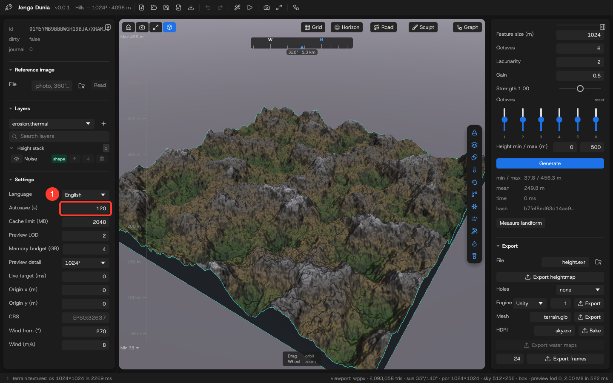

**Live target.** **Live target (ms)** (an app setting, kept in the browser store, 0 = off) is the time budget of one live-preview evaluation: while evaluations run over it the live evaluation steps one LOD coarser (up to four steps above the ≤ 512² live default), and when they finish in under a quarter of it it steps finer again, never below that default. The header's `preview lod N` is the *transfer* LOD of the viewport mesh (see Preview detail above), not the live-evaluation LOD; the project's **Preview LOD** setting is a hint stored in `project.json` for clients, the desktop's own choice is Preview detail. Evaluate and every export still run at full resolution.

**Clouds.** The Sun panel's **Clouds** slider sets the cover of the sky dome (`cloud_cover` on `sky.preview`); the log names the cover each bake used, and `sky.bake` takes the same parameters for the HDRI. **Fog** is a viewport look setting next to it: 0 keeps the faint aerial perspective, 1 closes the view within the world's width (the header shows `fog N %`); bakes and exports are untouched.

**Wind.** The Settings section also holds the world's shared wind — **Wind from (°)** and **Wind (m/s)** — the one setting dunes, yardangs, snow scour and the viewport's wind sea follow unless a node sets its own `wind_*` parameter; it is journaled through the same `project.set_settings` and saved in `project.json` under `world.wind` (UI-driven check: `apps/desktop/e2e/settings.spec.ts`).

*Settings live in the project panel: **Autosave (s)**, **Cache limit (MB)**, **Preview LOD** and **Memory budget (GB)** (evaluations whose pre-flight estimate exceeds it are refused with `E_RESOURCE_MEMORY` — the default 4 GB is the project's hard ceiling) are `project.json → settings`, edited through `project.set_settings` — a journaled mutation like everything else, so a crash mid-edit recovers it. The core validates every value (cache limit ≥ 16 MB, autosave ≤ a day, LOD ≤ 8) and a refused value snaps back to the stored one with the reason in the log. The UI-driven test `apps/desktop/e2e/settings.spec.ts` sets autosave to 1 s, tries an 8 MB cache (refused), edits a node and watches the project save itself.*


**Screen recording:** [`videos/graph-editor.mp4`](videos/graph-editor.mp4) (17 s, 1440×900) — the whole flow above: edit the seed, add a blur node, connect it by dragging the handles, move a node, evaluate, delete with the keyboard, undo and redo. It is the UI-driven test `apps/desktop/e2e/graph.spec.ts` running against the real core, recorded with `JD_VIDEO=1 pnpm exec playwright test e2e/graph.spec.ts` (actions slowed to human pace), so it is regenerated whenever the editor changes.

## Tasks and diagnostics

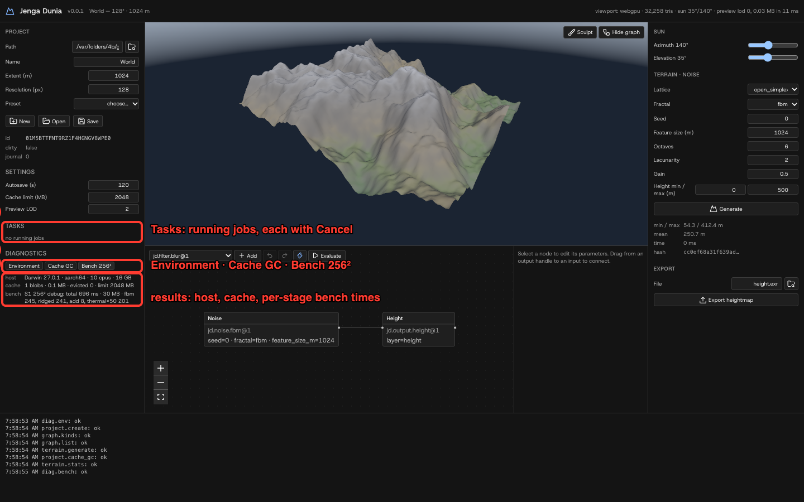

*Below the settings the project panel lists **Tasks** — every running job with its progress and a **Cancel** button (the header shows the first one; detached MCP jobs appear here too) — and **Diagnostics**: **Environment** (`diag.env`: OS, CPU count, memory), **Cache GC** (`project.cache_gc`: blobs and bytes kept, evicted, the project's limit) and **Bench 256²** (`diag.bench` S1 at a small size: per-stage milliseconds and peak memory; the CLI's `jd diag bench s1` is the comparable benchmark). Every result is an ordinary op envelope, so the log shows the same `ok`/error lines agents see. UI-driven test: `apps/desktop/e2e/diagnostics.spec.ts`.*

## Sky and sun

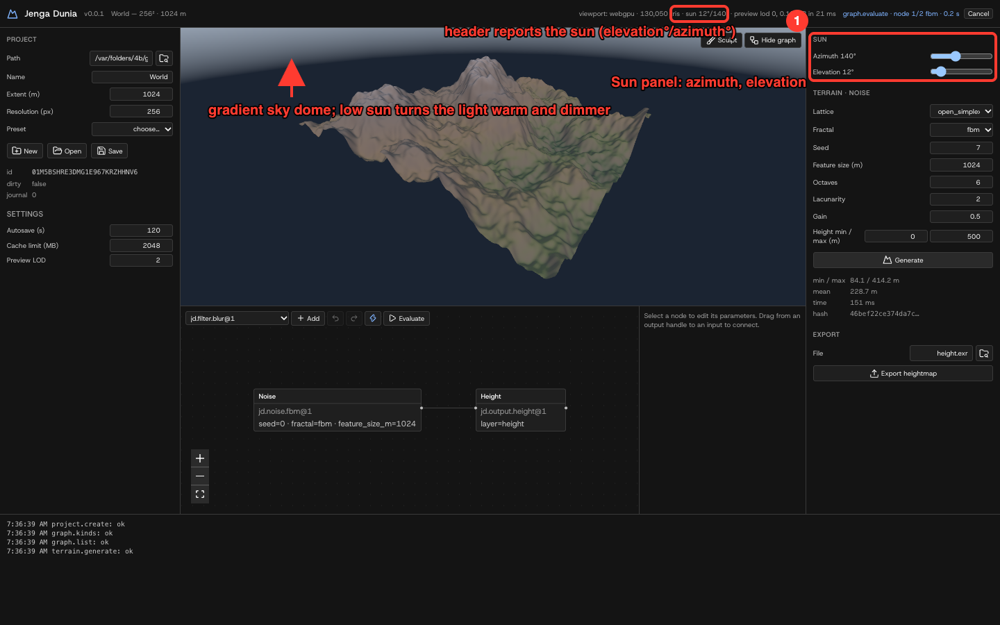

*The viewport lights the terrain with a sun you steer from the **Sun** panel (1): azimuth is the compass direction the light comes from, elevation its height above the horizon — below 20° the light turns warm and dimmer, like World Creator's time-of-day. The header reports the current direction (2). The sun is a view setting, not part of the project. UI-driven test: `apps/desktop/e2e/terrain.spec.ts` drags the elevation to 12° and checks the readout.*

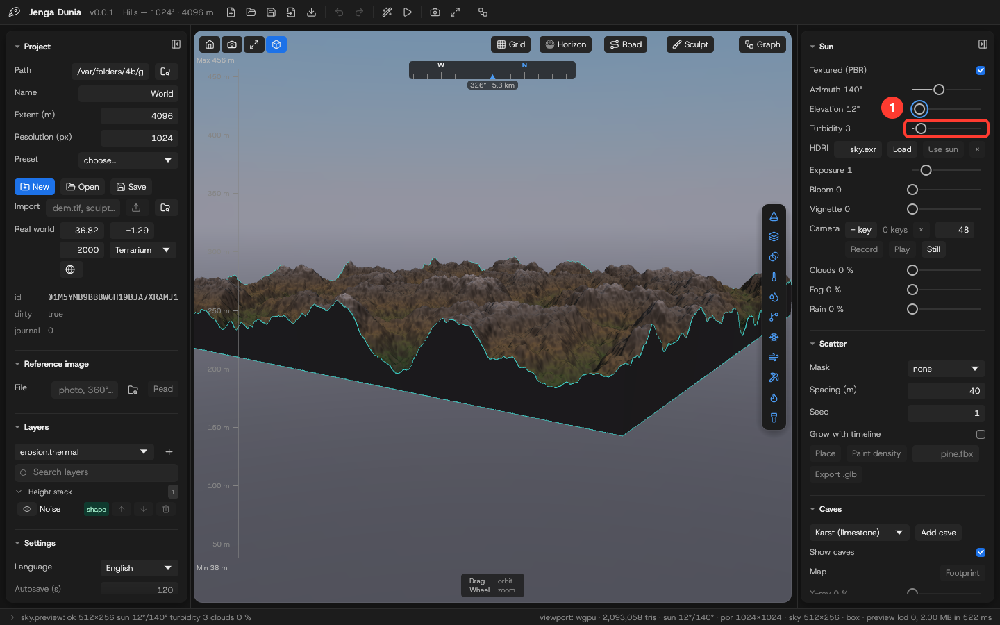

*Physical sky: the dome is the same Preetham daylight model `sky.bake` writes for engines (CLI quickstart, "Physical sky as an HDRI"), baked by the core as a small equirectangular preview whenever the sun moves or **Turbidity** (1) changes — 2 is clear mountain air, 3 clear, 6 hazy, 10 thick haze — and reported in the header as `sky 512×256` (2). Orbit down to the horizon to see it: a deep blue zenith, a bright aureole around the sun, a warm horizon at low elevations, and a ground band that fades out below the rim. The dome is only what you see; the terrain's lighting still comes from the sun lamp, so the baked HDRI (sun included) is the file to light a scene with elsewhere.*

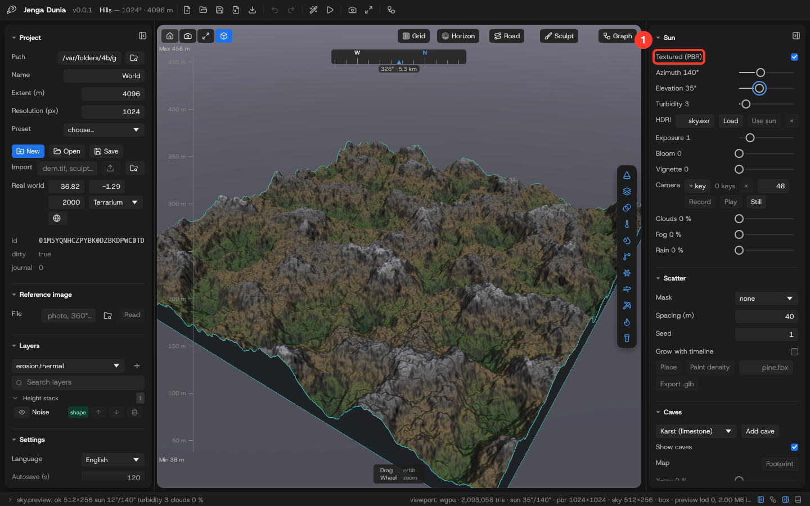

**Screen recording:** [`videos/terrain-pbr-import.mp4`](videos/terrain-pbr-import.mp4) (16 s, 1440×900) — new project, Generate, the PBR-textured viewport with the toggle switched off and on, the sun lowered, an EXR export, and the same file imported back as a heightmap input node that is wired to the output and evaluated. It is the UI-driven test `apps/desktop/e2e/terrain.spec.ts` recorded with `JD_VIDEO=1`, so it is regenerated whenever the flow changes.

*Textured terrain: with **Textured (PBR)** on (1, default) the viewport shades the height layer with the same maps the GLB export carries — albedo, tangent-space normal and roughness baked from the full-resolution field by `terrain.textures` (one texel per sample, capped at 1024 per side for the viewport). The normal map restores the relief that the preview LOD drops on large worlds, so a 4096² world previewed at 1024² still shows its fine ridges; the header reports the map size (2). Off, the terrain falls back to the height-ramp vertex colours; a **colour** overlay always wins over the maps. Maps are re-baked after each evaluation of a height-like layer, not for masks. UI-driven test: the terrain spec checks the readout and the toggle both ways.*

## Hydrology layers in the viewport

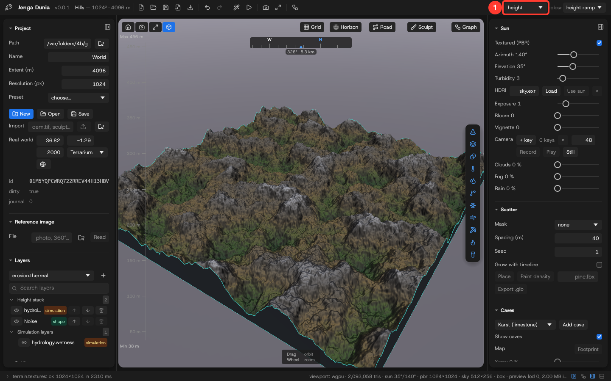

*Native capture (v0.0.1): a `noise → rivers → height` graph with two extra outputs (`rivers`, `wetness`) built from the CLI (see the hydrology recipe in the CLI quickstart) and opened in the app. The header's **layer** picker lists every published layer; the viewport shows the carved terrain, and picking `rivers` or `wetness` shows those masks with their own stats.*

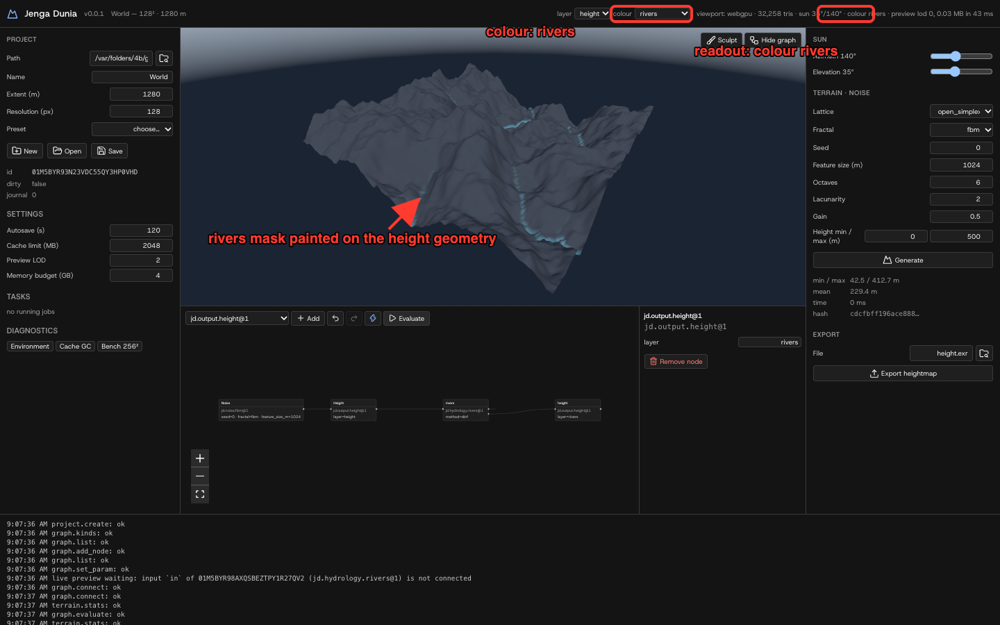

*Colour by layer: the header's **colour** select paints the terrain with any published layer instead of the height ramp — masks (rivers, wetness, slope, scatter densities) as a dark-to-blue gradient, class maps (biomes) with one hue per class — while the geometry stays the height layer. It is how you check a mask against the relief without leaving the 3D view; the header line reports `colour <layer>`. UI-driven test: `apps/desktop/e2e/hydrology.spec.ts`.*

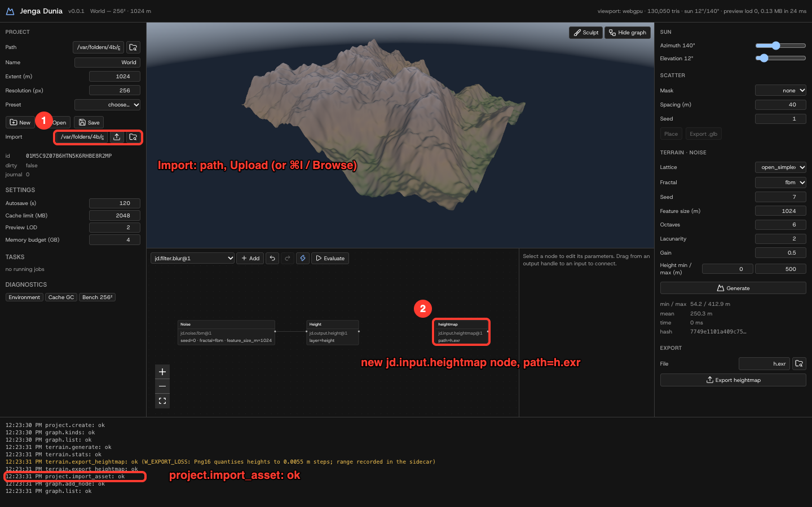

*Import a heightmap or mesh: the **Import** row in the Project panel (or **File ▸ Import Heightmap or Mesh…**, ⌘I, which opens the native file dialog) takes a PNG 16-bit, EXR, TIFF, RAW or binary FBX file, copies it into the project's `assets/` through `project.import_asset`, and adds a `jd.input.heightmap@1` node that reads it by name. Wire the node into an output and evaluate: the e2e test exports the generated terrain as EXR, imports it back this way and checks the layer's min/max/mean are the same again. An FBX mesh (sculpted in Blender, for instance) is rasterised over its footprint onto the world grid; quantised PNG/RAW files need their height range set on the node.*

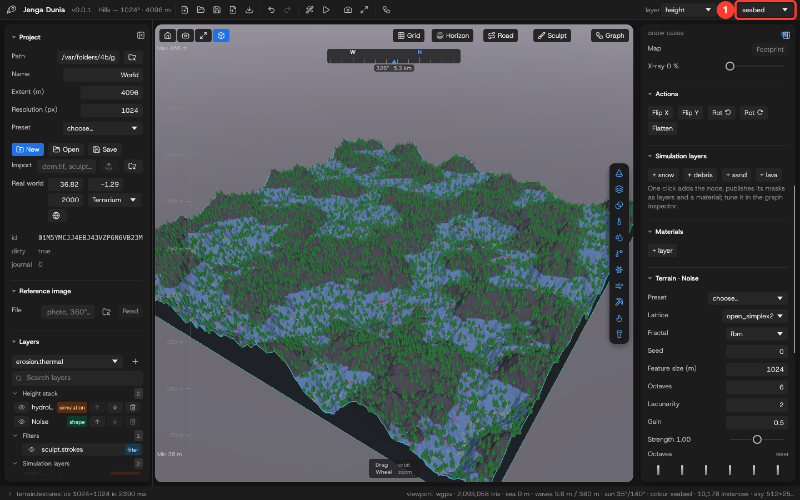

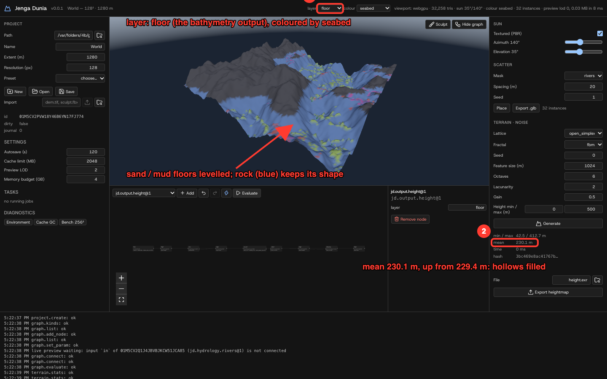

*Bathymetry: `jd.ocean.bathymetry@1` takes the terrain and the seabed class map and fills the sand and mud hollows with sediment (towards the local mean over `smooth_m`, at most `max_fill_m`, never above `level_m`) while rock and reef keep their shape. Published as `floor` it is an ordinary height layer: pick it in the header, colour it by `seabed`, and the stats show the mean rising as the hollows fill (229.4 → 230.1 m on the default world). Recording below.*

*Seabed classes: `jd.biome.seabed@1` takes the terrain (and optionally the `rivers` and `shore` masks) and labels the floor under `level_m` as sand, rock, mud or reef by depth and slope — see the CLI quickstart for the rules. Published as a layer it colours the viewport like any class map (the palette gives each class its own hue — on the default 128² world at a 250 m sea the floor reads 50.9 % rock in blue, 4.8 % mud in yellow-green and 2.0 % sand in red, with reef at a single cell; the steep noise terrain leaves little gentle shelf) and feeds `jd.mask.class@1` for materials and scatter. The hydrology e2e adds it, wires it from the rivers node, evaluates and colours by it.*

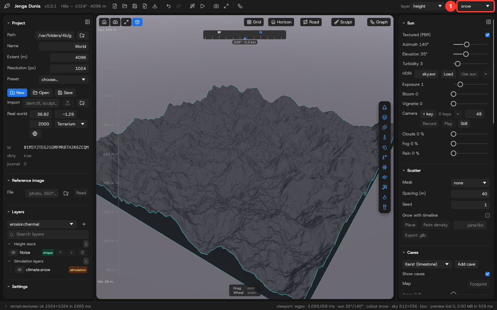

*Snow cover: `jd.climate.snow@1` turns a height layer into a 0..1 cover mask — a soft **snow line** (`snow_line_m` ± `transition_m`), retention that falls to zero at `max_slope_deg`, sun-facing slopes melting (`sun_azimuth_deg`, `sun_strength`) and windward slopes scoured (`wind_azimuth_deg`, `wind_strength`). Publish its `snow` port as a layer and it works everywhere a mask does: **colour** overlay (shown), scatter density, or an input to biome rules. The UI-driven biomes test adds the node, lowers the snow line to 300 m, wires and evaluates it, then colours the terrain by it.*

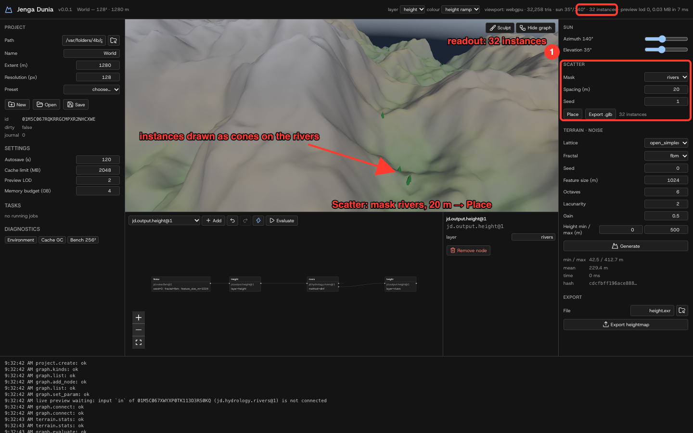

**Screen recording:** [`videos/hydrology-scatter-sea.mp4`](videos/hydrology-scatter-sea.mp4) (60 s, 1440×900) — the whole hydrology flow: add a rivers node, switch its method in the inspector, wire it, evaluate, publish the rivers mask as a second output, colour the terrain by it, scatter instances along the rivers and export them as GLB, add a sea-level node and raise the water to 250 m, make it murky (visibility 4 m) and raise a 20 m/s gale on it (the sea heaves and the surf foam widens), then classify the seabed, colour the drained floor by sand / rock / mud, and fill its sediment hollows with the bathymetry node (the floor layer's mean rises). The UI-driven test `apps/desktop/e2e/hydrology.spec.ts` recorded with `JD_VIDEO=1`.

*Scatter instances: the **Scatter** panel (right column, under Sun) takes any published 0..1 layer as a density **Mask**, a **Spacing** in metres and a **Seed**; **Place** calls `terrain.scatter` without a path, so the points come back inline and the viewport draws them as green cones (one `InstancedMesh`, cone height the larger of 0.35 × spacing and 1.2 % of the world extent, so they read at any world size; yaw and a 0.75–1.25 scale from each point's `r`, exactly what the GLB carries). The header readout shows `· N instances`, and the panel keeps the count. Instances follow the graph: after every evaluation they are re-placed while the mask layer is still published and dropped when it is not. **Export .glb** writes `exports/<mask>.glb` — one 1 m proxy pyramid instanced with `EXT_mesh_gpu_instancing` (see the CLI quickstart for the Blender-verified import). Inline placement is capped at 200 000 points; beyond that the core asks for a path or a larger spacing.*

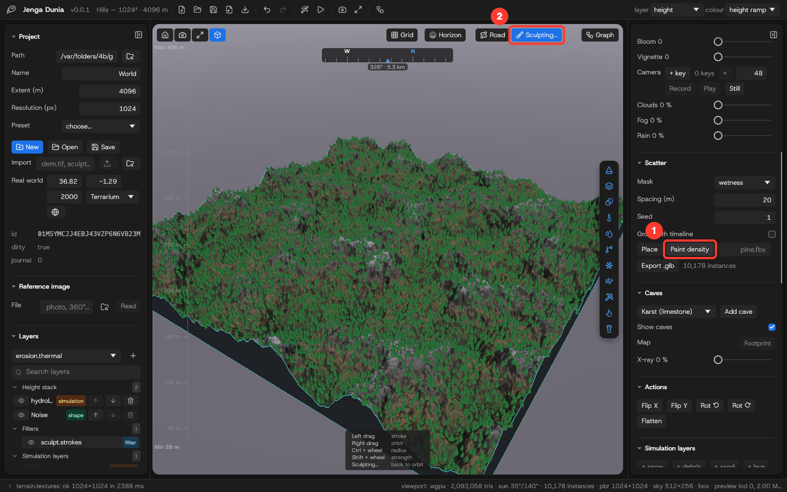

*Paint density: with a mask chosen, **Paint density** (1) splices a stroke node in front of the output that publishes that mask — the same `jd.sculpt.strokes@1` as sculpting, with `clamp` 0…1 so the mask stays a probability — and switches the viewport to the brush at strength 0.5 (2). Each drag adds density under the brush (a negative strength thins it), is one journaled stroke (3) that undo removes, and the live preview re-places the instances, so the count in the header follows the brush. This is VUE's EcoPainter idea on top of the node graph: the painted layer is data in the project, replayable and exportable like any other. The UI-driven test `apps/desktop/e2e/paint.spec.ts` scatters from a wetness mask, paints one stroke and checks the instance count rises.*

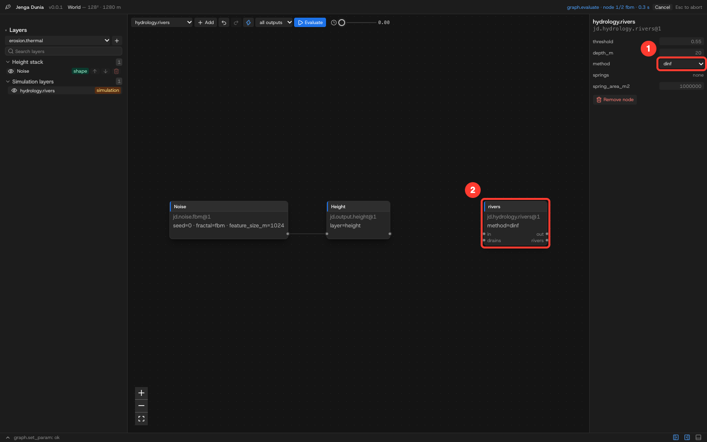

*Inside the app: pick `jd.hydrology.rivers@1` in the kinds dropdown and **Add** (1), click the node (2) and the schema-driven inspector shows its parameters; `method` is a select built from the node's schema — switch it from `d8` to `dinf` (3) and the node label updates (`method=dinf`) after the core journals `graph.set_param`. `jd.hydrology.sea_level@1` adds the same way and exposes two output handles, `ocean` and `depth`. Numbers that come from the core as 32-bit floats are shown rounded (`0.55`, not `0.550000011920929`). Captured by the UI-driven test `apps/desktop/e2e/hydrology.spec.ts`.*

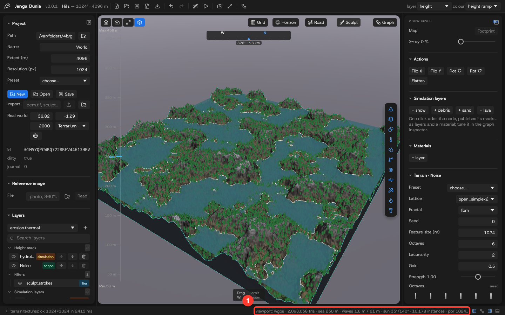

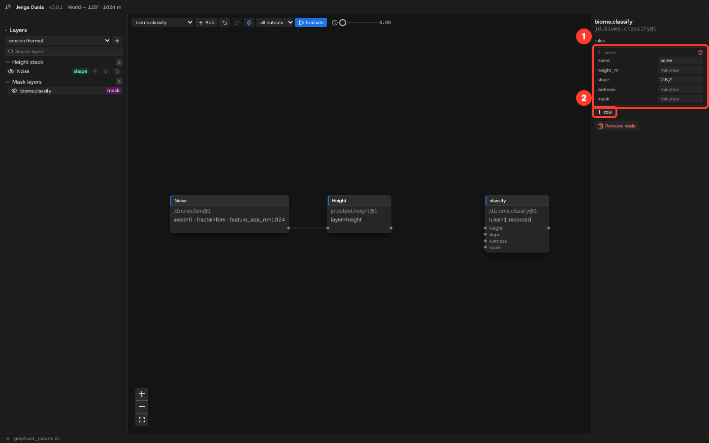

*Rules as a table: for parameters that are lists of records (biome rules) the inspector shows a table — **+ row** adds a rule, each cell applies on blur (`min,max` for ranges, empty for "no constraint"), the bin removes a row. The columns come from the node schema, so the `mask` band (the classify node's free `mask` input: playa depth for a salt crust, a painted mask) appears beside height, slope and wetness. Every edit is one journaled `graph.set_param`; a value the core refuses (an inverted range) is reported in the log before anything is journaled and the table keeps the last good value. Recorded brush strokes stay a count — they are data, not something to type. UI-driven test: `apps/desktop/e2e/biomes.spec.ts`.*

*Sea in the viewport: as soon as the graph contains a `jd.hydrology.sea_level@1` node (1) the viewport draws water at its `level_m` — edit the value (2) and it moves with it; the header's viewport line reports the height (boxed, top right). The surface is shaded by the depth of the terrain under each vertex: a pale foam band within ~1 % of the height range of the shore, translucent turquoise shallows darkening to opaque navy with an e-folding depth of 12 % of the height range, and nothing drawn over land (alpha 0), so the shoreline reads without a custom shader (`buildSeaGeometry`, unit-tested). Water is only drawn while the **height** layer is shown (masks like `ocean` or `rivers` are 0..1 and would hide under it). Same e2e test.*

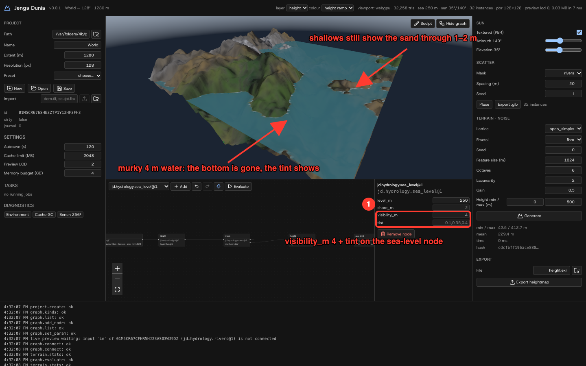

*Water clarity: the sea-level node carries `visibility_m` (the depth at which the bottom fades out — about 30 m for crystal-clear tropical water, 15 for open ocean, 3 for a murky estuary) and `tint`, the colour of what is suspended in it (blue-green plankton, brown silt, green algae). The viewport colours each vertex with Beer–Lambert transmittance per channel — pure water's absorption (red 0.4, green 0.07, blue 0.005 per metre, Pope & Fry 1997) scaled by 15 m / visibility over the light's path down and back — so the sandy bottom shows through clear shallows, red disappears first, blue carries deepest, and the tint takes over as depth or turbidity grows; opacity rises as the bottom disappears. Set visibility to 4 m (1) and the bay turns opaque blue-green while the shoreline still shows sand through the first metre. Both values are ordinary node parameters, so they are journaled, saved and read by the CLI. Unit-tested (`sea.test.ts`: clear vs murky at 10 m, deep water converging on the tint); the hydrology e2e sets the value through the inspector.*

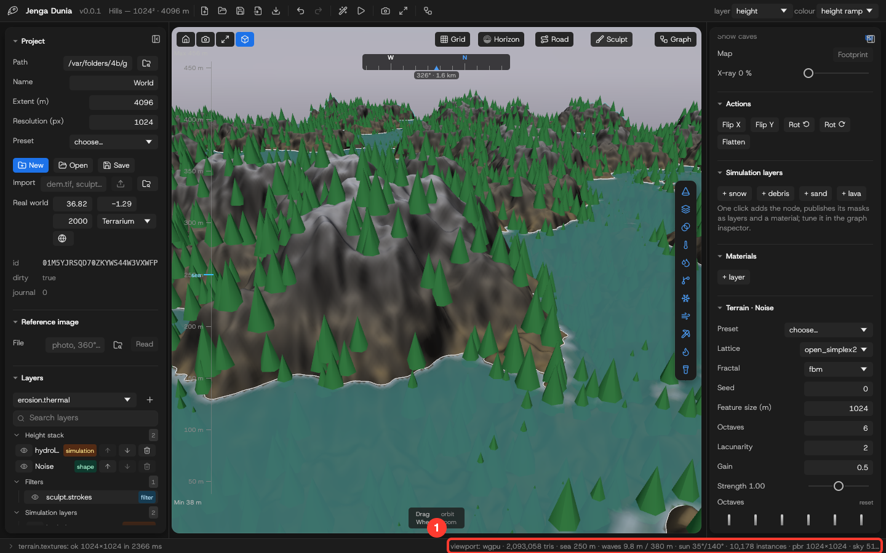

*Waves: `wind_speed_mps`, `fetch_km` and `wind_azimuth_deg` on the same node raise a wind sea. The app asks the core for the spectrum (`ocean.waves`: JONSWAP fetch-limited growth capped at the fully developed Pierson–Moskowitz sea) and moves the water plane along a Gerstner sum of its three components every frame, so a 3 m/s breeze makes 0.2 m ripples and a 20 m/s gale 9.8 m swells 380 m long (3.2 m / 96 m if the fetch is only 100 km). Waves break where the water is shallower than Hs / 0.78, and the shoreline foam widens to that surf zone — 12.6 m of depth in the gale above. The header shows the significant height and peak wavelength being drawn; recording below. **Export water maps** (Export panel) writes `exports/water/` — depth, colour, foam and a tileable wave normal map for the node's clarity and wind (`ocean.bake`, see the CLI quickstart). Not yet: refraction and shadowing by headlands.*

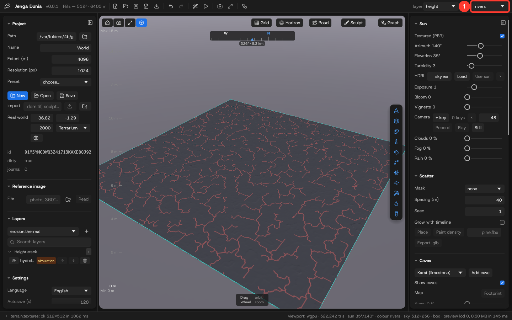

*Hydrology first: `jd.hydrology.network@1` (1) has no inputs — it grows the drainage network from the river mouths (`mouths`: south by default, or the whole border for an island) and builds the heights along it, headwaters steep and big rivers flat. Wire `out` to the height output and `rivers` to a second output (2) to colour the terrain by its trunks; `river_order` sets which Strahler order counts as a river. Every cell drains by construction (3): a `jd.hydrology.fill@1` node on `out` reports an empty `lakes` layer. `network.spec.ts` drives this through the UI.*

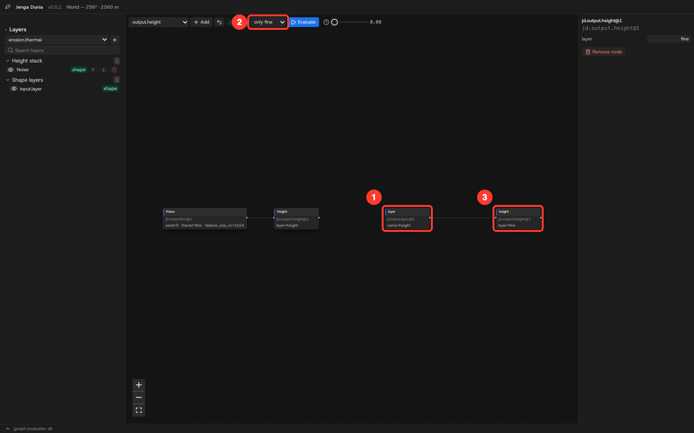

*The gate pattern in the app: `jd.input.layer@1` (1) reads any layer the project has published — `height` here, `height#lod2` when a coarse chain was evaluated at the preview resolution — and the toolbar's `only <output>` selector (2) makes Evaluate (and the live preview) run just that output's chain, so a 16k² world can erode at a coarse level and pick up its fine detail at full resolution without ever holding the heavy chain at 16k² (the CLI quickstart has the numbers). The header keeps listing every published layer (3). `gate.spec.ts` drives this through the UI.*

## Real world


The Project panel's **Real world** row fetches a digital elevation model around a point and makes it the world: type a longitude, a latitude and a radius in metres, pick the provider — **Terrarium** (AWS Terrain Tiles; no key, no quota), **Copernicus** (GLO-30, 1° tiles from the public bucket) or **OpenTopography** (needs your key in `JD_OPENTOPOGRAPHY_KEY`) — and press the globe. The app runs `geo.fetch_dem`, sets the world's CRS and origin to the DEM's, adds a `jd.input.heightmap@1` node in place of the starter noise, connects it to the height output and evaluates; the log shows each step and the right panel's min / max turn into the real heights (Nairobi: 1 640–1 747 m). The tiles go into the project's `cache/geo/` and the DEM into `assets/`, and the provider's notice is recorded so every export carries `ATTRIBUTION.txt`. On a slow link the fetch is patient — one connection to start, more as the link allows, retries with back-off (`docs/adr/0014-geo-fetch-policy.md`); set `JD_OFFLINE=1` to work from the cache only. The CLI chapter (`cli-quickstart.md`, "A terrain from the real world") has the same sequence op by op, the OSM features fetch, and the engine checks.

## Horizon

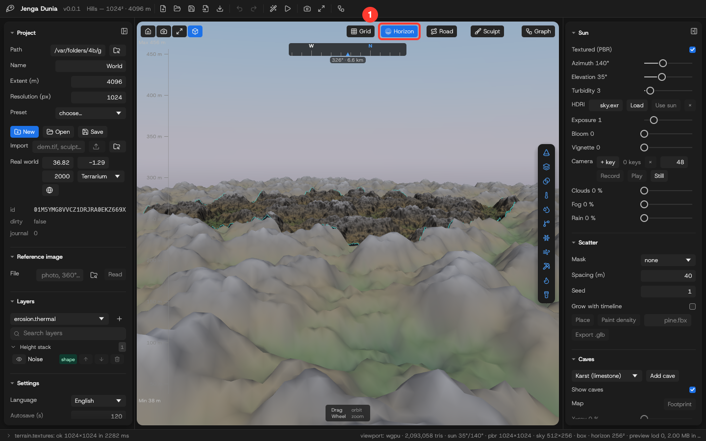

*Horizon (1): the noise node's own parameters are evaluated three times beyond the world's border at a coarse 256² and drawn as a dimmer skirt under the terrain, with the triangles under the world dropped so the real terrain shows through the hole; the same seed and origin make it continue the world's noise at the edge. It is for the eye — erosion, rivers and the rest of the graph stop at the border — and it re-bakes after every evaluation while on; the header reads `horizon 256²` (2). VUE's infinite terrains, as far as a heightfield tool honestly goes. CLI: `jd op terrain.horizon` returns the same field as a preview.*

## Roads

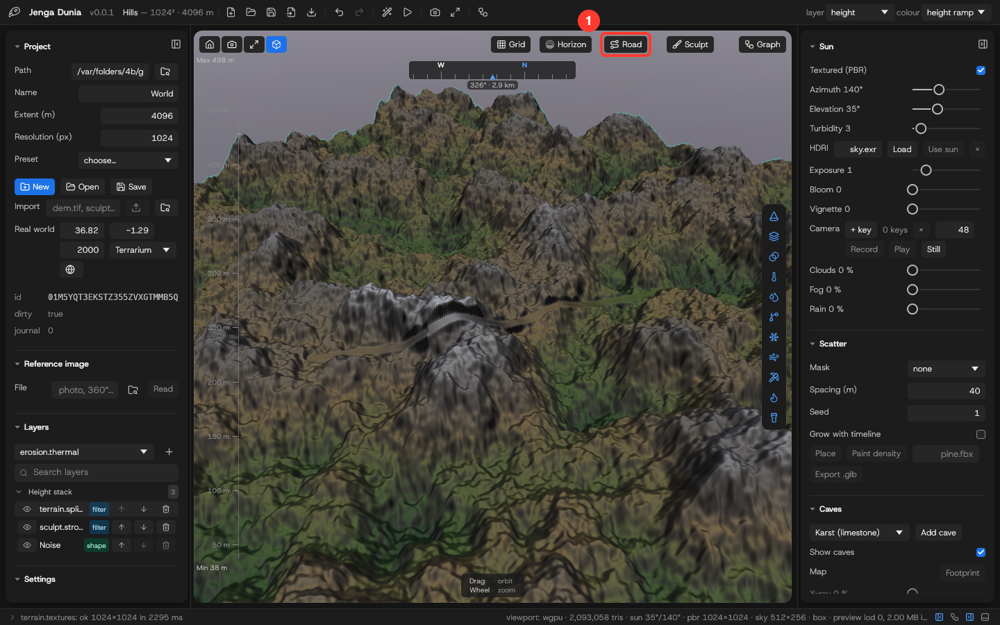

*Roads: click **Road** (1) and the next drag on the terrain becomes a `jd.terrain.spline@1` node (2) spliced in front of the height output — the corridor is flattened onto the line's smoothed grade with soft shoulders, exactly what the CLI node does (quickstart, "Roads, paths and canals") — and the button returns to orbiting, so each drag is one road. The node's width, falloff, mode (flatten, cut, raise) and the point list are ordinary parameters in the inspector (3); its `mask` output can be published and used for the road surface and the verges' scatter. The UI-driven test `apps/desktop/e2e/road.spec.ts` draws one road and checks the published height changes.*

## Materials

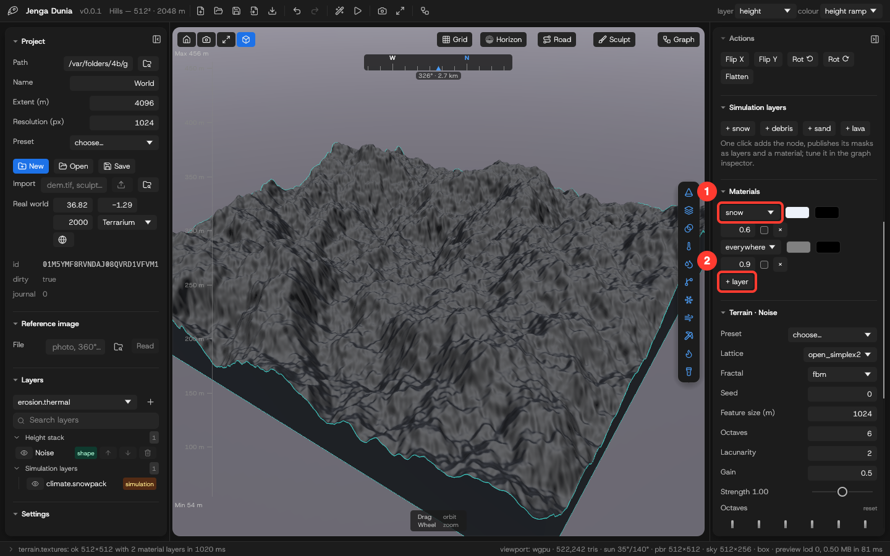

*The material layer stack: a row (1) is a mask layer from the last evaluation (or *everywhere*), a colour swatch, a roughness, a **detail** checkbox (a seamless grain tile repeated every *tile m* metres — blended by the layer's mask in the viewport through a node material on the WebGPU renderer, baked into exported maps by world position, written as tiles for Unity and Unreal; `images/desktop-materials-detail.png`); **+ layer** adds one (2), and every change re-bakes the viewport's PBR maps with the stack blended over the hypsometric base in row order (the log reads `terrain.textures: ok … with N material layers`). A snow mask with a white, smoother layer whitens the summits here. The same stack is what `terrain.textures` and `terrain.export_mesh {materials}` take, so an export carries what the viewport shows. UI-driven check: `apps/desktop/e2e/biomes.spec.ts`.*

## Timeline

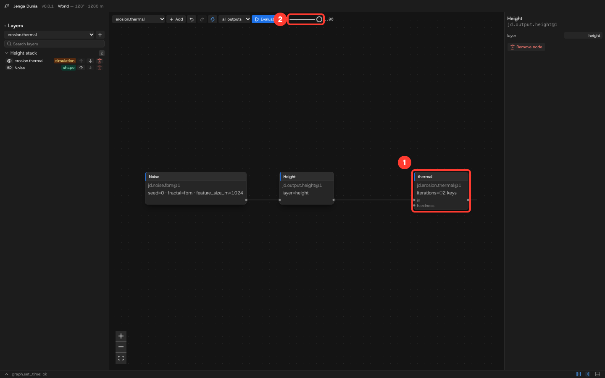

*Any parameter can be keyframed: type `t:v, t:v` in its inspector field — `0:1, 1:300` keys a thermal node from one step to three hundred over the timeline — and the node summary shows ⏱ with the key count (1). The slider in the graph toolbar (2) is the timeline position: moving it journals one `graph.set_time` per drag (undo takes it back), and the live preview re-evaluates with the parameters resolved at that time — numbers interpolate, choices step. Scrubbing back is instant because each time position caches on its own. The UI-driven test `apps/desktop/e2e/timeline.spec.ts` keys a thermal node, scrubs to 1.0 and checks the published height's hash changes.*

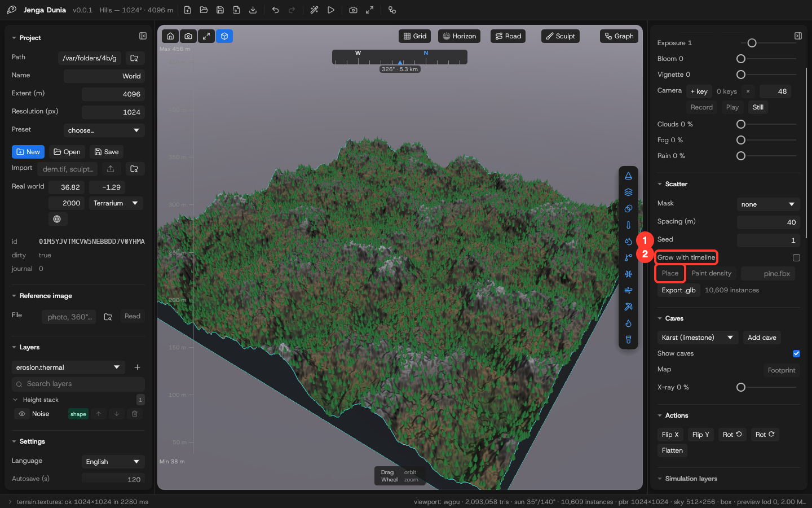

*Ecosystem growth: with **Grow with timeline** ticked, scatter instances follow the timeline — place a population with the slider at 0 and the count reads 0 (nobody born yet); scrub to 1 and the viewport fills with cones of mixed sizes, the young ones small (1). **Grow with timeline** is the opt-in (2) and the scatter panel's count follows the time (3). Each instance keeps its place; the timeline only decides whether it exists yet and how grown it is (`terrain.scatter {follow_time}`).*

**Export frames.** The Export section's **Export frames** button (with a frame count beside it, default 24) writes `exports/frames/height_0000.png …` through `timeline.export`: one 16-bit heightmap per evenly spaced time from 0 to 1, every keyframed parameter animating, one shared height range so the sequence does not flicker, the project's own time untouched. `ffmpeg -framerate 8 -i height_%04d.png …` turns it into a clip (`videos/timeline-dunes.mp4` is one made this way from the CLI). UI-driven check: `apps/desktop/e2e/timeline.spec.ts`.

## Desert landscapes

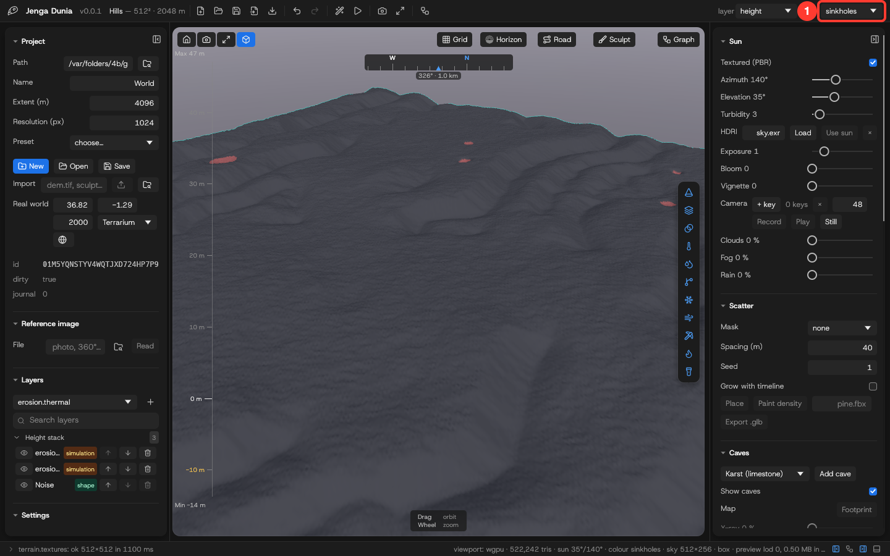

*A desert in three nodes: pick **Preset ▸ Desert plain 0..40 m** in the Terrain · Noise panel (it fills feature size 1200 m, 3 octaves, 0..40 m; Mountains, Ridged alpine and Rolling hills are the other presets) and **Generate** a plain (1); add `jd.erosion.aeolian@1` (Werner slabs hop downwind into dunes; 60 steps here) and `jd.erosion.karst@1` (dolines on ground flatter than `max_slope_deg`, 15° between the dunes) and wire noise → dunes → sinkholes → height (2); publish the node's `sinkholes` output as a second layer and colour by it (3) — the red floors are the pits. Strata for mesas, wadis, playas and the rest of the desert family are CLI recipes in the quickstart for now. The UI-driven test `apps/desktop/e2e/desert.spec.ts` builds exactly this and is the source of the capture.*

**Screen recording:** [`videos/desert-dunes-sinkholes.mp4`](videos/desert-dunes-sinkholes.mp4) (31 s, 1440×900) — the desert flow above, recorded from the test with `JD_VIDEO=1`.

**Generate and the graph are one terrain.** The Generate panel writes its settings into the graph's noise node (journaled `graph.set_param` edits, so undo and autosave cover them) and evaluates the graph at full resolution; Evaluate and the live preview then show the same terrain, and every node you add works on the plain you generated. Until this release the panel ran a standalone `terrain.generate` beside the graph: on a small world the starter graph's own preview could publish `height` right after a quick Generate and overwrite it, and erosion nodes added afterwards eroded the starter noise, not the generated plain. A graph without a noise node (one built from an imported heightmap) still uses the standalone op.

## Tutorial: sculpting

1. Click **Sculpt** (top of the viewport). If the graph has no stroke node yet, a `jd.sculpt.strokes` node is inserted in front of the output and selected; the button reads **Sculpting…** and a **Brush** panel appears on the right: **mode** (raise/lower by a strength in metres — negative digs; **smooth** blends towards the local mean; **flatten** pulls towards the height under the first point of the stroke), radius, and strength or amount (0–1).
2. Move over the terrain: a red ring the size of the brush follows the pointer on the surface. Drag to paint. The pointer is projected onto the surface and the path becomes one stroke (`points` in layer metres, radius, strength) appended to the node's `strokes` parameter — a journaled `graph.set_param`, so the live preview updates and **Undo** removes the whole stroke.
3. Click **Sculpting…** to go back to orbiting. Strokes are data in `graph.json`: the CLI and MCP see the same node, and re-evaluating anywhere replays them identically.


*This capture is the UI-driven test (`e2e/sculpt.spec.ts`, Chromium + the real core) rather than the native window; the native screenshots are re-shot when the display is available.*

## Workflow

1. **Project** — **File → New… (⌘N)** and choose where the `.jdproj` directory goes, or type a path (e.g. `~/Worlds/Hills.jdproj`) and click **New**; **Open… (⌘O)** or the folder button picks an existing project. Set extent (m) and resolution (px) before creating, or pick a **Preset** (Unity 1025²/2049²/4097², Unreal 2049²/4033², plain 512²–4096²); engines want 2ⁿ+1 samples so quads line up with their patch grids. The header shows `name — resolution² · extent m`; the panel shows the project id, dirty flag and pending journal entries.
2. **Terrain · Noise** — choose lattice and fractal, seed, feature size, octaves, lacunarity, gain, height range; click **Generate**. Stats (min/max/mean, time, content hash) appear under the button and the viewport shows the terrain with a preview shading: hypsometric tint by altitude (valley green → ochre → rock → snow), steep faces towards rock grey, sky background with distance fog. Drag to orbit, wheel to zoom. Real materials come from the material graph later.
3. **Export** — **File → Export Heightmap… (⌘E)** or the folder button opens a save dialog (the extension picks the format: `.exr`, `.tif`, `.png`, `.r16`, `.r32`); typing a relative name and clicking **Export heightmap** writes into the project's `exports/`. Every export gets a `.jd-height.json` sidecar. Quantised formats log a `W_EXPORT_LOSS` warning.
4. **Save** — writes `project.json`/`graph.json`/`scene.json` atomically and clears the journal.

Every button calls the same operation the CLI and MCP server expose (`jd schema --list`), so anything you do here can be scripted.

## How the UI is tested

| Level | What | Where |
|---|---|---|
| Component (jsdom) | the real `App` with `invoke` mocked at the Tauri boundary: create → generate → stats → preview → export warning; error display | `apps/desktop/src/App.test.tsx` (`pnpm test`) |
| End-to-end (Chromium) | the real frontend driven by Playwright with `invoke` bridged to the **real Rust core** via `jd-mcp` (MCP over stdio): project files appear on disk, the viewport reports its backend and triangle count, a 16-bit PNG is written | `apps/desktop/e2e/terrain.spec.ts` (`pnpm test:e2e`) |
| End-to-end, node graph | starter graph drawn from `graph.json`; edit a parameter, add a node, connect it by dragging handles, drag a node, evaluate, delete with the keyboard; the project's `journal/ops.ndjson` is read back and must list exactly `set_param, add_node, connect, move_node, remove_node` | `apps/desktop/e2e/graph.spec.ts` |
| Native window | screenshots of the real Tauri app on macOS; interaction recording requires Accessibility permission for the automating process | this page |

Known limits of this build: no sculpting, one output layer, no undo of graph edits yet (the journal records them). The tutorial images are the real app annotated by `scripts/annotate.mjs`; the Figma file linked in the brief is the design reference and receives the same screenshots once the connector is authorised.
