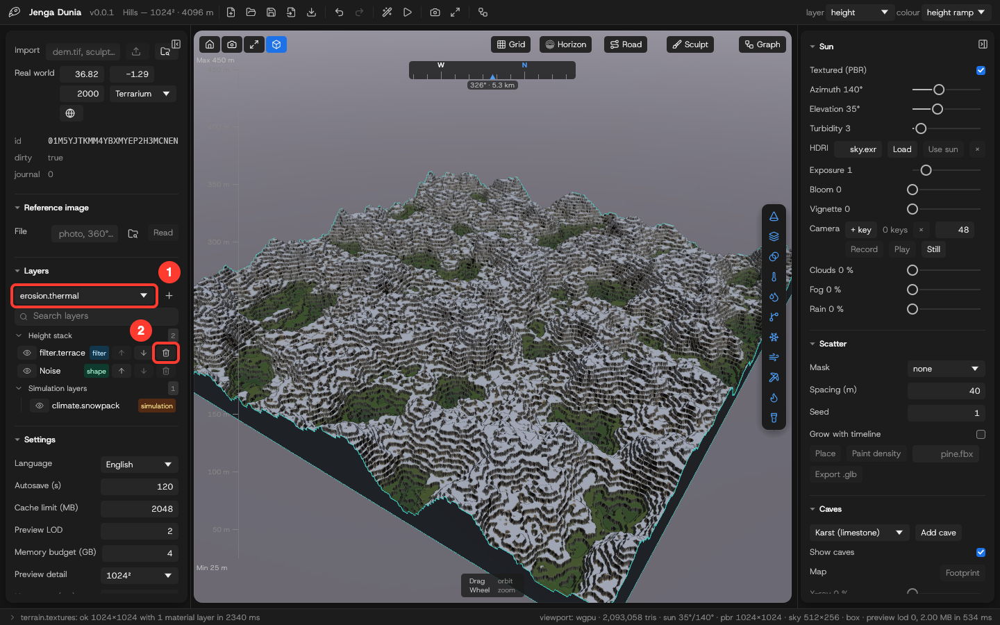
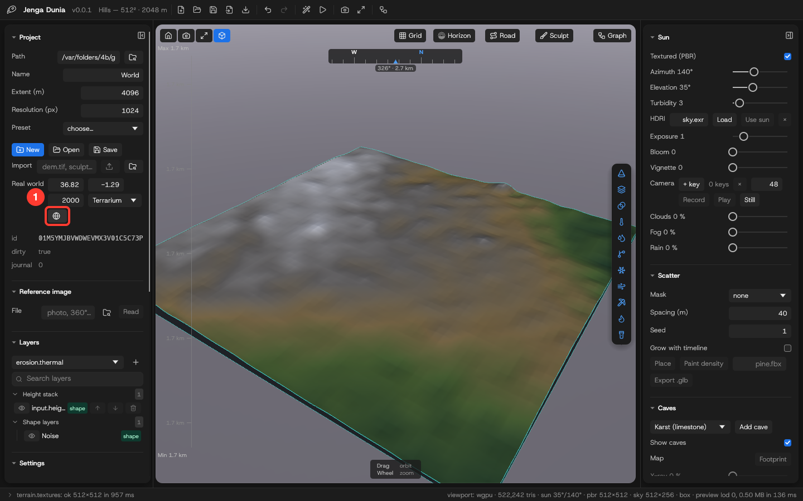
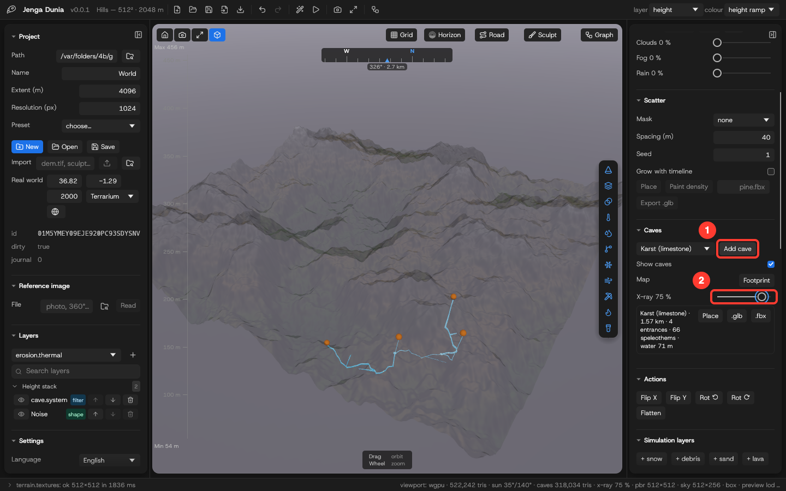
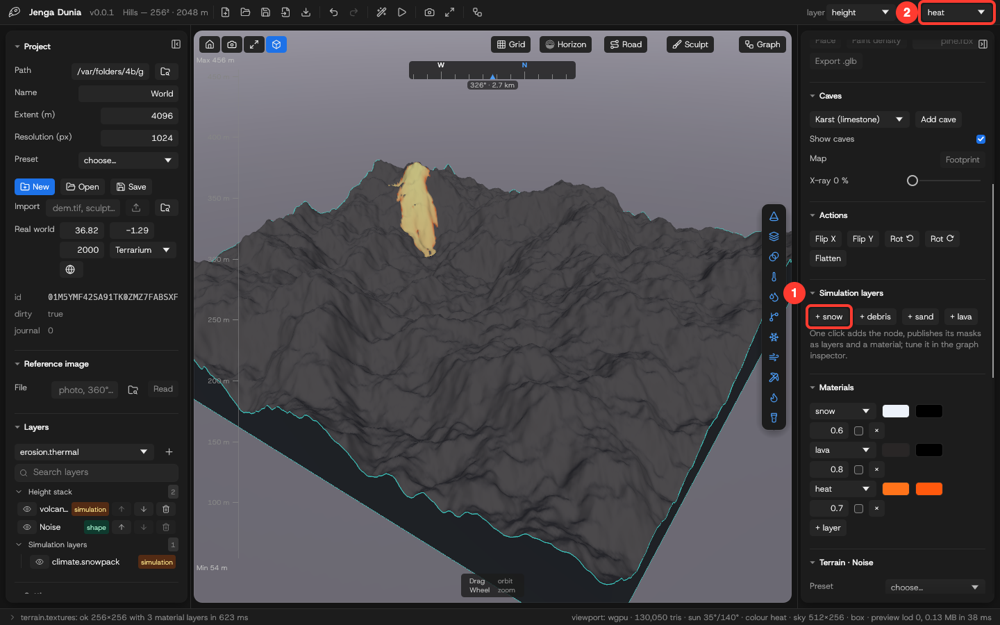
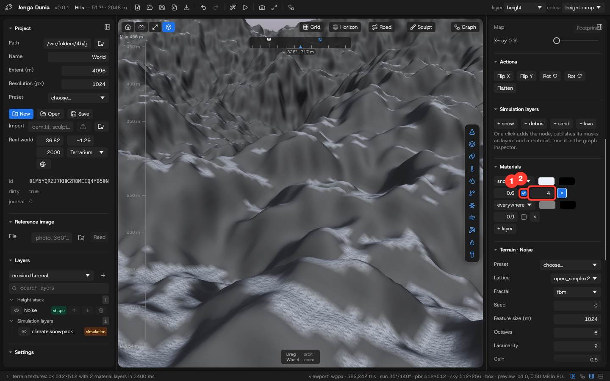
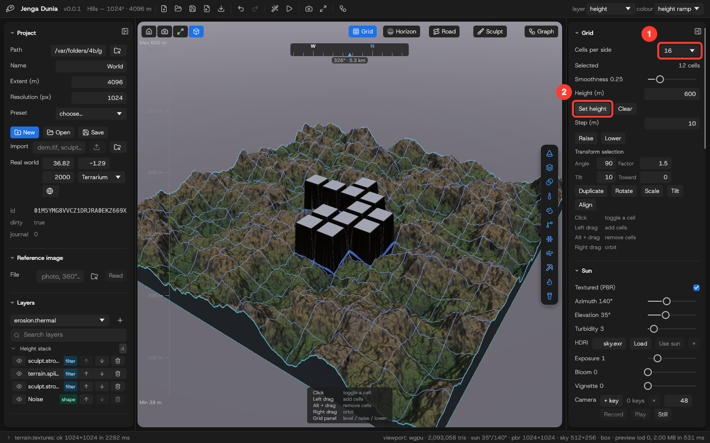

# Desktop app

Status: two windows (ADR-0017). **Studio** is the app you open: the 3-D viewport and every panel — project, reference image, layers, settings, tasks and diagnostics on the left; brush, grid, sun, scatter, caves, actions, materials, noise and export on the right; the operations log at the bottom. It owns the engine. **The Editor** (Graph button, or File ▸ Open in Studio) is the node graph: the layer stack beside the graph and its inspector, a status bar with the last log line and the log behind it. Both follow each other — a project opened in one opens in the other, an edit made in one shows in the other, a node selected in one is selected in the other — and both have the same menus and shortcuts (⌘N ⌘O ⌘S ⌘I ⌘E ⌘G ⌘R ⌥⌘Z ⇧⌥⌘Z).

> **The figures are rendered from Studio** offscreen at 1440×900 by `apps/studio/tests/guide.rs` (`JD_GUIDE_OUT=<dir> cargo test -p jd-studio --test guide -- --ignored --test-threads 1`), and `apps/desktop/scripts/annotate.mjs` draws the numbered boxes on the controls they name, so a layout change moves them with it. The Editor's figures come from its Playwright specs the same way (`JD_GUIDE_OUT=<dir> pnpm exec playwright test` in `apps/desktop`; `figure()` in `e2e/bridge.ts`). The menus still show the earlier single-window app, and the screen recordings are filmed from Studio (`film_*` in `guide.rs`) and the Editor's Playwright specs; the real-world figure fetches public Terrarium tiles (`guide_real_world`).


*No project yet: the viewport waits for one, while Tasks and Diagnostics already work.*


*A 4096 m world at 1024² (seed 42), generated and evaluated: the status bar's right side reads `viewport: wgpu · 2,093,058 tris · sun 35°/140° · pbr 1024×1024 · sky 512×256 · preview lod 0, 2.00 MB`, its left side the last log line. Measured on the earlier app (release build, Apple Silicon): a 512² generation in 15 ms, 2048² in 58–63 ms; `exports/height.exr` validated by macOS ImageIO as 2048×2048, 32 bits/sample.*


*The Edit menu adds **Undo Graph Edit** (⌥⌘Z) and **Redo Graph Edit** (⇧⌥⌘Z) below the WebView's Undo/Redo (native capture of the v0.0.1 bundle, 2026-10-21).*

## Native integration

- Menu bar: **Jenga Dunia** (About, Services, Hide, Quit) · **File** (New… ⌘N, Open… ⌘O, Save ⌘S, Export Heightmap… ⌘E, Close Window ⌘W) · **Edit** (Undo/Redo/Cut/Copy/Paste/Select All) · **Terrain** (Generate ⌘G, Evaluate Graph ⌘R) · **Window** (Minimize, Zoom, Full Screen). Menu actions run the same operations as the buttons.
- Native file dialogs (tauri-plugin-dialog): **New…** asks where to create the `.jdproj` directory, **Open…** picks an existing one, **Export Heightmap…** is a save dialog with EXR / PNG 16-bit / RAW filters. The folder buttons next to the Path and File fields open the same dialogs; typed paths still work (and are what the tests drive).
- Launch with a project: `jd-app ~/Worlds/Hills.jdproj` (or double-click a `.jdproj` once the bundle's file association is registered) opens it before the window appears.
- Window position, size and maximised state are restored on the next launch (`tauri-plugin-window-state`; verified natively: move/resize → Quit → relaunch restores the exact bounds).
- Dark window theme, native title bar, Host Grotesk typography.
- App icon: the brand mark on the brand gradient. macOS 26 and later draw the Icon Composer document `src-tauri/icons/icon.icon` (compiled into `Resources/Assets.car`, named by `CFBundleIconName`), so the system supplies the glass shape and the icon fills the Dock tile like every other app; a legacy `.icns` alone is shrunk onto a grey plate there. macOS 15 and earlier, Windows and Linux use `icon.icns` / `icon.ico` / the PNG sizes, regenerated by `scripts/app-icon.sh` (needs Xcode 26 for `actool`; the compiled catalog is committed).


## Run from source

Studio and the Editor (ADR-0017, what the bundle runs):

```sh
cd apps/desktop && pnpm install && pnpm dev    # the Editor's UI (a debug jd-app loads it from Vite)
cargo build -p jd-app && cargo run -p jd-studio -- ~/Worlds/Hills.jdproj   # project optional
```

Studio starts the Editor from `jd-app` next to it (or `--editor <path>` / `JD_EDITOR`; `--no-editor` for Studio alone). The single-window app:

```sh
cargo build -p jd-mcp            # not needed by the app; used by the UI end-to-end tests
cd apps/desktop && pnpm install && pnpm tauri dev
```

## Build the app bundle

```sh
cargo install cargo-packager --version 0.11.8 --locked   # once
scripts/package.sh                # → target/release/Jenga Dunia.app (+ a .dmg); `-f app` for the app only
```

The bundle starts **Studio** (ADR-0017: the engine, the 3-D viewport and the panels), which opens the **Editor** (the node graph) beside it; on macOS the Editor is the helper app `Contents/MacOS/Jenga Dunia Editor.app` (bundle id `com.seedexr.jengadunia.editor`), so the system's events for Jenga Dunia (open a document, quit) reach Studio. Quitting Studio closes the Editor. `src-tauri/Info.plist` (merged into the bundle's) declares `.jdproj` as a **package** document type (`LSTypeIsPackage`, UTI `com.seedexr.jengadunia.project`), so Finder treats the project folder as a single document owned by Jenga Dunia: double-click, **Open With**, or `open My.jdproj` hands it to Studio as an Apple Event (`crates/jd-macos`), which opens and live-previews it — the Editor follows; on Linux and Windows the path is a launch argument (`jd-studio My.jdproj`). Verified on macOS 27 (2026-10-27) with the packaged app: `open -a "Jenga Dunia.app" Pkg.jdproj` launched Studio, which opened and evaluated the project and started the Editor from the helper; a second `open` while running switched projects (one evaluation each, by Studio); an AppleScript `quit` closed both. The bundle is **unsigned** (no Apple developer account yet): Gatekeeper asks to confirm the first launch of a downloaded copy; a locally built bundle runs directly. macOS is the one packaged platform so far.

The single-window app (the Editor with its own engine and viewport) still builds as before with `cd apps/desktop && pnpm tauri build --no-sign` (→ `target/release/bundle/macos/Jenga Dunia.app`; same bundle id, so build one or the other).

Logs: `~/Library/Logs/com.seedexr.jengadunia/jd-studio.log` (Studio and the engine) and `jd-app.log` (the Editor) on macOS (`$XDG_DATA_HOME/com.seedexr.jengadunia/logs` on Linux, `%LOCALAPPDATA%\com.seedexr.jengadunia\logs` on Windows), plus stderr; `JD_LOG=debug` raises the level.

## Tutorial: first terrain in four steps


1. **Path** — type the project directory (created on disk as a `.jdproj` folder), or use the folder button / **File → Open…** for a native dialog. Below it, **Extent**, **Resolution** and a **Preset** (Unity 1025²/2049²/4097², Unreal 2049²/4033² or plain squares) set the world.
2. **New (⌘N)** — or **Open (⌘O)** for an existing project; the header shows `name — resolution² · extent m`.
3. **Generate (⌘G)** — the toolbar's wand, after choosing lattice, fractal, seed, feature size, octaves, lacunarity, gain and height range in the **Terrain · Noise** section, or a **Preset** there (Mountains 0..500 m, Ridged alpine 0..1200 m, Rolling hills 0..150 m, Desert plain 0..40 m) that fills those fields.
4. **Log** — the status bar shows the last line; click it to open the log behind it: every operation with warnings and errors (stable code, why, what to do next).

**Export heightmap (⌘E)** in the Export section writes `.exr`/`.tif`/`.r32` (exact) or `.png`/`.r16` (16-bit, warns about quantisation).


1. Viewport readout (the status bar's right side): backend (wgpu), triangle count, sun, baked maps, sky, preview LOD, size and transfer time. Shading: the baked PBR maps (or, with Textured off, an altitude tint — valley green → rock → snow), steep faces towards rock grey, sky with distance fog.
2. Layer statistics above **Measure landform**: min/max/mean height, generation time and the content hash — the same seed and parameters always give the same hash.
3. **Export heightmap** writes `exports/<file>` plus a `.jd-height.json` sidecar (size, range, flip, byte order); the folder button opens a native save dialog.

**Sculpt** (top of the viewport) switches the viewport to brush strokes (tutorial below).

**Screen recording:** [`videos/first-terrain.mp4`](videos/first-terrain.mp4) (17 s, 1440×900) — Studio with no project: the path typed, **New** (the starter graph live-previewed), **Generate** (the full-resolution, textured terrain), a look round, **Export heightmap** and the log opened from the status bar, `terrain.export_heightmap: ok` in it. Filmed offscreen by `apps/studio/tests/guide.rs` (`film_*`, 24 fps, the pointer drawn), so it is re-recorded whenever the flow changes.

**Screen recording:** [`videos/graph-erosion.mp4`](videos/graph-erosion.mp4) (12 s, 1440×900) — the layer strip's hydraulic erosion on a 1024² world: the node is spliced in front of the height output and live-previewed (`height#lod1`), then **Generate** evaluates the whole graph at full resolution and the eroded terrain comes back textured. Filmed offscreen by `apps/studio/tests/guide.rs` (`film_*`, 24 fps, the pointer drawn), so it is re-recorded whenever the flow changes.

## Tutorial: the node graph

Every project starts with a two-node graph (`Noise → Height`), the same `graph.json` the CLI and MCP server edit. The Editor window is that graph (Studio's **Graph** button brings it to the front).

**Layout.** Studio's side panels resize by their inner edge and collapse to a 24 px strip with the button in their top corner (the strip's button brings them back); the window's position and size, the panel sizes and the collapsed panels come back on the next launch. The Editor's graph fills its window beside the layer stack. At the status bar's right end, as in Zed, sit the dock toggles — in Studio the project panel, the graph (it brings the Editor to the front), the inspector and the log; in the Editor the layer stack, the inspector and the log — each accent while its dock shows. (Tests: Studio's `the_side_panels_collapse_to_a_strip_and_come_back`; window persistence checked by hand on macOS — move, resize, Quit, relaunch.)


**Preview detail.** The viewport shows a preview of at most **1024²** samples (about 2 MB a transfer and 2 M triangles) whatever the world's size — a 4096² world previews at lod 2. Settings ▸ **Preview detail** switches to **2048²** for worlds above 1024² when the fine ridges matter more than the frame rate: 4× the samples, 8 MB a transfer, about 8 M triangles, and the PBR maps bake at 2048 too; the header's `preview lod N, X MB` says what came across. The choice is an app setting in the browser store.


1. **Add** — pick a kind from the list (1) (`graph.kinds` drives it) and click **Add**; the node is placed to the right of the graph and the view re-fits.
2. **Undo · Redo · ⚡ · Evaluate** (2) — the toolbar's history buttons, the live-preview toggle and full-resolution evaluation, also **Terrain → Evaluate Graph (⌘R)**. While an evaluation runs, the header shows the job (`graph.evaluate · node 2/4 hydraulic · 3.2 s`) with a **Cancel** button; cancelling stops at the next node or erosion iteration and logs `E_CANCELLED` — nothing is published. With **live preview** (⚡, on by default) every edit re-evaluates at preview resolution (≤ 512², published as `height#lod<N>`) so the viewport follows your changes; unchanged nodes come from cache. A half-wired graph pauses the live preview with a `live preview waiting: input … not connected` line instead of an error. Export always evaluates at full resolution first.
3. **Nodes** — click to select, drag to move (the position is saved in the project), **Delete**/**Backspace** removes the node and its edges. The ↶ ↷ buttons (or **Edit → Undo/Redo Graph Edit**, ⌥⌘Z / ⇧⌥⌘Z) step through the edit history; ⌘Z alone stays with the text fields. The capture shows a blur node (3) just wired from the noise; it feeds nothing yet, so the height still comes from the noise.
4. **Inspector** (4) — the selected node's parameters, generated from the kind's JSON schema (enums become drop-downs, defaults show as placeholders). Leaving a field applies `graph.set_param`; number fields take arithmetic (`512*2`, `(1+2)*3`, `2^10`, `sqrt(2)`, `pi/4`, `min(a, b)`) and store the result; hovering a node for a quarter second shows a thumbnail of its output (`graph.node_preview`, the graph at a coarse lod through the cache, so it costs a cache hit after the first look); an invalid value is rejected by the core before anything is journaled and the reason appears in the log.

Studio's viewport shows what the graph evaluated. When the graph publishes more than one layer (e.g. a second output node named `water` fed by the hydraulic node's `water` port, or `slope` from the slope mask), a **layer** picker appears in the header; the viewport and stats follow the chosen layer, and live previews keep showing it.

**Presets.** A node kind with named presets (thermal, hydraulic, stream power, aeolian, snowpack, rain, debris, lava, terrace, karst) shows a **preset** select at the top of its inspector — World Creator's per-filter presets; choosing one applies its values as ordinary journaled edits, so undo removes them one at a time.

Undo and redo are operations like everything else (`graph.undo` / `graph.redo`, journaled as `graph.restore`), so a crash in the middle of undoing recovers to exactly what you saw. The history keeps up to 100 graph snapshots and at most 64 MiB of them: ordinary graphs are kilobytes and keep all 100; a sculpt session with hundreds of long strokes (500 strokes × 50 points serialise to 2 MiB) keeps about 30 steps. Connect nodes by dragging from an output handle (right) to an input handle (left); an input holds one edge, so dropping a new connection replaces the old one. Cycles, wrong ports and type mismatches are refused by the core (`E_GRAPH_CYCLE`, `E_INPUT_INVALID`, `E_GRAPH_TYPE_MISMATCH`). Evaluating while a required input is unconnected reports `E_GRAPH_MISSING_INPUT` with the node and port.

**Autosave.** Every edit is journaled first (crash-safe), and `settings.autosave_interval_s` seconds after the last edit (project.json, default 120; `0` disables) the app saves the project on its own: the log shows `project.save: ok`, the project panel's **dirty** returns to `false` and **journal** to `0`, and `graph.json` on disk is current. Press **Save** (⌘S) to save immediately. **Save** and autosave first flush a pending look write, so the saved scene carries the look as it is now (not as it was 400 ms ago). Background writes — autosave, the saved look (`project.set_look`), the ocean wave fetch — never mark the app busy: only an action you started disables the buttons for its round trip, so a click during an autosave is not lost. The UI-driven test `apps/desktop/e2e/hydrology.spec.ts` runs with the interval set to 2 s and checks the saved `graph.json` and the truncated journal. (For debugging, `?autosave=<ms>` in the dev URL overrides the interval.)


**Live target.** **Live target (ms)** (an app setting, kept in the browser store, 0 = off) is the time budget of one live-preview evaluation: while evaluations run over it the live evaluation steps one LOD coarser (up to four steps above the ≤ 512² live default), and when they finish in under a quarter of it it steps finer again, never below that default. The header's `preview lod N` is the *transfer* LOD of the viewport mesh (see Preview detail above), not the live-evaluation LOD; the project's **Preview LOD** setting is a hint stored in `project.json` for clients, the desktop's own choice is Preview detail. Evaluate and every export still run at full resolution.

**Post effects.** Three sliders under the Sun panel — **Exposure** (ACES tone mapping while any effect is on; 1 = the plain render), **Bloom** (strength on the bright parts: sun glints, lava glow) and **Vignette** — run as one post-processing pipeline over the frame; the header lists what is on (`post bloom 0.3 · vignette 0.2`). Viewport only: exports and bakes are untouched. **Camera.** **+ key** records the current view as a flythrough key; **Record** renders *N* frames along a smooth path through the keys (Catmull-Rom through every key, the heading unwrapped so a path across north never spins the long way, the distance eased in log space so zooms feel even); the key list under the row shows each key's heading, elevation and distance with **Go** (move the camera there) and **×**, and **Play** runs the path in the viewport for four seconds without writing frames — into `exports/flythrough/frame_0000.png …` through `project.write_export` — `ffmpeg -framerate 24 -i frame_%04d.png flythrough.mp4` makes the clip; **Still** saves the current frame as `exports/stills/view_<n>.png`. No path tracer: Studio's wgpu renderer rasterises, and a physically traced still would mean a second renderer; the ACES-tonemapped rasteriser with bloom is what ships. UI-driven test: Studio's window tests (`apps/studio/tests/window.rs`).

**HDRI.** The Sun panel's **HDRI** field takes an equirectangular EXR — `sky.bake`'s own output or any 2:1 lat-long HDRI — from the project's `assets/` (⌘I imports one) or an absolute path; **Load** draws it on the dome instead of the physical sky (the status bar reads `hdri`), **Use sun** points the sun where the map is brightest (`sky.load_hdri` reports that direction and the mean luminance), **×** returns to the physical sky. `.hdr` files are not read (OpenEXR only). UI-driven test: Studio's window tests (`apps/studio/tests/window.rs`) bakes a sky at one sun, moves the sliders away, loads the EXR and recovers the sun within a few degrees.

**Clouds.** The Sun panel's **Clouds** slider sets the cover of the sky dome (`cloud_cover` on `sky.preview`); the log names the cover each bake used, and `sky.bake` takes the same parameters for the HDRI. **Fog** is a viewport look setting next to it: 0 keeps the faint aerial perspective, 1 closes the view within the world's width (the header shows `fog N %`); bakes and exports are untouched.

**Wind.** The Settings section also holds the world's shared wind — **Wind from (°)** and **Wind (m/s)** — the one setting dunes, yardangs, snow scour and the viewport's wind sea follow unless a node sets its own `wind_*` parameter; it is journaled through the same `project.set_settings` and saved in `project.json` under `world.wind` (UI-driven check: Studio's window tests (`apps/studio/tests/window.rs`)).

*Settings live in the project panel: **Autosave (s)**, **Cache limit (MB)**, **Preview LOD** and **Memory budget (GB)** (evaluations whose pre-flight estimate exceeds it are refused with `E_RESOURCE_MEMORY` — the default 4 GB is the project's hard ceiling) are `project.json → settings`, edited through `project.set_settings` — a journaled mutation like everything else, so a crash mid-edit recovers it. The core validates every value (cache limit ≥ 16 MB, autosave ≤ a day, LOD ≤ 8) and a refused value snaps back to the stored one with the reason in the log. The UI-driven test Studio's window tests (`apps/studio/tests/window.rs`) sets autosave to 1 s, tries an 8 MB cache (refused), edits a node and watches the project save itself.*


**Screen recording:** [`videos/graph-editor.mp4`](videos/graph-editor.mp4) (22 s, 1440×900) — the Editor's flow above: edit the seed, a node's hover thumbnail, add a blur node, connect it by dragging the handles, move a node, evaluate, delete with the keyboard, undo and redo, then the status bar's dock toggles. It is the UI-driven test `apps/desktop/e2e/graph.spec.ts` running against the real core, recorded with `JD_VIDEO=1 pnpm exec playwright test e2e/graph.spec.ts` (actions slowed to human pace), so it is regenerated whenever the editor changes.

## Layer stack

World Creator's layer stack, as a view over the same graph: the **Layers** section in the project panel lists the chain that feeds the height output, top = last applied, each row a node with its category (shape, filter, simulation, mask), and the nodes off that chain — climate, classification, analysis — as **side branches**. The eye bypasses a layer (`graph.set_bypass`: the input passes through unchanged, the row dims), the arrows apply it later or earlier by re-wiring its neighbours, the bin removes it and closes the gap, **+** splices the chosen kind in front of the height output, and a click selects the node for the graph inspector. The graph editor and the stack show the same thing; use whichever reads better. Blend layers (`jd.math.min` / `max` / `lerp`) and placed shapes carry a readout after their name — op · opacity · the layer wired into `b` (or *b unwired*) — so the list reads like a layer stack with blend modes; the UI test `stack.spec.ts` inserts a lerp layer and checks it. The stack is a tree: a **search box** filters every row by kind or label, the **Height stack** (the chain) and the side branches — grouped as **Shape layers**, **Filters**, **Simulation layers** and **Mask layers** with their counts — fold under collapsible headings. On the viewport's right edge an **icon strip** adds a layer in one click: a cone, terraces, smoothing, thermal or hydraulic erosion, rivers (spliced in front of the output), or the snow, sand, debris and lava simulation layers. UI-driven test: `apps/desktop/e2e/tree.spec.ts`.



Blend operations are nodes like everything else: **min**, **max** and **lerp** (`jd.math.min@1`, `jd.math.max@1`, `jd.math.lerp@1`) take the chain on `in` and another layer on `b` — lerp also a 0..1 mask on `t` — with an `opacity`, which is World Creator's layer operation (overwrite / min / max with opacity and a mask) in graph form. Add one from the stack's **+** and wire its `b` in the graph editor: a stamp, a second noise, an imported heightmap. What the stack does not do yet: reordering across side branches. The UI-driven test `e2e/stack.spec.ts` adds terrace and thermal from the stack, bypasses and restores thermal, moves terrace above it, removes thermal and checks the core's edges after every step.

## Tasks and diagnostics


*Below the settings the project panel lists **Tasks** (1) — every running job with its progress and a **Cancel** button (the header shows the first one; detached MCP jobs appear here too) — and **Diagnostics**: **Environment** (2, `diag.env`: OS, CPU count, memory), **Cache GC** (`project.cache_gc`: blobs and bytes kept, evicted, the project's limit) and **Bench 256²** (`diag.bench` S1 at a small size: per-stage milliseconds and peak memory; the CLI's `jd diag bench s1` is the comparable benchmark). Every result is an ordinary op envelope, so the log shows the same `ok`/error lines agents see. UI-driven test: Studio's window tests (`apps/studio/tests/window.rs`).*

## Sky and sun


*The viewport lights the terrain with a sun you steer from the **Sun** section: azimuth is the compass direction the light comes from, elevation (1) its height above the horizon — below 20° the light turns warm and dimmer, like World Creator's time-of-day. The status bar reports the current direction (`sun 12°/140°`). The sun is a view setting, not part of the project. UI-driven test: Studio's window tests (`apps/studio/tests/window.rs`) drags the elevation to 12° and checks the readout.*


*Physical sky: the dome is the same Preetham daylight model `sky.bake` writes for engines (CLI quickstart, "Physical sky as an HDRI"), baked by the core as a small equirectangular preview whenever the sun moves or **Turbidity** (1) changes — 2 is clear mountain air, 3 clear, 6 hazy, 10 thick haze — and reported in the status bar as `sky 512×256`. Orbit down to the horizon to see it: a deep blue zenith, a bright aureole around the sun, a warm horizon at low elevations, and a ground band that fades out below the rim. The dome is only what you see; the terrain's lighting still comes from the sun lamp, so the baked HDRI (sun included) is the file to light a scene with elsewhere.*


**Screen recording:** [`videos/terrain-pbr-import.mp4`](videos/terrain-pbr-import.mp4) (21 s, 1440×900) — **Textured (PBR)** switched off (the height ramp) and on, the sun lowered with the keyboard, an EXR export, and the same file typed into **Import** and brought back as a heightmap node. Filmed offscreen by `apps/studio/tests/guide.rs` (`film_*`, 24 fps, the pointer drawn), so it is re-recorded whenever the flow changes.

*Textured terrain: with **Textured (PBR)** on (1, default) the viewport shades the height layer with the same maps the GLB export carries — albedo, tangent-space normal and roughness baked from the full-resolution field by `terrain.textures` (one texel per sample, capped at 1024 per side for the viewport). The normal map restores the relief that the preview LOD drops on large worlds, so a 4096² world previewed at 1024² still shows its fine ridges; the header reports the map size (2). Off, the terrain falls back to the height-ramp vertex colours; a **colour** overlay always wins over the maps. Maps are re-baked after each evaluation of a height-like layer, not for masks. UI-driven test: the terrain spec checks the readout and the toggle both ways.*

## Viewport chrome

**Language and crash reports.** Settings ▸ **Language** switches the panel headings and the main buttons between English, **Kiswahili** and **Français** (first drafts — corrections welcome; unknown strings stay in English) and remembers the choice. An uncaught error anywhere in the interface is written as a crash report — `crash_<time>.json` beside the project's `logs/ops.log`, or in the temp folder when no project is open, with the message, stack, version, OS and architecture — and noted in the log; the app keeps running. A core operation that panics answers `E_INTERNAL` with the report's path instead of taking the app down. UI-driven test: Studio's window tests (`apps/studio/tests/window.rs`).

**Look.** The workspace follows World Creator 2025's: navy-charcoal surfaces, floating rounded panels with soft shadows over the backdrop (the viewport is a card too), bold section headings with a chevron, a vivid blue for the main action of each group (New, Generate, Evaluate) and for slider fills, thin dark scrollbars, and graph nodes as rounded cards with an accent stripe. The tokens live in `apps/desktop/src/index.css` (`--color-jd-*`, `.jd-panel`, `.jd-section`, `.btn-primary`).

**Octave bars and strength.** Under the Noise panel, **Strength** scales the relief around the middle of the height range (0 = flat at the middle, 2 = twice the relief) and one vertical bar per octave sets that octave's strength (coarsest first, 0..2, fbm only); release a bar to apply it, **reset** clears them. Both write the noise node (`strength`, `octave_weights`), so the CLI and agents see the same thing. UI-driven test: Studio's window tests (`apps/studio/tests/window.rs`).

**Actions.** The right panel's **Actions** row — **Flip X**, **Flip Y**, **Rot ⟲**, **Rot ⟳** (90°, square worlds) and **Flatten** (to the mean, or `height_m`) — splices a `jd.filter.action@1` node in front of the height output, so every action is a layer-stack row you can bypass, reorder or remove, and undo works as for any edit. UI-driven test: Studio's window tests (`apps/studio/tests/window.rs`).

**Esc aborts.** While a job runs the header shows its progress, a **Cancel** button and *Esc to abort*: pressing Esc anywhere outside a text field cancels every running job (inside a field Esc only leaves the field). UI-driven test: `apps/desktop/e2e/jobs.spec.ts`.

Around the terrain the viewport carries what World Creator's does: a **compass strip** at the top (N / E / S / W and 15° ticks scroll as you orbit; the readout gives the heading the camera looks toward and its distance), a **height ruler** down the left edge (the shown layer's range in metres with nice ticks, the zero line heavier, negative heights in amber, the sea level marked when a sea-level node is in the graph, `Max` / `Min` at the ends), **shortcut hints** at the bottom that change with the tool (orbit, Sculpt, Grid, Road), and three buttons at the top left: **Fit** (home view), **Still** (save the frame under `exports/stills/`), **Fullscreen** and **Frame** — the world drawn as a block with side walls down below the lowest ground and a teal rim (on by default; the status bar reads `box`). With a sea-level node in the graph a white **shoreline** contour traces where the terrain meets the water (marching squares on the preview; the header reads `shore N`). The header shows the brand mark (the bird-head line drawing; the window icon is the disc version) and an icon toolbar — **New**, **Open**, **Save**, **Import**, **Export**, **Undo**, **Redo**, **Generate**, **Evaluate**, **Still**, **Fullscreen** — that runs the same actions as the native menu and its shortcuts. UI-driven test: Studio's window tests (`apps/studio/tests/window.rs`).

## Hydrology layers in the viewport

**Lakes as water.** Publish the fill node's `lakes` output (`jd.hydrology.fill@1` → a `jd.output.height@1` whose `layer` is `lakes`) and the viewport draws standing water on the terrain wherever that depth is above zero — every basin the fill found, each at its own level, coloured by depth like the sea; the status bar reads `lakes N cells`. Nothing to switch on: the preview is fetched beside the height preview whenever a `lakes` layer exists. UI-driven test: `apps/desktop/e2e/lakes.spec.ts`.


*A `noise → rivers → height` graph with two extra outputs (`rivers`, `wetness`), built through the engine as the hydrology recipe in the CLI quickstart does. The header's **layer** picker (1) lists every published layer; the viewport shows the carved terrain, and picking `rivers` or `wetness` shows those masks with their own stats.*


*Colour by layer: the header's **colour** select (1) paints the terrain with any published layer instead of the height ramp — masks (rivers, wetness, slope, scatter densities) as a dark-to-blue gradient, class maps (biomes) with one hue per class — while the geometry stays the height layer. It is how you check a mask against the relief without leaving the 3D view; the status bar reports `colour <layer>`. UI-driven test: Studio's `the_colour_picker_draws_a_layer_on_the_terrain_and_back`.*


*Import a heightmap or mesh: the **Import** row (1) in the Project panel (or **File ▸ Import Heightmap or Mesh…**, ⌘I, which opens the native file dialog) takes a PNG 16-bit, EXR, TIFF, RAW or binary FBX file, copies it into the project's `assets/` through `project.import_asset`, and adds a `jd.input.heightmap@1` node that reads it by name; the log (2) records each step. Wire the node into an output and evaluate: the e2e test exports the generated terrain as EXR, imports it back this way and checks the layer's min/max/mean are the same again. An FBX mesh (sculpted in Blender, for instance) is rasterised over its footprint onto the world grid; a PNG 16-bit or RAW file exported by Jenga Dunia brings its height range from the `.jd-height.json` beside it (imported with the file); a quantised file from elsewhere needs its height range set on the node.*


*Bathymetry: `jd.ocean.bathymetry@1` takes the terrain and the seabed class map and fills the sand and mud hollows with sediment (towards the local mean over `smooth_m`, at most `max_fill_m`, never above `level_m`) while rock and reef keep their shape. Published as `floor` it is an ordinary height layer: pick it in the header (1), colour it by `seabed`, and the stats show the mean rising as the hollows fill (229.4 → 230.1 m on the default world). Recording below.*

*Seabed classes: `jd.biome.seabed@1` takes the terrain (and optionally the `rivers` and `shore` masks) and labels the floor under `level_m` as sand, rock, mud or reef by depth and slope — see the CLI quickstart for the rules. Published as a layer it colours the viewport like any class map (the palette gives each class its own hue — on the default 128² world at a 250 m sea the floor reads 50.9 % rock in blue, 4.8 % mud in yellow-green and 2.0 % sand in red, with reef at a single cell; the steep noise terrain leaves little gentle shelf) and feeds `jd.mask.class@1` for materials and scatter. The hydrology e2e adds it, wires it from the rivers node, evaluates and colours by it.*


*Snow cover: `jd.climate.snow@1` turns a height layer into a 0..1 cover mask — a soft **snow line** (`snow_line_m` ± `transition_m`), retention that falls to zero at `max_slope_deg`, sun-facing slopes melting (`sun_azimuth_deg`, `sun_strength`) and windward slopes scoured (`wind_azimuth_deg`, `wind_strength`). Publish its `snow` port as a layer and it works everywhere a mask does: **colour** overlay (1, shown), scatter density, or an input to biome rules. The UI-driven biomes test adds the node, lowers the snow line to 300 m, wires and evaluates it, then colours the terrain by it.*


**Screen recording:** [`videos/hydrology.mp4`](videos/hydrology.mp4) (21 s, 1440×900) — on a `noise → rivers → height` project with the rivers mask published: colour by `rivers` and back, scatter along the rivers, then a sea-level node at 250 m (added through the engine, as the Editor does), the camera down to the shore, the water made murky (visibility 4 m) and a 20 m/s gale raised on it. Filmed offscreen by `apps/studio/tests/guide.rs` (`film_*`, 24 fps, the pointer drawn), so it is re-recorded whenever the flow changes; the Editor's side of the flow (the rivers node, its method, the seabed and bathymetry) is `apps/desktop/e2e/hydrology.spec.ts`.

*Scatter instances: the **Scatter** panel (right column, under Sun) takes any published 0..1 layer as a density **Mask**, a **Spacing** in metres and a **Seed**; **Place** calls `terrain.scatter` without a path, so the points come back inline and the viewport draws them as green cones (one `InstancedMesh`, cone height the larger of 0.35 × spacing and 1.2 % of the world extent, so they read at any world size; yaw and a 0.75–1.25 scale from each point's `r`, exactly what the GLB carries). The status bar shows `· N instances`, and the panel keeps the count. Instances follow the graph: after every evaluation they are re-placed while the mask layer is still published and dropped when it is not. **Export .glb** writes `exports/<mask>.glb` — one 1 m proxy pyramid instanced with `EXT_mesh_gpu_instancing` (see the CLI quickstart for the Blender-verified import). Inline placement is capped at 200 000 points; beyond that the core asks for a path or a larger spacing.* The **Model** field beside it names a binary FBX in the project's `assets/` (import it with ⌘I) to instance instead of the proxy — `terrain.scatter {model}`; the GLB carries your mesh once and every instance as a transform.


*Paint density: with a mask chosen, **Paint density** (1) splices a stroke node in front of the output that publishes that mask — the same `jd.sculpt.strokes@1` as sculpting, with `clamp` 0…1 so the mask stays a probability — and switches the viewport to the brush at strength 0.5 (2). Each drag adds density under the brush (a negative strength thins it), is one journaled stroke that undo removes, and the live preview re-places the instances, so the count in the status bar follows the brush. This is VUE's EcoPainter idea on top of the node graph: the painted layer is data in the project, replayable and exportable like any other. UI-driven tests: Studio's `paint_density_arms_a_clamped_brush_on_the_mask` and `apps/desktop/e2e/paint.spec.ts` (scatters from a wetness mask, paints one stroke, checks the instance count rises).*


*Inside the app: pick `jd.hydrology.rivers@1` in the kinds dropdown and **Add**, click the node (2) and the schema-driven inspector shows its parameters; `method` (1) is a select built from the node's schema — switch it from `d8` to `dinf` and the node label updates (`method=dinf`) after the core journals `graph.set_param`. `jd.hydrology.sea_level@1` adds the same way and exposes two output handles, `ocean` and `depth`. Numbers that come from the core as 32-bit floats are shown rounded (`0.55`, not `0.550000011920929`). Captured by the UI-driven test `apps/desktop/e2e/hydrology.spec.ts`.*


*Rules as records: for parameters that are lists of records (biome rules) the inspector shows one block of fields per record (1) — **+ row** (2) adds a rule, each field applies on blur (`min,max` for ranges, empty for "no constraint"), the bin removes a rule. The fields come from the node schema, so the `mask` band (the classify node's free `mask` input: playa depth for a salt crust, a painted mask) appears beside height, slope and wetness. Every edit is one journaled `graph.set_param`; a value the core refuses (an inverted range) is reported in the log before anything is journaled and the field keeps the last good value. Recorded brush strokes stay a count — they are data, not something to type. UI-driven test: `apps/desktop/e2e/biomes.spec.ts`.*

*Sea in the viewport: as soon as the graph contains a `jd.hydrology.sea_level@1` node (1) the viewport draws water at its `level_m` — edit the value (2) and it moves with it; the header's viewport line reports the height (boxed, top right). The surface is shaded by the depth of the terrain under each vertex: a pale foam band within ~1 % of the height range of the shore, translucent turquoise shallows darkening to opaque navy with an e-folding depth of 12 % of the height range, and nothing drawn over land (alpha 0), so the shoreline reads without a custom shader (`buildSeaGeometry`, unit-tested). Water is only drawn while the **height** layer is shown (masks like `ocean` or `rivers` are 0..1 and would hide under it). Same e2e test.*


*Water clarity: the sea-level node carries `visibility_m` (the depth at which the bottom fades out — about 30 m for crystal-clear tropical water, 15 for open ocean, 3 for a murky estuary) and `tint`, the colour of what is suspended in it (blue-green plankton, brown silt, green algae). The viewport colours each vertex with Beer–Lambert transmittance per channel — pure water's absorption (red 0.4, green 0.07, blue 0.005 per metre, Pope & Fry 1997) scaled by 15 m / visibility over the light's path down and back — so the sandy bottom shows through clear shallows, red disappears first, blue carries deepest, and the tint takes over as depth or turbidity grows; opacity rises as the bottom disappears. Set visibility to 4 m in the node's inspector and the bay turns opaque blue-green while the shoreline still shows sand through the first metre. Both values are ordinary node parameters, so they are journaled, saved and read by the CLI. Unit-tested (Studio's `the_sea_shades_by_depth_and_draws_its_shoreline`: clear vs murky at 10 m, deep water converging on the tint).*


*Waves: `wind_speed_mps`, `fetch_km` and `wind_azimuth_deg` on the same node raise a wind sea. The app asks the core for the spectrum (`ocean.waves`: JONSWAP fetch-limited growth capped at the fully developed Pierson–Moskowitz sea) and moves the water plane along a Gerstner sum of its three components every frame, so a 3 m/s breeze makes 0.2 m ripples and a 20 m/s gale 9.8 m swells 380 m long (3.2 m / 96 m if the fetch is only 100 km). Waves break where the water is shallower than Hs / 0.78, and the shoreline foam widens to that surf zone — 12.6 m of depth in the gale above. The status bar (1) shows the significant height and peak wavelength being drawn; recording below. **Export water maps** (Export panel) writes `exports/water/` — depth, colour, foam and a tileable wave normal map for the node's clarity and wind (`ocean.bake`, see the CLI quickstart). Not yet: refraction and shadowing by headlands.*


*Hydrology first: `jd.hydrology.network@1` has no inputs — it grows the drainage network from the river mouths (`mouths`: south by default, or the whole border for an island) and builds the heights along it, headwaters steep and big rivers flat. Wire `out` to the height output and `rivers` to a second output to colour the terrain by its trunks (1); `river_order` sets which Strahler order counts as a river. Every cell drains by construction: a `jd.hydrology.fill@1` node on `out` reports an empty `lakes` layer. `network.spec.ts` drives this through the UI.*


*The gate pattern in the app: `jd.input.layer@1` (1) reads any layer the project has published — `height` here, `height#lod2` when a coarse chain was evaluated at the preview resolution — and the toolbar's `only <output>` selector (2) makes Evaluate (and the live preview) run just that output's chain, so a 16k² world can erode at a coarse level and pick up its fine detail at full resolution without ever holding the heavy chain at 16k² (the CLI quickstart has the numbers). The output named `fine` (3) publishes the result beside `height`; Studio's layer picker lists both. `gate.spec.ts` drives this through the UI.*

## Real world



The Project panel's **Real world** row fetches a digital elevation model around a point and makes it the world: type a longitude, a latitude and a radius in metres, pick the provider — **Terrarium** (AWS Terrain Tiles; no key, no quota), **Copernicus** (GLO-30, 1° tiles from the public bucket) or **OpenTopography** (needs your key in `JD_OPENTOPOGRAPHY_KEY`) — and press the globe (1). The app runs `geo.fetch_dem`, sets the world's CRS and origin to the DEM's, adds a `jd.input.heightmap@1` node in place of the starter noise, connects it to the height output and evaluates; the log shows each step and the right panel's min / max turn into the real heights (Nairobi: 1 640–1 747 m). The tiles go into the project's `cache/geo/` and the DEM into `assets/`, and the provider's notice is recorded so every export carries `ATTRIBUTION.txt`. On a slow link the fetch is patient — one connection to start, more as the link allows, retries with back-off (`docs/adr/0014-geo-fetch-policy.md`); set `JD_OFFLINE=1` to work from the cache only. The CLI chapter (`cli-quickstart.md`, "A terrain from the real world") has the same sequence op by op, the OSM features fetch, and the engine checks.

## Reference image

A photo, a 360° photo sphere or a video is evidence about a place, a time and a light. The **Reference image** section (project panel) reads one with `media.metadata`: pick the file or type its path and click **Read** — the panel shows the kind and size, when it was captured and how that is known, the GPS position, the compass heading, the field of view (or the projection of a panorama), and the sun's azimuth and elevation at that place and instant. **Use sun** puts that sun on the viewport sky; **Terrain here** fetches the real elevation 5 km around the position (Terrarium) and places the world on it, like the Real world row. The notes under the readout say how far to trust each fact (an assumed time zone, a magnetic heading, a phone compass). The UI-driven test Studio's window tests (`apps/studio/tests/window.rs`) reads a tiny MP4 that states only where and when it was shot and checks the sun it gets. The full method, from a picture to a measured world, is in [Reading a landscape](reading-a-landscape.md).

## Horizon


*Horizon (1): the noise node's own parameters are evaluated three times beyond the world's border at a coarse 256² and drawn as a dimmer skirt under the terrain, with the triangles under the world dropped so the real terrain shows through the hole; the same seed and origin make it continue the world's noise at the edge. It is for the eye — erosion, rivers and the rest of the graph stop at the border — and it re-bakes after every evaluation while on; the status bar reads `horizon 256²`. VUE's infinite terrains, as far as a heightfield tool honestly goes. CLI: `jd op terrain.horizon` returns the same field as a preview.*

## Roads


*Roads: click **Road** (1) and the next drag on the terrain becomes a `jd.terrain.spline@1` node (the `terrain.spline` row in the layer stack) spliced in front of the height output — the corridor is flattened onto the line's smoothed grade with soft shoulders, exactly what the CLI node does (quickstart, "Roads, paths and canals") — and the button returns to orbiting, so each drag is one road. The node's width, falloff, mode (flatten, cut, raise) and the point list are ordinary parameters in the Editor's inspector; its `mask` output can be published and used for the road surface and the verges' scatter. The UI-driven test Studio's window tests (`apps/studio/tests/window.rs`) draws one road and checks the published height changes.*

## Caves



*Caves ([ADR-0016](../adr/0016-caves-as-an-implicit-volume-beside-the-heightfield.md)): the **Caves** section on the right adds a cave system — pick the kind (karst, hill / mountain, lava tube, sea cave, mine, road tunnel, catacombs, maze, coastal chambers) and press **Add cave** (1), or use the torch icon on the layer strip for a karst cave. Each cave is a `jd.cave.system@1` node spliced in front of the height output, with its entrance `holes` and footprint `plan` published as the `cave_holes` and `cave_plan` layers (a second cave joins the first through a `jd.math.max` node). The geology picks the mouths — sinkholes on gentle high ground and a spring at the foot of relief or in the nearest lake for karst, cliffs at sea level for sea caves, a hillside for a mine — until you place them: **Place** arms the viewport, and each click on the terrain adds an entrance (a tunnel takes two portals; the hint strip reads "Click — place a cave entrance"); the list under the cave removes them one by one. The summary line gives the passage length, entrances, speleothems and the water level, and the generator's notes (a tunnel steeper than 4 %, a mouth on gentle ground) appear under it. Everything else — seed, size, reach, rock cover, levels, sea level, speleothem density, roughness — is the node's inspector.*

*The viewport draws each cave's walls (rock-coloured, blue below the water level), its stalactites, stalagmites and columns, and an orange marker per entrance (blue under water). **X-ray** (2) makes the terrain see-through and hides the block's walls; while it is on the caves draw over the terrain and glow, so a 2 m passage on a 2 km world still reads as a line. **Footprint** colours the terrain with `cave_plan`, a map of what lies underground; **Show caves** turns the drawing off. **.glb** and **.fbx** write `exports/cave_<n>.glb|fbx` — walls and speleothems at full resolution in the terrain export's frame, so the file drops under `terrain.glb` or the engine terrain as is — and the terrain exports open over the mouths when you pass `cave_holes` as their holes layer. The meshes come from `caves.mesh` after every evaluation at the preview LOD (about 400 k triangles at most). The UI-driven test Studio's window tests (`apps/studio/tests/window.rs`) adds a mine, places its portal with a click, checks the cave is drawn under the x-rayed terrain, removes the entrance and exports the GLB; a second test adds a karst cave from the layer strip and checks its summary, the glow and the footprint.*

## Simulation layers

World Creator's Simulation Layers (Snow, Debris, Sand, Fluid) as one click each, on the node graph: the **Simulation layers** row on the right has **+ snow**, **+ debris**, **+ sand** and **+ lava**. Each button adds the node — snowpack beside the height output (snow does not move the terrain, so it reads the same height the output does), debris, sand and lava spliced in front of it — publishes the node's masks as layers (`snow`, `debris`, `heat` and `lava`), adds a material row keyed by the first mask (snow white, rock grey, basalt black) and colours the viewport by it once the evaluation has published it. The snow preset picks its sea-level temperature from the terrain's height so the snow line lands at six tenths of the highest ground; lava erupts from the summit for half an hour of simulated time so the first look is quick. Everything after the click is ordinary graph editing: select the node and tune it in the inspector.



The UI-driven test `e2e/simlayers.spec.ts` adds all four on a 128² world and checks the graph's wiring, the material rows, that the snow cover has a snow line inside the world and that the lava is still molten at the end of its eruption. Lava adds two material rows: basalt on the `lava` thickness and a glowing layer on `heat` whose **emissive** colour (the second swatch of every material row) is baked into an emissive map — the viewport glows with it, the GLB carries it as `emissiveTexture`, and the engine manifests list it per layer.

## Materials


*The material layer stack: a row (1) is a mask layer from the last evaluation (or *everywhere*), a colour swatch, a roughness, a **detail** checkbox (a seamless grain tile repeated every *tile m* metres — blended by the layer's mask in the viewport in Studio's terrain shader, baked into exported maps by world position, written as tiles for Unity and Unreal; see the figure below); **+ layer** adds one (2), and every change re-bakes the viewport's PBR maps with the stack blended over the hypsometric base in row order (the log reads `terrain.textures: ok … with N material layers`). A snow mask with a white, smoother layer whitens the summits here. The same stack is what `terrain.textures` and `terrain.export_mesh {materials}` take, so an export carries what the viewport shows. UI-driven test: Studio's `the_materials_section_edits_the_stack_and_rebakes_the_maps`.*



## Timeline


*Any parameter can be keyframed: type `t:v, t:v` in its inspector field — `0:1, 1:300` keys a thermal node from one step to three hundred over the timeline — and the node summary shows ⏱ with the key count (1). The slider in the graph toolbar (2) is the timeline position: moving it journals one `graph.set_time` per drag (undo takes it back), and the live preview re-evaluates with the parameters resolved at that time — numbers interpolate, choices step. Scrubbing back is instant because each time position caches on its own. The UI-driven test `apps/desktop/e2e/timeline.spec.ts` keys a thermal node, scrubs to 1.0 and checks the published height's hash changes.*


*Ecosystem growth: with **Grow with timeline** ticked, scatter instances follow the timeline — place a population with the slider at 0 and the count reads 0 (nobody born yet); scrub to 1 and the viewport fills with cones of mixed sizes, the young ones small. **Grow with timeline** (1) is the opt-in, **Place** (2) places the population, and the Scatter section's count follows the time. Each instance keeps its place; the timeline only decides whether it exists yet and how grown it is (`terrain.scatter {follow_time}`).*

**Export frames.** The Export section's **Export frames** button (with a frame count beside it, default 24) writes `exports/frames/height_0000.png …` through `timeline.export`: one 16-bit heightmap per evenly spaced time from 0 to 1, every keyframed parameter animating, one shared height range so the sequence does not flicker, the project's own time untouched. `ffmpeg -framerate 8 -i height_%04d.png …` turns it into a clip (`videos/timeline-dunes.mp4` is one made this way from the CLI). UI-driven check: `apps/desktop/e2e/timeline.spec.ts`.

## Desert landscapes


*A desert in three nodes: pick **Preset ▸ Desert plain 0..40 m** in the Terrain · Noise panel (it fills feature size 1200 m, 3 octaves, 0..40 m; Mountains, Ridged alpine and Rolling hills are the other presets) and **Generate** a plain; add `jd.erosion.aeolian@1` (Werner slabs hop downwind into dunes; 60 steps here) and `jd.erosion.karst@1` (dolines on ground flatter than `max_slope_deg`, 15° between the dunes) and wire noise → dunes → sinkholes → height; publish the node's `sinkholes` output as a second layer and colour by it (1) — the red floors are the pits. Strata for mesas, wadis, playas and the rest of the desert family are CLI recipes in the quickstart for now. The UI-driven test `apps/desktop/e2e/desert.spec.ts` builds exactly this; the figure is `guide.rs`'s.*

**Screen recording:** [`videos/desert.mp4`](videos/desert.mp4) (13 s, 1440×900) — **Preset ▸ Desert plain 0..40 m**, **Generate**, then the dunes and sinkhole nodes (added through the engine, as the Editor does) evaluated and the terrain coloured by the pits. Filmed offscreen by `apps/studio/tests/guide.rs` (`film_*`, 24 fps, the pointer drawn), so it is re-recorded whenever the flow changes.

**Generate and the graph are one terrain.** The Generate panel writes its settings into the graph's noise node (journaled `graph.set_param` edits, so undo and autosave cover them) and evaluates the graph at full resolution; Evaluate and the live preview then show the same terrain, and every node you add works on the plain you generated. Until this release the panel ran a standalone `terrain.generate` beside the graph: on a small world the starter graph's own preview could publish `height` right after a quick Generate and overwrite it, and erosion nodes added afterwards eroded the starter noise, not the generated plain. A graph without a noise node (one built from an imported heightmap) still uses the standalone op.

## Tutorial: sculpting

1. Click **Sculpt** (top of the viewport). If the graph has no stroke node yet, a `jd.sculpt.strokes` node is inserted in front of the output and selected; the button reads **Sculpting…** and a **Brush** panel appears on the right: **mode** (**raise** or **lower** by a strength in metres; **smooth** blends towards the local mean; **flatten** pulls towards a **Height** you type, or the height under the first point of the stroke when the field is empty), radius, strength or amount (0–1), and **Hardness** (0 = a soft falloff across the whole radius, 1 = a hard edge). The shortcut card under the panel says the rest: the left button strokes, the **right button orbits** so the camera is never locked while sculpting, **Ctrl + wheel** sizes the brush and **Shift + wheel** sets its strength.
2. Move over the terrain: a red ring the size of the brush follows the pointer on the surface. Drag to paint. The pointer is projected onto the surface and the path becomes one stroke (`points` in layer metres, radius, strength, mode, hardness and, for flatten, `target_m`) appended to the node's `strokes` parameter — a journaled `graph.append_param`, so the live preview updates and **Undo** removes the whole stroke.
3. Click **Sculpting…** to go back to orbiting. Strokes are data in `graph.json`: the CLI and MCP see the same node, and re-evaluating anywhere replays them identically.


**Screen recording:** [`videos/sculpt.mp4`](videos/sculpt.mp4) (14 s, 1440×900) — **Sculpt** clicked (the strokes node spliced in, the Brush panel open), a raise stroke across the terrain, the mode switched to lower and a second stroke, **Sculpting…** clicked off and an orbit. Filmed offscreen by `apps/studio/tests/guide.rs` (`film_*`, 24 fps, the pointer drawn), so it is re-recorded whenever the flow changes. *The still above is rendered by the same file.*

**Layer settings.** While sculpting, the Brush panel shows the strokes node's layer settings (World Creator's Layer and Area Settings): **Height scale** multiplies what the strokes changed (0 hides the layer), **Height offset** adds metres wherever the layer applies, **Blending** is the layer's opacity, **Level step** quantises the change into terraces, and the layer's **area** — a rectangle with a centre, size, rotation and blend width, placed in the inspector — limits where it applies; **Fit to terrain** clears it. UI-driven test: Studio's window tests (`apps/studio/tests/window.rs`).

**Brush alphas.** Above the radius, a palette of seven brush shapes sets the pattern inside the footprint: **plain** (the smooth falloff), **noise** (fractal, 0.25..1 of the stroke), **crater** (a raised rim at three quarters of the radius round a sunken bowl — in lower mode a ring dyke), **ridges** (bands three per radius), **rocks** (rounded cellular bumps), **dots** and **checker**. The choice is stored on each stroke (`alpha`), so a stroke replays the same anywhere. UI-driven test: Studio's window tests (`apps/studio/tests/window.rs`).

## Grid tools

World Creator's grid selection, on the node graph: **Grid** (top of the viewport) divides the world into cells (8–64 per side) draped over the terrain. **Click** a cell to toggle it, **drag** to add every cell you cross, **Alt + drag** to remove; the right button orbits. The **Grid** panel on the right shows the count and three operations on the selection — **Set height** levels the cells to the metres you type, **Raise** and **Lower** move them by a step — with a **Smoothness** slider that blends the selection's edge into its surroundings (0 = hard cell edges). World Creator's demo sets a coastline's cells to −60 m this way; the capture below sets twelve cells to 600 m, above the noise, so the result reads at a glance.



Each operation is **one stroke** on the same `jd.sculpt.strokes` node sculpting uses: `shape: "square"` stamps a square at every selected cell's centre (so the stroke is the selection, not a path through it), `hardness` = 1 − smoothness, and either `mode: "flatten"` with `target_m` or `mode: "raise"` with a signed `strength_m`. One stroke means one undo step, one journal entry, and a result the CLI and MCP replay identically. The UI-driven test Studio's window tests (`apps/studio/tests/window.rs`) selects cells by click and drag, orbits with the right button without touching the selection, levels the cells to 600 m, raises them 25 m and undoes the last step, checking the journal for exactly those two strokes.


**Transform the selection.** Under the Grid panel's Set / Raise / Lower (World Creator's Push / Pull), **Duplicate**, **Rotate**, **Scale**, **Tilt** and **Align** move the selected block as one piece — its bounding square, softened by Smoothness: Duplicate copies it one selection-width east, Rotate turns it by **Angle**, Scale multiplies its relief about its mean by **Factor** (0 levels it), Tilt adds a slope of **Tilt** degrees rising **Toward** a compass direction, Align levels it onto its own best-fit plane. Each press appends one op to a `jd.sculpt.transforms@1` node in front of the height output (one undo step each, one layer-stack row for all). The same ops are brush modes in the Brush panel — **rotate**, **scale**, **tilt** (rises in the drag's direction), **push / pull** (grab: the terrain slides with the drag) and **align** — on the round brush footprint. UI-driven test: Studio's window tests (`apps/studio/tests/window.rs`).

## Workflow

1. **Project** — **File → New… (⌘N)** and choose where the `.jdproj` directory goes, or type a path (e.g. `~/Worlds/Hills.jdproj`) and click **New**; **Open… (⌘O)** or the folder button picks an existing project. Set extent (m) and resolution (px) before creating, or pick a **Preset** (Unity 1025²/2049²/4097², Unreal 2049²/4033², plain 512²–4096²); engines want 2ⁿ+1 samples so quads line up with their patch grids. The header shows `name — resolution² · extent m`; the panel shows the project id, dirty flag and pending journal entries.
2. **Terrain · Noise** — choose lattice and fractal, seed, feature size, octaves, lacunarity, gain, height range; click **Generate**. Stats (min/max/mean, time, content hash) appear under the button, and **Measure landform** below them runs `terrain.measure` on the shown layer: relief, hypsometric integral (with a reading: dissected and old, or plateau-like and young), slope mean / median / 90th percentile and the dominant landform classes — the numbers to compare with a real DEM of the same kind in [Reading a landscape](reading-a-landscape.md#exemplars-real-terrains-to-measure-against) and the viewport shows the terrain with a preview shading: hypsometric tint by altitude (valley green → ochre → rock → snow), steep faces towards rock grey, sky background with distance fog. Drag to orbit, wheel to zoom. Real materials come from the material graph later.
3. **Export** — **File → Export Heightmap… (⌘E)** or the folder button opens a save dialog (the extension picks the format: `.exr`, `.tif`, `.png`, `.r16`, `.r32`); typing a relative name and clicking **Export heightmap** writes into the project's `exports/`. Every export gets a `.jd-height.json` sidecar. Quantised formats log a `W_EXPORT_LOSS` warning. The same section exports for an **Engine** (Unity or Unreal: the heightmap, one weightmap per material mask, the masks packed four per RGBA `splat_<k>.png`, a README with the import numbers and `materials.json` — `terrain.export_profile`; the **Tiles** number beside it, 2–16, cuts the world into tiles × tiles engine folders sharing one height range with a `tiles.json` manifest, for streaming terrains), and a **Holes** layer (any 0..1 layer: its cells ≥ 0.5 are left out of the mesh exports and written as `holes.png` for the engines — Unity's `SetHoles` through the import script, Unreal's Visibility layer; the same select applies to the Mesh export), a **Mesh** (`.glb` with the material stack baked into its textures, or `.fbx`, `.obj`, `.stl`, `.ply`, `.usda`, `.usdz` — `terrain.export_mesh`) and the sun as an **HDRI** (`sky.bake` with the viewport's sun, turbidity and clouds).
4. **Save** — writes `project.json`/`graph.json`/`scene.json` atomically and clears the journal. The **look** — the material stack, the scatter settings and the sun — is part of `scene.json`: every change journals a `project.set_look`, so a reopened project shows the same materials, sun and scatter it was left with (UI-driven check: Studio's window tests (`apps/studio/tests/window.rs`), which also runs the three exports and checks their files).

Every button calls the same operation the CLI and MCP server expose (`jd schema --list`), so anything you do here can be scripted.

## How the UI is tested

| Level | What | Where |
|---|---|---|
| Studio window (egui_kittest, real GPU) | every panel and viewport tool against the real core: sculpt / brush / alphas / layer settings, grid, roads, caves, sea and lakes, sun and sky readouts, scatter and timeline growth, materials and detail tiles, exports and imports, settings, diagnostics, shortcuts, collapsing panels, the job line with Cancel and Esc, the Editor's edits and selections arriving | `apps/studio/tests/window.rs` (`cargo test -p jd-studio`) |
| Engine flows the panels drive | the look and the settings through save → reopen, simulation layers, painted density, the cache GC report, stills kept under `exports/`, scatter following the timeline | `crates/jd-core/tests/desktop_flows.rs` |
| Editor component (jsdom) | the real `App` with `invoke` mocked at the Tauri boundary: menus, the noise mirror, the Studio sync, errors in the status bar | `apps/desktop/src/App.test.tsx` (`pnpm test`) |
| Editor end-to-end (Chromium) | the graph and the layer stack driven by Playwright with `invoke` bridged to the **real Rust core** via `jd-mcp`: graph edits journaled exactly, wiring, presets, the gate pattern, the timeline, jobs, hydrology and biome graphs | `apps/desktop/e2e/*.spec.ts` (`pnpm test:e2e`) |
| Guide figures | this page's Studio figures, rendered offscreen at 1440×900 with numbered callouts placed on the controls they name | `apps/studio/tests/guide.rs` (ignored; `JD_GUIDE_OUT=<dir>`) |
| Native windows | the packaged app on macOS: menus, Finder opens, the Graph button raising the Editor, quitting both | this page and `docs/user/desktop-app.md` ▸ Build the app bundle |

The viewport draws scatter instances as cones, or as low-poly boulders when the mask's name says debris, rock, boulder, scree or talus; a lava flow's `heat` layer is coloured with a glow ramp (black through red to yellow) when it is the colour layer. Known limits of this build: the viewport's boulders are a stand-in for the core's generated rocks (the GLB export writes the real ones). The Studio figures are rendered by `guide.rs` and annotated by `scripts/annotate.mjs`; the Figma file linked in the brief is the design reference and receives the same screenshots once the connector is authorised.

Assertions wait up to 15 s (`expect.timeout` in `playwright.config.ts`): the UI's text follows core work, and on a loaded machine (load average 20–35) Playwright's 5 s default lost races in specs unrelated to the change under test. They return as soon as they pass; two full runs at load average 23–25 passed 38 / 38.
