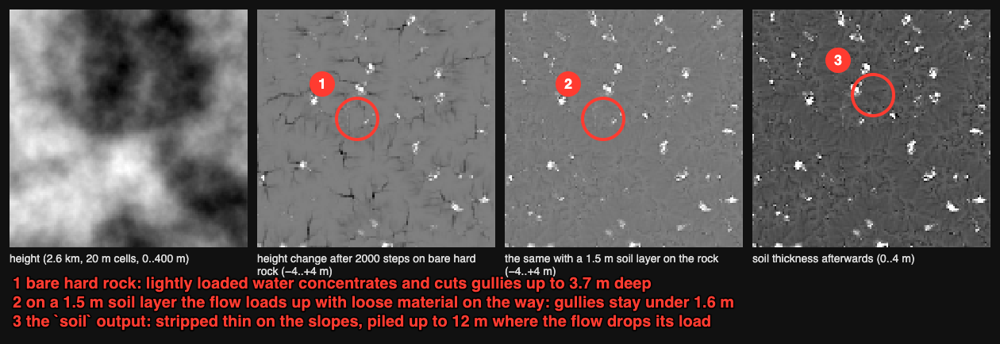
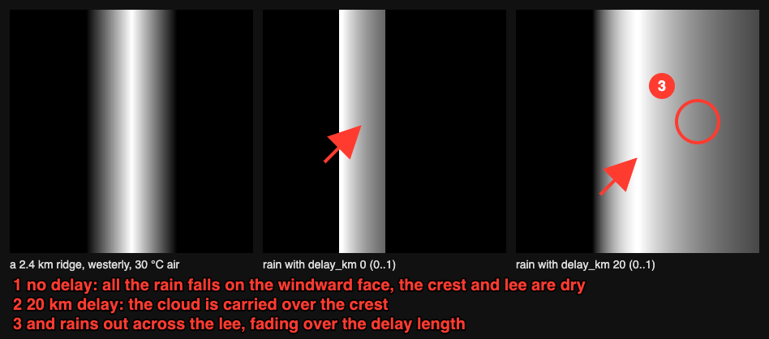
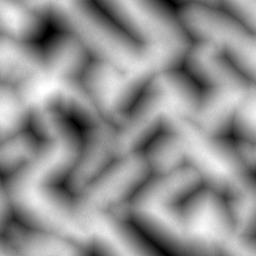
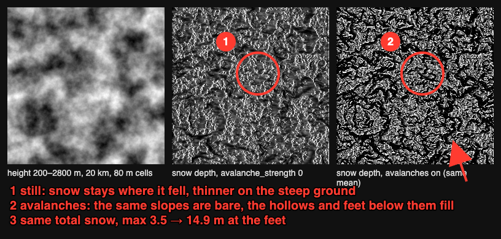
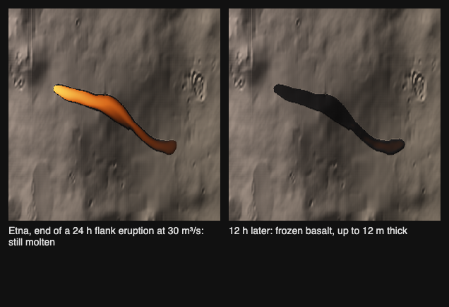

# Environments: soil, weather, deserts, snow and volcanoes

This guide is organised by the landscape you want to build. Each section explains what Jenga Dunia simulates, which nodes do it, which settings matter most, and what is not modelled. The full command-line runs, with timings and figures, are in the [CLI quickstart](cli-quickstart.md). This guide links to them instead of repeating them. Every node here works the same from the desktop graph editor, the `jd` command line and the MCP server.

Two shared settings shape every environment:

- **The world's wind.** `project.set_settings {wind: {azimuth_deg, speed_mps}}` sets one prevailing wind. Dunes, yardangs, rain, snow scour and the wind sea follow it unless a node sets its own `wind_azimuth_deg` ([Weather: one wind for the world](cli-quickstart.md#weather-one-wind-for-the-world)).
- **The timeline.** Any number parameter can be keyed over time with `graph.set_param {value: {keys: [[t, v], …]}}`. That is how seasons, a falling snow line or an advancing lava flow are animated ([Timeline](cli-quickstart.md#timeline-keyframed-parameters)).

## Soil

Jenga Dunia models soil as **a thickness of loose material lying on rock**. It does not model soil types, horizons or chemistry.

| What you want | Node and port | Key settings |
|---|---|---|
| Soil that erosion strips before it reaches the rock | `jd.erosion.hydraulic@1`, `soil` input (metres) | `dissolve_k`; the rock below keeps its `hardness` rate |
| Where soil ends up after erosion | `jd.erosion.hydraulic@1`, `soil` output | Thin on slopes, thick where water drops its load |
| Rock that resists erosion | `jd.terrain.strata@1` → `hardness` on thermal, stream-power and hydraulic erosion | `layer_m`, `hard_fraction`, `dip_deg` |
| Scree and talus | `jd.erosion.thermal@1` | `talus_deg` (scree 35–40°) |
| Rockfall debris and boulder fields | `jd.erosion.debris@1` | `source_slope_deg`, `reach_deg`, `sorting` |
| Soil and ground-cover classes for materials | `jd.biome.classify@1` with slope and wetness | Ordered rules, see "Sand deserts" below |

A constant soil layer comes from `jd.math.remap@1` mapping any field to a fixed value, such as 1.5 m everywhere. A varied layer can be a biome mask or the `soil` output of an earlier run. On hard rock a 1.5 m soil layer keeps gullies under 1.6 m deep, against 3.7 m on bare rock. The flow loads up with loose material on the way and deposits the difference in the hollows (the paragraph "A soil layer on the rock" in [Orographic rain](cli-quickstart.md#orographic-rain-windward-slopes-wet-the-lee-in-a-rain-shadow)).

**Not modelled:** soil formation over time, soil types, organic layers and frost heave.

## Weather and climate

The climate nodes turn one wind and one temperature into rain, snow and drifting snow. Weather here means the long-run pattern a landscape is shaped by, not individual storms.

| Pattern | Node | What it does | Key settings |
|---|---|---|---|
| Rain shadow | `jd.climate.rain@1` | Moist air rises over a range and rains on the windward side. The lee stays dry until the air recovers. | `moisture_scale_m`, `recovery_km` (40 km), `delay_km` |
| Rain or snow | `jd.climate.rain@1`, `snowfall` output | Precipitation falls as snow where the lapsed air is colder than `snow_below_c` | `temperature_c`, `lapse_c_per_km` (6.5) |
| Humidity | `jd.climate.rain@1`, `moisture` output | Relative humidity of the air leaving each cell | — |
| Rain-driven erosion | rain → `jd.erosion.hydraulic@1` `rain` input | Rivers cut where it actually rains | `rain_rate` |
| A season of snow | `jd.climate.snowpack@1` | Snow falls, melts by degree-day, drifts to the lee and avalanches off steep slopes | key `temperature_c` over the timeline |
| Sky, sun, clouds and haze | `sky.preview`, `sky.bake`; desktop **Sky and sun** | Physical sky, sun position, cloud cover and fog for the viewport and HDRI export | `sun_elevation_deg`, `turbidity`, `cloud_cover` |

A useful rule of thumb comes straight from the lapse rate. Air at the snow line is at freezing, so the snow line sits near `temperature_c ÷ lapse_c_per_km` kilometres up. With 12 °C at sea level and 6.5 °C/km, that is about 1.85 km. Key `temperature_c` down to 2 °C and the line walks down to about 300 m: winter.

Full runs: [Orographic rain](cli-quickstart.md#orographic-rain-windward-slopes-wet-the-lee-in-a-rain-shadow) and [Snowpack](cli-quickstart.md#snowpack-a-season-that-falls-drifts-and-melts).

**Not modelled:** individual storms, cloud physics, temperature or pressure fields, ocean–air coupling, and winds off the eight compass directions (the sweeps round to the nearest 45°).

## Sand deserts

Deserts are built from wind, rare water and salt. Each landform has its own node, and the [desktop guide's Desert landscapes section](desktop-app.md#desert-landscapes) shows the same in the app.

| Landform | Node | How to get it |
|---|---|---|
| Transverse dunes | `jd.erosion.aeolian@1` | A gently rolling sand sheet, one wind, 200+ `iterations` |
| Linear (seif) and star dunes | `jd.erosion.aeolian@1` | Set `wind2_azimuth_deg` and `wind2_share`: two winds make ridges along their bisector |
| Anchored and parabolic dunes | `jd.erosion.aeolian@1`, `vegetation` input | A 0..1 vegetation field holds the sand |
| Sand only where sand lies | `jd.erosion.aeolian@1`, `sand` input | A biome mask keeps rock in place |
| Yardangs | `jd.erosion.yardang@1` | Wind abrasion streamlines ridges along the wind; feed strata `hardness` for caprock keels |
| Mesas, buttes and canyon steps | `jd.filter.terrace@1` → `jd.terrain.strata@1` → thermal and stream-power erosion | Hard caps hold cliffs; soft beds slump into talus |
| Boulder aprons below cliffs | `jd.erosion.debris@1` → `terrain.scatter {rock}` | See [Rockfall debris](cli-quickstart.md#rockfall-debris-talus-aprons-and-boulder-fields) |
| Sinkholes | `jd.erosion.karst@1` | Seeded dolines on flat soluble ground; `sinkholes` → `drains` sends water underground |
| Playas (salt pans) | `jd.hydrology.fill@1` `lakes` | Every closed basin filled level is the evaporite floor |
| Wadis | `jd.hydrology.rivers@1` with a low `threshold`, shallow `depth_m`, `method: dinf` | A sparse network of flash-flood channels |
| Desert surfaces | `jd.biome.classify@1` | Wadi gravel by wetness, then sand sheet, reg (desert pavement) and varnished rock by slope, salt crust from the playa mask |

Things that make sand deserts read as real:

- **Sand needs room.** The aeolian node is a lattice model. A slab must be comparable to `cell × tan(shadow_deg)` for wind shadows to form, which is why the defaults follow the cell size (slab = a quarter cell, hop = 4 cells).
- **Mass is conserved.** Dunes only move sand around. If the dunes are too small, start from a thicker sand sheet.
- **Bedrock shows through.** Feed a `sand` mask so rock outcrops stay put and dunes pile against them.
- **Desert ground is mostly not sand.** In the desert rule set above, reg and varnished rock take the slopes, and salt takes the pans.

Full runs: [Wind: dunes from a sand sheet](cli-quickstart.md#wind-dunes-from-a-sand-sheet), [Strata](cli-quickstart.md#strata-mesas-buttes-and-stepped-canyon-walls), [Karst sinkholes](cli-quickstart.md#karst-sinkholes-desert-and-limestone-plains), [Yardangs](cli-quickstart.md#yardangs-wind-abrasion), [Playas and wadis](cli-quickstart.md#playas-and-wadis-from-the-nodes-you-have) and [Desert materials](cli-quickstart.md#desert-materials-a-biome-rule-set).

**Not modelled:** grain-size sorting in dunes, flash-flood timing, salt-crust growth, desert varnish ageing and dust storms.

## Plateaus, mesas and flat land

Flat land is not "no noise": a plateau has a level top, a shoulder and a slope, and the surface of
the top still carries small relief. Three tools make it, and they stack.

| Landform | Nodes | Notes |
|---|---|---|
| Table plateau, mesa, butte | `jd.shape.primitive@1` (shape `plateau`, `op: max`) | `ratio` is the flat share of the radius (0.85 = a wide table, 0.6 = a steep-sided mesa); `falloff_m` softens the rim. Preset: *table plateau*, *mesa (steep sides)*. |
| Stepped country, canyon benches | `jd.filter.terrace@1` → `jd.terrain.strata@1` → thermal / stream-power erosion | Hard caps hold cliffs while soft beds retreat (see "Sand deserts"). Preset: *mesa caps*. |
| A flattened pad of any outline | `jd.shape.polygon@1` (`op: lerp`) | A town site, an airfield, a terraced field: the outline takes one height, fading over `falloff_m`. Preset: *building pad (flatten)*. |
| Grid levelling by hand | the desktop **Grid** tool | Select cells and *Set height*: one square stamp per operation. |
| Low-relief plains | `jd.noise.fbm@1` with a small `height_range_m`, or `jd.math.curve@1` (gamma > 1) on a mountain field | Curves flatten the lowlands and keep the peaks. |

Keep some texture on the top: a `jd.noise.fbm@1` of a few metres added after the plateau, or a
material `detail` tile, keeps a mesa from reading as a CAD extrusion.

## Coasts and beaches

A beach is a shelf the waves cut and a sheet of sand they leave; the sand is soft because it is
fine and dry above the swash. The recipe:

| Step | Nodes | Notes |
|---|---|---|
| Set the sea | `jd.hydrology.sea_level@1` (`level_m`) | Border-connected water becomes `ocean`; `exposure` says where waves arrive. |
| Cut the shore | `jd.erosion.coastal@1` with the sea node's `exposure` on its input | `band_m` is how high above the sea the waves reach (a beach: 4–8 m; a cliff coast: 20–30 m), `rate_m` the cut per iteration, `drift` the share carried alongshore. Presets: *sandy beach*, *cliff coast*. The `shore` output is the wet band. |
| Lay the sand | `jd.biome.seabed@1` (sand / rock / mud / reef below the water) and a `jd.biome.classify@1` rule `elevation ≤ sea + band` → `beach` above it | The beach rule sits before the grass rule so the strand stays bare. |
| Soften it | `jd.erosion.aeolian@1` with the `beach` mask as its `sand` input, a few dozen iterations, the world's wind | Fore-dunes rise just inland of the strand; a `vegetation` field anchors them. |
| Colour it | a material layer on the `beach` mask: albedo ≈ 0.76 / 0.70 / 0.55, roughness 0.9, `detail` tile 2 m low bump | Wet sand darker: a second layer on the `shore` mask at 0.6 / 0.55 / 0.45. |

Measured on a 2 048 m / 256² noise world (0..500 m) with the sea at 250 m, 45.7 % of it ocean
(`jd.hydrology.sea_level@1` → `jd.erosion.coastal@1` with the sea node's `exposure`, 2026-10-25):
the *sandy beach* preset leaves a `shore` band covering 0.27 % of the world after 120 iterations;
the *cliff coast* preset 0.30 % (a band four times higher cut three times faster wets only a
little more: exposure, not the band, decides where waves work). Soft sand: the aeolian node needs
a sand slab comparable to `cell × tan(shadow_deg)` to form fore-dunes — on 8 m cells that is a
2–3 m sheet, which the beach rule's band provides.

## Snow-capped mountains

Two nodes make snow, depending on whether you want a quick mask or a season.

| | `jd.climate.snow@1` | `jd.climate.snowpack@1` |
|---|---|---|
| Output | Cover 0..1 | Depth in metres, and cover 0..1 |
| Driven by | Height, slope, sun and wind | Temperature with lapse rate, snowfall, melt, drift and avalanches over `steps` |
| Snow line | `snow_line_m` with a soft `transition_m` | Emerges where it is cold enough |
| Steep faces | Hold nothing above `max_slope_deg` (60°) | Avalanche above `avalanche_slope_deg` (38°) into the gullies below |
| Sunny side | Loses up to `sun_strength` of its cover | Melts up to `sun_strength` × 5 °C warmer |
| Wind | Windward faces scoured by `wind_strength` | A share of windward snow drifts to the lee each step |
| Best for | Biome rules and fast previews | Believable snow-capped peaks and seasonal animation |

A recipe for snow-capped peaks:

1. **Shape.** Ridged noise, then thermal erosion and hydraulic or stream-power erosion so the peaks have gullies for snow to collect in.
2. **Snow.** `jd.climate.snowpack@1` on the eroded height. Set `temperature_c` so the snow line falls where you want it, using `temperature_c ÷ 6.5` km as the first guess.
3. **Season.** Key `temperature_c` over the timeline, for example from −8 °C to +14 °C, to watch the pack build and retreat.
4. **Materials.** Use the `cover` output as a material mask, and as a biome rule `mask` band so rock and forest stop where snow begins.
5. **Sky.** A low winter sun with **Sky and sun** in the desktop app gives snow its blue shadows.

Full runs: [Snow cover](cli-quickstart.md#snow-cover) and [Snowpack](cli-quickstart.md#snowpack-a-season-that-falls-drifts-and-melts).

**Not modelled:** glaciers and ice flow, firn, cornices and sky-view shading of snow.

## Volcanoes and lava

`jd.volcanic.lava@1` erupts lava from vents and lets it flow, cool and freeze into new ground. The model is the MAGFLOW / GPUFLOW cellular automaton used for Etna hazard maps.

| Setting | Meaning |
|---|---|
| `vents` | `[{at: [u, v], rate_m3_s}]` in layer metres; empty = one vent on the highest cell |
| `eruption_s`, `duration_s` | How long the vents effuse, and how much time is simulated |
| `viscosity_pa_s`, `yield_pa` | Rheology at the vent; both rise as the lava cools (`*_decades`) |
| `cooling` | 0.3 by default; higher gives shorter, thicker flows |
| Outputs | `out` (terrain with lava), `lava` thickness in metres, `heat` 0..1 glow of molten lava |

Feed `heat` to an emissive material for glowing lava and `lava` to a dark basalt material. Key `duration_s` to animate the advance. Evaluate at the resolution you export, because run-out depends on cell size. Full run on a real Etna DEM: [Lava flows](cli-quickstart.md#lava-flows-vents-cooling-and-new-ground).

**Not modelled:** lava tubes, pyroclastic flows, ash fall, cone growth from tephra and lava–water interaction.

## Sources

Every model above has a research note in `docs/research/` with its references and the measurements that set the defaults. The main ones are `materials-geomorphology.md` (dunes, karst, yardangs, snow), `simulation-debris-lava.md` (debris and lava) and `world-creator.md` (how World Creator's equivalents compare).
