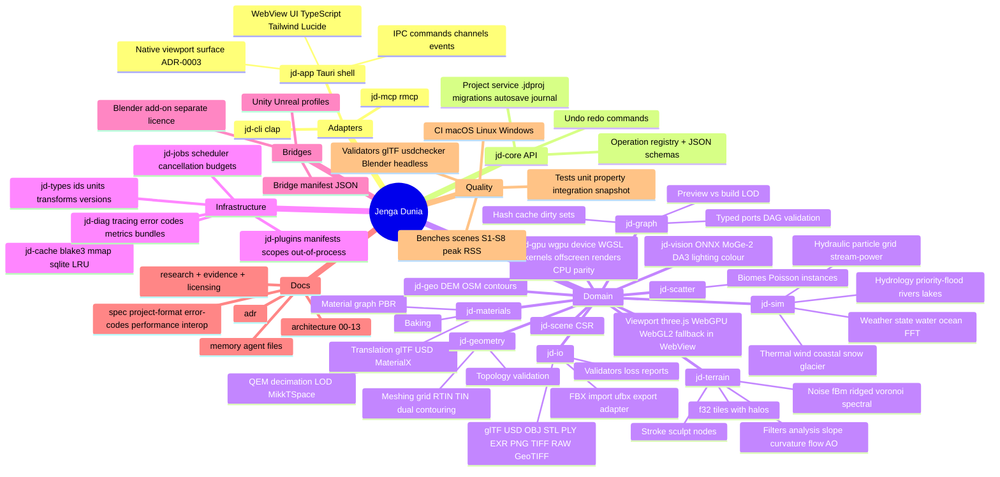

# Mindmap — Jenga Dunia System Map

Continuously evolving high-level map. Update when structure changes. Detailed diagrams live in `docs/architecture/`.

## Dependency direction (summary)

adapters → jd-core → domain crates → jd-types; infrastructure (jobs, cache, diag, plugins) used by jd-core and domain; only jd-gpu touches wgpu; only jd-io/jd-geo/jd-vision/jd-cache do I/O.

## Workflow map

generate → simulate → analyse → texture → scatter → compose → render/preview → optimise → export → validate → bridge.
