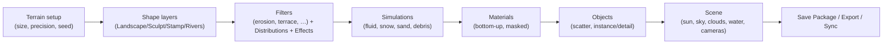

# Porting Notes — Reference Architecture vs Jenga Dunia

The brief's template assumes an original Windows implementation being ported. Jenga Dunia has **no original codebase**: it is a clean-room design informed by public documentation of Windows-native reference tools. This file therefore documents (a) the publicly observable architecture of the primary reference, World Creator, (b) the other references in brief, and (c) how each architectural element maps to Jenga Dunia's native cross-platform design. Everything about the reference tools is from public documentation and press; evidence status tags follow `docs/research/*.md`. **No binaries were inspected** (World Creator's EULA §8.3 prohibits reverse engineering; see `docs/research/opensource-rea.md` for the REA policy).

## A. World Creator (primary reference) — observable architecture

Source: `docs/research/world-creator.md` (60+ cited URLs, accessed 2026-10-19).

| Aspect | World Creator (2026.4, VERIFIED unless noted) | Jenga Dunia design |
|---|---|---|
| Platform | Windows 10+ only; WC4 (Nov 2026, REPORTED) plans macOS/Linux | macOS arm64 first, Windows, Linux; wgpu (Metal/Vulkan/DX12) |
| Runtime | C# / .NET 9, custom engine, **Vulkan** renderer, "all tasks on the GPU" | Rust core; CPU kernels always present, GPU compute optional (`jd-gpu`); CPU/GPU parity tests |
| Authoring model | Hierarchical **layer stack** (Terrain → Biomes → Filters/Materials/Objects/Simulations), bottom-up evaluation; Distribution (mask) stack + Effect stack per layer; combine ops Multiply/Add/Subtract/Min/Max + Opacity; node view only arriving in WC4 | **DAG node graph** as source of truth (`jd-graph`); a linear "stack view" is a UI projection when the graph is linear; masks and mask-effects are ordinary typed nodes |
| Multi-resolution | **Level Step pyramid**: generate from 2×2 upward, per-filter per-level strength curves; erosion at low levels, upsampled; WC4 abandons this for direct sculpting (REPORTED) | Pyramid kept as a **scheduler optimisation** (preview LOD, coarse-to-fine erosion warm start), never a user-facing parameter by default |
| Preview vs build | Realtime Generator toggle, viewport preview 4k (8k High VRAM), "Gen Full Res in Background", staged recompute toggles (Filters/Materials/Objects) | Preview mode (reduced LOD, debounced) vs Build mode; stage toggles map to subgraph dirty masks |
| Determinism | Seeds per terrain/noise/filter; cross-GPU determinism not claimed (AMD splat divergence fixed 2025.3) | Determinism contract: fixed seeds, ordered reductions, grid erosion, documented CPU/GPU tolerance |
| Representation | Heightfield in metres, 1–1/8 m/px, non-power-of-two, recommended max 16k², single terrain, tiles only at export (seam bugs historically) | f32 tiles with halos from the start; tiled evaluation, streaming, world > 16k via tiles |
| Erosion | Droplet hydraulic + thermal; strata-aware Hydraulic Sediment; fluid/snow/sand/debris sims; Rivers layer with carved valleys/floodplains/lakes | Particle + grid (virtual pipes) + stream-power hydraulic; thermal; wind; coastal; snow; hydrology nodes (priority-flood, flow, rivers, lakes per basin) |
| Masks | Terrain-feature distributions: slope, angle, cavity, curvature, flow, occlusion, sea level, sun direction, filter-change delta, object area; painted/imported masks; holes | Analysis nodes produce the same mask family early (Phase 2); painted masks as stroke nodes; holes via mask → mesh cut |
| Materials | PBR per material; Substance .sbsar; gradients; triplanar + stochastic (shader-only, non-exportable); height blending; splat/colour/normal/AO/roughness/metal; Unity Mask Map | Material graph → PBR → translation layer; triplanar/stochastic are viewport features **and** bakeable; loss report when a feature cannot survive export |
| Objects | glb/gltf/fbx/obj; Instance (point cloud export) vs Detail (mask export); millions of instances | `jd-scatter` instance tables; export as glTF `EXT_mesh_gpu_instancing`, USD PointInstancer, CSV/JSON for bridges |
| Real-world data | GeoTIFF/HGT/DTED/ASC/VRT/XYZ import; MapTiler streaming (paid) | `jd-geo`: open DEM sources with licence register; GeoTIFF import; contours |
| Export | RAW/EXR 16/32, TIFF 8/16/32, PNG 8/16, XYZ/ASC; meshes OBJ/FBX/glTF (REPORTED); splines .dae; instances CSV+JSON | glTF/GLB, USD(A/C/Z), OBJ/STL/PLY, EXR/PNG/TIFF/RAW, GeoTIFF; FBX via adapter; validators |
| Bridges | File-based `Sync/`: `bridge.xml` + `heightmap_x_y.raw` (u16) + colormap/texturemap PNG + `splatmap_x_y.tga` (RGBA = 4 layers) + Assets; per-DCC plugins (Unreal Landscape/World Partition/PCG, Unity Terrain tiles, Blender Geometry Nodes, Houdini HF, C4D, Godot Terrain3D); no live link | Versioned **JSON bridge manifest** + per-tile EXR/R32 and u16 RAW + weightmaps; community plugins consume it; Blender bridge first |
| Automation | None (no CLI/API/scripting); expressions in fields; WC4 promises batch + MCP (experimental) | CLI + MCP + JSON schemas from Phase 1 |
| Rendering | Path tracer + denoiser, rasterised modes, atmosphere, clouds, water (single level), AgX; post effects non-exportable; windowed-only renders (REPORTED) | Rasterised PBR viewport with atmosphere/fog/water; off-screen renders at arbitrary size; per-basin water |
| Licensing | Proprietary; Community Edition cannot export; Indie 8k cap; online login | MIT; no caps; offline |
| Hardware | min GTX 1080 4 GB / 8 GB RAM; AMD recurring bug source | Floor: Apple Silicon integrated GPU / 8 GB unified; 4 GB app RAM ceiling; CPU-only fallback |

### Process flow observed in World Creator (walkthrough order)

Jenga Dunia preserves this **mental order** as default graph templates and panel ordering while the underlying model is a DAG.

### Hardware usage pattern

World Creator is GPU-resident: terrain data lives in VRAM, preview resolution is bounded by VRAM ("High VRAM Mode"), export warns on VRAM overflow, object count scales with VRAM. Jenga Dunia inverts the default: CPU-tiled computation is the baseline (bounded RAM, deterministic), GPU accelerates kernels that measure faster, and unified memory on Apple Silicon makes CPU↔GPU tile exchange cheap.

## B. Other references (summary; full detail in `docs/research/`)

| Tool | Model | Platform | Automation | Key lesson |
|---|---|---|---|---|
| QuadSpinner Gaea 2 | Node graph, 32-bit float, build manager, tiled builds | Windows | see `gaea-world-machine.md` | professional output map set (flow/wear/deposit), build vs preview |
| World Machine | Node graph, tiled builds, LDR/HDR outputs | Windows | see `gaea-world-machine.md` | device/macro system, tiled world builds |
| TerraForge3D | C++/OpenGL node-based open source | Win/Linux | — | reference for open-source scope and pitfalls |
| ProceduralTerrains | see `opensource-rea.md` | — | — | — |

## C. Native cross-platform mapping (what "porting" means here)

| Concern | Approach |
|---|---|
| Graphics API | wgpu → Metal (macOS), Vulkan (Linux/Windows), DX12 (Windows); WGSL shaders; runtime feature detection; CPU fallback |
| Memory | Apple unified memory: avoid redundant staging copies; use mapped buffers for tile upload; Windows/Linux discrete GPUs: explicit staging and readback batching |
| Threads | rayon for CPU tiles; tokio for jobs/IPC; GPU submissions serialised on one queue |
| Filesystem | project-relative paths; case-sensitivity-safe; long-path aware on Windows; atomic writes (temp + rename) everywhere |
| Windowing | Tauri 2 windows; native surface handle for the viewport where supported (ADR-0003) |
| Packaging | macOS .app (signed/notarised), Windows MSI/NSIS, Linux AppImage/deb; CLI/MCP binaries shipped alongside |
| CI | GitHub Actions matrix: macOS arm64, Ubuntu, Windows (`.github/workflows/ci.yml`) |
